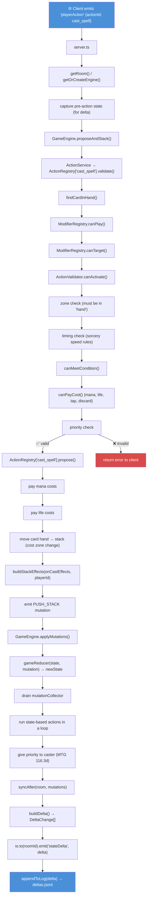
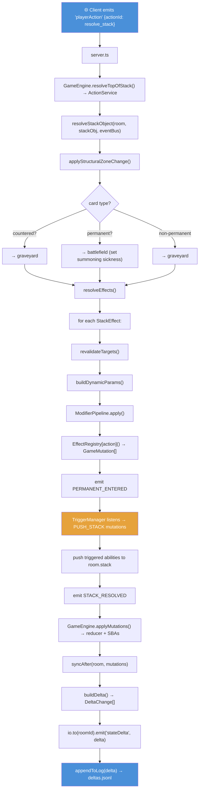
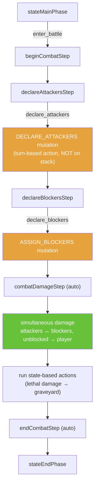
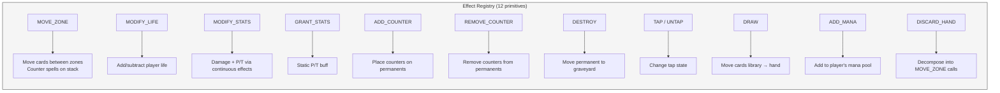
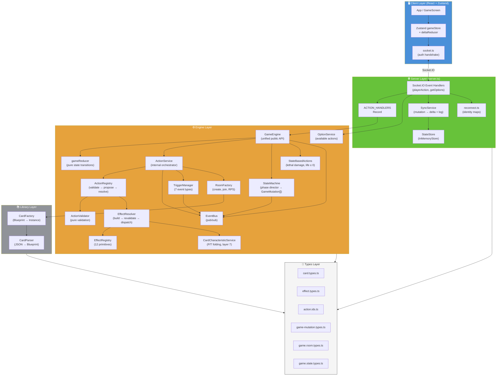

# Card Game Architecture Documentation (TypeScript)

**Date:** 2026-10-05
**Status:** Current

---

## 1. Overview

A multiplayer card game (MTG-inspired) built with TypeScript, Express, and Socket.IO on the server, and React + Zustand + Vite on the client. The architecture follows a strict layered design: **Types → Library → Engine → Server → Client**. The engine has zero knowledge of sockets or HTTP — `server.ts` is the sole translation layer between network events and engine calls.

**Tech stack:** TypeScript 6.0, Express 4.21, Socket.IO 4.8, React 19.2, Zustand 5.0, Vite 8.2, Vitest 4.1 (testing), UUID 11.0, Mongoose 8.9 (dependency, not yet wired).

**Key design principles:**
- `GameEngine` is the **single unified public API** — `server.ts` talks only to it; it owns and coordinates `EventBus`, `StateMachine`, and `ActionService` internally
- **Pure reducer pipeline** — handlers and services produce `GameMutation[]`; `GameEngine.applyMutations()` sequences each mutation through `gameReducer(state, mutation) => newState`. State is never mutated in place by handlers.
- Engine services are pure TypeScript — testable without network infrastructure
- State changes produce deltas — sent to clients and logged for replay
- Card effects decompose into 12 atomic primitives (`MOVE_ZONE`, `MODIFY_STATS`, `DESTROY`, `GRANT_STATS`, etc.)
- Actions follow a 3-phase lifecycle: validate → propose → resolve
- `EventBus` decouples state transitions from side effects (triggers, UI sync)
- **Phase director** — `StateMachine` is a pure phase/turn/priority director returning `GameMutation[]`; it no longer mutates the room directly
- **Continuous effect pool** — P/T modifications are stored as `ContinuousEffectEntry` records and folded at query time (MTG layer 7 subset)
- **State-based actions** — checked in a loop after every mutation batch (creatures with lethal damage die, players at 0 life lose)
- **Reconnect resilience** — stable player identity via `sessionStorage` + `socket.handshake.auth`; rooms survive a 30s disconnect grace window

### 1.1 Functional Game Flows (Implemented)

| Flow | Status | Description |
|---|---|---|
| Room lifecycle | ✅ Full | Create room, join room, RPS mini-game, deal starting hands |
| Turn structure | ✅ Full | `TURN_SEQUENCE`: TurnStart (untap) → Draw → Main → BeginCombat → DeclareAttackers → DeclareBlockers → CombatDamage → EndCombat → End → Cleanup → next turn |
| Play card (cast spell) | ✅ Full | Validate → pay costs → hand→stack → resolve → battlefield/graveyard |
| Combat (MTG pipeline) | ✅ Full | Enter Battle → Declare Attackers (turn-based action) → Declare Blockers → Combat Damage (simultaneous) → End Combat. Combat is NOT on the stack (CR 508–510) |
| Tap for mana | ✅ Full | Validate → tap permanent → add mana (does NOT use stack — mana ability; works for Lands and any permanent with a pure `ADD_MANA` ability) |
| Stack resolution | ✅ Full | LIFO pop → structural zone change → revalidate targets → dynamic params → dispatch effects → ETB triggers |
| ETB / LTB / death triggers | ✅ Full | `PERMANENT_ENTERED`, `PERMANENT_LEFT`, `PERMANENT_DIED`, `ATTACK_DECLARED`, `TURN_STARTED`, `LIFE_CHANGED`, `DAMAGE_TAKEN` → `TriggerManager` creates triggered `StackObject` → pushed to stack |
| Priority system | ✅ Full | Active player → opponent → both pass → resolve stack (MTG 116.4) or advance phase |
| State-based actions | ✅ Full | After each mutation batch: lethal-damage creatures → graveyard; life ≤ 0 → `gameOver` |
| Continuous effects (P/T) | ✅ Full | `ContinuousEffectPool` folded at query time via `CardCharacteristicService` (layer 7 subset: SET_STATS → STAT_DELTA → counters) |
| State sync | ✅ Full | Mutation-driven delta → `StateDelta` → Socket.IO emit + JSONL log |
| Target revalidation | ✅ Full | Targets checked at resolve time; illegal targets filtered out (handles `all:true` filter expansion) |
| Targeting (cast-time) | ✅ Full | Client enters targeting mode, taps legal battlefield cards / player panels, sends `TargetPointer[]` with the action; validated at cast time (CR 601.2c) |
| Targeting UI (tap-based) | ✅ Full | Bottom banner (Cancel/Confirm) + `.targetable`/`.selected` highlights on battlefield cards and player panels; tap-to-toggle select/deselect via `toggleTarget` |
| Dynamic params | ✅ Full | `DYNAMIC:source.power` etc. resolved at execution time |
| Reconnect | ✅ Full | Stable `playerId` in `sessionStorage`; `socket.handshake.auth` handshake; identity remap tables; 30s room-destroy grace window |
| Countering (structural) | ✅ Partial | `countered` flag on `StackObject` → skips effects, sends to graveyard. No counter-spell card yet. |

### 1.2 Stubs & Planned Features

| Area | Status | Description |
|---|---|---|
| Modifier system | 🔶 Stub | `ModifierRegistry` (permission checks: hexproof, shroud) and `ModifierPipeline` (value transforms: cost reduction, flash) are identity/no-op stubs |
| P/T modification | ✅ Full | `MODIFY_STATS` now emits `ADD_CONTINUOUS_EFFECT`; `GRANT_STATS` adds static buffs. Resolved via `CardCharacteristicService` |
| Death/destroy triggers | ✅ Full | `PERMANENT_LEFT`, `PERMANENT_DIED`, `ON_DIE` wired in `TriggerManager` |
| Upkeep/phase triggers | ✅ Full | `TURN_STARTED` → `BEGIN_UPKEEP` wired in `TriggerManager` |
| Activated abilities (non-mana) | 🔶 Partial | `OptionService` computes options; no handler registered for generic activated abilities |
| Multi-target selection | 🔶 Partial | Backend/data model support multi-target (`maxTargets`); tap-based UI collects multiple targets. Auto-confirm for single-target deferred (Confirm always shown) |
| Counter-spell card | ❌ Not started | No card with counter effect defined; `MOVE_ZONE` counter logic exists in `EffectRegistry` |
| Graveyard interaction | ❌ Not started | No cards or effects that interact with graveyard |
| Enchantments/Artifacts | ❌ Not started | Types defined; no cards or attachment logic |
| Trigger-holder discovery | 🔶 Partial | Global events (`LIFE_CHANGED`, `TURN_STARTED`) carry no card, so global triggers never fire (guard `if (!card) return;`). Deferred. |
| Room cleanup/destroy | ✅ Full | `TriggerManager.dispose()` unregisters listeners; `GameEngine.dispose()`, and `server.ts` `destroyRoom()`/`scheduleDestroy()` destroy empty rooms after a 30s grace window |
| Server handler extraction | ✅ Full | `server.ts` uses an `ACTION_HANDLERS: Record<ActionId, ActionHandler>` map; reconnect logic extracted to `src/server/reconnect.ts` |

---

## 2. Directory Map

```
src/
├── server.ts                          # Express + Socket.IO entry point; wires GameEngine to network
├── types/                             # Pure type definitions — no runtime code
│   ├── card.types.ts                  # CardBlueprint, CardInstance, CardState, ContinuousEffect, ContinuousEffectEntry
│   ├── effect.types.ts                # StackObject, StackEffect, ActionCost, TargetPointer, EffectDefinition
│   ├── action.ids.ts                  # ACTION_IDS const, ActionId union, ActionIdOrAbility, ACTION_ID_LABELS
│   ├── game-mutation.types.ts         # GameMutation discriminated union (atomic state mutations)
│   ├── delta.types.ts                 # StateDelta, DeltaChange (client sync payloads)
│   ├── game.player.types.ts           # PlayerState, ManaPool
│   ├── game.room.types.ts             # GameRoom — the central aggregate
│   └── game.state.types.ts            # TURN_SEQUENCE, Phase union, GameStatus union
├── library/                           # Card data loading and instantiation
│   ├── card_data.json                 # Raw card definitions (the active data file)
│   ├── card-parser.ts                 # Raw JSON → typed CardBlueprint (normalization)
│   └── card-factory.ts                # Blueprint cache + CardInstance factory (deep-clone, UUID)
├── engine/                            # Core game logic — no socket/HTTP knowledge
│   ├── game-engine.ts                 # Unified public API: owns EventBus, StateMachine, ActionService
│   ├── game-reducer.ts                # Pure reducer: (state, mutation) => newState (structural sharing)
│   ├── action-service.ts              # Internal orchestrator: validate → propose → resolve stack
│   ├── action-registry.ts             # ActionHandler interface + ActionRegistry record
│   ├── action-validator.ts            # Static pure validation: canActivate, canPayCost, canMeetCondition
│   ├── mana-pool.ts                   # Centralized mana pool operations (canPay, add, spend, drain, isPureAbility)
│   ├── state-machine.ts               # Phase director: turn phases, priority, stack LIFO; returns GameMutation[]
│   ├── state-based-actions.ts         # checkStateBasedActions(room): lethal damage, life ≤ 0
│   ├── card-characteristic-service.ts # Query facade: folds ContinuousEffectPool for P/T (layer 7 subset)
│   ├── card-utils.ts                  # hasKeyword(card, keyword), lethalDamageFor(room, card)
│   ├── event-bus.ts                   # In-memory pub/sub, room-scoped
│   ├── effect-registry.ts             # Primitive effect handlers (12 primitives)
│   ├── effect-resolver.ts             # Resolution pipeline: build effects, revalidate targets, structural zone changes
│   ├── trigger-manager.ts             # Listens for game events, creates triggered StackObjects
│   ├── modifier-pipeline.ts           # Stub: value-transformation modifier chain
│   ├── modifier-registry.ts           # Stub: permission-check modifiers (hexproof, etc.)
│   ├── option-service.ts              # Computes available actions for a card in a zone
│   ├── room-factory.ts                # Exported functions: createRoom, joinRoom, setupRPS, dealStartingHands
│   └── handlers/
│       ├── play-card-handler.ts       # cast_spell: validate → propose (pay costs, build StackObject)
│       ├── declare-attackers-handler.ts # declare_attackers: turn-based action, sets room.combat
│       ├── declare-blockers-handler.ts  # declare_blockers: assign blockers to attackers
│       ├── tap-for-mana-handler.ts    # tapForMana: validate → propose (tap land, add mana; no stack)
│       ├── enter-battle-handler.ts    # enter_battle: advance Main → Battle (declareAttackersStep)
│       ├── end-turn-handler.ts        # end_turn: skip to end phase, complete turn
│       ├── pass-priority-handler.ts   # pass_priority: hand priority to opponent
│       ├── resolve-stack-handler.ts   # resolve_stack: pop and resolve top of stack
│       └── rps-play-handler.ts        # rpsPlay: Rock/Paper/Scissors mini-game
├── server/                            # Persistence, client sync, reconnect
│   ├── state-store.ts                 # StateStore interface + InMemoryStore (Map-based)
│   ├── sync-service.ts                # Mutation → delta emission, JSONL logging
│   └── reconnect.ts                   # Identity maps: resolvePlayerId, bindSocket, decideRejoin
├── shared/                            # Code shared by server, client, and engine
│   ├── game-logger.ts                 # Structured LogEntry logger
│   └── target-utils.ts                # matchesTargetFilter(card, targeting, playerId)
└── client/                            # React + Zustand + Vite client (own tsconfig)
    ├── App.tsx, main.tsx, index.html
    ├── session.ts                     # Stable playerId in sessionStorage
    ├── socket.ts                      # Socket.IO client with auth handshake
    ├── targeting.ts                   # needsTargets() helper
    ├── store/
    │   ├── gameStore.ts               # Zustand store (room, targeting, combatSelection, UI)
    │   ├── deltaReducer.ts            # Path-based immutable delta applier
    │   └── combatSelection.ts         # Attacker/blocker selection state
    ├── hooks/
    │   ├── useSocket.ts               # Socket lifecycle + delta subscription
    │   └── useGameActions.ts          # playerAction / getOptions dispatch
    └── components/                    # 13 components: Battlefield, CardComponent, CombatDisplay,
                                       #   ContextMenu, GameLog, GameScreen, Hand, OpponentInfo,
                                       #   PhaseBar, PlayerInfo, StackDisplay, StartScreen, TargetSelector
data/
└── card_data.json.bak                 # Legacy card data backup (pre-refactor)
tests/
├── engine/                            # Engine unit + integration tests (25 test files)
│   ├── game-engine.test.ts            # Full turn loop integration test + GameEngine unit tests
│   ├── game-reducer.test.ts           # Pure reducer: each mutation type
│   ├── state-based-actions.test.ts    # Lethal damage, life ≤ 0
│   ├── card-characteristic-service.test.ts # Continuous effect folding (layer 7)
│   ├── battle-phase-smoke.test.ts     # End-to-end combat pipeline
│   ├── action-service.test.ts
│   ├── action-registry.test.ts
│   ├── action-validator.test.ts
│   ├── declare-attackers-handler.test.ts
│   ├── declare-blockers-handler.test.ts
│   ├── play-card-handler.test.ts
│   ├── effect-registry.test.ts
│   ├── effect-resolver.test.ts
│   ├── event-bus.test.ts
│   ├── option-service.test.ts
│   ├── state-machine.test.ts
│   └── trigger-manager.test.ts
├── client/                            # Client store + combat selection tests (2 files)
│   ├── gameStore.test.ts
│   └── combatSelection.test.ts
├── helpers/
│   └── test-room-factory.ts           # createTestRoom(): standardized room setup for tests
└── server/                            # Server tests (3 files)
    ├── state-store.test.ts
    ├── sync-service.test.ts
    └── reconnect.test.ts
```

---

## 3. Layer 1: Types (`src/types/`)

The type layer defines the data model. Files form a clean dependency hierarchy with no circular imports.

```
card.types.ts  ←  effect.types.ts  ←  game.player.types.ts  ←  game.room.types.ts
                                                              ←  game.state.types.ts
                                                              ←  game-mutation.types.ts
                                                              ←  delta.types.ts
action.ids.ts  (standalone — no imports)
```

### 3.1 `card.types.ts` — Foundation

Defines the card domain primitives and the two-level card model:

| Type | Purpose |
|---|---|
| `ManaColor`, `ManaCost` | Mana system primitives |
| `CardType`, `CardSubType`, `CardZone` | Card classification and location |
| `TriggerEvent` | Union of game events that trigger abilities (`ON_ENTER_BATTLEFIELD`, `ON_DIE`, `ON_ATTACK`, `ON_LEAVE_BATTLEFIELD`, `BEGIN_UPKEEP`, `ON_LIFE_GAIN`, `ON_DAMAGE_TAKEN`, etc.) |
| `ActivatedAbility` / `TriggeredAbility` | Discriminated union for card abilities |
| `CardBlueprint` | Static card definition (id, name, types, cost, abilities, `keywords?`, `onCastEffects?`, `onEnterEffects?`) |
| `CardState` | Runtime mutable state (zone, tapped, damage, `counters`, `attackedThisTurn`, summoning sickness, `attachedTo?`) |
| `CardInstance` | `CardBlueprint` + `uuid` + `CardState` — the runtime card object |
| `ContinuousEffect` | `STAT_DELTA` (relative P/T change) or `SET_STATS` (absolute P/T) |
| `ContinuousEffectEntry` | A pooled effect: `{ source, layer, effect, scope, requiredZone, duration }` |

### 3.2 `effect.types.ts` — Stack & Action System

Depends on `card.types.ts`. Defines the contracts between card definitions and the engine:

| Type | Purpose |
|---|---|
| `ActionType`, `EffectId` | Registry key types (open strings) |
| `ActionSpeed`, `StackItemType`, `TargetType` | Speed/stack/target enums |
| `ActionCost` | Resource costs (mana, tap, life, discard, sacrifice) |
| `ActionCondition` | State conditions (zone checks, global flags) |
| `ActionRequirements` | Combined cost + condition + zone + speed rules |
| `TargetPointer` | Flexible target reference (player, card, permanent, stack, zone) |
| `EffectDefinition` | Card-data-level effect (action + params + targeting) |
| `StackEffect` | Resolve-time effect with locked targets and dynamic params |
| `StackObject` | A stack item: spell/activated/triggered with source card and effects array |

### 3.3 `action.ids.ts` — Canonical Action IDs

Standalone module (no imports) defining the closed set of action identifiers:

| Export | Purpose |
|---|---|
| `ACTION_IDS` | Const object: `castSpell`, `declareAttackers`, `declareBlockers`, `tapForMana`, `enterBattle`, `endTurn`, `passPriority`, `resolveStack`, `rpsPlay` (9 total) |
| `ActionId` | Union of the 9 action ID string literals |
| `ActionIdOrAbility` | `ActionId \| \`activateAbility_${string}\`` — allows activated abilities |
| `ACTION_ID_LABELS` | Human-readable labels for the UI |

### 3.4 `game.player.types.ts` — Player State

Simple runtime player data: `PlayerState` (id, life, `ManaPool`, deck/hand/graveyard arrays).

### 3.5 `game.room.types.ts` — Central Aggregate

`GameRoom` composes all other types into the game state root:

```
GameRoom {
    roomId, player1Id, player2Id
    players: Record<PlayerId, PlayerState>   // all player data
    phase: Phase                             // current turn phase (TURN_SEQUENCE member)
    status: GameStatus                       // 'waiting' | 'RPS' | 'playing' | 'gameOver'
    engineState: 'waiting_for_player' | 'resolving_stack' | 'state_based_actions'
    activeTurnPlayerId, priorityPlayerId, lastPassedPlayerId
    battlefield: CardInstance[]
    stack: StackObject[]
    combat: CombatDeclaration[]              // declared attackers + assigned blockers
    continuousEffectPool: ContinuousEffectEntry[]
    rpsState: { status, playedCards }
}
```

> **Phase/status split:** `phase` and `status` are independent. Any code that previously relied on `currentPhase` leaving a value (e.g. `RPS`) must now explicitly set `status`. For example, `resolveRPS` must emit `SET_STATUS 'playing'`.

### 3.6 `game.state.types.ts` — Turn Sequence

`TURN_SEQUENCE` is the ordered phase list:

```
['stateTurnStart', 'stateDrawPhase', 'stateMainPhase', 'beginCombatStep',
 'declareAttackersStep', 'declareBlockersStep', 'combatDamageStep',
 'endCombatStep', 'stateEndPhase', 'cleanupStep']
```

`Phase` is the union of those members. `GameStatus = 'waiting' | 'RPS' | 'playing' | 'gameOver'`.

### 3.7 `game-mutation.types.ts` — Atomic Mutations

A discriminated union of every atomic state change the reducer understands. Handlers and services return `GameMutation[]` instead of mutating the room.

| Category | Mutations |
|---|---|
| Card movement | `MOVE_CARD`, `SET_CARD_ZONE` |
| Card state | `TAP_CARD`, `UNTAP_CARD`, `SET_SUMMONING_SICKNESS`, `SET_ATTACKED_THIS_TURN`, `SET_DAMAGE`, `ADD_COUNTER`, `REMOVE_COUNTER` |
| Continuous effects | `ADD_CONTINUOUS_EFFECT`, `REMOVE_CONTINUOUS_EFFECT`, `CLEAR_END_OF_TURN_EFFECTS` |
| Life / mana | `SET_LIFE`, `SET_MANA`, `ADD_MANA`, `SPEND_MANA`, `CLEAR_DAMAGE` |
| Stack | `PUSH_STACK`, `POP_STACK`, `SET_COUNTERED`, `SET_FIZZLED` |
| Combat | `DECLARE_ATTACKERS`, `ASSIGN_BLOCKERS`, `CLEAR_COMBAT` |
| Phase / turn | `SET_PHASE`, `SET_STATUS`, `SET_ENGINE_STATE`, `SET_TURN`, `SET_PRIORITY`, `SET_LAST_PASSED` |
| RPS | `SET_RPS_STATUS`, `SET_RPS_PLAYED_CARD` |

### 3.8 `delta.types.ts` — Client Sync Payloads

`StateDelta` (sequence-numbered, room-scoped) and `DeltaChange` (path + value) — the wire format emitted to clients and appended to the JSONL log.

---

## 4. Layer 2: Library (`src/library/`)

Bridges raw JSON card data to typed runtime instances.

### 4.1 `card-parser.ts`

Pure normalization functions. Converts raw JSON objects from `card_data.json` into typed structures:

- `normalizeActionCost()` — raw cost → `ActionCost` with defaults
- `normalizeEffect()` — raw effect → `EffectDefinition`
- `normalizeAbility()` — raw ability → `ActivatedAbility | TriggeredAbility`
- `normalizeCard()` — raw card → `CardBlueprint` (throws on missing `id`)
- `parseAll()` — bulk parse of entire card map

### 4.2 `card-factory.ts`

Caching and instantiation:

- `getBlueprint()` — parses once, caches in `blueprintCache`
- `instantiateCard()` — deep-clones a blueprint into a `CardInstance` with fresh UUID and default `CardState`. Deep-clones abilities and costs to prevent shared-reference bugs.

**Data flow:** `card_data.json` → `card-parser.ts` → `CardBlueprint` (cached) → `card-factory.ts` → `CardInstance` (runtime)

---

## 5. Layer 3: Engine (`src/engine/`)

The core game logic. All engine files work with plain TypeScript types — no socket, HTTP, or I/O knowledge.

### 5.1 Orchestration & Lifecycle

#### `game-engine.ts` — Unified Public API

**The single entry point for all engine operations.** `server.ts` talks only to `GameEngine` — no more juggling separate `EventBus`, `StateMachine`, and `ActionService` instances.

`GameEngine` owns and coordinates three internal services:
- `EventBus` — created per room in constructor
- `StateMachine` — pure phase director; returns `GameMutation[]`
- `ActionService` — handles action pipeline and stack resolution

Key methods:
- `initRoom()` — wires `TriggerManager` for triggered abilities
- `dispose()` — tears down the `TriggerManager` and releases listeners
- `generateUuid()` — UUID source for new cards/stack objects
- `applyMutations(mutations)` — **the core state transition**: sequences each mutation through `gameReducer(state, mutation) => newState`, drains the `mutationCollector`, then runs state-based actions in a loop until stable. Emits `PERMANENT_LEFT`, `PERMANENT_DIED`, `DAMAGE_TAKEN`, `LIFE_CHANGED` events.
- `handleAction(playerId, actionType, actionData)` → `ActionResult` — validate → propose pipeline
- `proposeAndStack(playerId, actionType, actionData)` → `ActionResult` — propose + push to stack
- `resolveTopOfStack()` → `ActionResult` — pop stack, resolve via `resolveStackObject()`
- `transition(to)` / `advancePhase(intent)` / `switchTurn()` / `isPlayerTurn()` — phase/turn delegation
- `applyPhaseChunked()` — advances through auto-phases, running SBAs at each phase boundary
- `givePriorityTo()` / `passPriority()` — priority delegation; `passPriority()` auto-resolves the stack after both players pass (MTG 116.4)
- Accessors: `roomState`, `phase`, `status`, `engineState`, `activeTurnPlayerId`, `priorityPlayerId`

> **⚠️ Stale room references:** `applyMutations` **reassigns** `this.room` to a brand-new object returned by the reducer. Any local `room` reference captured before a mutation batch is now stale. Always read back via `engine.roomState` after mutations.

#### `game-reducer.ts` — Pure Reducer

`gameReducer(state, mutation) => newState`. A pure function that applies one `GameMutation` and returns a new `GameRoom`. It shallow-copies only the objects along the changed path; untouched subtrees are shared by reference (structural sharing).

Key helpers:
- `findCard(room, cardUuid)` — searches battlefield, stack (via `so.source.uuid`), and per-player zones
- `removeFromZone()` / `addToZone()` — zone bookkeeping; `addToZone()` normalizes `library` → `deck`

#### `action-service.ts` — Internal Action Orchestrator

An internal delegate used by `GameEngine` (not called directly by `server.ts`). Responsibilities:
- Route client actions to `ActionRegistry` (validate → propose)
- Manage stack resolution (structural zone change + effect resolution + triggers)
- Wire per-room `TriggerManager` for triggered abilities
- Emit events via `EventBus`

#### `state-machine.ts` — Phase Director

Manages game phases, turn order, and the priority system. **Pure** — every method returns `GameMutation[]` rather than mutating the room.

Key concepts:
- `nextInTurn()` — the next phase in `TURN_SEQUENCE`
- `AUTO_PHASES` — phases that need no player input and advance automatically: `stateTurnStart`, `stateDrawPhase`, `combatDamageStep`, `endCombatStep`, `stateEndPhase`, `cleanupStep`
- `phaseNeedsInput()` — whether the current phase waits for a player action
- `defaultPriorityFor()` — who receives priority by default (`declareBlockersStep` → defender, else active player)
- `canTransition()` / `transition()` — validate and produce the phase-change mutations
- `advancePhase(room, 'complete' | 'skipToEnd')` — advance one phase or skip to end of turn
- `switchTurn()` — toggles the active player; runs **before** the untap step
- `givePriorityTo()` / `passPriority()` — priority mutations

> **Deleted in the phase-control refactor:** the old `TRANSITIONS` map, `previousPhase`, the `Stack` pseudo-phase, `waitingForResponse`, and `stackOpen`. The stack is now a first-class `room.stack` array and the phase never changes to represent it.

#### `state-based-actions.ts` — State-Based Actions

`checkStateBasedActions(room)` — pure function returning `GameMutation[]`:
- Creatures with `damageTaken >= toughness` → graveyard
- Players with `life <= 0` → `SET_STATUS 'gameOver'`

Run in a loop by `GameEngine.applyMutations()` after every mutation batch until no further SBAs apply.

#### `card-characteristic-service.ts` — P/T Query Facade

Resolves a card's current power/toughness by folding the `ContinuousEffectPool` through a 4-step pipeline:
1. `locateSource` — find the effect's source permanent
2. `hasValidSourceZone` — is the source in its `requiredZone`?
3. `matchesScope` — does the effect apply to this card?
4. Fold `STAT_DELTA` — apply the effect

Layer 7 subset ordering: `SET_STATS` (declared, no handler yet) → `STAT_DELTA` → counters. Exports `resolvePower()` and `resolveToughness()`.

#### `card-utils.ts` — Card Helpers

- `hasKeyword(card, keyword)` — keyword check against the blueprint
- `lethalDamageFor(room, card)` — damage threshold for destruction

### 5.2 Action Pipeline

#### `action-registry.ts` — Handler Interface & Registry

Defines the 3-phase action lifecycle:

```
validate(room, playerId, action) → ActionResult  // permission checks, cost validation
propose(room, playerId, action)  → ActionResult  // pay costs, create StackObject, push to stack
resolve(room, stackObj)          → ActionResult  // apply effects via EffectRegistry
```

`ActionRegistry` is a `Record<ActionType, ActionHandler>`. Handlers are registered by string key (e.g., `'cast_spell'`).

> **Action IDs are now canonicalized** in [`src/types/action.ids.ts`](src/types/action.ids.ts) as the `ACTION_IDS` const. The canonical registry linking every producer (who emits an ID) to its consumer (who handles it) lives in
> [`docs/action-ids.md`](docs/action-ids.md). **Update that table whenever you add, rename, or
> remove an action ID.**

#### `action-validator.ts` — Pure Validation

Static utility class with no side effects:

- `canActivate(room, playerId, card, req)` — master validation pipeline:
  1. Zone eligibility
  2. Timing/speed constraints (sorcery vs instant)
  3. State conditions (`canMeetCondition`)
  4. Resource costs (`canPayCost`)
  5. Priority check
- `canMeetCondition(room, playerId, condition?)` — zone checks (card count, type, ID), global flags
- `canPayCost(room, playerId, card, cost?)` — mana (via `ManaPool.canPay()`), life, tap state, discard checks

#### Handlers (`src/engine/handlers/`)

Nine concrete `ActionHandler`s, one per `ActionId`:

| Handler | Action ID | Behaviour |
|---|---|---|
| `play-card-handler.ts` | `cast_spell` | validate (in hand, costs) → propose (pay mana/life, hand→stack, build `StackObject`) |
| `declare-attackers-handler.ts` | `declare_attackers` | Turn-based action (CR 508): validate (active player, `declareAttackersStep`, untapped, no sickness) → `DECLARE_ATTACKERS` mutation. **Not on the stack.** |
| `declare-blockers-handler.ts` | `declare_blockers` | Validate (defender, `declareBlockersStep`) → `ASSIGN_BLOCKERS` mutation |
| `tap-for-mana-handler.ts` | `tapForMana` | Validate (untapped, no sickness, pure `ADD_MANA` ability) → tap + add mana. **Mana ability — no stack.** |
| `enter-battle-handler.ts` | `enter_battle` | Advance Main Phase → Battle Phase, stopping at `declareAttackersStep` |
| `end-turn-handler.ts` | `end_turn` | Skip to end phase and complete the turn (blocked while stack is open) |
| `pass-priority-handler.ts` | `pass_priority` | Hand priority to the opponent |
| `resolve-stack-handler.ts` | `resolve_stack` | Pop and resolve the top of the stack |
| `rps-play-handler.ts` | `rpsPlay` | Rock/Paper/Scissors mini-game play |

> **Deleted:** the old `attack-handler.ts` (which pushed combat damage onto the stack) was replaced by the `declare-attackers` / `declare-blockers` / `combatDamageStep` pipeline, matching MTG combat rules.

**Cost vs Effect zone changes:** The hand→stack move in `propose()` is a *cost* — it happens immediately and cannot be countered. The stack→battlefield/graveyard move in `applyStructuralZoneChange()` is a *structural game rule* applied at resolution.

### 5.3 Effect Resolution

#### `effect-registry.ts` — Primitive Handlers

Maps primitive names to handler functions: `(room, stackObj, effect) => GameMutation[]`.

| Primitive | Purpose |
|---|---|
| `MOVE_ZONE` | Move cards between zones; counter spells on stack |
| `MODIFY_LIFE` | Add/subtract player life |
| `MODIFY_STATS` | Apply damage to permanents; P/T changes emit `ADD_CONTINUOUS_EFFECT` |
| `GRANT_STATS` | Add a static P/T buff as a continuous effect |
| `ADD_COUNTER` | Place counters on permanents |
| `REMOVE_COUNTER` | Remove counters from permanents |
| `DESTROY` | Move a permanent to the graveyard (destruction) |
| `TAP` / `UNTAP` | Change tap state |
| `DRAW` | Move cards from library to hand |
| `ADD_MANA` | Add to player's mana pool (via `ManaPool.add()`) |
| `DISCARD_HAND` | Convenience: decomposes into individual MOVE_ZONE calls |

Also contains zone utility helpers: `findCardOnBattlefield()`, `findCardInZone()`, `removeFromZone()`, `addToZone()`.

#### `effect-resolver.ts` — Resolution Pipeline

The full resolution sequence for a `StackObject`:

1. **`buildStackEffects()`** — converts `EffectDefinition[]` from card data into `StackEffect[]` with auto-filled self-targets
2. **`applyStructuralZoneChange()`** — game rule: permanents → battlefield, non-permanents → graveyard, countered → graveyard. Exhaustive switch on `StackObject` type.
3. **`revalidateTargets()`** — filters out targets no longer legal at resolve time (e.g., creature bounced after spell cast). Handles both concrete targets and filter-based `all:true` expansion (anthem-style effects).
4. **`buildDynamicParams()`** — computes values that change between propose and resolve (e.g., `DYNAMIC:source.power`)
5. **`resolveEffects()`** — dispatches each effect to `EffectRegistry`, running modifier pipeline and revalidation per effect
6. **`resolveStackObject()`** — full orchestration: zone change → effects → `PERMANENT_ENTERED` event → `STACK_RESOLVED` event

#### `trigger-manager.ts` — Triggered Abilities

Created per-room by `ActionService.initRoom()`. Listens on the room's `EventBus` and pushes `PUSH_STACK` mutations into the collector:

| Event | Trigger |
|---|---|
| `PERMANENT_ENTERED` | `ON_ENTER_BATTLEFIELD` |
| `PERMANENT_LEFT` | `ON_LEAVE_BATTLEFIELD` |
| `PERMANENT_DIED` | `ON_DIE` |
| `ATTACK_DECLARED` | `ON_ATTACK` |
| `TURN_STARTED` | `BEGIN_UPKEEP` |
| `LIFE_CHANGED` | `ON_LIFE_GAIN` |
| `DAMAGE_TAKEN` | `ON_DAMAGE_TAKEN` |

Tracks every registered `{eventId, listener}` pair and exposes `dispose(eventBus)` to unregister them all — called when a room is torn down.

> **Known limitation:** global events (`LIFE_CHANGED`, `TURN_STARTED`) carry no card, so global triggers never fire (guard `if (!card) return;`). Trigger-holder discovery is deferred.

### 5.4 Support Services

#### `event-bus.ts` — Pub/Sub

Room-scoped in-memory event bus. `emit()`, `on()`, `off()`. Used by `StateMachine` (emits phase/priority events), `TriggerManager` (listens for game events), and `ActionService` (emits action events).

#### `option-service.ts` — Action Options

Computes available actions for a card in a given zone (`hand` or `battlefield`):
- Hand cards → "Play Card" (validated via `ActionValidator.canActivate()`)
- Battlefield lands or permanents with a pure mana ability → "Tap for Mana" (checked via `ManaPool.isPureAbility()`)
- Battlefield creatures → "Declare Attackers" (with summoning sickness / turn checks)
- Battlefield permanents → activated abilities from card definition

Returns `ActionOption[]` with `disabled`/`disabledReason` for the client UI.

#### `room-factory.ts` — Room Factory

Exported functions (converted from static-only class) for `GameRoom` lifecycle:
- `createRoom(roomId, player1Id)` → `GameRoom` — initial blank room with player 1
- `joinRoom(room, player2Id)` — adds player 2
- `setupRPS(room)` — deals Rock/Paper/Scissors cards to both players
- `dealStartingHands(room)` — clears RPS, deals 4 cards each from deck

#### `mana-pool.ts` — Centralized Mana Operations

All mana pool mutations route through a single `ManaPool` namespace. The pool itself remains a plain `Record<ManaColor, number>` on `PlayerState` — this module only centralizes the arithmetic so it isn't scattered across the engine.

| Function | Purpose |
|---|---|
| `canPay(pool, cost)` | Check if a pool can cover a `ManaCost` |
| `add(pool, color, amount)` | Add mana to a pool (mutates in place) |
| `spend(pool, cost)` | Deduct a cost from a pool (caller verifies with `canPay` first) |
| `drain(pool)` | Zero out the pool and return what was drained (for mana-burn / triggers) |
| `isPureAbility(effectId)` | True if an effect ID is a pure mana ability (`ADD_MANA`), eligible for atomic execution |

**Call sites:** `action-validator.ts` (`canPay`), `play-card-handler.ts` (`spend`), `tap-for-mana-handler.ts` (`add`, `isPureAbility`), `effect-registry.ts` (`add`), `state-machine.ts` (`drain`), `option-service.ts` (`isPureAbility`).

#### `modifier-pipeline.ts` — Stub

Intended for value-transformation modifiers (cost reducers, flash granters, target modifiers). Currently identity transform — returns effect unchanged.

#### `modifier-registry.ts` — Stub

Intended for permission-check modifiers (hexproof, shroud, "can't play creatures"). Currently all checks pass through.

---

## 6. Layer 4: Server (`src/server/`)

### 6.1 `state-store.ts` — Persistence

`StateStore` interface with `InMemoryStore` implementation (backed by `Map<string, GameRoom>`). Designed for future Redis swap via same interface.

### 6.2 `sync-service.ts` — Client Sync

Mutation-driven sync. `buildDelta(oldState, mutations, context)` converts a batch of `GameMutation[]` into a `StateDelta`; `mutationToChanges()` maps each mutation to `DeltaChange[]`; `broadcast(delta, room, resolveSocketId)` emits to all clients in the room. Appends to a JSONL delta log for replay/debugging. Sequence-numbered per room.

### 6.3 `reconnect.ts` — Identity Resilience

Decouples the stable **player identity** from the ephemeral **socket ID** so a player can rejoin after a network drop:

| Function | Purpose |
|---|---|
| `createIdentityMaps()` | Build the playerId ↔ socketId remap tables for a room |
| `resolvePlayerId(room, socketId)` | socketId → stable playerId |
| `resolveSocketId(room, playerId)` | stable playerId → current socketId |
| `bindSocket(room, playerId, socketId)` | Associate a socket with a player |
| `unbindSocket(room, socketId)` | Remove a socket association |
| `unbindRoom(room)` | Clear all associations for a room |
| `decideRejoin(room, playerId)` | Decide whether a reconnecting player rejoins an existing seat |

---

## 7. Entry Point: `server.ts`

Express + Socket.IO wiring (~600 lines). The only file with socket or HTTP knowledge.

**Per-room engine instances** (created lazily):
- `GameEngine` — one per room (owns `EventBus`, `StateMachine`, `ActionService` internally)
- `OptionService` — singleton (stateless)

**Action dispatch** — a single `ACTION_HANDLERS: Record<ActionId, ActionHandler>` map replaces the old per-action socket events. The unified `playerAction` socket handler switches on `actionId` and routes to the matching handler.

**Socket events handled:**
| Event | Handler |
|---|---|
| `createRoom` | Create room, init `GameEngine`, emit `roomCreated` |
| `joinRoom` | Add player 2, setup RPS, emit `startGame` / `rpsPhase` |
| `playerAction` | Unified action router: `{ actionId, cardUuid?, targets?, payload? }` → `ACTION_HANDLERS[actionId]` → `engine.*`, then `syncAfter()` |
| `getOptions` | Delegate to `OptionService`, emit options |
| `disconnect` | `scheduleDestroy()` — destroy the room after a 30s grace window if the last player leaves |

**Reconnect handshake:** on connection, the client sends its stable `playerId` via `socket.handshake.auth`. `server.ts` uses `src/server/reconnect.ts` to remap the socket to the existing player seat and re-sync state.

**Room lifecycle helpers:**
- `destroyRoom(roomId)` — dispose the engine, remove it from the `engines` Map, delete from `StateStore`
- `scheduleDestroy(roomId)` — start the 30s grace timer
- `cancelScheduledDestroy(roomId)` — cancel it when a player reconnects
- `syncAfter(room, mutations, context)` — build and broadcast the delta

**Sync pattern (every mutating action):**
1. Capture the pre-action state (for delta computation)
2. Call the `GameEngine` method — which produces `GameMutation[]` and applies them through the reducer
3. `saveRoom(room)` — persist to `StateStore`
4. `syncAfter()` — build the delta from the mutations, emit `stateDelta`, append to JSONL log

---

## 8. Client Layer (`src/client/`)

A React 19 + Zustand 5 single-page app built with Vite. It has its own `tsconfig.json` and is excluded from the server build. Vite aliases `@shared` → `src/types` and `@engine` → `src/engine`; the dev server runs on port 5173 and proxies `/socket.io` to `localhost:3000`.

### 8.1 Session & Socket

- `session.ts` — generates and persists a stable `playerId` in `sessionStorage`, so a page reload keeps the same identity (enables reconnect)
- `socket.ts` — Socket.IO client that sends the stable `playerId` via `auth` on connect
- `hooks/useSocket.ts` — manages the socket lifecycle and subscribes to `stateDelta` events
- `hooks/useGameActions.ts` — exposes `playerAction(actionId, cardUuid?, targets?, payload?)` and `getOptions()`

### 8.2 Store (`store/`)

- `gameStore.ts` — the Zustand store holding `room`, `targeting`, `combatSelection`, and UI state. Selectors like `selectMyPlayerId`, `selectIsMyTurn`, `selectTargeting` derive view state.
- `deltaReducer.ts` — a **path-based immutable delta applier**: applies each `DeltaChange` (path + value) to the local room copy without a full re-render
- `combatSelection.ts` — attacker/blocker selection state (`attackers`, `blockerPairs`, `pendingBlocker`)

> **Zustand v5 note:** selectors that return arrays/objects must be wrapped in `useShallow` or React throws error #185.

### 8.3 Components (`components/`)

13 components render the game:

| Component | Role |
|---|---|
| `StartScreen` | Create/join room, RPS entry |
| `GameScreen` | Top-level layout |
| `Battlefield` | Renders permanents |
| `CardComponent` | A single card; resolves P/T via `CardCharacteristicService`, handles targeting highlights and combat click-to-select |
| `Hand` | Player's hand |
| `StackDisplay` | Current stack contents |
| `CombatDisplay` | Declared attackers + blocker pairs (uses `useShallow`) |
| `PhaseBar` | Phase indicator + action buttons (Enter Battle, End Turn, Confirm Attackers, Confirm Blockers, No Blocks) gated on `isMyTurn`/`hasPriority`/`phase` |
| `TargetSelector` | Targeting banner with Cancel/Confirm |
| `PlayerInfo` / `OpponentInfo` | Life totals, mana pools, player targeting |
| `GameLog` | Structured log feed |
| `ContextMenu` | Card action menu |

---

## 9. Data Flow: Play Card End-to-End

### 9.1 Propose Phase (Client → Stack)



### 9.2 Resolve Phase (Stack → Battlefield)



### 9.3 Combat Pipeline (MTG 508–510)



### 9.4 Effect Registry Primitives



### 9.5 Full System Architecture



---

## 10. Points of Interest

The following areas warrant deeper investigation. They are not necessarily bugs, but structural choices that may benefit from review as the codebase evolves.

### 10.1 ✅ RESOLVED: Dual Orchestrators: `GameEngine` vs `ActionService`

**Resolution (2026-07-16):** `GameEngine` is now the **unified public API**. It owns `EventBus`, `StateMachine`, and `ActionService` internally. `server.ts` talks only to `GameEngine`. `ActionService` is an internal delegate — not called directly by `server.ts`. Tests use `GameEngine` directly.

### 10.2 ✅ RESOLVED: Dual Stack State

**Resolution (2026-07-16):** `StateMachine` no longer maintains its own `stack` array. It reads/writes `room.stack` directly. `addToStack()` handles phase transition and priority but does not duplicate the stack.

### 10.3 ✅ RESOLVED: StateMachine Owns Duplicate GameRoom Fields

**Resolution (2026-10-05):** `StateMachine` is now a **pure phase director** — it holds no room state at all and returns `GameMutation[]`. The old `previousPhase`, `waitingForResponse`, and `stackOpen` fields were deleted in the phase-control refactor. All state lives in `GameRoom` and is changed only through the reducer.

### 10.4 ✅ RESOLVED: `room-factory.ts` Uses Static-Only Class

**Resolution (2026-07-16):** Converted to exported functions: `createRoom()`, `joinRoom()`, `setupRPS()`, `dealStartingHands()`. No class wrapper.

### 10.5 Stub Modifiers in the Critical Path

`ModifierRegistry` and `ModifierPipeline` are called in the validate/propose/resolve pipeline but are no-ops. This is intentional scaffolding, but the placeholder calls add indirection without value until implemented.

**Question to resolve:** Is there a timeline for implementing the modifier system? If distant, consider whether the stubs should remain inline or be extracted behind a feature flag.

### 10.6 ✅ RESOLVED: `TriggerManager` Lifecycle

**Resolution (2026-09-06):** `TriggerManager` now tracks every registered `{eventId, listener}` pair in a `registered` array and exposes `dispose(eventBus)` which calls `eventBus.off()` for each and clears the array. `GameEngine.dispose()` invokes it, so destroying a room no longer leaks listeners.

### 10.7 ✅ RESOLVED: `server.ts` Growing Responsibilities

**Resolution (2026-10-05):** `server.ts` now uses a single `ACTION_HANDLERS: Record<ActionId, ActionHandler>` map and a unified `playerAction` socket handler, replacing the old per-action events. Reconnect logic was extracted to `src/server/reconnect.ts`. The file is larger (~600 lines) but its responsibilities are now clearly separated: socket translation, action routing, room lifecycle, and reconnect.

### 10.8 `ActionValidator` is All-Static

`ActionValidator` has no instance state — all methods are `public static`. This makes it hard to mock in tests and prevents dependency injection if validation ever needs configuration.

**Question to resolve:** Is the static design intentional (pure functions, no config needed), or should it be an injectable service?

### 10.9 ✅ RESOLVED: `MODIFY_STATS` Only Handles Damage

**Resolution (2026-10-05):** `MODIFY_STATS` now emits `ADD_CONTINUOUS_EFFECT` for P/T changes, and a new `GRANT_STATS` primitive adds static buffs. Both are folded at query time by `CardCharacteristicService` (layer 7 subset: `SET_STATS` → `STAT_DELTA` → counters).

### 10.10 ✅ RESOLVED: `destroyRoom()` / Room Cleanup

**Resolution (2026-09-06):** Room lifecycle cleanup is implemented end-to-end:
- `TriggerManager.dispose(eventBus)` — unregisters all listeners
- `GameEngine.dispose()` — disposes the `TriggerManager`
- `server.ts` `destroyRoom(roomId)` helper — disposes the engine, removes it from the `engines` Map, deletes the room from the `StateStore`, and logs
- `scheduleDestroy()` / `cancelScheduledDestroy()` — a 30s grace window before destroying a room whose last player disconnected (supports reconnect)

Covered by a test in `tests/engine/trigger-manager.test.ts` verifying listeners are unregistered after `dispose()`.

### 10.11 ⚠️ Stale Room References After `applyMutations()`

`GameEngine.applyMutations()` **reassigns** `this.room` to the new object returned by `gameReducer`. Any local `room` reference captured before a mutation batch is stale. Always read back via `engine.roomState` after mutations. This is a common source of bugs when adding new handlers.

### 10.12 ⚠️ Phase/Status Split Regression Class

`phase` and `status` are independent fields. Any code that previously relied on `currentPhase` leaving a value (e.g. `RPS`) must now explicitly set `status`. For example, `resolveRPS` must emit `SET_STATUS 'playing'`. Missing this leaves the game stuck in the RPS status.

### 10.13 ⚠️ Zustand v5 Selector Identity

Array/object-returning Zustand selectors MUST use `useShallow` (from `zustand/react/shallow`) or React throws error #185 (infinite loop). See `CombatDisplay.tsx` for the pattern.

### 10.14 ⚠️ Trigger-Holder Discovery Deferred

Global events (`LIFE_CHANGED`, `TURN_STARTED`) carry no card, so global triggers never fire (guard `if (!card) return;`). Trigger-holder discovery is deferred until a card needs it.

---

## 11. Relationship to Legacy JS Codebase

The root-level `.js` files (`server.js`, `gameLogic.js`, `socketHandlers.js`, `stateMachine.js`, `library.js`, `decks.js`, `effectHandler.js`, `stackItem.js`, `stackObject.js`, `cardParser.js`, `dummy_card.js`) are the **deprecated pre-refactor codebase**. They are kept for reference only and are not used by the TypeScript system. The TypeScript code in `src/` is the complete redesigned replacement.

Similarly, `data/card_data.json.bak` is the legacy card data backup. The active card data lives at `src/library/card_data.json`.

Key architectural changes from legacy JS to TypeScript:

| Concept | Legacy JS | TypeScript |
|---|---|---|
| Card effects | Inline functions with wrapper system | Declarative `EffectDefinition[]` → `StackEffect[]` |
| Effect execution | Collected effects + emits objects | `EffectRegistry` primitive dispatch returning `GameMutation[]` |
| State management | Global `rooms` object | `StateStore` interface (InMemoryStore) + pure `gameReducer` |
| State mutation | Direct in-place mutation | `GameMutation[]` → `gameReducer(state, mutation) => newState` |
| Client sync | Direct socket emissions in handlers | `SyncService` with mutation-driven delta computation |
| Socket coupling | Engine files import socket.io | Only `server.ts` knows about sockets |
| Targeting | Ad-hoc | `TargetPointer` with resolve-time revalidation |
| Stack | Simple array | `StackObject` with per-effect targets, countered flag, dynamic params |
| Combat | Damage pushed onto the stack | MTG pipeline: declare attackers/blockers → simultaneous combat damage (not on stack) |
| P/T modification | Direct field writes | `ContinuousEffectPool` folded at query time (layer 7 subset) |
| Client | Vanilla JS (`public/game.js`) | React 19 + Zustand 5 + Vite (`src/client/`) |
| Identity | Socket ID | Stable `playerId` (sessionStorage) + reconnect remap |

---

## 12. Test Architecture

**360 tests across 30 test files** — all passing, `tsc --noEmit` clean.

**Framework:** Vitest 4.1 with globals enabled, Node environment (`include: ['tests/**/*.test.ts']`).

**Test structure:**

```
tests/
├── engine/                            # 25 test files
│   ├── game-engine.test.ts            # GameEngine unit tests + full turn loop integration test
│   ├── game-reducer.test.ts           # Pure reducer: each mutation type
│   ├── state-based-actions.test.ts    # Lethal damage, life ≤ 0
│   ├── card-characteristic-service.test.ts # Continuous effect folding (layer 7)
│   ├── battle-phase-smoke.test.ts     # End-to-end combat pipeline
│   ├── action-service.test.ts         # ActionService: handleAction, proposeAndStack, resolveTopOfStack
│   ├── action-registry.test.ts        # ActionRegistry: register, retrieve, override
│   ├── action-validator.test.ts       # ActionValidator: canPayCost, canActivate, canMeetCondition
│   ├── declare-attackers-handler.test.ts
│   ├── declare-blockers-handler.test.ts
│   ├── play-card-handler.test.ts
│   ├── effect-registry.test.ts        # All 12 effect primitives
│   ├── effect-resolver.test.ts        # buildStackEffects, revalidateTargets, buildDynamicParams, resolveStackObject
│   ├── event-bus.test.ts              # EventBus: emit, on, off
│   ├── option-service.test.ts         # OptionService: hand options, battlefield options
│   ├── state-machine.test.ts          # StateMachine: transitions, priority, turn switching
│   └── trigger-manager.test.ts        # TriggerManager: triggers, dispose
├── client/                            # 2 test files
│   ├── gameStore.test.ts              # Zustand store selectors + actions
│   └── combatSelection.test.ts        # Attacker/blocker selection state
├── helpers/
│   └── test-room-factory.ts           # createTestRoom(overrides?): standardized 2-player room with
│                                       #   empire-servant in player1's hand, 5 mana each color,
│                                       #   stateMainPhase, player1 priority
└── server/                            # 3 test files
    ├── state-store.test.ts            # InMemoryStore: save, get, delete
    ├── sync-service.test.ts           # SyncService: mutation → delta emission
    └── reconnect.test.ts              # Identity maps: bind, resolve, rejoin
```

**Key integration tests:**
- `game-engine.test.ts` — a "full turn play loop" test exercising play land → tap for mana → cast creature → attack
- `battle-phase-smoke.test.ts` — the complete combat pipeline (declare attackers → blockers → damage → SBAs)

**Test patterns:**
- `createTestRoom()` provides a standardized starting state; tests override specific fields as needed
- `ActionRegistry` is cleared in `beforeEach` to prevent test pollution
- `GameEngine` is the primary test interface (not `ActionService` directly)
- Tests assert on the state returned by the reducer / `engine.roomState` (not in-place mutation)
