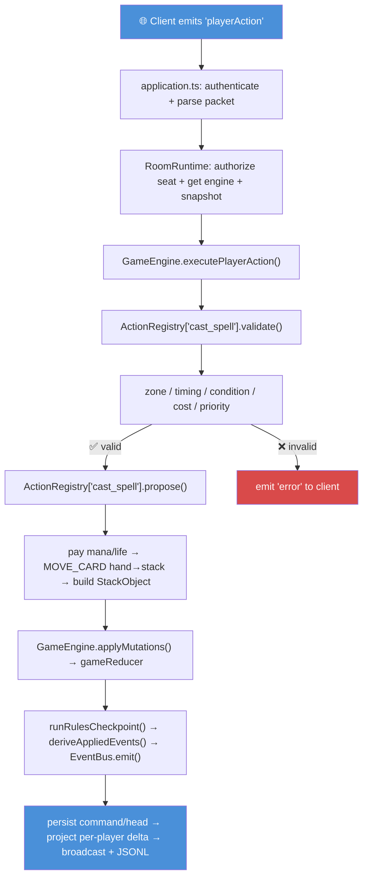
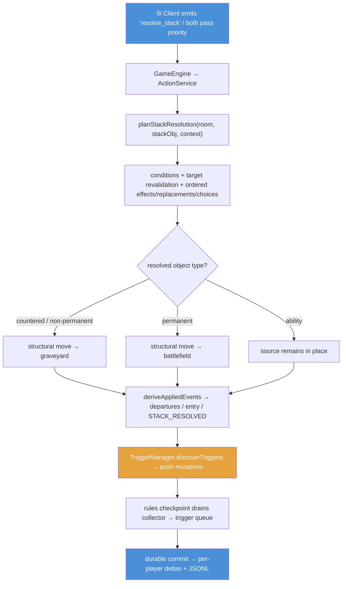
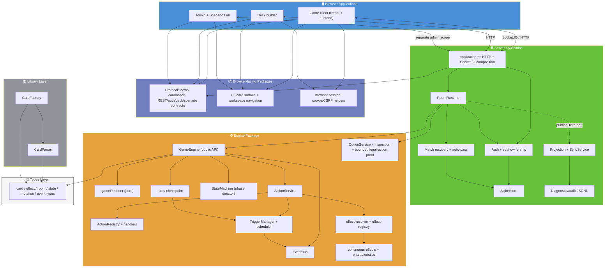

# Card Game Architecture Documentation (TypeScript)

**Date:** 2026-11-18
**Status:** Current as of `main` commit `435f3f2`

> This document describes the **active TypeScript application** (`apps/` and `packages/`) and is the canonical
> current-state architecture reference. Historical audits and interim notes remain separate;
> linked milestone reports record acceptance evidence for the current workspace and protocol boundaries.
>
> **Looking for where a concept lives or how a flow runs?** Start with the
> [concept map](docs/MAP.md) — it indexes every subsystem by entry point, location, and
> ownership, and traces the end-to-end flows. This document is the deep per-type reference.

---

## 1. Overview

A two-player, MTG-inspired card-game platform built with TypeScript, Express, Socket.IO,
React and Zustand. It is an npm workspace rather than a single server/client pair:

- `packages/engine` owns deterministic rules, card authoring and match state.
- `packages/protocol` owns versioned browser-facing views, commands and REST contracts.
- `apps/server` owns authentication, persistence, multiplayer lifecycle and transport.
- `apps/game-client`, `apps/deck-builder` and `apps/admin` are independent applications.
- `packages/ui` and `packages/browser-session` provide deliberately narrow shared UI and
  public-session facilities.

The principal dependency direction remains **Types/Contracts → Library/Rules → Engine → Server → Apps**.
The engine has no socket, HTTP, account or database knowledge. `apps/server/src/application.ts`
translates authenticated transport messages into calls on `RoomRuntime`, which coordinates engines,
durable match commits, reconnect, auto-pass and synchronization.

**Tech stack:** TypeScript 6.0, Express 4.21, Socket.IO 4.8, React 19, Zustand 5, Vite 8,
Vitest 4.1 (testing), UUID 11.0. Node `^20.19.0 || >=22.12.0`.

**Key design principles:**

- **Immutable reducer core.** Handlers are pure: they produce `GameMutation[]` and never mutate
  state. `GameEngine.applyMutations()` sequences each mutation through the pure `gameReducer`,
  which returns a **new `GameRoom`** (structural sharing along the changed path).
- **`GameEngine` is the single public game API.** `RoomRuntime` talks to it; it owns and
  coordinates `EventBus`, `StateMachine`, `ActionService`, and an action registry internally.
- **Actions follow a 3-phase lifecycle:** validate → propose → resolve. Handlers return
  mutations; the engine commits them.
- **Events are derived, not hand-emitted.** After a batch commits, `deriveAppliedEvents()`
  produces canonical game events from the before/after state diff. `EventBus` dispatches them;
  `TriggerManager` discovers triggers and pushes new mutations into a collector.
- **Player state has an explicit protocol boundary.** Clients receive audience-filtered
  `PlayerView` snapshots and projected `ViewDelta`s. Raw engine mutations and private state remain
  server-side.
- **Server-owned identity and seats.** Public browser sessions use an HttpOnly browser-family
  cookie; each game tab receives a separate bounded bearer credential. The server derives the
  player/seat from verified ownership and never trusts a packet-supplied actor.
- **Durable accepted commands.** Ordinary matches checkpoint to SQLite after the opening round.
  Each accepted command records authoritative UUID/random inputs and state/event checksums before
  its update is published, allowing deterministic restart recovery and duplicate-command handling.

> For the full catalogue of design principles applied in this codebase — each with the mechanism,
> the rationale, and a source pointer — see
> [Software design principles](docs/design-principles.md).

### 1.1 Functional Game Flows

| Flow | Status | Description |
|---|---|---|
| Room lifecycle | ✅ Full | Create/join, private opening picks, saved-deck setup, concession, explicit leave and bounded disconnect cleanup |
| Turn structure | ✅ Full | Ordered phases (see §3.5): TurnStart → Upkeep → Draw → Main → BeginCombat → DeclareAttackers → DeclareBlockers → CombatDamage → EndCombat → PostcombatMain → End → Cleanup → next turn |
| Play card (cast spell) | ✅ Full | Validate → pay costs → hand→stack → resolve → battlefield/graveyard |
| Play land | ✅ Full | Land special action (CR 305.1): validate → hand→battlefield directly; **does not use the stack**; enforces one land per turn |
| Attack / block | ✅ Full | Declare attackers/blockers (turn-based actions, not on the stack) → combat damage step with damage assignment |
| Tap for mana | ✅ Full | Validate → tap permanent → add mana (mana ability; does NOT use the stack) |
| Stack resolution | ✅ Full | LIFO pop → structural zone change → revalidate targets → dynamic params → dispatch effects → ETB triggers |
| Triggered abilities | ✅ Full | Battlefield discovery + event-card scan; pending-trigger records; triggering event carried onto the stack object; APNAP-style scheduling |
| Priority system | ✅ Full | Active player → opponent → both pass → resolve stack / advance phase |
| State sync | ✅ Full | Mutation-derived, per-player `ViewDelta`; sequence gaps request a private recovery snapshot; JSONL remains diagnostic |
| Reconnect | ✅ Full | Verified seat ownership, tab credential reuse, grace cleanup and audience-filtered snapshots |
| Durable recovery | ✅ Full | Versioned SQLite checkpoint + command journal replay for ordinary active matches; failed recovery is isolated per room |
| Action discovery | ✅ Conservative | Shared inspection validates concrete commands; bounded auto-pass search returns `available`, proven `none`, or safe `unknown` |
| Auto-pass | ✅ Full | Opt-in, server-owned five-second timer; only a settled position with proven no non-pass action may pass |
| Targeting | ✅ Full | Client selection, cast-time validation, resolve-time revalidation, multi-target groups |
| Continuous effects | ✅ Full | Global `continuousEffectPool`, characteristic layers, `STAT_DELTA`/counters, end-of-turn cleanup |
| State-based actions | ✅ Full | Lethal damage, nonpositive life, poison, failed draw; terminal win/draw outcome |
| Replacement effects | ✅ Full | `replacementEffects` registry + pending-choice transactions |
| Countering | ✅ Full | `countered` flag on `StackObject` → skips effects, sends to graveyard |

### 1.2 Current Boundaries and Known Gaps

These are explicit product boundaries, not invitations to replace cohesive subsystems:

| Area | Status | Current boundary |
|---|---|---|
| Rule contracts and permissions | ✅ Implemented | Strict characteristic, permission, cast-cost and event-replacement families feed existing engine consumers; unsupported operations fail validation |
| Activated abilities and payments | ✅ Implemented baseline | Abilities are selected by stable ability ID and share announcement, targeting, modes, costs and usage accounting. Broader activation-cost modifiers, selected-exile/binding payments and some dynamic limits remain card-driven extensions |
| Mana | ✅ Structured | Colored requirements, generic requirements, explicit allocations and bounded substitution are supported. More general substitution/conversion rules remain intentionally narrow |
| Private projection | ✅ Implemented | Snapshots, deltas, choices, observations, action handles and reconnect share one audience policy; clients import protocol rather than engine rules |
| Persistence | ✅ Implemented baseline | SQLite stores accounts, sessions, decks, scenarios, audit data, seat ownership and ordinary active-match checkpoints/journals. Waiting lobbies and Scenario Lab runs remain process-local |
| Legal-action search | 🔶 Conservative | Concrete inspection is authoritative. Exhaustive non-pass discovery is deliberately bounded and returns `unknown` rather than guessing when search, number ranges or choice shapes exceed its proof domain |
| Rules breadth | 🔶 Card-driven | Remaining families include selected-result values/collection sums, bounded repetition, some stack/source follow-ups, combat expiry and life-protection cases. Add them only for accepted card recipes |
| Content | 🔶 In progress | The explicit manifest contains 159 card definitions and two token templates. Six included workbook rows remain deferred, and registration alone is not certification of complete printed behavior |
| Deployment | 🔶 Separate gate | Linux/TLS installation, monitoring and security assessment remain operations work; local builds and logic checks do not claim production-host readiness |

---

## 2. Directory Map

```
packages/engine/src/
├── config.ts / config/                # Compatibility API + JSON rules, diagnostics, elements and presets
├── types/                             # Pure type definitions — no runtime code
│   ├── card.types.ts                  # CardBlueprint, CardInstance, CardState, abilities, ManaColor
│   ├── effect.types.ts                # StackObject, StackEffect, ActionCost, TargetPointer, EffectDefinition
│   ├── game.player.types.ts           # PlayerState, ManaPool
│   ├── game.room.types.ts             # GameRoom — the central aggregate
│   ├── setup-config.types.ts           # Serializable room setup contract
│   ├── game.state.types.ts            # TURN_SEQUENCE, Phase union, GameStatus union
│   ├── game-mutation.types.ts         # GameMutation discriminated union (the reducer's input)
│   ├── game-event.types.ts            # AppliedEventBatch, CommandContext, ResolutionReport
│   ├── action.ids.ts                  # ACTION_IDS closed set + labels
│   ├── choice.types.ts                # PendingChoice + continuations
│   ├── combat.types.ts                # CombatDeclaration, CombatDamageState
│   ├── continuous-effect.types.ts     # ContinuousEffectEntry, layers
│   ├── damage.types.ts                # DamageAssignment
│   ├── delta.types.ts                 # StateDelta, DeltaChange
│   ├── trigger.types.ts               # TriggerQueue, DelayedTrigger, TurnHistory
│   ├── proposed-event.types.ts        # ReplacementDefinition
│   ├── card-observation.types.ts / resolution-result.types.ts
│   ├── change-cause.types.ts / counter-cost.types.ts
│   ├── rule.types.ts / state-based.types.ts / numeric-value.types.ts / operation-outcome.types.ts
│   └── debug-mode.types.ts
├── library/                           # Card data loading and instantiation
│   ├── cards/                         # Grouped single-card JSON definitions + explicit manifest
│   ├── tokens/                        # Named token templates; excluded from playable-card enumeration
│   ├── card-parser.ts                 # Raw JSON → typed CardBlueprint (normalization)
│   ├── card-definition-validator.ts   # Pure card/effect schema validation
│   ├── card-catalog.ts                # Lazy, recursively frozen blueprint cache
│   └── card-factory.ts                # CardInstance factory + compatible catalog re-export
├── rules/
│   ├── parse.ts                       # Public versioned authoring boundary
│   ├── schema/                        # Pure strict schemas and functional compiler
│   ├── runtime/                       # Live cost and static event-rule evaluation
│   └── operation-stage.ts             # Shared operation-to-layer order
├── engine/                            # Core game logic — no socket/HTTP knowledge
│   ├── game-engine.ts                 # Unified public API: owns EventBus, StateMachine, ActionService
│   ├── game-reducer.ts                # Pure (state, mutation) → newState; reduceGameOperation
│   ├── action-service.ts              # Internal orchestrator: validate → propose → resolve stack
│   ├── action-registry.ts             # ActionHandler interface + immutable ActionRegistry
│   ├── default-action-registry.ts     # Assembles the built-in action handlers
│   ├── action-validator.ts            # Static pure validation: canActivate, canPayCost, canMeetCondition
│   ├── player-commands.ts             # Orchestration command table (enter_battle, end_turn, …)
│   ├── state-machine.ts               # Phase director: turn phases, priority, stack; returns mutations
│   ├── event-bus.ts                   # In-memory pub/sub, room-scoped
│   ├── applied-events.ts              # deriveAppliedEvents: before/after diff → canonical events
│   ├── rules-checkpoint.ts            # Settles SBAs and schedules triggers between batches
│   ├── effect-registry.ts             # Primitive effect handlers (return GameMutation[])
│   ├── resolution-planning.ts          # Pure effect construction, target revalidation, dynamic params
│   ├── effect-resolver.ts             # planStackResolution: ordered orchestration and structural moves
│   ├── effect-context.ts              # Random-only capability for effect resolution
│   ├── trigger-manager.ts             # Event listener → discoverTriggers → push mutations
│   ├── trigger-matching.ts            # Event → trigger predicate matching
│   ├── trigger-scheduler.ts           # APNAP ordering + trigger queue choices
│   ├── continuous-effect-state.ts     # Read-only card/source/lifetime queries
│   ├── continuous-effects.ts          # Effect timestamps, sequence, normalization
│   ├── characteristic-layers.ts       # Layer ordering for characteristic resolution
│   ├── card-characteristic-service.ts # Effective P/T, keywords, types, controller
│   ├── numeric-values.ts / numeric-characteristics.ts
│   ├── combat-service.ts / combat-rules.ts / combat-state.ts
│   ├── damage-service.ts / damage-keywords.ts
│   ├── state-based-actions.ts / state-based-planner.ts
│   ├── replacement-rules.ts / proposed-events.ts
│   ├── choices.ts / action-choices.ts / resolution-choices.ts
│   ├── ability-usage.ts / action-costs.ts / payment-flow.ts / counter-costs.ts
│   ├── captured-windows.ts / observation-state.ts / resolution-results.ts
│   ├── change-cause.ts / source-information.ts / trigger-event-context.ts
│   ├── zone-transitions.ts            # Centralized MOVE_CARD validation + application
│   ├── mana-pool.ts / mana-abilities.ts
│   ├── option-service.ts              # Computes available actions for a card in a zone
│   ├── legal-actions.ts               # Pure bounded proof of a legal non-pass action
│   ├── token-creation.ts              # Named-token instantiation and board-only lifecycle
│   ├── scenario-setup.ts              # Plain-data deterministic Test Lab setup seam
│   ├── room-factory.ts                # createRoom, joinRoom, buildStartingCardMutations
│   ├── turn-history.ts / library-operations.ts / card-utils.ts
│   ├── permission-registry.ts         # Live cast and target permission checks
│   └── handlers/                      # One file per registered action
│       ├── play-card-handler.ts       # cast_spell
│       ├── play-land-handler.ts       # play_land (land special action; no stack)
│       ├── activate-ability-handler.ts# activate_ability
│       ├── tap-for-mana-handler.ts    # tapForMana (no stack)
│       ├── declare-attackers-handler.ts
│       ├── declare-blockers-handler.ts
│       ├── enter-battle-handler.ts    # enter_battle
│       ├── end-turn-handler.ts        # end_turn (skip-to-end)
│       ├── pass-priority-handler.ts   # pass_priority
│       ├── resolve-stack-handler.ts   # resolve_stack (debug)
└── shared/                            # Cross-cutting runtime and rule helpers
    ├── game-logger.ts                 # Structured logger (engineLogger, serverLogger)
    ├── runtime-context.ts             # UUID/random capabilities + production defaults
    ├── card-state.ts                  # Default mutable state construction
    ├── numeric-values.ts              # Pure numeric expression/query contracts
    ├── action-cost-validation.ts / mana-validation.ts / effect-scope-validation.ts
    ├── target-legality.ts / target-utils.ts
    ├── action-modes.ts / action-permissions.ts
    ├── action-cost-description.ts     # Human-readable cost descriptions
    ├── choice-diagnostics.ts          # Compact choice metadata for send/receipt logging
    ├── protection.ts / rule-path.ts / state-value.ts / turn-utils.ts

apps/server/
├── package.json / tsconfig.json / vite.config.mts / vitest.config.mts
├── src/
│   ├── index.ts                      # Process startup and listener
│   ├── application.ts                # Express + Socket.IO composition root
│   ├── config/                       # JSON defaults/profiles, strict schema and startup loader
│   ├── admin/                        # Durable audit, account disabling and bounded log reads
│   ├── auth/                         # Passwords, scoped sessions, ownership, routes, bootstrap
│   ├── http/                         # Origin policy and privileged admin routes
│   ├── realtime/handshake.ts          # Token-derived socket identity
│   ├── stores/                       # SQLite adapter, migrations and online backup
│   ├── catalog/                      # Printed public catalog and format eligibility
│   ├── decks/                        # Ownership-scoped deck repositories and validation service
│   ├── projection/                  # Player/card views, visibility, deltas, choices and inspector gate
│   ├── scenarios/                   # Privileged Scenario Lab persistence and launch orchestration
│   └── rooms/
│       ├── room-runtime.ts           # Engines, identity, timers, room lifecycle
│       ├── state-store.ts            # StateStore + InMemoryStore
│       ├── match-recovery.ts         # Versioned checkpoints, command journal and deterministic replay
│       ├── auto-pass.ts              # Opt-in delayed server-side pass coordinator
│       ├── sync-service.ts           # Deltas, filtering, JSONL log
│       ├── reconnect.ts              # Identity mapping and rejoin decisions
│       └── action-packet.ts          # Socket packet validation
└── dist/index.js                    # Vite Node bundle, including engine source

apps/game-client/
├── package.json / tsconfig.json / vite.config.mts / vitest.config.mts
├── main.tsx / App.tsx / index.html / style.css
├── session.ts / socket.ts / targeting.ts
├── card-label.ts / stack-description.ts
├── store/                           # gameStore, deltaReducer, combatSelection
├── hooks/                           # useSocket, useGameActions
├── components/                      # Game shell, cards, combat, choices, logs and controls
├── layout/                          # Permanent/token grouping and board layout helpers
├── presentation/                    # Board transitions, targeting lines and impact motion
└── dist/                            # Independent player build; served by Express

apps/admin/
├── config/                          # Public UI page/poll settings; separate storage namespace
├── api.ts / session.ts / router.ts   # Admin-only HTTP, credentials and route ownership
├── hooks.ts / resource.ts            # Abortable, non-overlapping resource polling
├── pages/                           # Rooms, logs, accounts, configuration and scenarios
└── dist/                            # Independent admin build; own origin in production

apps/deck-builder/                   # Public catalog, local drafts, import/export and owned deck CRUD
packages/protocol/                   # Versioned views, socket/REST/auth/deck/scenario contracts
packages/ui/                         # Shared CardSurface, catalog controls and workspace navigation
packages/browser-session/            # Cookie/CSRF transport and verified public-session helpers

tests/                               # Root-scoped engine, server, client and architecture tests
build/types/                         # Ignored TS declarations and incremental metadata
data/deltas.jsonl                    # Ignored append-only diagnostic log
```

---

## 3. Layer 1: Types (`packages/engine/src/types/`)

The type layer defines the data model. Files form a clean dependency hierarchy with no circular
imports.

### 3.1 `card.types.ts` — Foundation

| Type | Purpose |
|---|---|
| `ManaColor`, `ManaCost` | Mana system primitives |
| `CardType`, `CardSubType`, `CardZone` | Card classification and location |
| `TriggerEvent` | Union of game events that trigger abilities (`ON_ENTER_BATTLEFIELD`, `ON_DIE`, …) |
| `ActivatedAbility` / `TriggeredAbility` | Discriminated union; both carry an `EffectDefinition` |
| `CardBlueprint` | Static card definition (id, name, types, cost, abilities, effects) |
| `CardState` | Runtime mutable state (zone, tapped, damage, counters, summoning sickness, zoneRevision) |
| `CardInstance` | `CardBlueprint` + `uuid` + `CardState` — the runtime card object |
| `ContinuousEffectEntry` | A pool entry (source, effect, timestamps, duration) |

### 3.2 `effect.types.ts` — Stack & Action System

| Type | Purpose |
|---|---|
| `ActionType`, `EffectId` | Registry key types (open strings) |
| `ActionSpeed`, `StackItemType`, `TargetType` | Speed/stack/target enums |
| `ActionCost` | Resource costs (mana, tap, life, discard, sacrifice) |
| `ActionCondition` / `ActionRequirements` | State conditions + combined cost/zone/speed rules |
| `TargetPointer` | Flexible target reference (player, card, permanent, stack, zone) |
| `TargetingDefinition` / `TargetGroupDefinition` | Card-data targeting (incl. filter-based `all`) |
| `EffectDefinition` | Card-data-level effect (action + params + targeting + tags) |
| `StackEffect` | Resolve-time effect with locked targets and dynamic params |
| `StackObject` | A stack item: spell/activated/triggered with source card and effects array |
| `TriggeringEvent` | `{ eventId, payload }` carried onto triggered stack objects |
| `CombatDeclaration` | A declared attacker with its blockers |

### 3.3 `game.player.types.ts` — Player State

`PlayerState` (id, life, poison, `ManaPool`, deck/hand/graveyard/exile arrays, failedDraw).

### 3.4 `game.room.types.ts` — Central Aggregate

`GameRoom` composes all other types into the game state root:

```
GameRoom {
    roomId, player1Id, player2Id
    players: Record<PlayerId, PlayerState>   // all player data
    phase: Phase                             // turn clock (TURN_SEQUENCE)
    status: GameStatus                       // 'waiting' | 'playing' | 'gameOver'
    engineState: 'waiting_for_player' | 'resolving_stack' | 'state_based_actions' | 'game_over'
    activeTurnPlayerId, priorityPlayerId, lastPassedPlayerId
    stack: StackObject[]                     // a ZONE, not a phase
    battlefield: CardInstance[]
    combat: CombatDeclaration[]
    combatDeclarations?, combatDamage?
    continuousEffectPool: ContinuousEffectEntry[]
    replacementEffects?, delayedTriggers?, turnHistory?, triggerQueue?
    pendingChoice?, pendingTriggers?
    effectTimestamp?, effectSequence?, turnNumber?, outcome?
}
```

> **Note:** `phase` (turn clock) and `status` (game-level) are **orthogonal**. `engineState`
> disambiguates why `priorityPlayerId` may be `null`. The stack is a **zone**, not a phase.

### 3.5 `game.state.types.ts` — Turn Sequence

```ts
export const TURN_SEQUENCE = [
  'stateTurnStart', 'upkeepStep', 'stateDrawPhase', 'stateMainPhase',
  'beginCombatStep', 'declareAttackersStep', 'declareBlockersStep',
  'combatDamageStep', 'endCombatStep', 'postcombatMainPhase',
  'stateEndPhase', 'cleanupStep',
] as const;
export type Phase = typeof TURN_SEQUENCE[number];
export type GameStatus = 'waiting' | 'playing' | 'gameOver';
```

### 3.6 `game-mutation.types.ts` — The Reducer's Input

`GameMutation` is a discriminated union of every state change the engine can apply
(`MOVE_CARD`, `CHANGE_LIFE`, `MARK_DAMAGE`, `DESTROY_CARD`, `PUSH_STACK`, `SET_PRIORITY`,
`SET_ENGINE_STATE`, `SET_PENDING_CHOICE`, `ADD_CONTINUOUS_EFFECT`, `SET_TURN_HISTORY`, …).
Handlers and the phase director produce these; only `gameReducer` consumes them.

---

## 4. Layer 2: Library (`packages/engine/src/library/`)

Bridges raw JSON card data to typed runtime instances.

### 4.1 `card-parser.ts`

Strict version-1 parsing: `parseCardDefinition()`, `parseAbilityDefinition()` and
`parseInstructionDefinition()` validate through `rules/schema`, then compile functional instructions
and static rules into the existing execution representation. `rules/parse.ts` is the shared public
facade. `normalizeActionCost()` and `parseAll()` remain internal library utilities. Unknown or ignored
fields are rejected before normalization; flattened ability `effectId` and the `onPlay` alias are retired.

### 4.2 Catalog and instance construction

- `card-catalog.ts` owns raw JSON lookup, lazy normalization, and one recursively frozen cached
  `CardBlueprint` reference per card ID.
- `card-factory.ts` re-exports `getBlueprint()` for compatibility and constructs a
  `CardInstance` with a UUID from the supplied runtime capability and mutable default `CardState`.
- `card-definition-validator.ts` owns pure authored-definition validation. The library depends on
  `types` and stable `shared` contracts, never engine implementation modules; the architecture
  gate checks runtime and type-only imports.

> **Gotcha:** `instantiateCard()` returns instances that **share** a deeply frozen cached
> blueprint. Tests that need synthetic content must replace the whole local fixture reference,
> for example `card.blueprint = { ...card.blueprint, power: 2 }`; do not mutate nested catalog
> fields. `parseCardDefinition()` returns mutable results for isolated parser fixtures.

**Data flow:** `library/cards/*/*.json` + explicit manifest → `card-parser.ts` → `card-catalog.ts` (cached and frozen)
→ `card-factory.ts` → `CardInstance` (runtime).

The current manifest contains **159 playable card definitions**. `library/tokens/` contains two
named templates that use the same strict schema but are intentionally excluded from playable-card
enumeration and deck construction. Catalog registration is not a claim of complete workbook
fidelity; [`docs/card-blockers-current.md`](docs/card-blockers-current.md) is the current readiness
and deferred-ruling ledger.

---

## 5. Layer 3: Engine (`packages/engine/src/engine/`)

The core game logic. All engine files work with plain TypeScript types — no socket, HTTP, or I/O
knowledge. Authoritative UUID generation and randomness enter through `RuntimeContext`;
`EffectContext` retains the effect pipeline's narrower random-only view. Wall-clock timestamps are
not part of this deterministic boundary.

### 5.1 Orchestration & Lifecycle

#### `game-engine.ts` — Unified Public API

The single entry point for all engine operations. `GameEngine` owns and coordinates:

- `EventBus` — created per room in the constructor
- `StateMachine` — phase/turn/priority director (returns mutations)
- `ActionService` — action pipeline and stack resolution
- `ActionRegistry` — an engine-owned registry; the default is assembled by
  `createDefaultActionRegistry()` and callers may supply a local registry to the constructor
- `mutationCollector` — shared array that `TriggerManager` pushes into during event dispatch

**Mutation pipeline:**

1. Handlers produce `GameMutation[]` (pure, no side effects).
2. `applyMutations()` sequences each through `reduceGameOperation` (the pure reducer).
3. `runRulesCheckpoint()` settles state-based actions and schedules discovered triggers.
4. `deriveAppliedEvents()` produces canonical events from the before/after diff; `EventBus`
   dispatches them; listeners enqueue further mutations into the collector, which are drained in
   a loop until empty.

Key methods:

- `executePlayerAction(playerId, actionId, data)` → `ActionResult` — **the player-command
  boundary** (validates room slot, terminal state, payload shape, status, readiness, debug mode).
- `inspectPlayerAction(playerId, actionId, data)` — read-only command inspection using the same
  announcement, pending-choice and final validation rules as submission.
- `handleAction()` / `proposeAndStack()` — lower-level rules/test primitives.
- `applyMutations(mutations, resolution?, cause?)` → `GameMutation[]` — commit + checkpoint.
- `advancePhase(mode)` / `givePriorityTo()` / `passPriority()` — phase/priority delegation.
- `initRoom()` / `dispose()` — wire/tear down the per-room `TriggerManager`.
- `roomState` — **read this after any mutation** (the reducer reassigns `this.room`).
- `drainEventBatches()` — consume committed `AppliedEventBatch[]` for delta emission.

> **Critical rule:** `applyMutations` reassigns `engine.room` to a **new object**. Any local
> `const room = getRoom(...)` reference goes stale after an engine mutation. Always read back via
> `engine.roomState`.

#### `game-reducer.ts` — Pure Reducer

`gameReducer(state, mutation) → GameRoom` and `reduceGameOperation(state, mutation) →
OperationOutcome` (`committed` | `unchanged` | `rejected`). Returns a new `GameRoom` with shallow
copies along the changed path; untouched subtrees are shared by reference. Also reconciles combat
and resolves characteristics after characteristic-affecting mutations.

Damage ownership follows the same boundary: `damage-service.ts` owns rule hooks, assignment
validation, and damage planning, while `reduceDamageBatch()` in `game-reducer.ts` owns atomic
application of the resulting mutations. Replacement previews use that reducer-owned helper, so
damage planning never imports the authoritative reducer.

#### `action-service.ts` — Internal Action Orchestrator

Internal delegate used by `GameEngine`. Routes actions to `ActionRegistry` (validate → propose),
manages stack resolution via `planStackResolution()`, and wires the per-room `TriggerManager`.
Pure with respect to `GameRoom`: it returns mutations to the engine.

#### `state-machine.ts` — Phase Director

Pure with respect to `GameRoom`: every method receives the current room snapshot and returns
`GameMutation[]`. Reads/writes `room.phase`, `room.activeTurnPlayerId`, `room.priorityPlayerId`,
`room.lastPassedPlayerId`, and `room.stack`.

- `advancePhase(room, 'complete' | 'skipToEnd')` — auto-advances through `AUTO_PHASES`
  (`stateTurnStart`, `cleanupStep`), stops at the first phase needing input, and gives priority.
- `defaultPriorityFor(phase, room)` — declaration steps await a turn-based decision (null
  priority); response windows belong to the active player.
- `passPriority` — stack > 0 + both passed → `resolving_stack`; stack == 0 + both passed →
  `advancePhase('complete')`.
- `addToStack` — no phase change; emits `STACK_UPDATED` and gives priority to the controller
  (MTG 116.3d).
- `nextInTurn` wraps `cleanupStep` → `stateTurnStart`; `switchTurn` runs **before** untap.

> **MTG 116.4:** after stack resolution the phase does **not** change; the active player gets
> priority in the same phase.

### 5.2 Action Pipeline

#### `action-registry.ts` — Handler Interface & Registry

```
validate(room, playerId, action) → ActionResult  // permission checks, cost validation
propose(room, playerId, action)  → ActionResult  // pay costs, create StackObject, push to stack
resolve(room, stackObj)          → ActionResult  // apply effects via EffectRegistry
```

`ActionRegistry` is an immutable mapping of `ActionType` to `ActionHandler`. The built-in mapping
is assembled by `createDefaultActionRegistry()` in `default-action-registry.ts`, and every
`GameEngine` owns its own instance. The known set of player actions is the closed `ActionId` union
in `packages/engine/src/types/action.ids.ts`; the default factory covers every built-in handler. Transport code
constructs engines without importing concrete rule handlers. See [`docs/action-ids.md`](docs/action-ids.md).

#### `player-commands.ts` — Orchestration Command Table

A small table of commands that are not ordinary card actions (`enter_battle`, `end_turn`, …).
Each entry declares a required `status`, optional `debug` mode, a `validate(data)` shape check,
and an `execute(engine, playerId, data)`. `executePlayerAction` consults this table before falling
back to `ActionRegistry`.

#### `action-validator.ts` — Pure Validation

Static utility class with no side effects: `canActivate()` (zone → timing → condition → cost →
priority), `canMeetCondition()`, `canPayCost()` (mana via `ManaPool.canPay()`, life, tap, discard).

#### `handlers/` — One File per Action

| Handler | Action ID | Notes |
|---|---|---|
| `play-card-handler.ts` | `cast_spell` | Pay mana/life, move hand→stack (cost), build `StackObject` |
| `play-land-handler.ts` | `play_land` | Land special action: hand→battlefield directly; **no stack**; one land per turn |
| `activate-ability-handler.ts` | `activate_ability` | Selected blueprint ability ID |
| `tap-for-mana-handler.ts` | `tapForMana` | Tap permanent, add mana; **no stack** (mana ability) |
| `declare-attackers-handler.ts` | `declare_attackers` | Turn-based action; then advance |
| `declare-blockers-handler.ts` | `declare_blockers` | Turn-based action; then advance |
| `enter-battle-handler.ts` | `enter_battle` | Main → combat, stops at `beginCombatStep` |
| `end-turn-handler.ts` | `end_turn` | Skip-to-end (`advancePhase('skipToEnd')`) |
| `pass-priority-handler.ts` | `pass_priority` | Priority pipeline |
| `resolve-stack-handler.ts` | `resolve_stack` | Debug resolution through the normal pipeline |

**Cost vs effect zone changes:** the hand→stack move in `propose()` is a *cost* (immediate,
uncounterable). The stack→battlefield/graveyard move at resolution is a *structural game rule*.

### 5.3 Effect Resolution

#### `effect-registry.ts` — Primitive Handlers

Maps primitive names to `(room, stackObj, effect, context) => GameMutation[]`. Primitives include
`MOVE_ZONE`, `MODIFY_LIFE`, `MODIFY_STATS`, `ADD_COUNTER`/`REMOVE_COUNTER`, `TAP`/`UNTAP`,
`DRAW`, `ADD_MANA`, `DISCARD_HAND`, `SHUFFLE`, `REORDER_LIBRARY`, `GRANT_STATS`, and more. Also
contains zone utility helpers (`findCardOnBattlefield`, `findCardInZone`, …).

#### `resolution-planning.ts` — Pure Resolution Primitives

Owns `buildStackEffects()`, `revalidateTargets()`, and `buildDynamicParams()`. These functions build
resolve-time values from a room snapshot but do not advance the resolution cursor or commit state.
`effect-resolver.ts` re-exports them for compatibility with existing consumers.

#### `effect-resolver.ts` — Resolution Pipeline

`planStackResolution()` orchestrates a `StackObject`'s resolution:

1. Evaluate intervening conditions and whole-object target/fizzle state.
2. Expand bounded reveal instructions or pause for a serializable resolution choice.
3. Revalidate each effect's targets and compute dynamic params through `resolution-planning.ts`.
4. Dispatch each effect to `EffectRegistry`, plan replacements/outcomes, and advance the working
   room in order.
5. Apply the structural zone change: permanents → battlefield, non-permanents/countered spells →
   graveyard; activated and triggered sources remain in place.
6. Return the resolution report used to derive `PERMANENT_ENTERED` / `STACK_RESOLVED` events.

#### `trigger-manager.ts` — Triggered Abilities

Created per-room by `ActionService.initRoom()`. Listens on the room's `EventBus` and separates
read-only discovery from stack insertion:

- `discoverTriggers(event, context): PendingTrigger[]` — pure, read-only. Scans battlefield
  permanents (watchers) plus the event card (deduped by uuid), fixing both self-triggers and
  "whenever another creature enters" watchers.
- `EVENT_MAP` maps event ids → `{ triggerEvent, scanBattlefield, includeEventCard }` for
  `PERMANENT_ENTERED`, `PERMANENT_LEFT`, `PERMANENT_DIED`, `ATTACK_DECLARED`, `DAMAGE_TAKEN`,
  `TURN_STARTED`, `LIFE_CHANGED`.
- The constructor takes `(eventBus, collector, generateUuid, getRoom)` — `getRoom` is a getter
  because the engine reassigns `room` after each mutation.
- `dispose(eventBus)` unregisters every listener; called by `ActionService.destroyRoom()`.

Trigger scheduling (APNAP ordering, trigger-queue choices) lives in `trigger-scheduler.ts`;
predicate matching in `trigger-matching.ts`.

### 5.4 Support Services

#### `event-bus.ts` — Pub/Sub

Room-scoped in-memory event bus (`emit`, `on`, `off`). Events carry an `EventContext`
(`{ before, after, command }`) so listeners can inspect the state around each event.

#### `applied-events.ts` — Event Derivation

`deriveAppliedEvents(before, after, steps, resolution, onContext)` produces canonical game events
from the before/after diff of each committed mutation. This is why handlers never hand-emit
events — events are a projection of state change.

#### `rules-checkpoint.ts` — SBA + Trigger Settlement

`runRulesCheckpoint()` settles state-based actions and schedules discovered triggers between
mutation batches, looping until no further work remains (or a choice is pending).

#### `option-service.ts` and `legal-actions.ts` — Action Discovery

Computes available actions for a card in a zone (`hand` or `battlefield`): "Play Card", "Tap for
Mana", "Attack", and activated abilities. Returns `ActionOption[]` with `disabled` /
`disabledReason` for the client UI.

`inspectPlayerAction()` validates a concrete or incomplete command and describes its next typed
input. `hasLegalNonPassAction()` is a separate pure bounded search used only for conservative
auto-pass decisions. It returns a validated witness, proven absence, or `unknown`; search limits,
wide numeric ranges and unsupported choice shapes never become permission to pass.

#### `room-factory.ts` — Room Factory

Exported functions: `createRoom(roomId, player1Id)`, `joinRoom(room, player2Id)`,
`buildStartingCardMutations(room)`.

Starting-deck construction accepts runtime capabilities for deterministic
card UUIDs and Fisher-Yates randomness while retaining production defaults for ordinary callers.

#### `mana-pool.ts` — Centralized Mana Operations

All mana arithmetic routes through a single namespace: `canPay`, `add`, `spend`, `drain`,
`isPureAbility`, `validManaAmounts`. The pool itself remains a plain `Record<ManaColor, number>`
on `PlayerState`.

#### Characteristic and continuous-effect ownership

The characteristic system resolves effective P/T, keywords, types, and controller from the
`continuousEffectPool` using layer ordering. `card-characteristic-service.ts` is the public
read-only facade, and `characteristic-layers.ts` owns whole-board layer and dependency evaluation.
`continuous-effect-state.ts` owns read-only room-card enumeration, source lookup, and effect
lifetime checks. `continuous-effects.ts` owns effect timestamps, sequence allocation, and entry
normalization; it re-exports the state queries for compatibility. Shared `numeric-values.ts`
owns pure dynamic-value evaluation and query registration; the engine path is a compatibility
re-export, while `numeric-characteristics.ts` supplies engine-owned characteristic queries.

#### Contracted rules and permissions

The unused `ModifierPipeline` is removed. The live registry is named `PermissionRegistry` and
keeps cast/target permission checks. `rules/schema` owns strict shared contracts; `rules/runtime`
evaluates cost and static event-replacement rules. Characteristic and permission rules compile
into the existing layer system. See [the rule-contract supplement](docs/rule-contract-architecture.md)
for family ownership, lifetimes, usage identities, migration and remaining card blockers.

Resolution-local card sets are documented in [the result-set supplement](docs/resolution-results-architecture.md).
Milling can capture exact arrival references/snapshots; subsequent searches and numeric queries reuse
the shared filters. Cards remain in real zones, and temporary sets expire with the resolving object.

---

## 6. Layer 4: Server (`apps/server/src/`)

### 6.1 State, SQLite and Durable Matches

`rooms/state-store.ts` keeps the live `GameRoom` lookup behind `StateStore`; `InMemoryStore` is the
ordinary process cache and the complete test adapter. Persistent concerns are narrower repositories
rather than a database-aware engine. `stores/sqlite-store.ts` implements account, session, deck,
audit, scenario, seat and match repositories with migrations, prepared statements and transactions.

`rooms/match-recovery.ts` owns match format versioning, checkpoints, accepted-command journal
entries and replay validation. After the opening round, normal matches are durable:

1. Save a checkpoint containing `GameRoom` and the engine's last event-batch identity.
2. For each accepted command, record its authoritative UUID/random inputs plus state and event
   checksums.
3. Commit the journal/head update before publishing the client update.
4. At startup, replay the tail through a fresh `GameEngine`; quarantine only the room whose
   format, sequence or checksum fails.

Checkpoint rollover occurs every 32 accepted commands and at the terminal outcome. Waiting lobbies
and Scenario Lab runs remain process-local by design.

### 6.2 Projection and Client Synchronization

`rooms/sync-service.ts` drains committed engine batches and writes the internal diagnostic JSONL.
For each viewer, `projection/` compares audience-filtered before/after `PlayerView`s and emits a
versioned `ViewDelta`. Raw mutations, hidden cards, unrestricted blueprints and serializable
continuations do not cross this boundary. Sequences are per room; a browser that detects a gap
pauses input and requests a fresh private snapshot rather than replaying a command.

### 6.3 Authentication, Seats and Reconnect

`auth/` owns password/session verification and durable seat ownership. `packages/browser-session`
supplies the public cookie/CSRF client boundary; game tabs use separate bearer credentials. The
Socket.IO handshake derives identity from the verified game credential and optional owned room
reference. `rooms/reconnect.ts` maintains current socket/player maps, but authorization comes from
the server-owned seat repository—not from a client-generated player ID or packet field.

### 6.4 Commands, Inspection and Auto-pass

`rooms/action-packet.ts` parses strict versioned action packets and drops actor-shaped input.
`RoomRuntime.executePlayerAction()` supplies the authenticated seat, command identity and current
engine. `inspectPlayerAction` uses the same engine rules without mutation. `rooms/auto-pass.ts`
coordinates opt-in timers and calls the ordinary `pass_priority` command only after both players
are connected, the engine is settled and `hasLegalNonPassAction()` proves `none` in the current
position. `available`, `unknown`, disconnects and stale timer identities fail closed.

---

## 7. Multiplayer Entry and Runtime

`apps/server/src/application.ts` composes Express, Socket.IO, browser/account/admin routes,
projection, persistence, scenarios and `RoomRuntime`. `index.ts` loads validated configuration,
waits for initialization/recovery and starts the listener. The engine remains independent of
accounts, transport and storage.

`rooms/room-runtime.ts` is the multiplayer application boundary. It owns live `GameEngine`
instances, socket bindings, lobby opening picks, grace timers, explicit departure/concession,
command commit/rollback, durable match heads, action inspection, auto-pass coordination and room
cleanup. It depends on narrow publishing, destruction and repository ports and has no Express or
Socket.IO imports.

One resolved `RuntimeContext` supplies authoritative UUIDs/randomness to setup and each engine.
When a durable command runs, `MatchInputs` records those capabilities so restart replay consumes
the exact same values. Cryptographic credentials remain an authentication concern and are never
stored in `GameRoom`.

#### Durable aggregate versus process resources

`GameRoom` is the serialized authoritative rules aggregate: players, cards, phases, priority,
stack, choices, combat, observations, effects, trigger queues and terminal outcome. The persistent
match head adds replay position and checksums. Socket objects, timers, repository handles,
`GameEngine` instances and auto-pass preferences are process resources and are reconstructed or
reset after restart.

**Principal Socket.IO events:**

| Event | Handler |
|---|---|
| `connection` | Verify the game-tab credential and seat ownership; establish/recover the current room and emit `sessionReady` plus a private snapshot |
| `createRoom` / `joinRoom` | Validate owned deck/session, reserve one account seat, create/join the process-local lobby and emit viewer-specific state |
| `submitRps` | Lock one private opening pick; when both exist, start the engine match and atomically create its durable opening checkpoint |
| `playerAction` | Parse → authorize seat → execute/record command → publish projected updates; duplicate accepted command IDs return a snapshot |
| `inspectPlayerAction` / `getOptions` | Read-only authoritative action/input discovery for the seated viewer |
| `setAutoPass` | Store the socket-local preference and refresh conservative timer eligibility |
| `leaveRoom` | Concede if necessary, release seat/binding and retire an empty room |
| `disconnect` | Preserve the seat for reconnect, cancel auto-pass work and schedule configured grace cleanup |

**Accepted-command pattern:**

1. Authenticate the socket/seat and parse the strict packet.
2. Snapshot the pre-command room and execute through `GameEngine` with recorded runtime inputs.
3. Persist the command journal and match head transactionally. On failure, restore the prior
   engine position and publish nothing.
4. Drain event batches, build per-viewer deltas, append diagnostic data and broadcast.

**Lifecycle:** `RoomRuntime` disposes engines, timers and auto-pass state, removes process and
persistent room records when the room closes, releases seats, and reports `roomDestroyed`
recipients through its port. Server shutdown cancels process resources and closes SQLite only
after runtime disposal; durable ordinary matches remain recoverable on the next startup.

---

## 8. Data Flow: Play Card End-to-End

### 8.1 Propose Phase (Client → Stack)



### 8.2 Resolve Phase (Stack → Battlefield)



### 8.3 Full System Architecture



---

## 9. Client (`apps/game-client/`)

React 19 + Zustand 5, bundled by Vite.

- **`session.ts`** — validated per-tab game credential and room persistence. The old generated
  browser ID survives only as a compatibility helper; `sessionReady` supplies authoritative identity.
- **`auth-state.ts` / `AccountControls.tsx`** — browser-family guest bootstrap, account
  register/login/logout and seated guest linking; passwords are never persisted. No admin panel is
  bundled into the player app.
- **`socket.ts`** — starts disconnected, obtains or restores a public browser session and connects
  with the tab's game credential plus optional owned room reference. It rejects wrong-room,
  wrong-viewer, duplicate and stale updates. A sequence gap freezes input and requests a private
  recovery snapshot; gameplay commands are never automatically resent.
- **`store/gameStore.ts`** — the Zustand store: server-authoritative `room`, plus client-only UI
  state (sync status, action draft, targeting, log, combat selection and auto-pass display).
- **`store/deltaReducer.ts`** — applies audience-filtered `ViewDelta` changes to `PlayerView`; the
  store owns protocol, room, viewer and contiguous-sequence checks.
- **`store/combatSelection.ts`** — client-side combat selection slice.
- **`hooks/useSocket.ts` / `hooks/useGameActions.ts`** — establish the verified session and expose
  command, inspection, choice, room lifecycle and auto-pass operations to components.
- **`layout/`** — deterministic permanent grouping, density and compact-land layout helpers.
- **`presentation/`** — derives movement, damage, targeting-line and persistent-status cues from
  accepted before/after player views. Effects do not invent game state.
- **`components/`** — route shell, lobby/opening round, board/hand/stack, choices, action controls,
  auto-pass, observations, logs and responsive rotate gate.

The current board is a CSS/Web Animations proof of concept. It groups equivalent tokens while
preserving each targetable instance, displays attachments and ongoing public effects, and uses
projected damage impacts for transient cues. [`docs/game-ui-poc.md`](docs/game-ui-poc.md) is its
maintainer guide and records the boundary for a future animation library.

> **Zustand v5 pitfall:** selectors that return a **new reference** each call (`.filter()`,
> `.map()`, `?? []`, `?? {}`) cause an infinite re-render loop (React error #185). Wrap them in
> `useShallow` from `zustand/react/shallow`.

---

## 10. Points of Interest

### 10.1 ✅ RESOLVED: Dual Orchestrators (`GameEngine` vs `ActionService`)

`GameEngine` is the unified public API; `ActionService` is an internal delegate. `RoomRuntime` talks
only to `GameEngine`.

### 10.2 ✅ RESOLVED: Dual Stack State

`StateMachine` no longer maintains its own stack array — it reads/writes `room.stack` directly.

### 10.3 ✅ RESOLVED: StateMachine Owns Duplicate GameRoom Fields

`StateMachine` is now pure with respect to `GameRoom`: it receives a snapshot and returns
mutations. All state lives on `GameRoom`.

### 10.4 ✅ RESOLVED: `room-factory.ts` Uses Static-Only Class

Converted to exported functions.

### 10.5 ✅ RESOLVED: `TriggerManager` Lifecycle

`TriggerManager.dispose(eventBus)` unregisters all listeners; `ActionService.destroyRoom()` and
`GameEngine.dispose()` invoke it; `RoomRuntime` destroys or recovers rooms and owns process cleanup.

### 10.6 ✅ RESOLVED: `destroyRoom()` / Room Cleanup

Room lifecycle cleanup is implemented end-to-end, including the 30s grace timer and HTTP-close
cleanup.

### 10.7 ✅ RESOLVED: Reducer-Based Mutation Pipeline

Handlers are pure and return `GameMutation[]`; `gameReducer` is the single state transition
function; events are derived from state diffs rather than hand-emitted.

### 10.8 ✅ RESOLVED: Reconnect Resilience

Server-owned seat identity, socket remapping, private recovery snapshots, durable ordinary-match
replay and grace cleanup are implemented. Waiting lobbies intentionally do not survive restart.

### 10.9 ✅ RESOLVED: Modifier ownership and authoring contracts

The unused pipeline was removed; the live registry was renamed for permissions. Versioned strict
authoring contracts group characteristic, permission, cost and event-replacement families, sharing
parsing without duplicating existing layer or proposed-event execution. See the rule-contract supplement.

### 10.10 ✅ RESOLVED: Server Composition Growing Responsibilities

`RoomRuntime` now owns room lifecycle, engine ownership, RPS setup, action routing, persistence,
identity, auto-pass and grace timers. `application.ts` is limited to transport, HTTP composition and
dependency wiring;
the existing cohesive sync, reconnect, and storage modules remain separate.

### 10.11 ✅ DECIDED: `ActionValidator` Remains a Pure Static Utility

The validator is stateless and deterministic, and its consumers need no replaceable service or
lifecycle. Tests exercise it directly and through handlers. Converting it to an injectable class
would add indirection without creating a useful boundary, so it remains unchanged unless a real
runtime dependency appears.

### 10.12 ✅ RESOLVED: Private Snapshot Projection

Snapshots, deltas, choices, card actions, observations and action-inspection results all pass
through the same audience policy. Opponent libraries expose counts, opponent hands expose counts
without card identities, and recovery snapshots cannot bypass the projection boundary.

### 10.13 🔶 OPEN: Card-driven Rules Fidelity

The core turn, priority, combat, payment, stack, choices, replacement, continuous-effect and
state-based pipelines are established. Remaining gaps should be justified by accepted card recipes
or a cross-card rule family, then added through the existing contracts. The current list is kept in
[`docs/card-blockers-current.md`](docs/card-blockers-current.md); architectural novelty alone is not
a reason to refactor a working subsystem.

### 10.14 ✅ RESOLVED: Incomplete Deterministic Context

`RuntimeContext` now supplies UUIDs and random values to authoritative room/card setup,
`RoomRuntime`, `GameEngine`, and `MutationCommitter`. Production still uses UUID v4 and
`Math.random`; tests can provide deterministic sequences. Each durable accepted command records
the authoritative values it consumed, so restart replay does not depend on restoring generator
internals. Client-only animation identifiers and observational timestamps remain outside the
authoritative boundary.

### 10.15 ✅ RESOLVED: Active-match Restart Recovery

SQLite migration 005 stores ordinary active-match checkpoints, command journals and seat owners.
Replay verifies format, sequence, state and event identities before admitting a recovered room.
Corruption or incompatible data isolates that room instead of weakening global startup.

### 10.16 🔶 BOUNDED: Exhaustive Legal-action Search

Concrete action inspection is authoritative. The engine's non-pass query explores only its stated
finite domain and returns `unknown` when it cannot prove an answer. Auto-pass treats `unknown` as a
hard stop. This is a deliberate safety boundary, not a placeholder for speculative general search;
see [`docs/legal-action-query.md`](docs/legal-action-query.md).

---

## 11. Test Architecture

The current tree contains **252 `*.test.ts` files**. Test-case totals are intentionally not frozen in
this document because parameterized cases change frequently. `npm test` runs four Vitest 4.1
projects—engine/library, server, client/shared packages and architecture—in the Node environment;
the live-routing suite requires localhost socket access.

`npm run test:coverage` measures logic in engine, protocol, shared UI, browser-session, server and
game-client TypeScript. The current configuration covers 235 logic files at 100% measured line,
statement, function and branch coverage, with a 99% ratchet threshold. React components are
excluded from that metric and belong to browser smoke/interaction coverage rather than
server-rendered snapshot inflation.

The TypeScript-AST architecture gate runs in the normal suite and separately through
`npm run test:architecture`. It rejects runtime import cycles, engine-to-transport dependencies,
transport-to-engine dependencies, transport-to-concrete-handler dependencies, undocumented client
runtime rule queries, direct authoritative UUID/random access outside `RuntimeContext`, and all
runtime or type-only imports from card content into engine implementation modules. It also keeps
core type declarations independent of executable configuration. No app imports another app, and no package imports an app. See
[`docs/architecture-import-policy.md`](docs/architecture-import-policy.md) for its precise scope
and current exception register.

```
tests/
├── architecture/ # Import graph and enforced dependency boundaries
├── engine/       # Reducer, actions, phases, combat, effects, choices, recovery inputs, etc.
├── library/      # Manifest, card schema, catalog and content registration
├── client/       # Store/delta recovery, targeting, layout, presentation and session behavior
├── server/       # Projection, auth, stores, recovery, room runtime and real-socket routing
├── shared/       # Cross-package logic exercised through the four projects
├── fixtures/     # Reviewed scenarios promoted from the Test Lab
└── helpers/      # Standard room/card/runtime test construction
```

**Key patterns:**

- `createTestRoom()` provides a standardized starting state; tests override specific fields.
- Default `GameEngine` fixtures receive the built-in registry automatically. Tests that customize
  routing create a local registry and pass it as the third constructor argument.
- `GameEngine` is the primary test interface. **Read `engine.roomState` after engine operations** —
  the original `room` reference is stale after a mutation batch.
- `instantiateCard()` shares a cached blueprint — clone `card.blueprint` before mutating it.
- Cards placed in deck/hand/graveyard must have `ownerId`/`controllerId` set, or `MOVE_CARD`
  mutations target the wrong player's zone.
- `tapForMana` returns mutations but does not apply them — call
  `engine.applyMutations(result.mutations)`.

**Verification commands:**

```powershell
npm run verify
npm run test:architecture       # focused dependency-policy gate
npm test -- <test-file>         # focused regression while developing
```

## Appendix A. Workspace Build and Verification

`@card-game/engine/*` exports TypeScript sources. The four application builds and Vitest consume
the same workspace sources; the Node production bundle includes the engine and leaves third-party
dependencies external. Root TypeScript references cover engine, protocol, UI, browser-session,
server, game client, admin and deck builder, emitting only declaration/build metadata under
`build/types/`. A focused app typecheck builds its referenced declarations first, so a clean
checkout needs no prebuilt package. `npm run verify` runs all referenced typechecks, the coverage
suite (including the architecture gate) and all four production builds.

| Concern | Authoritative location |
|---|---|
| Workspace membership and root commands | `package.json` |
| Strict compiler defaults and project order | `tsconfig.base.json`, `tsconfig.json` |
| Production server bundle | `apps/server/vite.config.mts` → `apps/server/dist/index.js` |
| Independent player build | `apps/game-client/vite.config.mts` → `apps/game-client/dist/` |
| Admin and deck-builder builds | `apps/admin/vite.config.mts`, `apps/deck-builder/vite.config.mts` |
| Test project composition and source identity | `vitest.config.mts`, `vitest.shared.mts`, per-project Vitest configs |
| Production dependency checks | `tests/architecture/import-boundaries.test.ts`, `import-graph.ts` |

The [Workspace Architecture supplement](docs/workspace-architecture.md) documents the source-to-runtime flow, declaration-only typechecking, test module identity, operational commands, decision trade-offs and current boundaries. The [Phase 0 completion report](docs/phase-0-status-2026-10-25.md) records the requirement-by-requirement evidence, independent pre-move comparison and production browser smoke. The [import policy](docs/architecture-import-policy.md) remains the precise rule and exception register.

## Appendix B. Protocol and Player Projection

`packages/protocol` is the player-facing contract. The server's `projection/` modules resolve display characteristics and legal target references, enforce audience policy, map opaque choice/generated ability identifiers, and build both snapshots and deltas. Clients render these DTOs and send versioned commands; they do not import engine code.

Create, join, opening picks, card options, action inspection, observations, normal updates, sequence
recovery and reconnect use the same boundary. Libraries expose counts only, opponents' hands stay
empty with counts, and private choices appear as waiting status. Milestone 2 connects full-state
inspection to a separate admin-scoped session and current role; game identity derives from verified
server-issued sessions and durable seat ownership.

The [Protocol and Projection supplement](docs/protocol-projection-architecture.md) provides the diagram, contracts, decisions, trade-offs and failure behavior. The [Milestone 1 report](docs/phase-1-status-2026-10-26.md) records verification. Browser smoke tests were waived by the user; this milestone uses logic/integration tests, typechecks and builds.

## Appendix C. Accounts, Sessions and Admin Access

The server issues opaque guest and account credentials, stores token hashes, validates expiry/revocation and derives the authorized player identity. Guest-to-account linking transfers server-owned seat bindings while preserving existing engine PlayerIds. Passwords use Argon2id and an offline blocklist. Strict REST schemas, auth rate limits, Helmet and a shared HTTP/socket origin allowlist protect the transport boundary.

Admin login requires a fresh password and an explicitly provisioned admin account. It issues a separate 15-minute admin token by default. Shared verifier code centralizes validity checks; scope and current role separately authorize privileged requests. An admin account's game token cannot inspect, and an admin token cannot enter the game socket. Full-state inspection also requires the server flag. Milestone 4 now provides the separate panel described in Appendix E.

The [Authentication Architecture supplement](docs/authentication-architecture.md) records the
design, ADRs, setup and API contracts. The [Milestone 2 report](docs/phase-2-status-2026-10-26.md)
records its focused verification and historical limitations. Accounts, sessions and seats for
ordinary active matches are now durable; waiting-lobby seats and current socket bindings remain
process-local. These milestones do not establish production deployment readiness.

## Appendix D. Persistence, Catalog and Saved Decks

`SqliteStore` implements account/session, owned-deck, audit, scenario, seat and active-match
repositories behind server-owned seams. It alone imports the native SQLite driver at runtime.
Five numbered migrations, prepared statements, foreign keys and short transactions protect stored
consistency; credentials remain hashed and admin scope stays separate. Ordinary matches become
durable when the opening round creates their checkpoint. Waiting lobbies and Test Lab runs remain
in memory. Auth changes commit before socket revocation notifications are published.

The public paged catalog exposes printed data and deck-legality metadata. Protocol owns strict deck contracts and a pure format validator. Account-scoped REST routes create/list/read/update/delete owned decks. Create/join socket messages carry an owned deck reference; the server validates and snapshots its card IDs into per-player room setup. RPS then leads to shuffled/dealt saved decks. Neither edits nor deletion change an existing match, and player projections exclude the private setup lists. Fixture decks remain behind debug configuration.

The [Persistence and Saved Decks supplement](docs/persistence-deck-architecture.md) records the
original account/deck design, schemas, APIs, backups, restore and log rotation. The
[Milestone 3 completion report](docs/phase-3-status-2026-10-27.md) is historical evidence;
`rooms/match-recovery.ts` and migration 005 are authoritative for current match durability.
Milestone 5 adds the separate builder and connects it to the game's saved-deck selector; Milestone 4
supplies the admin UI.

## Appendix E. Configuration Ownership and Admin Application

Editable data now lives in dedicated server/engine/protocol/frontend config folders. Server defaults, environment profile, optional operator file and narrow environment overrides produce one validated frozen startup configuration. The application snapshots gameplay rules into rooms; card definitions and all five presets retain their pre-extraction data. Secrets are external, safety/permission invariants remain code, and clients receive only public contracts or an explicitly allowlisted admin summary. See the [Configuration Architecture supplement](docs/configuration-architecture.md).

`apps/admin` is a separate React/Vite operational app with scoped login/storage and routes for room
inspection, bounded diagnostic logs, accounts, read-only settings and—only on an explicitly enabled
lab instance—Scenario Builder/Test rooms. Every admin API request verifies scope and current role.
Account disabling commits persistent state, both-scope revocation and audit data before sockets are
retired. A durable outbox exports credential-safe JSONL records with retry; signed byte cursors bound
log reads and detect rotation/truncation. Production admin assets use an independent origin, with no
admin route code in the player build. It is an operator entry point, not the game server process or
a public server-health console; health/readiness remain server endpoints and deployment concerns.

The [Admin Architecture supplement](docs/admin-architecture.md) records diagrams, API contracts, ADRs, failure behavior and operator setup. The [Milestone 4 report](docs/phase-4-status-2026-10-27.md) records focused tests/typechecks/builds and deployment limits. No browser smoke, long/full-suite run or Linux/TLS deployment is claimed for this delivery.

## Appendix F. Deck Builder and Shared Card Display

`apps/deck-builder` is an independent React/Vite app at development port 5175 and built path `/deck-builder/`. It browses/filters the public printed catalog, edits recoverable local drafts, validates through the protocol's existing pure format rules, imports/exports bounded stable-ID text and loads/creates/updates account-owned decks. Configurable public values live in `apps/deck-builder/config/`. Source dependency checks keep it independent of the engine and other apps.

`packages/ui` provides React-only display primitives for the browser apps: `CardSurface`, catalog
tiles/count controls and workspace navigation. The game wrapper retains effective labels, runtime
state and targeting/combat/action handlers; shared components receive display data and callbacks,
not engine state. Eight TypeScript projects and four app builds cover the workspace.

Milestone 6 now shares browser account sign-in across Home/Play/Decks and gives game tabs their own bearer credentials/seats. Play sends only a deck UUID; the game verifies the owned list and the server validates/snapshots that reference. Draft recovery excludes saved-record authority. M5’s dedicated-builder-session limitation remains recorded in its historical report; current details are in Appendix G.

The [Deck Builder supplement](docs/deck-builder-architecture.md) explains structure, tech choices, ADRs, text format, configuration, failure behavior and setup. The [Milestone 5 report](docs/phase-5-status-2026-10-28.md) records the requirement audit and focused evidence. The short real HTTP/socket acceptance completes build/import → save → owned selection → room → a full normal turn. The user's testing adjustment excludes browser smoke, long/full-suite waits and deployment verification.

## Appendix G. Navigation, Public Sessions and Test Lab

The separate [security-lab architecture](docs/security-lab-architecture.md) and [learning scaffold](lab/README.md) describe planned isolated nginx hosting, telemetry and assessment plus a separate optional invited tunnel demo. These are structure/decisions, not installed infrastructure or verified detection evidence.

**Milestone 6 implemented:** Home/Play/room routes, shared workspace navigation, account controls and server-owned environment/destination metadata now connect the independent apps. An active game retains its tab/socket; workspace actions open another tab. URLs request a deck/room and never establish authority. Home shows actual owned decks and a verified cached-room resume affordance.

Public account access uses an HttpOnly host-only browser-family cookie with fixed expiry and Origin/custom-header/CSRF protection. Game tabs receive separate bounded bearer credentials and seat ownership; admin keeps its fresh short-lived bearer on a separate origin. Local tab, browser-family and account-wide public logout are explicit. Legacy bearer APIs remain supported. Migration 003 stores parent/purpose fields and binds a persistent database to its configured instance ID/purpose; old rows retain legacy semantics. Socket rejoin checks the ownership record even if an old engine player ID happens to match.

See the [current navigation/session supplement](docs/navigation-session-architecture.md), [ADRs/ledger](docs/milestone-6-implementation.md) and [Milestone 6 report](docs/phase-6-status-2026-10-29.md) for contracts, migration, setup and focused evidence. The earlier M5 separate-builder-session description is historical; the ordinary UI now reuses browser sign-in. The full game rules/projection boundary remains unchanged.

**Milestone 7 implemented:** the isolated admin Scenario Builder adds revisioned setup, assigned
game seats, launch/inspection/log context, reset/stop and reviewed fixture export. Capability
defaults off and remains unavailable on live instances. The current match UI proof of concept adds
responsive board layout, token/attachment presentation, movement, targeting and impact cues without
changing the rules/projection boundary. See the [roadmap](docs/platform-plan-2026-10-24.md),
[lab design](docs/navigation-test-lab-plan.md) and [UI maintainer guide](docs/game-ui-poc.md).
Linux/network isolation, TLS deployment, monitoring and pentest campaigns keep their separate
security-lab gates. Local logic/build checks do not claim installed deployment readiness.

## Appendix H. Admin Scenario Lab

Milestone 7 adds strict scenario/fixture contracts and pure editor helpers to protocol, shared catalog/count/transfer presentation to UI, privileged scenario adapters in admin/server, and a plain-data engine setup seam. Normal deck legality remains unchanged. Ordinary development now uses saved decks by default; the explicit test/legacy fixture mode remains for automated regressions.

Migration 004 stores revisioned scenario sources separately from decks. Server gates require lab
identity, enabled capability, inspection and current admin scope/role. Launch snapshots are immutable
and bind two enabled lab accounts to generated seats; game tabs claim only their assigned seat with
game credentials. Reset replaces the room from its snapshot; source edits/deletion cannot alter an
existing run. Saves/imports preserve descriptive provenance and optimistic revisions. Scenario Lab
runs and their seats intentionally remain process-local; migration 005 durability applies to
ordinary matches, not mutable/resettable lab runs.

The built local startup command uses a separate profile, port 3001, loopback binding, database and logs; operator credentials stay external. See [Scenario Lab architecture/ADRs](docs/scenario-lab-architecture.md), [implementation ledger](docs/milestone-7-implementation.md), [completion evidence](docs/phase-7-status-2026-11-03.md) and [fixture promotion](tests/fixtures/scenarios/README.md). This is application-level lab capability, not installed Linux/network isolation, a pentest campaign or a new game rule.
