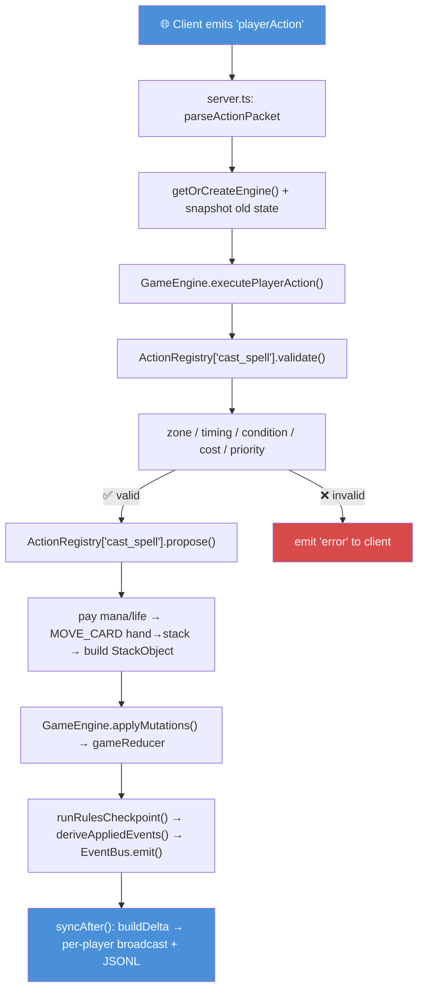
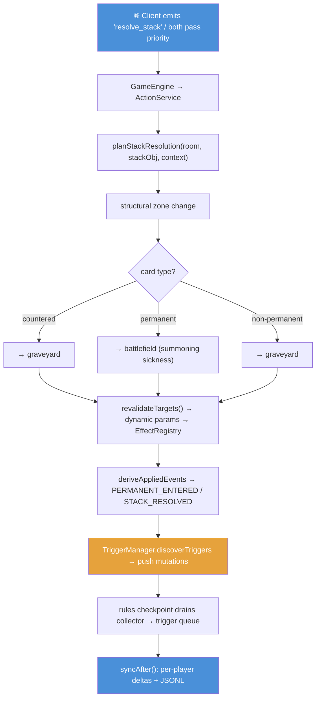
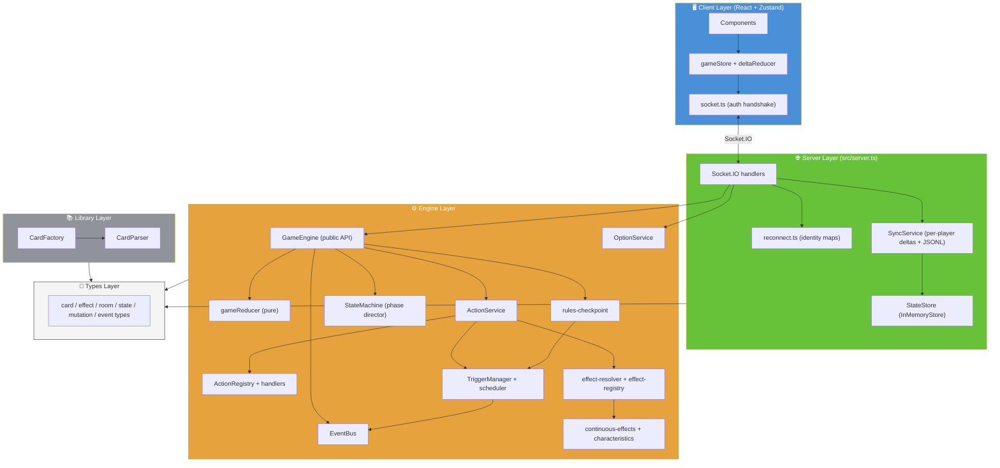

# Card Game Architecture Documentation (TypeScript)

**Date:** 2026-10-12
**Status:** Current

> This document describes the **active TypeScript application** (`src/`). The `legacy/`
> directory holds the deprecated pre-refactor prototype (see §12).
> For the latest rules-fidelity assessment and known defects, see
> [`docs/project-status-2026-10-07.md`](docs/project-status-2026-10-07.md) and
> [`docs/implementation-plan-2026-10-07.md`](docs/implementation-plan-2026-10-07.md).
>
> **Looking for where a concept lives or how a flow runs?** Start with the
> [concept map](docs/MAP.md) — it indexes every subsystem by entry point, location, and
> ownership, and traces the end-to-end flows. This document is the deep per-type reference.

---

## 1. Overview

A two-player, MTG-inspired card game built with TypeScript, Express, and Socket.IO, with a
React + Zustand client. The architecture follows a strict layered design:
**Types → Library → Engine → Server → Client**. The engine has zero knowledge of sockets or
HTTP — `src/server.ts` is the sole translation layer between network events and engine calls.

**Tech stack:** TypeScript 6.0, Express 4.21, Socket.IO 4.8, React 19, Zustand 5, Vite 8,
Vitest 4.1 (testing), UUID 11.0. Node `^20.19.0 || >=22.12.0`.

**Key design principles:**

- **Immutable reducer core.** Handlers are pure: they produce `GameMutation[]` and never mutate
  state. `GameEngine.applyMutations()` sequences each mutation through the pure `gameReducer`,
  which returns a **new `GameRoom`** (structural sharing along the changed path).
- **`GameEngine` is the single public API.** `server.ts` talks only to it; it owns and
  coordinates `EventBus`, `StateMachine`, `ActionService`, and an action registry internally.
- **Actions follow a 3-phase lifecycle:** validate → propose → resolve. Handlers return
  mutations; the engine commits them.
- **Events are derived, not hand-emitted.** After a batch commits, `deriveAppliedEvents()`
  produces canonical game events from the before/after state diff. `EventBus` dispatches them;
  `TriggerManager` discovers triggers and pushes new mutations into a collector.
- **State changes produce deltas** — per-player filtered `StateDelta`s are sent to clients and
  appended to a JSONL log for replay/debugging.
- **Stable player identity.** The server uses a client-generated stable `playerId` (not
  `socket.id`) so a refresh/reconnect rejoins the same seat.

### 1.1 Functional Game Flows

| Flow | Status | Description |
|---|---|---|
| Room lifecycle | ✅ Full | Create room, join room, RPS mini-game, deal starting hands |
| Turn structure | ✅ Full | Ordered phases (see §3.5): TurnStart → Upkeep → Draw → Main → BeginCombat → DeclareAttackers → DeclareBlockers → CombatDamage → EndCombat → PostcombatMain → End → Cleanup → next turn |
| Play card (cast spell) | ✅ Full | Validate → pay costs → hand→stack → resolve → battlefield/graveyard |
| Play land | ✅ Full | Land special action (CR 305.1): validate → hand→battlefield directly; **does not use the stack**; enforces one land per turn |
| Attack / block | ✅ Full | Declare attackers/blockers (turn-based actions, not on the stack) → combat damage step with damage assignment |
| Tap for mana | ✅ Full | Validate → tap permanent → add mana (mana ability; does NOT use the stack) |
| Stack resolution | ✅ Full | LIFO pop → structural zone change → revalidate targets → dynamic params → dispatch effects → ETB triggers |
| Triggered abilities | ✅ Full | Battlefield discovery + event-card scan; pending-trigger records; triggering event carried onto the stack object; APNAP-style scheduling |
| Priority system | ✅ Full | Active player → opponent → both pass → resolve stack / advance phase |
| State sync | ✅ Full | Mutation-derived, per-player filtered `StateDelta` → Socket.IO emit + JSONL log |
| Reconnect | ✅ Full | Stable player id, identity remap, 30s grace timer, rejoin snapshot |
| Targeting | ✅ Full | Client selection, cast-time validation, resolve-time revalidation, multi-target groups |
| Continuous effects | ✅ Full | Global `continuousEffectPool`, characteristic layers, `STAT_DELTA`/counters, end-of-turn cleanup |
| State-based actions | ✅ Full | Lethal damage, nonpositive life, poison, failed draw; terminal win/draw outcome |
| Replacement effects | ✅ Full | `replacementEffects` registry + pending-choice transactions |
| Countering | ✅ Full | `countered` flag on `StackObject` → skips effects, sends to graveyard |

### 1.2 Stubs & Known Gaps

See [`docs/project-status-2026-10-07.md`](docs/project-status-2026-10-07.md) for the full,
evidence-backed defect list. Highlights:

| Area | Status | Description |
|---|---|---|
| `ModifierRegistry` / `ModifierPipeline` | 🔶 Stub | Permission checks always pass; value transforms return input unchanged. Superseded in practice by the continuous-effect pool + characteristic service |
| Generic activated abilities | 🔶 Partial | `activate_ability` handler exists; action IDs identify effects rather than distinct abilities |
| Mana payment model | 🔶 Partial | Numeric costs treated as colorless; no generic-vs-colorless payment choice |
| Private snapshot projection | ❌ Deferred | Full `roomSnapshot` is not redacted (opponent hand/deck visible in snapshots) |
| Persistence | 🔶 In-memory | `InMemoryStore` only; Mongoose is a dependency with no active integration |
| Content | 🔶 Prototype | Nine card definitions; no graveyard/attachment/token cards |

---

## 2. Directory Map

```
src/
├── server.ts                          # Express + Socket.IO entry point; wires GameEngine to network
├── config.ts                          # gameConfig: setup, debug mode, logging, feature flags
├── types/                             # Pure type definitions — no runtime code
│   ├── card.types.ts                  # CardBlueprint, CardInstance, CardState, abilities, ManaColor
│   ├── effect.types.ts                # StackObject, StackEffect, ActionCost, TargetPointer, EffectDefinition
│   ├── game.player.types.ts           # PlayerState, ManaPool
│   ├── game.room.types.ts             # GameRoom — the central aggregate
│   ├── game.state.types.ts            # TURN_SEQUENCE, Phase union, GameStatus union
│   ├── game-mutation.types.ts         # GameMutation discriminated union (the reducer's input)
│   ├── game-event.types.ts            # AppliedEventBatch, CommandContext, ResolutionReport
│   ├── action.ids.ts                  # ACTION_IDS closed set + labels
│   ├── choice.types.ts                # PendingChoice + continuations
│   ├── combat.types.ts                # CombatDeclaration, CombatDamageState
│   ├── continuous-effect.types.ts     # ContinuousEffectEntry, layers
│   ├── damage.types.ts                # DamageAssignment
│   ├── delta.types.ts                 # StateDelta, DeltaChange
│   ├── trigger.types.ts               # TriggerQueue, DelayedTrigger, TurnHistory
│   ├── proposed-event.types.ts        # ReplacementDefinition
│   ├── rule.types.ts / state-based.types.ts / numeric-value.types.ts / operation-outcome.types.ts
│   └── debug-mode.types.ts
├── library/                           # Card data loading and instantiation
│   ├── card_data.json                 # Raw card definitions (the active data file)
│   ├── card-parser.ts                 # Raw JSON → typed CardBlueprint (normalization)
│   └── card-factory.ts                # Blueprint cache + CardInstance factory (deep-clone, UUID)
├── engine/                            # Core game logic — no socket/HTTP knowledge
│   ├── game-engine.ts                 # Unified public API: owns EventBus, StateMachine, ActionService
│   ├── game-reducer.ts                # Pure (state, mutation) → newState; reduceGameOperation
│   ├── action-service.ts              # Internal orchestrator: validate → propose → resolve stack
│   ├── action-registry.ts             # ActionHandler interface + immutable ActionRegistry
│   ├── default-action-registry.ts     # Assembles the built-in action handlers
│   ├── action-validator.ts            # Static pure validation: canActivate, canPayCost, canMeetCondition
│   ├── player-commands.ts             # Orchestration command table (enter_battle, end_turn, …)
│   ├── state-machine.ts               # Phase director: turn phases, priority, stack; returns mutations
│   ├── event-bus.ts                   # In-memory pub/sub, room-scoped
│   ├── applied-events.ts              # deriveAppliedEvents: before/after diff → canonical events
│   ├── rules-checkpoint.ts            # Settles SBAs and schedules triggers between batches
│   ├── effect-registry.ts             # Primitive effect handlers (return GameMutation[])
│   ├── resolution-planning.ts          # Pure effect construction, target revalidation, dynamic params
│   ├── effect-resolver.ts             # planStackResolution: ordered orchestration and structural moves
│   ├── effect-context.ts              # Injected RNG/clock/etc. (EffectContext)
│   ├── trigger-manager.ts             # Event listener → discoverTriggers → push mutations
│   ├── trigger-matching.ts            # Event → trigger predicate matching
│   ├── trigger-scheduler.ts           # APNAP ordering + trigger queue choices
│   ├── continuous-effect-state.ts     # Read-only card/source/lifetime queries
│   ├── continuous-effects.ts          # Effect timestamps, sequence, normalization
│   ├── characteristic-layers.ts       # Layer ordering for characteristic resolution
│   ├── card-characteristic-service.ts # Effective P/T, keywords, types, controller
│   ├── numeric-values.ts / numeric-characteristics.ts / numeric-definitions.ts
│   ├── combat-service.ts / combat-rules.ts / combat-state.ts
│   ├── damage-service.ts / damage-keywords.ts
│   ├── state-based-actions.ts / state-based-planner.ts
│   ├── replacement-rules.ts / proposed-events.ts
│   ├── choices.ts / action-choices.ts / resolution-choices.ts
│   ├── source-information.ts          # Last-known information snapshots
│   ├── zone-transitions.ts            # Centralized MOVE_CARD validation + application
│   ├── mana-pool.ts / mana-abilities.ts
│   ├── option-service.ts              # Computes available actions for a card in a zone
│   ├── room-factory.ts                # createRoom, joinRoom, setupRPS, resolveRPS, buildStartingCardMutations
│   ├── turn-history.ts / library-operations.ts / card-utils.ts
│   ├── modifier-pipeline.ts           # Stub: value-transformation modifier chain
│   ├── modifier-registry.ts           # Stub: permission-check modifiers
│   └── handlers/                      # One file per registered action
│       ├── play-card-handler.ts       # cast_spell
│       ├── play-land-handler.ts       # play_land (land special action; no stack)
│       ├── activate-ability-handler.ts# activate_ability
│       ├── tap-for-mana-handler.ts    # tapForMana (no stack)
│       ├── declare-attackers-handler.ts
│       ├── declare-blockers-handler.ts
│       ├── enter-battle-handler.ts    # enter_battle
│       ├── end-turn-handler.ts        # end_turn (skip-to-end)
│       ├── pass-priority-handler.ts   # pass_priority
│       ├── resolve-stack-handler.ts   # resolve_stack (debug)
│       └── rps-play-handler.ts        # rpsPlay
├── server/                            # Persistence, sync, reconnect
│   ├── state-store.ts                 # StateStore interface + InMemoryStore (Map-based)
│   ├── sync-service.ts                # Mutation-derived deltas, per-player filtering, JSONL logging
│   ├── reconnect.ts                   # Pure identity-map + rejoin-decision logic
│   └── action-packet.ts               # parseActionPacket: flat socket packet → { roomId, actionId, data }
├── shared/                            # Code shared by engine and client
│   ├── game-logger.ts                 # Structured logger (engineLogger, serverLogger)
│   ├── target-legality.ts / target-utils.ts
│   ├── action-modes.ts / action-permissions.ts
│   ├── action-cost-description.ts     # Human-readable cost descriptions
│   ├── choice-diagnostics.ts          # Compact choice metadata for send/receipt logging
│   ├── protection.ts / rule-path.ts / state-value.ts / turn-utils.ts
└── client/                            # React + Zustand client
    ├── main.tsx / App.tsx / index.html / style.css
    ├── session.ts                     # Stable playerId + roomId in sessionStorage
    ├── socket.ts                      # Socket.IO client with auth handshake
    ├── targeting.ts
    ├── card-label.ts                  # Battlefield card label helper
    ├── stack-description.ts           # Human-readable stack object descriptions
    ├── store/
    │   ├── gameStore.ts               # Zustand store (room, UI state, actions)
    │   ├── deltaReducer.ts            # Applies StateDelta changes to the store
    │   └── combatSelection.ts         # Client-side combat selection slice
    ├── hooks/
    │   ├── useSocket.ts               # Wires socket events → store
    │   └── useGameActions.ts          # Emits player actions
    └── components/                    # GameScreen, Battlefield, Hand, StackDisplay, PhaseBar,
                                       #   CombatDisplay, TargetSelector, ChoicePanel, ContextMenu,
                                       #   CardComponent, GameLog, PlayerInfo, OpponentInfo,
                                       #   StartScreen, DebugControls
data/
└── deltas.jsonl                       # Append-only delta log (diagnostics/replay)
legacy/                                # Deprecated pre-refactor JS prototype (see §12)
notes/                                 # Reviews + scratch notes (non-production)
```

---

## 3. Layer 1: Types (`src/types/`)

The type layer defines the data model. Files form a clean dependency hierarchy with no circular
imports.

### 3.1 `card.types.ts` — Foundation

| Type | Purpose |
|---|---|
| `ManaColor`, `ManaCost` | Mana system primitives |
| `CardType`, `CardSubType`, `CardZone` | Card classification and location |
| `TriggerEvent` | Union of game events that trigger abilities (`ON_ENTER_BATTLEFIELD`, `ON_DIE`, …) |
| `ActivatedAbility` / `TriggeredAbility` | Discriminated union; both carry an `EffectDefinition` |
| `CardBlueprint` | Static card definition (id, name, types, cost, abilities, effects) |
| `CardState` | Runtime mutable state (zone, tapped, damage, counters, summoning sickness, zoneRevision) |
| `CardInstance` | `CardBlueprint` + `uuid` + `CardState` — the runtime card object |
| `ContinuousEffectEntry` | A pool entry (source, effect, timestamps, duration) |

### 3.2 `effect.types.ts` — Stack & Action System

| Type | Purpose |
|---|---|
| `ActionType`, `EffectId` | Registry key types (open strings) |
| `ActionSpeed`, `StackItemType`, `TargetType` | Speed/stack/target enums |
| `ActionCost` | Resource costs (mana, tap, life, discard, sacrifice) |
| `ActionCondition` / `ActionRequirements` | State conditions + combined cost/zone/speed rules |
| `TargetPointer` | Flexible target reference (player, card, permanent, stack, zone) |
| `TargetingDefinition` / `TargetGroupDefinition` | Card-data targeting (incl. filter-based `all`) |
| `EffectDefinition` | Card-data-level effect (action + params + targeting + tags) |
| `StackEffect` | Resolve-time effect with locked targets and dynamic params |
| `StackObject` | A stack item: spell/activated/triggered with source card and effects array |
| `TriggeringEvent` | `{ eventId, payload }` carried onto triggered stack objects |
| `CombatDeclaration` | A declared attacker with its blockers |

### 3.3 `game.player.types.ts` — Player State

`PlayerState` (id, life, poison, `ManaPool`, deck/hand/graveyard/exile arrays, failedDraw).

### 3.4 `game.room.types.ts` — Central Aggregate

`GameRoom` composes all other types into the game state root:

```
GameRoom {
    roomId, player1Id, player2Id
    players: Record<PlayerId, PlayerState>   // all player data
    phase: Phase                             // turn clock (TURN_SEQUENCE)
    status: GameStatus                       // 'waiting' | 'RPS' | 'playing' | 'gameOver'
    engineState: 'waiting_for_player' | 'resolving_stack' | 'state_based_actions' | 'game_over'
    activeTurnPlayerId, priorityPlayerId, lastPassedPlayerId
    stack: StackObject[]                     // a ZONE, not a phase
    battlefield: CardInstance[]
    combat: CombatDeclaration[]
    combatDeclarations?, combatDamage?
    continuousEffectPool: ContinuousEffectEntry[]
    replacementEffects?, delayedTriggers?, turnHistory?, triggerQueue?
    pendingChoice?, pendingTriggers?
    effectTimestamp?, effectSequence?, turnNumber?, outcome?
    rpsState: { status, playedCards }
}
```

> **Note:** `phase` (turn clock) and `status` (game-level) are **orthogonal**. `engineState`
> disambiguates why `priorityPlayerId` may be `null`. The stack is a **zone**, not a phase.

### 3.5 `game.state.types.ts` — Turn Sequence

```ts
export const TURN_SEQUENCE = [
  'stateTurnStart', 'upkeepStep', 'stateDrawPhase', 'stateMainPhase',
  'beginCombatStep', 'declareAttackersStep', 'declareBlockersStep',
  'combatDamageStep', 'endCombatStep', 'postcombatMainPhase',
  'stateEndPhase', 'cleanupStep',
] as const;
export type Phase = typeof TURN_SEQUENCE[number];
export type GameStatus = 'waiting' | 'RPS' | 'playing' | 'gameOver';
```

### 3.6 `game-mutation.types.ts` — The Reducer's Input

`GameMutation` is a discriminated union of every state change the engine can apply
(`MOVE_CARD`, `CHANGE_LIFE`, `MARK_DAMAGE`, `DESTROY_CARD`, `PUSH_STACK`, `SET_PRIORITY`,
`SET_ENGINE_STATE`, `SET_PENDING_CHOICE`, `ADD_CONTINUOUS_EFFECT`, `SET_TURN_HISTORY`, …).
Handlers and the phase director produce these; only `gameReducer` consumes them.

---

## 4. Layer 2: Library (`src/library/`)

Bridges raw JSON card data to typed runtime instances.

### 4.1 `card-parser.ts`

Pure normalization functions: `normalizeActionCost()`, `normalizeEffect()`, `normalizeAbility()`
(builds an `EffectDefinition` from legacy `effectId`/`params`), `normalizeCard()` (throws on
missing `id`), `parseAll()`.

### 4.2 `card-factory.ts`

- `getBlueprint()` — parses once, caches in `blueprintCache`
- `instantiateCard()` — deep-clones a blueprint into a `CardInstance` with a fresh UUID and
  default `CardState`.

> **Gotcha:** `instantiateCard()` returns instances that **share** the cached blueprint. Never
> mutate `card.blueprint` in tests — clone it (`{ ...card.blueprint, ... }`) instead.

**Data flow:** `card_data.json` → `card-parser.ts` → `CardBlueprint` (cached) → `card-factory.ts`
→ `CardInstance` (runtime).

---

## 5. Layer 3: Engine (`src/engine/`)

The core game logic. All engine files work with plain TypeScript types — no socket, HTTP, or I/O
knowledge. Non-determinism (UUIDs, RNG, clock) is injected via `EffectContext` at the engine
boundary.

### 5.1 Orchestration & Lifecycle

#### `game-engine.ts` — Unified Public API

The single entry point for all engine operations. `GameEngine` owns and coordinates:

- `EventBus` — created per room in the constructor
- `StateMachine` — phase/turn/priority director (returns mutations)
- `ActionService` — action pipeline and stack resolution
- `ActionRegistry` — an engine-owned registry; the default is assembled by
  `createDefaultActionRegistry()` and callers may supply a local registry to the constructor
- `mutationCollector` — shared array that `TriggerManager` pushes into during event dispatch

**Mutation pipeline:**

1. Handlers produce `GameMutation[]` (pure, no side effects).
2. `applyMutations()` sequences each through `reduceGameOperation` (the pure reducer).
3. `runRulesCheckpoint()` settles state-based actions and schedules discovered triggers.
4. `deriveAppliedEvents()` produces canonical events from the before/after diff; `EventBus`
   dispatches them; listeners enqueue further mutations into the collector, which are drained in
   a loop until empty.

Key methods:

- `executePlayerAction(playerId, actionId, data)` → `ActionResult` — **the player-command
  boundary** (validates room slot, terminal state, payload shape, status, readiness, debug mode).
- `handleAction()` / `proposeAndStack()` — lower-level rules/test primitives.
- `applyMutations(mutations, resolution?, cause?)` → `GameMutation[]` — commit + checkpoint.
- `advancePhase(mode)` / `givePriorityTo()` / `passPriority()` — phase/priority delegation.
- `initRoom()` / `dispose()` — wire/tear down the per-room `TriggerManager`.
- `roomState` — **read this after any mutation** (the reducer reassigns `this.room`).
- `drainEventBatches()` — consume committed `AppliedEventBatch[]` for delta emission.

> **Critical rule:** `applyMutations` reassigns `engine.room` to a **new object**. Any local
> `const room = getRoom(...)` reference goes stale after an engine mutation. Always read back via
> `engine.roomState`.

#### `game-reducer.ts` — Pure Reducer

`gameReducer(state, mutation) → GameRoom` and `reduceGameOperation(state, mutation) →
OperationOutcome` (`committed` | `unchanged` | `rejected`). Returns a new `GameRoom` with shallow
copies along the changed path; untouched subtrees are shared by reference. Also reconciles combat
and resolves characteristics after characteristic-affecting mutations.

Damage ownership follows the same boundary: `damage-service.ts` owns rule hooks, assignment
validation, and damage planning, while `reduceDamageBatch()` in `game-reducer.ts` owns atomic
application of the resulting mutations. Replacement previews use that reducer-owned helper, so
damage planning never imports the authoritative reducer.

#### `action-service.ts` — Internal Action Orchestrator

Internal delegate used by `GameEngine`. Routes actions to `ActionRegistry` (validate → propose),
manages stack resolution via `planStackResolution()`, and wires the per-room `TriggerManager`.
Pure with respect to `GameRoom`: it returns mutations to the engine.

#### `state-machine.ts` — Phase Director

Pure with respect to `GameRoom`: every method receives the current room snapshot and returns
`GameMutation[]`. Reads/writes `room.phase`, `room.activeTurnPlayerId`, `room.priorityPlayerId`,
`room.lastPassedPlayerId`, and `room.stack`.

- `advancePhase(room, 'complete' | 'skipToEnd')` — auto-advances through `AUTO_PHASES`
  (`stateTurnStart`, `cleanupStep`), stops at the first phase needing input, and gives priority.
- `defaultPriorityFor(phase, room)` — declaration steps await a turn-based decision (null
  priority); response windows belong to the active player.
- `passPriority` — stack > 0 + both passed → `resolving_stack`; stack == 0 + both passed →
  `advancePhase('complete')`.
- `addToStack` — no phase change; emits `STACK_UPDATED` and gives priority to the controller
  (MTG 116.3d).
- `nextInTurn` wraps `cleanupStep` → `stateTurnStart`; `switchTurn` runs **before** untap.

> **MTG 116.4:** after stack resolution the phase does **not** change; the active player gets
> priority in the same phase.

### 5.2 Action Pipeline

#### `action-registry.ts` — Handler Interface & Registry

```
validate(room, playerId, action) → ActionResult  // permission checks, cost validation
propose(room, playerId, action)  → ActionResult  // pay costs, create StackObject, push to stack
resolve(room, stackObj)          → ActionResult  // apply effects via EffectRegistry
```

`ActionRegistry` is an immutable mapping of `ActionType` to `ActionHandler`. The built-in mapping
is assembled by `createDefaultActionRegistry()` in `default-action-registry.ts`, and every
`GameEngine` owns its own instance. The known set of player actions is the closed `ActionId` union
in `src/types/action.ids.ts`; the default factory covers every built-in handler. Transport code
constructs engines without importing concrete rule handlers. See [`docs/action-ids.md`](docs/action-ids.md).

#### `player-commands.ts` — Orchestration Command Table

A small table of commands that are not ordinary card actions (`enter_battle`, `end_turn`, …).
Each entry declares a required `status`, optional `debug` mode, a `validate(data)` shape check,
and an `execute(engine, playerId, data)`. `executePlayerAction` consults this table before falling
back to `ActionRegistry`.

#### `action-validator.ts` — Pure Validation

Static utility class with no side effects: `canActivate()` (zone → timing → condition → cost →
priority), `canMeetCondition()`, `canPayCost()` (mana via `ManaPool.canPay()`, life, tap, discard).

#### `handlers/` — One File per Action

| Handler | Action ID | Notes |
|---|---|---|
| `play-card-handler.ts` | `cast_spell` | Pay mana/life, move hand→stack (cost), build `StackObject` |
| `play-land-handler.ts` | `play_land` | Land special action: hand→battlefield directly; **no stack**; one land per turn |
| `activate-ability-handler.ts` | `activate_ability` | Selected blueprint ability ID |
| `tap-for-mana-handler.ts` | `tapForMana` | Tap permanent, add mana; **no stack** (mana ability) |
| `declare-attackers-handler.ts` | `declare_attackers` | Turn-based action; then advance |
| `declare-blockers-handler.ts` | `declare_blockers` | Turn-based action; then advance |
| `enter-battle-handler.ts` | `enter_battle` | Main → combat, stops at `beginCombatStep` |
| `end-turn-handler.ts` | `end_turn` | Skip-to-end (`advancePhase('skipToEnd')`) |
| `pass-priority-handler.ts` | `pass_priority` | Priority pipeline |
| `resolve-stack-handler.ts` | `resolve_stack` | Debug resolution through the normal pipeline |
| `rps-play-handler.ts` | `rpsPlay` | RPS mini-game; server finishes deck setup |

**Cost vs effect zone changes:** the hand→stack move in `propose()` is a *cost* (immediate,
uncounterable). The stack→battlefield/graveyard move at resolution is a *structural game rule*.

### 5.3 Effect Resolution

#### `effect-registry.ts` — Primitive Handlers

Maps primitive names to `(room, stackObj, effect, context) => GameMutation[]`. Primitives include
`MOVE_ZONE`, `MODIFY_LIFE`, `MODIFY_STATS`, `ADD_COUNTER`/`REMOVE_COUNTER`, `TAP`/`UNTAP`,
`DRAW`, `ADD_MANA`, `DISCARD_HAND`, `SHUFFLE`, `REORDER_LIBRARY`, `GRANT_STATS`, and more. Also
contains zone utility helpers (`findCardOnBattlefield`, `findCardInZone`, …).

#### `resolution-planning.ts` — Pure Resolution Primitives

Owns `buildStackEffects()`, `revalidateTargets()`, and `buildDynamicParams()`. These functions build
resolve-time values from a room snapshot but do not advance the resolution cursor or commit state.
`effect-resolver.ts` re-exports them for compatibility with existing consumers.

#### `effect-resolver.ts` — Resolution Pipeline

`planStackResolution()` orchestrates a `StackObject`'s resolution:

1. Evaluate intervening conditions and whole-object target/fizzle state.
2. Expand bounded reveal instructions or pause for a serializable resolution choice.
3. Revalidate each effect's targets and compute dynamic params through `resolution-planning.ts`.
4. Dispatch each effect to `EffectRegistry`, plan replacements/outcomes, and advance the working
   room in order.
5. Apply the structural zone change: permanents → battlefield, non-permanents/countered spells →
   graveyard; activated and triggered sources remain in place.
6. Return the resolution report used to derive `PERMANENT_ENTERED` / `STACK_RESOLVED` events.

#### `trigger-manager.ts` — Triggered Abilities

Created per-room by `ActionService.initRoom()`. Listens on the room's `EventBus` and separates
read-only discovery from stack insertion:

- `discoverTriggers(event, context): PendingTrigger[]` — pure, read-only. Scans battlefield
  permanents (watchers) plus the event card (deduped by uuid), fixing both self-triggers and
  "whenever another creature enters" watchers.
- `EVENT_MAP` maps event ids → `{ triggerEvent, scanBattlefield, includeEventCard }` for
  `PERMANENT_ENTERED`, `PERMANENT_LEFT`, `PERMANENT_DIED`, `ATTACK_DECLARED`, `DAMAGE_TAKEN`,
  `TURN_STARTED`, `LIFE_CHANGED`.
- The constructor takes `(eventBus, collector, generateUuid, getRoom)` — `getRoom` is a getter
  because the engine reassigns `room` after each mutation.
- `dispose(eventBus)` unregisters every listener; called by `ActionService.destroyRoom()`.

Trigger scheduling (APNAP ordering, trigger-queue choices) lives in `trigger-scheduler.ts`;
predicate matching in `trigger-matching.ts`.

### 5.4 Support Services

#### `event-bus.ts` — Pub/Sub

Room-scoped in-memory event bus (`emit`, `on`, `off`). Events carry an `EventContext`
(`{ before, after, command }`) so listeners can inspect the state around each event.

#### `applied-events.ts` — Event Derivation

`deriveAppliedEvents(before, after, steps, resolution, onContext)` produces canonical game events
from the before/after diff of each committed mutation. This is why handlers never hand-emit
events — events are a projection of state change.

#### `rules-checkpoint.ts` — SBA + Trigger Settlement

`runRulesCheckpoint()` settles state-based actions and schedules discovered triggers between
mutation batches, looping until no further work remains (or a choice is pending).

#### `option-service.ts` — Action Options

Computes available actions for a card in a zone (`hand` or `battlefield`): "Play Card", "Tap for
Mana", "Attack", and activated abilities. Returns `ActionOption[]` with `disabled` /
`disabledReason` for the client UI.

#### `room-factory.ts` — Room Factory

Exported functions: `createRoom(roomId, player1Id)`, `joinRoom(room, player2Id)`,
`setupRPS(room)`, `resolveRPS(room)`, `buildStartingCardMutations(room)`.

#### `mana-pool.ts` — Centralized Mana Operations

All mana arithmetic routes through a single namespace: `canPay`, `add`, `spend`, `drain`,
`isPureAbility`, `validManaAmounts`. The pool itself remains a plain `Record<ManaColor, number>`
on `PlayerState`.

#### Characteristic and continuous-effect ownership

The characteristic system resolves effective P/T, keywords, types, and controller from the
`continuousEffectPool` using layer ordering. `card-characteristic-service.ts` is the public
read-only facade, and `characteristic-layers.ts` owns whole-board layer and dependency evaluation.
`continuous-effect-state.ts` owns read-only room-card enumeration, source lookup, and effect
lifetime checks. `continuous-effects.ts` owns effect timestamps, sequence allocation, and entry
normalization; it re-exports the state queries for compatibility. `numeric-values.ts` handles
dynamic numeric values.

#### `modifier-pipeline.ts` / `modifier-registry.ts` — Stubs

Intended for value-transformation and permission-check modifiers. Currently no-ops; the
continuous-effect pool + characteristic service cover most of this ground in practice.

---

## 6. Layer 4: Server (`src/server/`)

### 6.1 `state-store.ts` — Persistence

`StateStore` interface with `InMemoryStore` (backed by `Map<string, GameRoom>`). Designed for a
future Redis swap via the same interface.

### 6.2 `sync-service.ts` — Client Sync

Builds a `StateDelta` from the mutations an engine operation applied, **filters it per player**
(opponent hand/deck redaction), broadcasts to each player's current socket, and appends to
`data/deltas.jsonl`. Sequence-numbered per room. `broadcast(delta, room, resolveSocketId)` takes a
resolver because socket ids change on reconnect.

### 6.3 `reconnect.ts` — Identity & Rejoin

Pure, testable logic: `createIdentityMaps`, `resolvePlayerId`, `resolveSocketId`, `bindSocket`
(cleans the stale socket link on rebind), `unbindSocket`, `unbindRoom`, `decideRejoin`
(rejoin / `rejoin_failed` with reason `room_destroyed` | `not_a_member`).

### 6.4 `action-packet.ts` — Packet Parsing

`parseActionPacket(input)` extracts `{ roomId, actionId, data }` from the flat socket packet,
dropping `playerId`/`socketId` (the actor is derived from the socket binding, never trusted from
the payload).

---

## 7. Entry Point: `src/server.ts`

Express + Socket.IO wiring. The only file with socket or HTTP knowledge.

**Per-room engine instances** (created lazily via `getOrCreateEngine()` /
`replaceRoomEngine()`): one `GameEngine` per room, plus a singleton `OptionService`.

**Action composition:** transport code constructs `GameEngine` without importing concrete action
handlers. Each engine receives a fresh registry from `createDefaultActionRegistry()` unless a
caller explicitly supplies a local registry; the factory's typed handler map keeps built-in action
coverage compiler-checked.

**Socket events handled:**

| Event | Handler |
|---|---|
| `connection` | Read `auth` handshake; if room exists + member → rejoin (bind, join, cancel destroy timer, emit `rejoined` + `roomSnapshot`); else `rejoinFailed` |
| `createRoom` | Create room, `replaceRoomEngine`, emit `roomCreated` + `roomSnapshot` |
| `joinRoom` | Add player 2, `replaceRoomEngine`, `setupRPS`, `SET_STATUS 'RPS'`, emit `startGame` / `rpsPhase` / `roomSnapshot` |
| `playerAction` | Parse packet → `engine.executePlayerAction()`; on RPS resolution, finish deck setup + `advancePhase('complete')`; sync |
| `getOptions` | Delegate to `OptionService`, emit `optionsForCard` (and callback) |
| `disconnect` | Unbind socket; destroy immediately if pre-game and other player gone, else schedule a 30s grace timer |

**Sync pattern (every mutating event):**

1. `JSON.parse(JSON.stringify(room))` — snapshot old state for the diff
2. `engine.executePlayerAction(...)` — applies mutations (reassigns `engine.room`)
3. `saveRoom(engine.roomState)` — persist to `StateStore`
4. `syncAfter(oldState, currentRoom, mutations, action, playerId, engine.drainEventBatches())` —
   build + broadcast per-player deltas, append to JSONL

**Room lifecycle:** `destroyRoom(roomId)` disposes the engine, removes it from the `engines` map
and the store, unbinds identity, and emits `roomDestroyed`. `scheduleDestroy` /
`cancelScheduledDestroy` manage the 30s grace timer. The HTTP server `close` handler cancels
timers and disposes engines.

---

## 8. Data Flow: Play Card End-to-End

### 8.1 Propose Phase (Client → Stack)



### 8.2 Resolve Phase (Stack → Battlefield)



### 8.3 Full System Architecture



---

## 9. Client (`src/client/`)

React 19 + Zustand 5, bundled by Vite.

- **`session.ts`** — `getOrCreatePlayerId()` (sessionStorage `cardgame.playerId`),
  `getStoredRoomId()` / `setStoredRoomId()` / `clearStoredRoomId()`. Uses **sessionStorage**
  (per-tab) so two tabs are two players.
- **`socket.ts`** — `io({ autoConnect: true, auth: (cb) => cb({ playerId, roomId }) })`. The auth
  function is re-evaluated on every connection attempt, including auto-reconnect.
- **`store/gameStore.ts`** — the Zustand store: server-authoritative `room`, plus client-only UI
  state (context menu, targeting, pending card, error, log, combat selection). Actions include
  `applyDelta`, `setRoom`, `beginTargeting`, `addTarget`, `clearSession`, etc.
- **`store/deltaReducer.ts`** — applies `StateDelta` changes to the store.
- **`store/combatSelection.ts`** — client-side combat selection slice.
- **`hooks/useSocket.ts`** — wires socket events (`roomSnapshot`, `stateDelta`, `rejoined`,
  `rejoinFailed`, `roomDestroyed`, …) into the store; sets `myPlayerId` from the stable id.
- **`hooks/useGameActions.ts`** — emits player actions.
- **`components/`** — `GameScreen`, `Battlefield`, `Hand`, `StackDisplay`, `PhaseBar`,
  `CombatDisplay`, `TargetSelector`, `ChoicePanel`, `ContextMenu`, `CardComponent`, `GameLog`,
  `PlayerInfo`, `OpponentInfo`, `StartScreen`, `DebugControls`.

> **Zustand v5 pitfall:** selectors that return a **new reference** each call (`.filter()`,
> `.map()`, `?? []`, `?? {}`) cause an infinite re-render loop (React error #185). Wrap them in
> `useShallow` from `zustand/react/shallow`.

---

## 10. Points of Interest

### 10.1 ✅ RESOLVED: Dual Orchestrators (`GameEngine` vs `ActionService`)

`GameEngine` is the unified public API; `ActionService` is an internal delegate. `server.ts` talks
only to `GameEngine`.

### 10.2 ✅ RESOLVED: Dual Stack State

`StateMachine` no longer maintains its own stack array — it reads/writes `room.stack` directly.

### 10.3 ✅ RESOLVED: StateMachine Owns Duplicate GameRoom Fields

`StateMachine` is now pure with respect to `GameRoom`: it receives a snapshot and returns
mutations. All state lives on `GameRoom`.

### 10.4 ✅ RESOLVED: `room-factory.ts` Uses Static-Only Class

Converted to exported functions.

### 10.5 ✅ RESOLVED: `TriggerManager` Lifecycle

`TriggerManager.dispose(eventBus)` unregisters all listeners; `ActionService.destroyRoom()` and
`GameEngine.dispose()` invoke it; `server.ts` destroys rooms on disconnect/close.

### 10.6 ✅ RESOLVED: `destroyRoom()` / Room Cleanup

Room lifecycle cleanup is implemented end-to-end, including the 30s grace timer and HTTP-close
cleanup.

### 10.7 ✅ RESOLVED: Reducer-Based Mutation Pipeline

Handlers are pure and return `GameMutation[]`; `gameReducer` is the single state transition
function; events are derived from state diffs rather than hand-emitted.

### 10.8 ✅ RESOLVED: Reconnect Resilience

Stable player ids, identity remapping, rejoin snapshots, and grace timers are implemented.

### 10.9 🔶 OPEN: Stub Modifiers in the Critical Path

`ModifierRegistry` and `ModifierPipeline` remain no-ops. The continuous-effect pool and
characteristic service now cover most of the intended ground; decide whether to remove the stubs
or fold them into the characteristic system.

### 10.10 🔶 OPEN: `server.ts` Growing Responsibilities

`server.ts` mixes room lifecycle, RPS logic, turn management, and action routing. Consider
extracting socket handlers into `src/server/handlers/`.

### 10.11 🔶 OPEN: `ActionValidator` is All-Static

All methods are `public static`, which makes mocking/injection harder. Decide whether the pure
design is intentional.

### 10.12 🔶 OPEN: Private Snapshot Projection

Full `roomSnapshot` emissions are not redacted (opponent hand/deck visible). Delta redaction alone
cannot protect these cards. Tracked as deferred work (0.3).

### 10.13 🔶 OPEN: Rules Fidelity

Priority boundaries, combat arithmetic, mana payment, and continuous-effect lifetimes still have
gaps. See [`docs/project-status-2026-10-07.md`](docs/project-status-2026-10-07.md) for the
evidence-backed defect list and
[`docs/implementation-plan-2026-10-07.md`](docs/implementation-plan-2026-10-07.md) for the
dependency-ordered remediation plan.

---

## 11. Test Architecture

**1076 tests across 84 files** (all passing; one live-routing network test is occasionally
flaky). `npm test` runs Vitest 4.1 (globals enabled, Node environment).

```
tests/
├── engine/     # ~65 files — reducer, handlers, phases, combat, triggers, continuous effects,
│               #   state-based actions, replacement effects, choices, targeting, mana, etc.
├── client/     # gameStore, deltaReducer, combatSelection, pending choices, mana options, debug
├── server/     # state-store, sync-service, reconnect, action-packet, live-routing (real sockets)
├── shared/     # game-logger
└── helpers/    # test-room-factory: createTestRoom() standardized 2-player setup
```

**Key patterns:**

- `createTestRoom()` provides a standardized starting state; tests override specific fields.
- Default `GameEngine` fixtures receive the built-in registry automatically. Tests that customize
  routing create a local registry and pass it as the third constructor argument.
- `GameEngine` is the primary test interface. **Read `engine.roomState` after engine operations** —
  the original `room` reference is stale after a mutation batch.
- `instantiateCard()` shares a cached blueprint — clone `card.blueprint` before mutating it.
- Cards placed in deck/hand/graveyard must have `ownerId`/`controllerId` set, or `MOVE_CARD`
  mutations target the wrong player's zone.
- `tapForMana` returns mutations but does not apply them — call
  `engine.applyMutations(result.mutations)`.

**Verification commands:**

```powershell
npm test
npm run typecheck:server
npm run typecheck:client
npm run build
```

---

## 12. Relationship to Legacy JS Codebase

The `legacy/` directory holds the **deprecated pre-refactor prototype**: the root-level `.js`
files (`server.js`, `gameLogic.js`, `socketHandlers.js`, `stateMachine.js`, `library.js`,
`decks.js`, `effectHandler.js`, `stackItem.js`, `stackObject.js`, `cardParser.js`,
`dummy_card.js`, `testCardEffects.js`, `testStack.js`), the old `public/` frontend, the stale
`wrangler.jsonc` (points at the retired `public/` assets path), and `card_data.json.bak` (the
legacy card data backup). They are kept for reference only and are not used by the TypeScript
system. The active card data lives at `src/library/card_data.json`.

Key architectural changes from legacy JS to TypeScript:

| Concept | Legacy JS | TypeScript |
|---|---|---|
| Card effects | Inline functions with wrapper system | Declarative `EffectDefinition[]` → `StackEffect[]` |
| Effect execution | Collected effects + emits objects | `EffectRegistry` primitives returning `GameMutation[]` |
| State management | Global `rooms` object, in-place mutation | `StateStore` + pure `gameReducer` (immutable) |
| Events | Hand-emitted side effects | Derived from state diffs (`deriveAppliedEvents`) |
| Client sync | Direct socket emissions in handlers | `SyncService` with per-player filtered deltas |
| Socket coupling | Engine files import socket.io | Only `server.ts` knows about sockets |
| Targeting | Ad-hoc | `TargetPointer` with resolve-time revalidation |
| Stack | Simple array | `StackObject` with per-effect targets, countered flag, dynamic params |
| Identity | `socket.id` | Stable client-generated `playerId` + reconnect remap |
