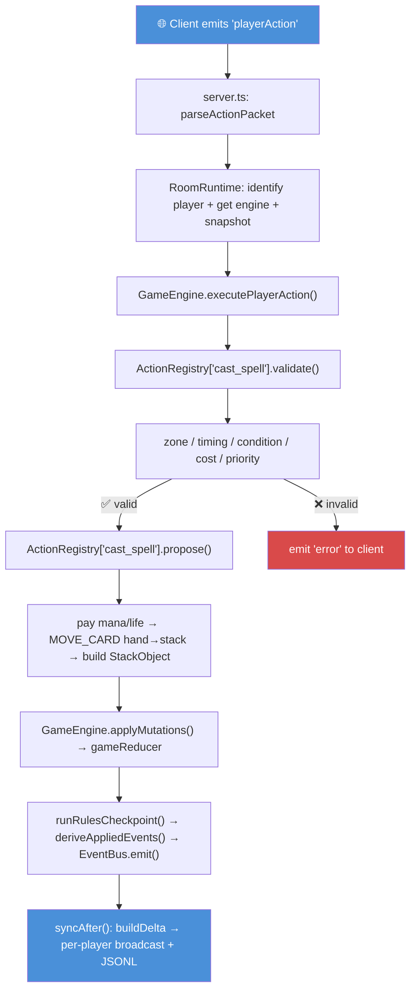
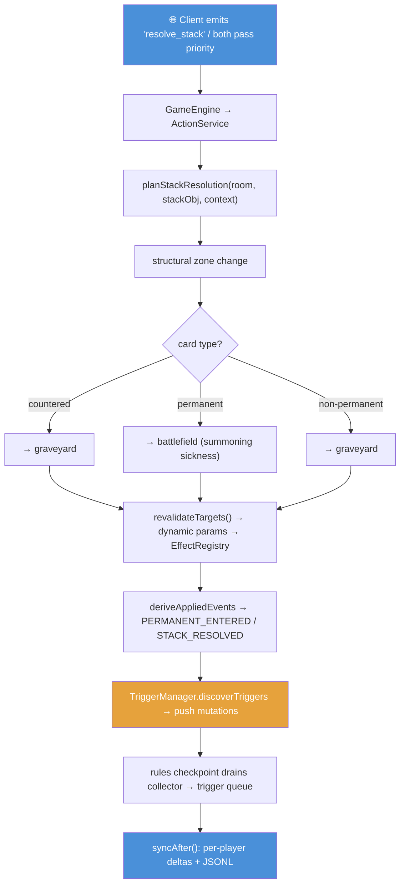
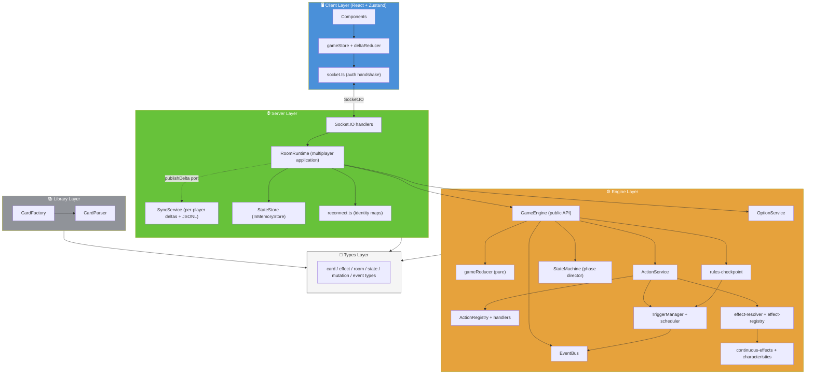

# Card Game Architecture Documentation (TypeScript)

**Date:** 2026-10-26
**Status:** Current

> This document describes the **active TypeScript application** (`apps/` and `packages/`) and is the canonical
> current-state architecture reference. Historical audits and interim notes remain separate;
> linked milestone reports record acceptance evidence for the current workspace and protocol boundaries.
>
> **Looking for where a concept lives or how a flow runs?** Start with the
> [concept map](docs/MAP.md) — it indexes every subsystem by entry point, location, and
> ownership, and traces the end-to-end flows. This document is the deep per-type reference.

---

## 1. Overview

A two-player, MTG-inspired card game built with TypeScript, Express, and Socket.IO, with a
React + Zustand client. The architecture follows a strict layered design:
**Types → Library → Engine → Server → Client**. The engine has zero knowledge of sockets or
HTTP — `apps/server/src/application.ts` translates network events into calls on the multiplayer `RoomRuntime`,
which coordinates engine, persistence, reconnect, and synchronization services.

**Tech stack:** TypeScript 6.0, Express 4.21, Socket.IO 4.8, React 19, Zustand 5, Vite 8,
Vitest 4.1 (testing), UUID 11.0. Node `^20.19.0 || >=22.12.0`.

**Key design principles:**

- **Immutable reducer core.** Handlers are pure: they produce `GameMutation[]` and never mutate
  state. `GameEngine.applyMutations()` sequences each mutation through the pure `gameReducer`,
  which returns a **new `GameRoom`** (structural sharing along the changed path).
- **`GameEngine` is the single public game API.** `RoomRuntime` talks to it; it owns and
  coordinates `EventBus`, `StateMachine`, `ActionService`, and an action registry internally.
- **Actions follow a 3-phase lifecycle:** validate → propose → resolve. Handlers return
  mutations; the engine commits them.
- **Events are derived, not hand-emitted.** After a batch commits, `deriveAppliedEvents()`
  produces canonical game events from the before/after state diff. `EventBus` dispatches them;
  `TriggerManager` discovers triggers and pushes new mutations into a collector.
- **Player state has an explicit protocol boundary.** Clients receive `PlayerView` snapshots and projected `ViewDelta`s. Raw `StateDelta`s remain in the server diagnostic/replay log.
- **Stable player identity.** The server uses a client-generated stable `playerId` (not
  `socket.id`) so a refresh/reconnect rejoins the same seat.

> For the full catalogue of design principles applied in this codebase — each with the mechanism,
> the rationale, and a source pointer — see
> [Software design principles](docs/design-principles.md).

### 1.1 Functional Game Flows

| Flow | Status | Description |
|---|---|---|
| Room lifecycle | ✅ Full | Create room, join room, RPS mini-game, deal starting hands |
| Turn structure | ✅ Full | Ordered phases (see §3.5): TurnStart → Upkeep → Draw → Main → BeginCombat → DeclareAttackers → DeclareBlockers → CombatDamage → EndCombat → PostcombatMain → End → Cleanup → next turn |
| Play card (cast spell) | ✅ Full | Validate → pay costs → hand→stack → resolve → battlefield/graveyard |
| Play land | ✅ Full | Land special action (CR 305.1): validate → hand→battlefield directly; **does not use the stack**; enforces one land per turn |
| Attack / block | ✅ Full | Declare attackers/blockers (turn-based actions, not on the stack) → combat damage step with damage assignment |
| Tap for mana | ✅ Full | Validate → tap permanent → add mana (mana ability; does NOT use the stack) |
| Stack resolution | ✅ Full | LIFO pop → structural zone change → revalidate targets → dynamic params → dispatch effects → ETB triggers |
| Triggered abilities | ✅ Full | Battlefield discovery + event-card scan; pending-trigger records; triggering event carried onto the stack object; APNAP-style scheduling |
| Priority system | ✅ Full | Active player → opponent → both pass → resolve stack / advance phase |
| State sync | ✅ Full | Mutation-derived, per-player filtered `StateDelta` → Socket.IO emit + JSONL log |
| Reconnect | ✅ Full | Stable player id, identity remap, 30s grace timer, rejoin snapshot |
| Targeting | ✅ Full | Client selection, cast-time validation, resolve-time revalidation, multi-target groups |
| Continuous effects | ✅ Full | Global `continuousEffectPool`, characteristic layers, `STAT_DELTA`/counters, end-of-turn cleanup |
| State-based actions | ✅ Full | Lethal damage, nonpositive life, poison, failed draw; terminal win/draw outcome |
| Replacement effects | ✅ Full | `replacementEffects` registry + pending-choice transactions |
| Countering | ✅ Full | `countered` flag on `StackObject` → skips effects, sends to graveyard |

### 1.2 Stubs & Known Gaps

Known product gaps outside the completed architecture modernization scope:

| Area | Status | Description |
|---|---|---|
| `ModifierRegistry` / `ModifierPipeline` | 🔶 Stub | Permission checks always pass; value transforms return input unchanged. Superseded in practice by the continuous-effect pool + characteristic service |
| Generic activated abilities | 🔶 Partial | `activate_ability` handler exists; action IDs identify effects rather than distinct abilities |
| Mana payment model | 🔶 Partial | Numeric costs treated as colorless; no generic-vs-colorless payment choice |
| Private snapshot projection | ✅ Implemented | Shared server policy for snapshots, deltas, choices, displays and reconnect; client imports protocol only |
| Persistence | 🔶 In-memory | `InMemoryStore` only; Mongoose is a dependency with no active integration |
| Content | 🔶 Prototype | 79 card definitions; no complete production card catalog |

---

## 2. Directory Map

```
packages/engine/src/
├── config.ts / config/                # Compatibility API + JSON rules, diagnostics, elements and presets
├── types/                             # Pure type definitions — no runtime code
│   ├── card.types.ts                  # CardBlueprint, CardInstance, CardState, abilities, ManaColor
│   ├── effect.types.ts                # StackObject, StackEffect, ActionCost, TargetPointer, EffectDefinition
│   ├── game.player.types.ts           # PlayerState, ManaPool
│   ├── game.room.types.ts             # GameRoom — the central aggregate
│   ├── setup-config.types.ts           # Serializable room setup contract
│   ├── game.state.types.ts            # TURN_SEQUENCE, Phase union, GameStatus union
│   ├── game-mutation.types.ts         # GameMutation discriminated union (the reducer's input)
│   ├── game-event.types.ts            # AppliedEventBatch, CommandContext, ResolutionReport
│   ├── action.ids.ts                  # ACTION_IDS closed set + labels
│   ├── choice.types.ts                # PendingChoice + continuations
│   ├── combat.types.ts                # CombatDeclaration, CombatDamageState
│   ├── continuous-effect.types.ts     # ContinuousEffectEntry, layers
│   ├── damage.types.ts                # DamageAssignment
│   ├── delta.types.ts                 # StateDelta, DeltaChange
│   ├── trigger.types.ts               # TriggerQueue, DelayedTrigger, TurnHistory
│   ├── proposed-event.types.ts        # ReplacementDefinition
│   ├── rule.types.ts / state-based.types.ts / numeric-value.types.ts / operation-outcome.types.ts
│   └── debug-mode.types.ts
├── library/                           # Card data loading and instantiation
│   ├── cards/                         # Grouped single-card JSON definitions + explicit manifest
│   ├── card-parser.ts                 # Raw JSON → typed CardBlueprint (normalization)
│   ├── card-definition-validator.ts   # Pure card/effect schema validation
│   ├── card-catalog.ts                # Lazy, recursively frozen blueprint cache
│   └── card-factory.ts                # CardInstance factory + compatible catalog re-export
├── engine/                            # Core game logic — no socket/HTTP knowledge
│   ├── game-engine.ts                 # Unified public API: owns EventBus, StateMachine, ActionService
│   ├── game-reducer.ts                # Pure (state, mutation) → newState; reduceGameOperation
│   ├── action-service.ts              # Internal orchestrator: validate → propose → resolve stack
│   ├── action-registry.ts             # ActionHandler interface + immutable ActionRegistry
│   ├── default-action-registry.ts     # Assembles the built-in action handlers
│   ├── action-validator.ts            # Static pure validation: canActivate, canPayCost, canMeetCondition
│   ├── player-commands.ts             # Orchestration command table (enter_battle, end_turn, …)
│   ├── state-machine.ts               # Phase director: turn phases, priority, stack; returns mutations
│   ├── event-bus.ts                   # In-memory pub/sub, room-scoped
│   ├── applied-events.ts              # deriveAppliedEvents: before/after diff → canonical events
│   ├── rules-checkpoint.ts            # Settles SBAs and schedules triggers between batches
│   ├── effect-registry.ts             # Primitive effect handlers (return GameMutation[])
│   ├── resolution-planning.ts          # Pure effect construction, target revalidation, dynamic params
│   ├── effect-resolver.ts             # planStackResolution: ordered orchestration and structural moves
│   ├── effect-context.ts              # Random-only capability for effect resolution
│   ├── trigger-manager.ts             # Event listener → discoverTriggers → push mutations
│   ├── trigger-matching.ts            # Event → trigger predicate matching
│   ├── trigger-scheduler.ts           # APNAP ordering + trigger queue choices
│   ├── continuous-effect-state.ts     # Read-only card/source/lifetime queries
│   ├── continuous-effects.ts          # Effect timestamps, sequence, normalization
│   ├── characteristic-layers.ts       # Layer ordering for characteristic resolution
│   ├── card-characteristic-service.ts # Effective P/T, keywords, types, controller
│   ├── numeric-values.ts / numeric-characteristics.ts
│   ├── combat-service.ts / combat-rules.ts / combat-state.ts
│   ├── damage-service.ts / damage-keywords.ts
│   ├── state-based-actions.ts / state-based-planner.ts
│   ├── replacement-rules.ts / proposed-events.ts
│   ├── choices.ts / action-choices.ts / resolution-choices.ts
│   ├── source-information.ts          # Last-known information snapshots
│   ├── zone-transitions.ts            # Centralized MOVE_CARD validation + application
│   ├── mana-pool.ts / mana-abilities.ts
│   ├── option-service.ts              # Computes available actions for a card in a zone
│   ├── room-factory.ts                # createRoom, joinRoom, setupRPS, resolveRPS, buildStartingCardMutations
│   ├── turn-history.ts / library-operations.ts / card-utils.ts
│   ├── modifier-pipeline.ts           # Stub: value-transformation modifier chain
│   ├── modifier-registry.ts           # Stub: permission-check modifiers
│   └── handlers/                      # One file per registered action
│       ├── play-card-handler.ts       # cast_spell
│       ├── play-land-handler.ts       # play_land (land special action; no stack)
│       ├── activate-ability-handler.ts# activate_ability
│       ├── tap-for-mana-handler.ts    # tapForMana (no stack)
│       ├── declare-attackers-handler.ts
│       ├── declare-blockers-handler.ts
│       ├── enter-battle-handler.ts    # enter_battle
│       ├── end-turn-handler.ts        # end_turn (skip-to-end)
│       ├── pass-priority-handler.ts   # pass_priority
│       ├── resolve-stack-handler.ts   # resolve_stack (debug)
│       └── rps-play-handler.ts        # rpsPlay
└── shared/                            # Cross-cutting runtime and rule helpers
    ├── game-logger.ts                 # Structured logger (engineLogger, serverLogger)
    ├── runtime-context.ts             # UUID/random capabilities + production defaults
    ├── card-state.ts                  # Default mutable state construction
    ├── numeric-values.ts              # Pure numeric expression/query contracts
    ├── action-cost-validation.ts / mana-validation.ts / effect-scope-validation.ts
    ├── target-legality.ts / target-utils.ts
    ├── action-modes.ts / action-permissions.ts
    ├── action-cost-description.ts     # Human-readable cost descriptions
    ├── choice-diagnostics.ts          # Compact choice metadata for send/receipt logging
    ├── protection.ts / rule-path.ts / state-value.ts / turn-utils.ts

apps/server/
├── package.json / tsconfig.json / vite.config.mts / vitest.config.mts
├── src/
│   ├── index.ts                      # Process startup and listener
│   ├── application.ts                # Express + Socket.IO composition root
│   ├── config/                       # JSON defaults/profiles, strict schema and startup loader
│   ├── admin/                        # Durable audit, account disabling and bounded log reads
│   ├── auth/                         # Passwords, scoped sessions, ownership, routes, bootstrap
│   ├── http/                         # Origin policy and privileged admin routes
│   ├── realtime/handshake.ts          # Token-derived socket identity
│   ├── stores/                       # SQLite adapter, migrations and online backup
│   ├── catalog/                      # Printed public catalog and format eligibility
│   ├── decks/                        # Ownership-scoped deck repositories and validation service
│   ├── projection/                  # Player/card views, visibility, deltas, choices and inspector gate
│   └── rooms/
│       ├── room-runtime.ts           # Engines, identity, timers, room lifecycle
│       ├── state-store.ts            # StateStore + InMemoryStore
│       ├── sync-service.ts           # Deltas, filtering, JSONL log
│       ├── reconnect.ts              # Identity mapping and rejoin decisions
│       └── action-packet.ts          # Socket packet validation
└── dist/index.js                    # Vite Node bundle, including engine source

apps/game-client/
├── package.json / tsconfig.json / vite.config.mts / vitest.config.mts
├── main.tsx / App.tsx / index.html / style.css
├── session.ts / socket.ts / targeting.ts
├── card-label.ts / stack-description.ts
├── store/                           # gameStore, deltaReducer, combatSelection
├── hooks/                           # useSocket, useGameActions
├── components/                      # GameScreen, cards, combat, choices, logs, controls
└── dist/                            # Independent player build; served by Express

apps/admin/
├── config/                          # Public UI page/poll settings; separate storage namespace
├── api.ts / session.ts / router.ts   # Admin-only HTTP, credentials and four hash routes
├── hooks.ts / resource.ts            # Abortable, non-overlapping resource polling
├── pages/                           # Rooms, logs, accounts, read-only configuration
└── dist/                            # Independent admin build; own origin in production

tests/                               # Root-scoped tests, split into four Vitest projects
build/types/                         # Ignored TS declarations and incremental metadata
data/deltas.jsonl                    # Ignored append-only diagnostic log
```

---

## 3. Layer 1: Types (`packages/engine/src/types/`)

The type layer defines the data model. Files form a clean dependency hierarchy with no circular
imports.

### 3.1 `card.types.ts` — Foundation

| Type | Purpose |
|---|---|
| `ManaColor`, `ManaCost` | Mana system primitives |
| `CardType`, `CardSubType`, `CardZone` | Card classification and location |
| `TriggerEvent` | Union of game events that trigger abilities (`ON_ENTER_BATTLEFIELD`, `ON_DIE`, …) |
| `ActivatedAbility` / `TriggeredAbility` | Discriminated union; both carry an `EffectDefinition` |
| `CardBlueprint` | Static card definition (id, name, types, cost, abilities, effects) |
| `CardState` | Runtime mutable state (zone, tapped, damage, counters, summoning sickness, zoneRevision) |
| `CardInstance` | `CardBlueprint` + `uuid` + `CardState` — the runtime card object |
| `ContinuousEffectEntry` | A pool entry (source, effect, timestamps, duration) |

### 3.2 `effect.types.ts` — Stack & Action System

| Type | Purpose |
|---|---|
| `ActionType`, `EffectId` | Registry key types (open strings) |
| `ActionSpeed`, `StackItemType`, `TargetType` | Speed/stack/target enums |
| `ActionCost` | Resource costs (mana, tap, life, discard, sacrifice) |
| `ActionCondition` / `ActionRequirements` | State conditions + combined cost/zone/speed rules |
| `TargetPointer` | Flexible target reference (player, card, permanent, stack, zone) |
| `TargetingDefinition` / `TargetGroupDefinition` | Card-data targeting (incl. filter-based `all`) |
| `EffectDefinition` | Card-data-level effect (action + params + targeting + tags) |
| `StackEffect` | Resolve-time effect with locked targets and dynamic params |
| `StackObject` | A stack item: spell/activated/triggered with source card and effects array |
| `TriggeringEvent` | `{ eventId, payload }` carried onto triggered stack objects |
| `CombatDeclaration` | A declared attacker with its blockers |

### 3.3 `game.player.types.ts` — Player State

`PlayerState` (id, life, poison, `ManaPool`, deck/hand/graveyard/exile arrays, failedDraw).

### 3.4 `game.room.types.ts` — Central Aggregate

`GameRoom` composes all other types into the game state root:

```
GameRoom {
    roomId, player1Id, player2Id
    players: Record<PlayerId, PlayerState>   // all player data
    phase: Phase                             // turn clock (TURN_SEQUENCE)
    status: GameStatus                       // 'waiting' | 'RPS' | 'playing' | 'gameOver'
    engineState: 'waiting_for_player' | 'resolving_stack' | 'state_based_actions' | 'game_over'
    activeTurnPlayerId, priorityPlayerId, lastPassedPlayerId
    stack: StackObject[]                     // a ZONE, not a phase
    battlefield: CardInstance[]
    combat: CombatDeclaration[]
    combatDeclarations?, combatDamage?
    continuousEffectPool: ContinuousEffectEntry[]
    replacementEffects?, delayedTriggers?, turnHistory?, triggerQueue?
    pendingChoice?, pendingTriggers?
    effectTimestamp?, effectSequence?, turnNumber?, outcome?
    rpsState: { status, playedCards }
}
```

> **Note:** `phase` (turn clock) and `status` (game-level) are **orthogonal**. `engineState`
> disambiguates why `priorityPlayerId` may be `null`. The stack is a **zone**, not a phase.

### 3.5 `game.state.types.ts` — Turn Sequence

```ts
export const TURN_SEQUENCE = [
  'stateTurnStart', 'upkeepStep', 'stateDrawPhase', 'stateMainPhase',
  'beginCombatStep', 'declareAttackersStep', 'declareBlockersStep',
  'combatDamageStep', 'endCombatStep', 'postcombatMainPhase',
  'stateEndPhase', 'cleanupStep',
] as const;
export type Phase = typeof TURN_SEQUENCE[number];
export type GameStatus = 'waiting' | 'RPS' | 'playing' | 'gameOver';
```

### 3.6 `game-mutation.types.ts` — The Reducer's Input

`GameMutation` is a discriminated union of every state change the engine can apply
(`MOVE_CARD`, `CHANGE_LIFE`, `MARK_DAMAGE`, `DESTROY_CARD`, `PUSH_STACK`, `SET_PRIORITY`,
`SET_ENGINE_STATE`, `SET_PENDING_CHOICE`, `ADD_CONTINUOUS_EFFECT`, `SET_TURN_HISTORY`, …).
Handlers and the phase director produce these; only `gameReducer` consumes them.

---

## 4. Layer 2: Library (`packages/engine/src/library/`)

Bridges raw JSON card data to typed runtime instances.

### 4.1 `card-parser.ts`

Pure normalization functions: `normalizeActionCost()`, `normalizeEffect()`, `normalizeAbility()`
(builds an `EffectDefinition` from legacy `effectId`/`params`), `normalizeCard()` (throws on
missing `id`), `parseAll()`.

### 4.2 Catalog and instance construction

- `card-catalog.ts` owns raw JSON lookup, lazy normalization, and one recursively frozen cached
  `CardBlueprint` reference per card ID.
- `card-factory.ts` re-exports `getBlueprint()` for compatibility and constructs a
  `CardInstance` with a UUID from the supplied runtime capability and mutable default `CardState`.
- `card-definition-validator.ts` owns pure authored-definition validation. The library depends on
  `types` and stable `shared` contracts, never engine implementation modules; the architecture
  gate checks runtime and type-only imports.

> **Gotcha:** `instantiateCard()` returns instances that **share** a deeply frozen cached
> blueprint. Tests that need synthetic content must replace the whole local fixture reference,
> for example `card.blueprint = { ...card.blueprint, power: 2 }`; do not mutate nested catalog
> fields. `normalizeCard()` remains mutable for isolated parser fixtures.

**Data flow:** `library/cards/*/*.json` + explicit manifest → `card-parser.ts` → `card-catalog.ts` (cached and frozen)
→ `card-factory.ts` → `CardInstance` (runtime).

---

## 5. Layer 3: Engine (`packages/engine/src/engine/`)

The core game logic. All engine files work with plain TypeScript types — no socket, HTTP, or I/O
knowledge. Authoritative UUID generation and randomness enter through `RuntimeContext`;
`EffectContext` retains the effect pipeline's narrower random-only view. Wall-clock timestamps are
not part of this deterministic boundary.

### 5.1 Orchestration & Lifecycle

#### `game-engine.ts` — Unified Public API

The single entry point for all engine operations. `GameEngine` owns and coordinates:

- `EventBus` — created per room in the constructor
- `StateMachine` — phase/turn/priority director (returns mutations)
- `ActionService` — action pipeline and stack resolution
- `ActionRegistry` — an engine-owned registry; the default is assembled by
  `createDefaultActionRegistry()` and callers may supply a local registry to the constructor
- `mutationCollector` — shared array that `TriggerManager` pushes into during event dispatch

**Mutation pipeline:**

1. Handlers produce `GameMutation[]` (pure, no side effects).
2. `applyMutations()` sequences each through `reduceGameOperation` (the pure reducer).
3. `runRulesCheckpoint()` settles state-based actions and schedules discovered triggers.
4. `deriveAppliedEvents()` produces canonical events from the before/after diff; `EventBus`
   dispatches them; listeners enqueue further mutations into the collector, which are drained in
   a loop until empty.

Key methods:

- `executePlayerAction(playerId, actionId, data)` → `ActionResult` — **the player-command
  boundary** (validates room slot, terminal state, payload shape, status, readiness, debug mode).
- `handleAction()` / `proposeAndStack()` — lower-level rules/test primitives.
- `applyMutations(mutations, resolution?, cause?)` → `GameMutation[]` — commit + checkpoint.
- `advancePhase(mode)` / `givePriorityTo()` / `passPriority()` — phase/priority delegation.
- `initRoom()` / `dispose()` — wire/tear down the per-room `TriggerManager`.
- `roomState` — **read this after any mutation** (the reducer reassigns `this.room`).
- `drainEventBatches()` — consume committed `AppliedEventBatch[]` for delta emission.

> **Critical rule:** `applyMutations` reassigns `engine.room` to a **new object**. Any local
> `const room = getRoom(...)` reference goes stale after an engine mutation. Always read back via
> `engine.roomState`.

#### `game-reducer.ts` — Pure Reducer

`gameReducer(state, mutation) → GameRoom` and `reduceGameOperation(state, mutation) →
OperationOutcome` (`committed` | `unchanged` | `rejected`). Returns a new `GameRoom` with shallow
copies along the changed path; untouched subtrees are shared by reference. Also reconciles combat
and resolves characteristics after characteristic-affecting mutations.

Damage ownership follows the same boundary: `damage-service.ts` owns rule hooks, assignment
validation, and damage planning, while `reduceDamageBatch()` in `game-reducer.ts` owns atomic
application of the resulting mutations. Replacement previews use that reducer-owned helper, so
damage planning never imports the authoritative reducer.

#### `action-service.ts` — Internal Action Orchestrator

Internal delegate used by `GameEngine`. Routes actions to `ActionRegistry` (validate → propose),
manages stack resolution via `planStackResolution()`, and wires the per-room `TriggerManager`.
Pure with respect to `GameRoom`: it returns mutations to the engine.

#### `state-machine.ts` — Phase Director

Pure with respect to `GameRoom`: every method receives the current room snapshot and returns
`GameMutation[]`. Reads/writes `room.phase`, `room.activeTurnPlayerId`, `room.priorityPlayerId`,
`room.lastPassedPlayerId`, and `room.stack`.

- `advancePhase(room, 'complete' | 'skipToEnd')` — auto-advances through `AUTO_PHASES`
  (`stateTurnStart`, `cleanupStep`), stops at the first phase needing input, and gives priority.
- `defaultPriorityFor(phase, room)` — declaration steps await a turn-based decision (null
  priority); response windows belong to the active player.
- `passPriority` — stack > 0 + both passed → `resolving_stack`; stack == 0 + both passed →
  `advancePhase('complete')`.
- `addToStack` — no phase change; emits `STACK_UPDATED` and gives priority to the controller
  (MTG 116.3d).
- `nextInTurn` wraps `cleanupStep` → `stateTurnStart`; `switchTurn` runs **before** untap.

> **MTG 116.4:** after stack resolution the phase does **not** change; the active player gets
> priority in the same phase.

### 5.2 Action Pipeline

#### `action-registry.ts` — Handler Interface & Registry

```
validate(room, playerId, action) → ActionResult  // permission checks, cost validation
propose(room, playerId, action)  → ActionResult  // pay costs, create StackObject, push to stack
resolve(room, stackObj)          → ActionResult  // apply effects via EffectRegistry
```

`ActionRegistry` is an immutable mapping of `ActionType` to `ActionHandler`. The built-in mapping
is assembled by `createDefaultActionRegistry()` in `default-action-registry.ts`, and every
`GameEngine` owns its own instance. The known set of player actions is the closed `ActionId` union
in `packages/engine/src/types/action.ids.ts`; the default factory covers every built-in handler. Transport code
constructs engines without importing concrete rule handlers. See [`docs/action-ids.md`](docs/action-ids.md).

#### `player-commands.ts` — Orchestration Command Table

A small table of commands that are not ordinary card actions (`enter_battle`, `end_turn`, …).
Each entry declares a required `status`, optional `debug` mode, a `validate(data)` shape check,
and an `execute(engine, playerId, data)`. `executePlayerAction` consults this table before falling
back to `ActionRegistry`.

#### `action-validator.ts` — Pure Validation

Static utility class with no side effects: `canActivate()` (zone → timing → condition → cost →
priority), `canMeetCondition()`, `canPayCost()` (mana via `ManaPool.canPay()`, life, tap, discard).

#### `handlers/` — One File per Action

| Handler | Action ID | Notes |
|---|---|---|
| `play-card-handler.ts` | `cast_spell` | Pay mana/life, move hand→stack (cost), build `StackObject` |
| `play-land-handler.ts` | `play_land` | Land special action: hand→battlefield directly; **no stack**; one land per turn |
| `activate-ability-handler.ts` | `activate_ability` | Selected blueprint ability ID |
| `tap-for-mana-handler.ts` | `tapForMana` | Tap permanent, add mana; **no stack** (mana ability) |
| `declare-attackers-handler.ts` | `declare_attackers` | Turn-based action; then advance |
| `declare-blockers-handler.ts` | `declare_blockers` | Turn-based action; then advance |
| `enter-battle-handler.ts` | `enter_battle` | Main → combat, stops at `beginCombatStep` |
| `end-turn-handler.ts` | `end_turn` | Skip-to-end (`advancePhase('skipToEnd')`) |
| `pass-priority-handler.ts` | `pass_priority` | Priority pipeline |
| `resolve-stack-handler.ts` | `resolve_stack` | Debug resolution through the normal pipeline |
| `rps-play-handler.ts` | `rpsPlay` | RPS mini-game; server finishes deck setup |

**Cost vs effect zone changes:** the hand→stack move in `propose()` is a *cost* (immediate,
uncounterable). The stack→battlefield/graveyard move at resolution is a *structural game rule*.

### 5.3 Effect Resolution

#### `effect-registry.ts` — Primitive Handlers

Maps primitive names to `(room, stackObj, effect, context) => GameMutation[]`. Primitives include
`MOVE_ZONE`, `MODIFY_LIFE`, `MODIFY_STATS`, `ADD_COUNTER`/`REMOVE_COUNTER`, `TAP`/`UNTAP`,
`DRAW`, `ADD_MANA`, `DISCARD_HAND`, `SHUFFLE`, `REORDER_LIBRARY`, `GRANT_STATS`, and more. Also
contains zone utility helpers (`findCardOnBattlefield`, `findCardInZone`, …).

#### `resolution-planning.ts` — Pure Resolution Primitives

Owns `buildStackEffects()`, `revalidateTargets()`, and `buildDynamicParams()`. These functions build
resolve-time values from a room snapshot but do not advance the resolution cursor or commit state.
`effect-resolver.ts` re-exports them for compatibility with existing consumers.

#### `effect-resolver.ts` — Resolution Pipeline

`planStackResolution()` orchestrates a `StackObject`'s resolution:

1. Evaluate intervening conditions and whole-object target/fizzle state.
2. Expand bounded reveal instructions or pause for a serializable resolution choice.
3. Revalidate each effect's targets and compute dynamic params through `resolution-planning.ts`.
4. Dispatch each effect to `EffectRegistry`, plan replacements/outcomes, and advance the working
   room in order.
5. Apply the structural zone change: permanents → battlefield, non-permanents/countered spells →
   graveyard; activated and triggered sources remain in place.
6. Return the resolution report used to derive `PERMANENT_ENTERED` / `STACK_RESOLVED` events.

#### `trigger-manager.ts` — Triggered Abilities

Created per-room by `ActionService.initRoom()`. Listens on the room's `EventBus` and separates
read-only discovery from stack insertion:

- `discoverTriggers(event, context): PendingTrigger[]` — pure, read-only. Scans battlefield
  permanents (watchers) plus the event card (deduped by uuid), fixing both self-triggers and
  "whenever another creature enters" watchers.
- `EVENT_MAP` maps event ids → `{ triggerEvent, scanBattlefield, includeEventCard }` for
  `PERMANENT_ENTERED`, `PERMANENT_LEFT`, `PERMANENT_DIED`, `ATTACK_DECLARED`, `DAMAGE_TAKEN`,
  `TURN_STARTED`, `LIFE_CHANGED`.
- The constructor takes `(eventBus, collector, generateUuid, getRoom)` — `getRoom` is a getter
  because the engine reassigns `room` after each mutation.
- `dispose(eventBus)` unregisters every listener; called by `ActionService.destroyRoom()`.

Trigger scheduling (APNAP ordering, trigger-queue choices) lives in `trigger-scheduler.ts`;
predicate matching in `trigger-matching.ts`.

### 5.4 Support Services

#### `event-bus.ts` — Pub/Sub

Room-scoped in-memory event bus (`emit`, `on`, `off`). Events carry an `EventContext`
(`{ before, after, command }`) so listeners can inspect the state around each event.

#### `applied-events.ts` — Event Derivation

`deriveAppliedEvents(before, after, steps, resolution, onContext)` produces canonical game events
from the before/after diff of each committed mutation. This is why handlers never hand-emit
events — events are a projection of state change.

#### `rules-checkpoint.ts` — SBA + Trigger Settlement

`runRulesCheckpoint()` settles state-based actions and schedules discovered triggers between
mutation batches, looping until no further work remains (or a choice is pending).

#### `option-service.ts` — Action Options

Computes available actions for a card in a zone (`hand` or `battlefield`): "Play Card", "Tap for
Mana", "Attack", and activated abilities. Returns `ActionOption[]` with `disabled` /
`disabledReason` for the client UI.

#### `room-factory.ts` — Room Factory

Exported functions: `createRoom(roomId, player1Id)`, `joinRoom(room, player2Id)`,
`setupRPS(room)`, `resolveRPS(room)`, `buildStartingCardMutations(room)`.

RPS card creation and starting-deck construction accept runtime capabilities for deterministic
card UUIDs and Fisher-Yates randomness while retaining production defaults for ordinary callers.

#### `mana-pool.ts` — Centralized Mana Operations

All mana arithmetic routes through a single namespace: `canPay`, `add`, `spend`, `drain`,
`isPureAbility`, `validManaAmounts`. The pool itself remains a plain `Record<ManaColor, number>`
on `PlayerState`.

#### Characteristic and continuous-effect ownership

The characteristic system resolves effective P/T, keywords, types, and controller from the
`continuousEffectPool` using layer ordering. `card-characteristic-service.ts` is the public
read-only facade, and `characteristic-layers.ts` owns whole-board layer and dependency evaluation.
`continuous-effect-state.ts` owns read-only room-card enumeration, source lookup, and effect
lifetime checks. `continuous-effects.ts` owns effect timestamps, sequence allocation, and entry
normalization; it re-exports the state queries for compatibility. Shared `numeric-values.ts`
owns pure dynamic-value evaluation and query registration; the engine path is a compatibility
re-export, while `numeric-characteristics.ts` supplies engine-owned characteristic queries.

#### `modifier-pipeline.ts` / `modifier-registry.ts` — Stubs

Intended for value-transformation and permission-check modifiers. Currently no-ops; the
continuous-effect pool + characteristic service cover most of this ground in practice.

---

## 6. Layer 4: Server (`apps/server/src/rooms/`)

### 6.1 `state-store.ts` — Persistence

`StateStore` interface with `InMemoryStore` (backed by `Map<string, GameRoom>`). Designed for a
future Redis swap via the same interface.

### 6.2 `sync-service.ts` — Client Sync

Builds an internal `StateDelta` from committed mutations for server replay/logging. For each viewer, it compares projected before/after `PlayerView`s and broadcasts a `ViewDelta` to the current socket. No raw mutation path, blueprint, private hand/library or continuation crosses this boundary. The internal log defaults to `data/deltas.jsonl`; `DELTA_LOG_PATH` selects another location or disables it when empty. Sequences are per room. `broadcast(delta, room, resolveSocketId)` takes a
resolver because socket ids change on reconnect.

### 6.3 `reconnect.ts` — Identity & Rejoin

Pure, testable logic: `createIdentityMaps`, `resolvePlayerId`, `resolveSocketId`, `bindSocket`
(cleans the stale socket link on rebind), `unbindSocket`, `unbindRoom`, `decideRejoin`
(rejoin / `rejoin_failed` with reason `room_destroyed` | `not_a_member`).

### 6.4 `action-packet.ts` — Packet Parsing

`parseActionPacket(input)` extracts `{ roomId, actionId, data }` from the flat socket packet,
dropping `playerId`/`socketId` (the actor is derived from the socket binding, never trusted from
the payload).

---

## 7. Multiplayer Entry and Runtime

`apps/server/src/application.ts` composes Express, Socket.IO, authentication, HTTP routers and
`RoomRuntime`. `index.ts` waits for initialization and starts the listener. Transport modules
decode incoming payloads, validate sessions, call the runtime, manage Socket.IO room membership
and emit versioned payloads. The engine remains independent of accounts and transport.

`apps/server/src/rooms/room-runtime.ts` is the multiplayer application boundary. It owns the `StateStore`
reference, per-room `GameEngine` instances, engine replacement/disposal, stable-player identity
maps, socket-to-room bindings, grace timers, room lifecycle, options, command execution, RPS setup,
persistence, and delta requests. It has no Socket.IO, Express, or HTTP imports.

It also resolves one `RuntimeContext` and supplies it to room setup and every created or recovered
`GameEngine`. Room IDs, fallback command IDs, card/stack/choice/trigger identifiers, event-batch
identifiers, and setup randomness therefore share an explicit source without entering snapshots.

The runtime reports effects through two narrow ports: `publishDelta(RoomDeltaRequest)` and
`roomDestroyed(RoomDestroyedNotice)`. The composition root implements those ports with
`SyncService` and Socket.IO emission. This keeps transport details out of application coordination
without introducing a general event framework.

#### Serialized match state versus process session state

`GameRoom` remains the serialized authoritative match aggregate: player membership, setup/debug
snapshots, RPS/game status, phases, priority, stack, choices, cards, combat, and effects all affect
rule execution or recovery. `RoomRuntime` owns process-local session resources: engine instances,
socket-to-room and player identity bindings, destruction timers, runtime capabilities, store
coordination, and transport ports. Sockets, timers, stores, and engine objects are never serialized.

A separate `RoomSession` wrapper is intentionally absent. It becomes justified only when a
concrete transport or persistence feature needs one object to own several process resources and
removes duplicated lifecycle behavior from `RoomRuntime`; renaming or nesting `GameRoom` alone
would not improve the current boundary.

**Socket events handled:**

| Event | Handler |
|---|---|
| `connection` | Verify a game-scoped token, derive server-owned identity/seat, emit `sessionReady`; an owned room can rejoin with snapshot, otherwise `rejoinFailed` |
| `createRoom` | Create room, `replaceRoomEngine`, emit `roomCreated` + `roomSnapshot` |
| `joinRoom` | Add player 2, `replaceRoomEngine`, `setupRPS`, `SET_STATUS 'RPS'`, emit `startGame` / `rpsPhase` / `roomSnapshot` |
| `playerAction` | Parse packet → `runtime.executePlayerAction()`; emit an error or the post-RPS snapshot returned by the runtime |
| `getOptions` | Call `runtime.getOptions()`, emit `optionsForCard` (and callback) |
| `disconnect` | Unbind socket; destroy immediately if pre-game and other player gone, else schedule a 30s grace timer |

**Sync pattern (every mutating event):**

1. `application.ts` validates the session and packet, then calls `RoomRuntime.executePlayerAction(...)`.
2. `RoomRuntime` resolves the stable player identity and coordinates the room's `GameEngine`.
3. The runtime persists the resulting room to `StateStore` and drains applied-event batches.
4. The runtime calls `publishDelta(...)`; the transport-side port builds and broadcasts the
   per-player delta through `SyncService` and appends it to JSONL.

**Room lifecycle:** `RoomRuntime` disposes engines, removes destroyed rooms from the store, unbinds
identity, and reports `roomDestroyed` recipients through its port. It also owns the 30s grace
timer. The HTTP server `close` handler calls `runtime.dispose()` to cancel timers and dispose all
engines.

---

## 8. Data Flow: Play Card End-to-End

### 8.1 Propose Phase (Client → Stack)



### 8.2 Resolve Phase (Stack → Battlefield)



### 8.3 Full System Architecture



---

## 9. Client (`apps/game-client/`)

React 19 + Zustand 5, bundled by Vite.

- **`session.ts`** — validated per-tab auth/session and room storage. Legacy generated player IDs
  are placeholders; the server supplies authoritative identity in `sessionReady`.
- **`auth-state.ts` / `AccountControls.tsx`** — guest bootstrap, register/login/logout, seated guest linking;
  passwords are never persisted. No admin panel is bundled into the player app.
- **`socket.ts`** — starts disconnected, obtains a guest/account credential, then connects with a
  game-scoped token and optional room ID. Credentials are read again on reconnect.
- **`store/gameStore.ts`** — the Zustand store: server-authoritative `room`, plus client-only UI
  state (context menu, targeting, pending card, error, log, combat selection). Actions include
  `applyDelta`, `setRoom`, `beginTargeting`, `addTarget`, `clearSession`, etc.
- **`store/deltaReducer.ts`** — applies `ViewDelta` changes to the `PlayerView` store, with version/audience/room/sequence checks.
- **`store/combatSelection.ts`** — client-side combat selection slice.
- **`hooks/useSocket.ts`** — wires socket events (`roomSnapshot`, `stateDelta`, `rejoined`,
  `rejoinFailed`, `roomDestroyed`, …) into the store; sets `myPlayerId` from the stable id.
- **`hooks/useGameActions.ts`** — emits player actions.
- **`components/`** — `GameScreen`, `Battlefield`, `Hand`, `StackDisplay`, `PhaseBar`,
  `CombatDisplay`, `TargetSelector`, `ChoicePanel`, `ContextMenu`, `CardComponent`, `GameLog`,
  `PlayerInfo`, `OpponentInfo`, `StartScreen`, `DebugControls`.

> **Zustand v5 pitfall:** selectors that return a **new reference** each call (`.filter()`,
> `.map()`, `?? []`, `?? {}`) cause an infinite re-render loop (React error #185). Wrap them in
> `useShallow` from `zustand/react/shallow`.

---

## 10. Points of Interest

### 10.1 ✅ RESOLVED: Dual Orchestrators (`GameEngine` vs `ActionService`)

`GameEngine` is the unified public API; `ActionService` is an internal delegate. `server.ts` talks
only to `GameEngine`.

### 10.2 ✅ RESOLVED: Dual Stack State

`StateMachine` no longer maintains its own stack array — it reads/writes `room.stack` directly.

### 10.3 ✅ RESOLVED: StateMachine Owns Duplicate GameRoom Fields

`StateMachine` is now pure with respect to `GameRoom`: it receives a snapshot and returns
mutations. All state lives on `GameRoom`.

### 10.4 ✅ RESOLVED: `room-factory.ts` Uses Static-Only Class

Converted to exported functions.

### 10.5 ✅ RESOLVED: `TriggerManager` Lifecycle

`TriggerManager.dispose(eventBus)` unregisters all listeners; `ActionService.destroyRoom()` and
`GameEngine.dispose()` invoke it; `server.ts` destroys rooms on disconnect/close.

### 10.6 ✅ RESOLVED: `destroyRoom()` / Room Cleanup

Room lifecycle cleanup is implemented end-to-end, including the 30s grace timer and HTTP-close
cleanup.

### 10.7 ✅ RESOLVED: Reducer-Based Mutation Pipeline

Handlers are pure and return `GameMutation[]`; `gameReducer` is the single state transition
function; events are derived from state diffs rather than hand-emitted.

### 10.8 ✅ RESOLVED: Reconnect Resilience

Stable player ids, identity remapping, rejoin snapshots, and grace timers are implemented.

### 10.9 🔶 OPEN: Stub Modifiers in the Critical Path

`ModifierRegistry` and `ModifierPipeline` remain no-ops. The continuous-effect pool and
characteristic service now cover most of the intended ground; decide whether to remove the stubs
or fold them into the characteristic system.

### 10.10 ✅ RESOLVED: `server.ts` Growing Responsibilities

`RoomRuntime` now owns room lifecycle, engine ownership, RPS setup, action routing, persistence,
identity, and grace timers. `server.ts` is limited to transport decoding/emission and composition;
the existing cohesive sync, reconnect, and storage modules remain separate.

### 10.11 🔶 OPEN: `ActionValidator` is All-Static

All methods are `public static`, which makes mocking/injection harder. Decide whether the pure
design is intentional.

### 10.12 🔶 OPEN: Private Snapshot Projection

Full `roomSnapshot` emissions are not redacted (opponent hand/deck visible). Delta redaction alone
cannot protect these cards. Tracked as deferred work (0.3).

### 10.13 🔶 OPEN: Rules Fidelity

Priority boundaries, combat arithmetic, mana payment, and continuous-effect lifetimes still have
known product-fidelity gaps. They are mechanics work rather than architecture cleanup and remain
outside this behavior-preserving modernization.

### 10.14 ✅ RESOLVED: Incomplete Deterministic Context

`RuntimeContext` now supplies UUIDs and random values to authoritative room/card setup,
`RoomRuntime`, `GameEngine`, and `MutationCommitter`. Production still uses UUID v4 and
`Math.random`; tests can provide deterministic sequences. Client identifiers, observational
timestamps, and persisted generator state remain deliberately outside this boundary.

---

## 11. Test Architecture

**1,393 tests across 114 files** (1,391 pre-move tests plus two required app/package boundary checks). `npm test` runs the engine, server, client, and architecture Vitest 4.1 projects (globals enabled, Node environment);
the live-routing suite requires localhost socket access.

The TypeScript-AST architecture gate runs in the normal suite and separately through
`npm run test:architecture`. It rejects runtime import cycles, engine-to-transport dependencies,
transport-to-engine dependencies, transport-to-concrete-handler dependencies, undocumented client
runtime rule queries, direct authoritative UUID/random access outside `RuntimeContext`, and all
runtime or type-only imports from card content into engine implementation modules. It also keeps
core type declarations independent of executable configuration. No app imports another app, and no package imports an app. See
[`docs/architecture-import-policy.md`](docs/architecture-import-policy.md) for its precise scope
and current exception register.

```
tests/
├── architecture/ # TypeScript import graph and enforced dependency boundaries
├── engine/     # Rules tests — reducer, handlers, phases, combat, triggers, continuous effects,
│               #   state-based actions, replacement effects, choices, targeting, mana, etc.
├── client/     # gameStore, deltaReducer, combatSelection, pending choices, mana options, debug
├── server/     # state-store, sync-service, reconnect, action-packet, live-routing (real sockets)
├── shared/     # game-logger
└── helpers/    # test-room-factory: createTestRoom() standardized 2-player setup
```

**Key patterns:**

- `createTestRoom()` provides a standardized starting state; tests override specific fields.
- Default `GameEngine` fixtures receive the built-in registry automatically. Tests that customize
  routing create a local registry and pass it as the third constructor argument.
- `GameEngine` is the primary test interface. **Read `engine.roomState` after engine operations** —
  the original `room` reference is stale after a mutation batch.
- `instantiateCard()` shares a cached blueprint — clone `card.blueprint` before mutating it.
- Cards placed in deck/hand/graveyard must have `ownerId`/`controllerId` set, or `MOVE_CARD`
  mutations target the wrong player's zone.
- `tapForMana` returns mutations but does not apply them — call
  `engine.applyMutations(result.mutations)`.

**Verification commands:**

```powershell
npm test
npm run typecheck:server
npm run typecheck:client
npm run build
```

## Appendix A. Workspace Build and Verification

`@card-game/engine/*` exports TypeScript sources. Both Vite applications and Vitest consume those same files; the Node production bundle includes the engine and leaves third-party dependencies external. TypeScript project references check engine, protocol, server, and client, emitting only declaration/build metadata under `build/types/`. A server-only or client-only typecheck builds its engine declarations first, so a clean checkout needs no prebuilt package. `npm run verify` includes the architecture gate through the normal suite.

| Concern | Authoritative location |
|---|---|
| Workspace membership and root commands | `package.json` |
| Strict compiler defaults and project order | `tsconfig.base.json`, `tsconfig.json` |
| Production server bundle | `apps/server/vite.config.mts` → `apps/server/dist/index.js` |
| Independent player build | `apps/game-client/vite.config.mts` → `apps/game-client/dist/` |
| Test project composition and source identity | `vitest.config.mts`, `vitest.shared.mts`, per-project Vitest configs |
| Production dependency checks | `tests/architecture/import-boundaries.test.ts`, `import-graph.ts` |

The [Workspace Architecture supplement](docs/workspace-architecture.md) documents the source-to-runtime flow, declaration-only typechecking, test module identity, operational commands, decision trade-offs and current boundaries. The [Phase 0 completion report](docs/phase-0-status-2026-10-25.md) records the requirement-by-requirement evidence, independent pre-move comparison and production browser smoke. The [import policy](docs/architecture-import-policy.md) remains the precise rule and exception register.

## Appendix B. Protocol and Player Projection

`packages/protocol` is the player-facing contract. The server's `projection/` modules resolve display characteristics and legal target references, enforce audience policy, map opaque choice/generated ability identifiers, and build both snapshots and deltas. Clients render these DTOs and send versioned commands; they do not import engine code.

Create, join, RPS, card options, normal updates and reconnect use the same boundary. Libraries expose counts only, opponents' hands stay empty with counts, and private choices appear as waiting status. Milestone 2 connects full-state inspection to a separate admin-scoped session and current role; game identity now derives from verified server-issued sessions.

The [Protocol and Projection supplement](docs/protocol-projection-architecture.md) provides the diagram, contracts, decisions, trade-offs and failure behavior. The [Milestone 1 report](docs/phase-1-status-2026-10-26.md) records verification. Browser smoke tests were waived by the user; this milestone uses logic/integration tests, typechecks and builds.

## Appendix C. Accounts, Sessions and Admin Access

The server issues opaque guest and account credentials, stores token hashes, validates expiry/revocation and derives the authorized player identity. Guest-to-account linking transfers server-owned seat bindings while preserving existing engine PlayerIds. Passwords use Argon2id and an offline blocklist. Strict REST schemas, auth rate limits, Helmet and a shared HTTP/socket origin allowlist protect the transport boundary.

Admin login requires a fresh password and an explicitly provisioned admin account. It issues a separate 15-minute admin token by default. Shared verifier code centralizes validity checks; scope and current role separately authorize privileged requests. An admin account's game token cannot inspect, and an admin token cannot enter the game socket. Full-state inspection also requires the server flag. Milestone 4 now provides the separate panel described in Appendix E.

The [Authentication Architecture supplement](docs/authentication-architecture.md) records the design, ADRs, setup, API contracts and proposed panel. The [Milestone 2 report](docs/phase-2-status-2026-10-26.md) records its focused verification and historical limitations. Milestone 3 persists accounts and sessions while seat bindings remain ephemeral. These milestones do not establish production deployment readiness.

## Appendix D. Persistence, Catalog and Saved Decks

`SqliteStore` implements account/session and owned-deck repositories behind the server store seam. It alone imports the native SQLite driver at runtime. Numbered migrations, prepared statements, foreign keys and short transactions protect stored consistency; credentials remain hashed and admin scope stays separate. Rooms and seat bindings remain in memory. Auth changes commit before socket revocation notifications are published.

The public paged catalog exposes printed data and deck-legality metadata. Protocol owns strict deck contracts and a pure format validator. Account-scoped REST routes create/list/read/update/delete owned decks. Create/join socket messages carry an owned deck reference; the server validates and snapshots its card IDs into per-player room setup. RPS then leads to shuffled/dealt saved decks. Neither edits nor deletion change an existing match, and player projections exclude the private setup lists. Fixture decks remain behind debug configuration.

The [Persistence and Saved Decks supplement](docs/persistence-deck-architecture.md) records library ownership, schemas, format decisions, APIs, failure modes, backups, restore and log rotation. The [Milestone 3 completion report](docs/phase-3-status-2026-10-27.md) records historical focused evidence. Milestone 5 adds the separate builder and connects it to the game's saved-deck selector; Milestone 4 supplies the admin UI.

## Appendix E. Configuration Ownership and Admin Application

Editable data now lives in dedicated server/engine/protocol/frontend config folders. Server defaults, environment profile, optional operator file and narrow environment overrides produce one validated frozen startup configuration. The application snapshots gameplay rules into rooms; card definitions and all five presets retain their pre-extraction data. Secrets are external, safety/permission invariants remain code, and clients receive only public contracts or an explicitly allowlisted admin summary. See the [Configuration Architecture supplement](docs/configuration-architecture.md).

`apps/admin` is a separate React/Vite app with scoped login/storage and routes for room inspection, bounded diagnostic logs, accounts and read-only settings. Every admin API request verifies scope/current role. Account disabling commits the persistent state, both-scope revocation and audit event atomically, then retires sockets. A durable outbox exports credential-safe JSONL records with retry; signed byte cursors bound log reads and detect rotation/truncation. Production admin assets use an independent origin, with no admin route code in the player build.

The [Admin Architecture supplement](docs/admin-architecture.md) records diagrams, API contracts, ADRs, failure behavior and operator setup. The [Milestone 4 report](docs/phase-4-status-2026-10-27.md) records focused tests/typechecks/builds and deployment limits. No browser smoke, long/full-suite run or Linux/TLS deployment is claimed for this delivery.

## Appendix F. Deck Builder and Shared Card Display

`apps/deck-builder` is an independent React/Vite app at development port 5175 and built path `/deck-builder/`. It browses/filters the public printed catalog, edits recoverable local drafts, validates through the protocol's existing pure format rules, imports/exports bounded stable-ID text and loads/creates/updates account-owned decks. Configurable public values live in `apps/deck-builder/config/`. Source dependency checks keep it independent of the engine and other apps.

`packages/ui` provides one React-only `CardSurface` and stylesheet for the builder and game. The game wrapper retains effective labels, runtime state and existing targeting/combat/action handlers; the shared face receives only display data. Eight TypeScript projects and four app builds now cover the workspace after Milestone 6.

Milestone 6 now shares browser account sign-in across Home/Play/Decks and gives game tabs their own bearer credentials/seats. Play sends only a deck UUID; the game verifies the owned list and the server validates/snapshots that reference. Draft recovery excludes saved-record authority. M5’s dedicated-builder-session limitation remains recorded in its historical report; current details are in Appendix G.

The [Deck Builder supplement](docs/deck-builder-architecture.md) explains structure, tech choices, ADRs, text format, configuration, failure behavior and setup. The [Milestone 5 report](docs/phase-5-status-2026-10-28.md) records the requirement audit and focused evidence. The short real HTTP/socket acceptance completes build/import → save → owned selection → room → a full normal turn. The user's testing adjustment excludes browser smoke, long/full-suite waits and deployment verification.

## Appendix G. Navigation, Public Sessions and Planned Test Lab

**Milestone 6 implemented:** Home/Play/room routes, shared workspace navigation, account controls and server-owned environment/destination metadata now connect the independent apps. An active game retains its tab/socket; workspace actions open another tab. URLs request a deck/room and never establish authority. Home shows actual owned decks and a verified cached-room resume affordance.

Public account access uses an HttpOnly host-only browser-family cookie with fixed expiry and Origin/custom-header/CSRF protection. Game tabs receive separate bounded bearer credentials and seat ownership; admin keeps its fresh short-lived bearer on a separate origin. Local tab, browser-family and account-wide public logout are explicit. Legacy bearer APIs remain supported. Migration 003 stores parent/purpose fields and binds a persistent database to its configured instance ID/purpose; old rows retain legacy semantics. Socket rejoin checks the ownership record even if an old engine player ID happens to match.

See the [current navigation/session supplement](docs/navigation-session-architecture.md), [ADRs/ledger](docs/milestone-6-implementation.md) and [Milestone 6 report](docs/phase-6-status-2026-10-29.md) for contracts, migration, setup and focused evidence. The earlier M5 separate-builder-session description is historical; the ordinary UI now reuses browser sign-in. The full game rules/projection boundary remains unchanged.

**Still planned:** Milestone 7 adds the isolated admin Scenario Builder, test-room launch/inspection loop and reviewed fixture export. Its capability remains unavailable in current metadata. Milestone 8 retains the original UI revamp. See the [roadmap](docs/platform-plan-2026-10-24.md) and [lab design](docs/navigation-test-lab-plan.md). Linux/network isolation, TLS deployment, monitoring and pentest campaigns keep their separate security-lab gates. No browser smoke, long/full-suite run or installed deployment is claimed by local logic/build checks.
