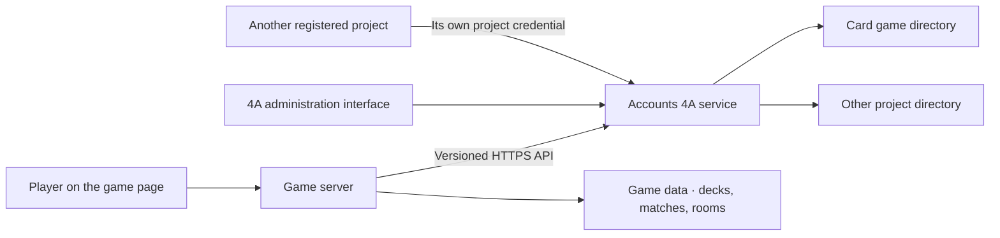

# Accounts 4A milestone plan

**Status** — Proposed for review. The card game is the first client. The service must be usable by a second project without the card game.

## Project boundary

`Accounts_4A/` is the home for the 4A service, its administration interface, API specification, migrations, tests, fixtures, build and deployment files, and documentation. It has its own package manifest, lockfile, build, storage, and release process. Keep it outside the game’s package workspaces. The entire folder must be buildable from a separate checkout or build context. The game’s regular build and tests continue to run independently.

The game and 4A communicate through a **versioned HTTPS API** between servers. Each owns its own configuration, secrets, and data. The game has a provider-neutral identity interface at its server boundary. 4A-specific protocol documentation, examples, and compatibility tests live here. Neither project imports the other’s source or packages, reads the other’s database, or requires a coordinated deployment for compatible updates.

**Runtime implication.** In an environment configured to use 4A, account creation, sign-in, and current-rights checks require a reachable 4A server. If 4A is unavailable, these operations report a temporary service failure. Protected actions that require a fresh decision pause until it is available. There is no fallback to local passwords or cached privileged roles in a 4A-backed environment. The game’s standalone development and test setups can use their own independent identity provider.

## Milestone 0 — Contract and isolation design

**Deliver** the project registration and credential model, a versioned API contract, and ownership rules. A platform administrator registers a project and provisions its first project Admin through 4A. A project service credential is bound to one project and granted specific operations. 4A derives project scope from authenticated credentials. A request parameter cannot widen that scope. Specify account IDs, API errors, retry behavior, and compatibility rules before wiring the game.

Use a separate directory and database for each project’s accounts, roles, sessions, and audit data. The platform registry holds project registration metadata and credential bindings. The same username can identify different accounts in different projects. Platform administration is a separate scope from project administration. The first release shares a 4A service process across projects, so a service-wide failure can affect multiple projects. Separate deployments are an option if independent outage or host-level isolation becomes a requirement.

**Exit criteria.** Approve the contract and boundary diagram. Verify the game workspace has no 4A dependency. Write the cross-project isolation cases before implementing permissions.

## Milestone 1 — Accounts and rights

**Deliver** a standalone project registry, account store, and administration interface. Support exactly three project roles.

| Role | Card game use |
| --- | --- |
| **User** | Create a public account, manage decks, and play regular matches. |
| **Tester** | Use the game and create, control, and edit their own Test Rooms. |
| **Admin** | Manage their project’s accounts and rights, review its audit records, and administer the game. |

Public signup is configurable per project. The game server’s public registration credential can create **User** accounts only. Authorized project Admins create named Tester accounts directly in 4A or change a role there. Record account creation, role changes, disablement, and credential rotation with actor, project, target, time, and outcome.

**Exit criteria.** Register two projects and create the same username in both. Disable one and confirm the other still works. Prove that project credentials, project Admins, and public registration cannot read or change another project’s accounts, rights, sessions, or audit records. Verify that public signup cannot supply a privileged role.

## Milestone 2 — Sign-in, sessions, and revocation

**Deliver** sign-in, current-access checks, activity reporting, logout, and revocation. Keep password hashing and session issuance inside 4A. Use established libraries for hashing and credential handling. Keep passwords and session credentials out of application logs. A disabled account or removed role takes effect on the next protected server action. Active connections should also update within a defined revocation interval, even when the user is idle.

Set Tester sessions to expire after **one hour of inactivity**, enforced by 4A. A committed player command or board edit counts as activity. Background polling, heartbeats, reconnects, and automatic priority passes do not count. Set a maximum session age separately. Session expiry ends access. The game owns the room retention policy and may let the same authorized tester sign in again and resume.

**Exit criteria.** Use controlled clocks to verify idle expiry at one hour, extension after real activity, and expiry despite background traffic. Verify rejection of expired, revoked, and wrong-project credentials. Exercise revocation, service unavailability, and recovery with a standalone sample client.

## Milestone 3 — Card game integration and migration

**Deliver** public signup and sign-in entirely on the game pages. The game server relays these requests through HTTPS. 4A creates the account in the game directory, assigns User, and authenticates sign-ins. The game stores the returned account ID or an explicit mapping from its existing player identity. It keeps ownership of decks, matches, and rooms. Game-specific room and seat checks remain in the game.

Rehearse migration on a copy of game data. Preserve account-to-deck ownership and existing match references. Verify password compatibility before deciding whether accounts can migrate with their existing hashes or need a reset. Use a retry-safe registration request so a lost response cannot create a duplicate account. If the game fails after 4A creates the account, the same account ID must allow game profile setup to resume. Switch each environment to a single identity authority. Define the rollback point before enabling new registrations in 4A.

**Exit criteria.** In an integration environment, complete signup, sign-in, and a match without navigating the player to 4A. Verify that existing accounts retain their decks, public signup grants User, and protected requests and sockets enforce current rights. Run the game’s ordinary build and test suite independently of 4A.

## Milestone 4 — Tester rooms and production readiness

**Deliver** Tester access in Scenario Lab and account-owned room resume. A Tester can run both seats and edit their own board. When sign-in expires, show a persistent sign-in prompt and resume the retained room after successful reauthentication. Loss of Tester rights closes the editor and prevents further lab actions on both seats. Choose a bounded room retention period independently of session expiry. Preserving the room through a game server restart would require persisted checkpoints and is a separate decision.

Before production cutover, exercise backup and restore, project credential rotation, audit access, and recovery from an unavailable 4A service. Run a second sample project through signup, sign-in, and role revocation to prove reuse. Verify independent build and deployment in both directions.

**Exit criteria.** An active Tester can continue past the old 15-minute cutoff. A Tester idle for one hour is signed out and can resume a retained board after signing back in. Removing Tester rights blocks both active seats and the editor. A second project passes isolation tests without installing game code.

## Decisions for review

- **Folder and deployment.** Start in the top-level `Accounts_4A/` folder of the current repository with a standalone build and deployment. The folder can move to its own repository without changing the game API contract.
- **First release.** Use separate project directories, three project roles, game-hosted signup, and a one-hour Tester idle timeout. Confirm the maximum session age, room retention period, and idle-connection revocation interval before production rollout.
- **Cutover.** Decide the handling of existing password hashes and account identifiers after a migration rehearsal. Deprecate local account login in each 4A-backed environment only after ownership, recovery, and rollback checks pass.
