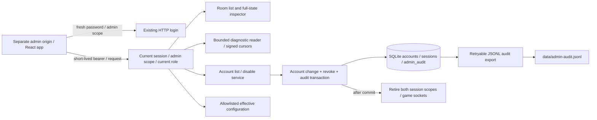

# Milestone 4 — administrator application and audit boundary

**Date:** 27 October 2026. **Status:** implemented with focused verification. Extends [authentication](authentication-architecture.md), [persistence](persistence-deck-architecture.md), [configuration ownership](configuration-architecture.md) and [ARCHITECTURE.md](../ARCHITECTURE.md).

Milestone 4 supplies the separate `apps/admin` frontend, protected room/log/account/config APIs, persistent account disabling and durable audit records. It reuses the existing React/Vite/protocol/auth stack and adds no routing or configuration framework. Zod is now a direct server dependency because the server owns configuration schemas; its existing protocol version is reused.

## Frontend and authorization

The admin app has its own workspace, bundle, CSS, Vite configuration and TypeScript project. Its four hash routes are Rooms, Game logs, Accounts and Configuration. A small typed hash resolver is sufficient for this scope; no additional router dependency is added. The player build contains no admin API paths, admin session key or admin page implementation. Protocol modules declare side-effect-free exports so unused admin contracts are removed from player bundles.

Admin login uses the existing HTTP API with `scope: "admin"` and a fresh password. Only a currently enabled, server-provisioned admin can obtain the short-lived token. The app validates the response and uses the dedicated `cardgame.adminSession.v1` per-tab key; it never borrows the game session. Password input is cleared after submission and is not persisted. Expiry signs the operator out. HTTP 401 invalidates the matching session; a late response/logout from an older session cannot erase a newer login. Bearer requests are restricted to the admin API path.

The server verifies token validity, admin scope and current role on every admin route. Current role/account status is checked in the repository, not trusted from the browser. Room inspection independently requires the inspection flag. The legacy debug inspector retains its verified boundary and now records successful inspections in the same audit trail. Admin tokens still cannot connect to game sockets.

Room lists and selected-room reads poll every five seconds by default. Resource subscriptions abort when selection/route changes, suppress late results and schedule the next poll only after the prior request settles. The inspector displays phase, turn, active/priority player, players' zones, battlefield, stack and pending choices, with a full JSON view. This channel intentionally includes private game information and is distinct from player projections. Text/JSON render through React escaping, with no HTML interpretation.

Accounts are paged and expose ID, username, role, disabled state and creation time only. Disabling requires an explicit UI confirmation. The backend transaction marks the account disabled, revokes both game/admin scopes and inserts its audit event. Matching sockets are retired immediately after commit. The final active administrator cannot be disabled. There is no role promotion, re-enable or password-reset endpoint in this milestone. Read-only configuration shows safe effective values/revision and pending audit export; it exposes no credential source or raw filesystem path.

## API contracts

Strict shared schemas live in `packages/protocol/src/rest/admin.ts`. Missing/expired credentials return 401; a valid ordinary game/player session returns 403. Invalid bounded queries/bodies fail rather than being coerced into privileged actions.

| Endpoint | Behavior |
|---|---|
| `GET /api/admin/me` | Current public administrator identity. |
| `GET /api/admin/rooms?offset&limit` | Bounded room summaries, requiring inspection enabled. |
| `GET /api/admin/rooms/:id` | Authoritative room aggregate, requiring inspection enabled. |
| `GET /api/admin/accounts?offset&limit` | Paged safe account records. |
| `POST /api/admin/accounts/:id/disable` | Strict `{protocolVersion:1}` body; atomic account/session/audit change. |
| `GET /api/admin/deltas?cursor&limit` | Bounded diagnostic page and continuation cursor. |
| `GET /api/admin/deltas?offset&limit` | Initial byte-offset entry point; offset must be a line boundary. |
| `GET /api/admin/config` | Allowlisted effective settings and revision, read-only. |

Pagination defaults come from server HTTP settings, with the protocol's absolute 100-item ceiling. Clients request bounded pages explicitly. No endpoint accepts a log filename or configuration write. Another account's deck APIs remain separate and ownership-scoped; an admin token is not a game/deck token.

## Bounded diagnostic reader

`admin/log-reader.ts` uses an open file descriptor, `fstat` and positional reads; it never reads/splits the whole file. Default buffers/limits are a 32 KiB read chunk, 64 KiB line ceiling, 256 KiB entry-data page budget and 1 MiB scan budget. The entry budget excludes small response-envelope/JSON-array overhead; anchor/boundary checks add at most 129 bytes of I/O beyond the reported scan reads.

An opaque HMAC-signed cursor carries a file generation, byte position, prior-byte fingerprint and oversized-line continuation state. Appends can continue from an EOF cursor. Changed generation, truncation or changed preceding content requires a reset; invalid/old-process cursors also require refresh. The reader skips malformed or oversized entries and reports their count, advances even across very large lines, and retries an unfinished final normal line after more data arrives. Credential-shaped fields receive recursive redaction before display. The UI offers bounded previous/next navigation and an explicit refresh-from-beginning action.

The focused large-file test writes **100,000 lines**, reads successive first pages and directly seeks near the end. It verifies entry continuity and small reads rather than holding the file in memory. Separate cases cover bad cursors, append, rotation, truncation, oversized/malformed lines, partial final lines and disabled/missing sources.

## Durable auditing and failure handling

Migration `002-admin-audit.ts` adds an append-only application audit table/outbox. Privileged reads/actions record event UUID, timestamp, actor ID, fixed action, approved target and outcome. Requests, passwords, hashes, tokens and arbitrary query/body data are not logged. Unknown room paths are recorded as an unknown target rather than echoing arbitrary strings. Auth login/logout also retain the existing credential-safe authentication logs.

Account changes and audit insertion share the same SQLite transaction. If durable audit insertion fails, account state and token revocations roll back and no socket notification fires. Post-commit notification failures cannot turn an already committed disable into a contradictory failure response; they emit a fixed warning and later request/session checks still deny revoked tokens.

The production process exports pending events to `data/admin-audit.jsonl`, flushing the append before marking the event exported. Export failures preserve pending events in SQLite and are retried on subsequent actions, every five seconds by default and at shutdown. The config page shows pending export. Export is at least once: a crash between append and database marking may duplicate an event UUID; consumers can deduplicate by UUID. The database remains authoritative. Isolated application tests can explicitly disable file export while retaining audit records.

The existing logrotate policy now covers both diagnostic and admin-audit JSONL files. New audit files request private permissions; deployment must provision existing directories/owners correctly. Retention/backups for the database audit table remain an operational policy; this milestone does not claim tamper-proof logging or an external audit service.

## Running and deployment

After installing dependencies, use `npm run build` to build server, player and admin, and `npm run typecheck` to check all five TypeScript projects. `npm run dev:admin` serves the independent app at `http://localhost:5174/admin/` and proxies `/api` to the backend. A development backend can also serve the built app at `http://localhost:3000/admin/`.

Provision an administrator with the existing explicit bootstrap username and protected password file, enable inspection deliberately, and start the backend. No default credential or real operator secret is created by this implementation. For example, supply `ADMIN_BOOTSTRAP_USERNAME`, `ADMIN_BOOTSTRAP_PASSWORD_FILE` and `INSPECTOR_ENABLED=true` through the service environment. Repeated startup verifies the existing admin identity rather than resetting/promoting it.

Production uses an independent admin origin. `deploy/nginx/admin.conf.example` serves the admin build under `/admin/`, proxies only its HTTP API to the shared backend and blocks Socket.IO on that origin. It includes static security headers/CSP and placeholder TLS paths. Replace domains/certificate paths for the intended host and add its exact origin to configured origins. The production backend does not serve the admin frontend beside the player app. Do not treat the same-origin development path as production browser isolation.

Before deployment, validate nginx with `nginx -t`, install certificates, provision private database/log/password paths, validate logrotate on a temporary log and verify the chosen host/Node native bindings. These Linux/TLS/serving checks were not executed in the local focused-test workflow. MFA and reauthentication for higher-impact future operations remain additional deployment/authentication work.

| ADR | Decision | Trade-off |
|---|---|---|
| A4-01 | Independent admin workspace/origin and scoped storage/token | Strong browser/package boundaries; one more frontend build and origin configuration. |
| A4-02 | Existing React/Vite and a small hash router | No new UI/router framework; routing remains intentionally limited to four pages. |
| A4-03 | SQLite audit outbox plus JSONL export | Atomic privileged state/audit changes and retryability; exported IDs may duplicate after a crash. |
| A4-04 | Signed byte cursors and fixed log budgets | Bounded memory/seek work; rotation and oversized lines require explicit handling/reset. |
| A4-05 | Account disable revokes both scopes; protect final admin | Immediate access withdrawal without accidental total lockout; recovery/re-enable is a separate operator feature. |

The [completion report](phase-4-status-2026-10-27.md) records the user-adjusted focused acceptance, build separation and remaining deployment limits.
