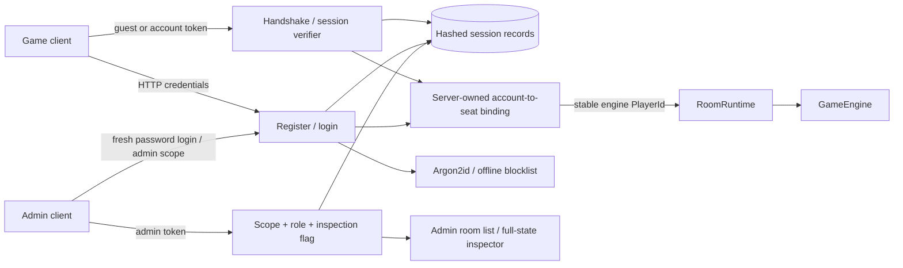

# Accounts, Sessions and Admin Access — Architecture Supplement

**Date:** 26 October 2026. **Scope:** platform Milestone 2, plus the authenticated admin API requested by the user. An admin panel UI is not included.

**Milestone 3 update, 27 October:** accounts/sessions now persist behind the same repository boundary; seat bindings and rooms remain ephemeral. Registration, linking and session rotation commit atomically before socket notifications. Repeated bootstrap verifies an existing admin without changing its identity/hash. See the [persistence supplement](persistence-deck-architecture.md) for the current storage and operation model; Milestone 2 evidence remains historical.

**Milestone 4 update:** the [independent admin app](admin-architecture.md) now supplies room/log/account/config pages, immediate account disabling and durable audited access. Config defaults/lifetimes now live in [dedicated files](configuration-architecture.md). Existing milestone reports remain historical evidence.

This extends [ARCHITECTURE.md](../ARCHITECTURE.md) and the [projection supplement](protocol-projection-architecture.md). See the [implementation ledger](milestone-2-implementation.md) and [completion report](phase-2-status-2026-10-26.md) for scope and evidence.

## Identity and authorization

`application.ts` composes Express, Socket.IO, the auth repository and `RoomRuntime`; `index.ts` only initializes and listens. The engine still receives a game seat's PlayerId and has no account/session/password dependency.

Guests obtain opaque credentials from `POST /api/auth/guest`. Their server-generated identity cannot be selected through `playerId`. Socket handshakes validate a token and derive a canonical identity or an owned seat binding. Missing, expired, revoked and wrong-scope tokens fail. Invalid credentials never fall back to a guest. The browser's old generated ID is a placeholder only.

A server-owned binding maps an account to a seat in a particular room. Registering or signing in while seated transfers a verified guest's seat ownership to that account. The seat's existing ID stays unchanged inside cards, targets, triggers, choices and history. Conflicting links fail if that account already owns the room's other seat. Guest credentials are then revoked and their sockets disconnected; the room receives a reconnect grace period, including an otherwise unjoined room. The account token reconnects to that same seat.

## Separate admin sessions

The shared verifier checks token validity, expiry, revocation and current account status. It does not grant admin permission. A fresh login with `scope: "admin"` requires both the password and a server-provisioned admin account. It issues a separate token with a 15-minute lifetime. Game sessions have an eight-hour lifetime; guests have 24 hours. Game and admin login rotations affect their own scope. Logging out one token revokes that token.

Every admin API call checks scope and role. Full-state inspection also requires `INSPECTOR_ENABLED=true`. An admin account's **game token cannot inspect**; an **admin token cannot connect to the game socket**. This limits the privilege available through a stolen game credential while keeping expiry/revocation logic consistent. Milestone 4 supplies separate frontend/origin configuration; deployed TLS and stronger authentication such as MFA remain operational/authentication work.

Accounts are created as players through the public API. Role claims and unknown fields are rejected by strict request schemas. Only explicit operator bootstrap configuration creates an admin. There is no default admin password and no public role-promotion endpoint.

## Passwords and bounded sessions

Server-only `authConfig` sets Argon2id memory to 19,456 KiB, two iterations and one lane. Each hash has a fresh salt. Passwords use NFC normalization, a 15–128 Unicode-character length policy, spaces and no character-composition rules. Login preserves case and whitespace. The offline blocklist compares normalized/case-folded SHA-256 values; it contains 9,920 unique entries from a documented public common/breached-password snapshot plus four weak long examples. Its source fingerprint and MIT notice are retained beside the data. Passwords are never sent to a breach-check service.

These choices follow the [OWASP password-storage guidance](https://cheatsheetseries.owasp.org/cheatsheets/Password_Storage_Cheat_Sheet.html) and [NIST password guidance](https://pages.nist.gov/800-63-4/sp800-63b.html). The blocklist is bounded and needs maintenance; it is not an exhaustive breach corpus.

Tokens contain 256 random bits. The repository stores their SHA-256 digests, not raw tokens. It bounds sessions at 1,000 and accounts at 10,000; expired records are pruned during validation/issuance. At most two expensive password jobs run concurrently. Login to an unknown/disabled account still performs password verification against a dummy hash. Account state is rechecked after password verification to avoid completing a login against a changed credential.

Active game sockets have expiry timers and a per-packet validity check. Logout, login rotation and guest linking disconnect invalidated sockets immediately. Disabled accounts and withdrawn admin eligibility fail validation. Credentials, hashes, bearer headers and token digests are excluded from auth logs; fixed messages and redacted structured metadata record result, scope and account ID.

## HTTP and client boundaries

`packages/protocol/src/rest/auth.ts` owns strict Zod request/response schemas. The server validates auth input and output. Bodies are limited to 8 KiB. Credential attempts are limited to 20 per IP per 15 minutes; guest issuance has its own 100-per-IP limit. Helmet adds standard response protections, and API responses use `Cache-Control: no-store`.

HTTP and Socket.IO use the same origin allowlist. Development includes `http://localhost:3000`, `http://localhost:5173`, `http://localhost:5174`, plus configured origins. Production includes only exact origins supplied through `ALLOWED_ORIGINS`. Unlisted preflights and WebSocket origins fail. Headerless native clients remain supported and must still authenticate. Origin policy is not identity authentication. Helmet's HTTPS upgrade/HSTS behavior is enabled in production and disabled for ordinary local HTTP development.

The game client obtains a guest credential before connecting, accepts its authoritative seat ID from `sessionReady`, and stores its session per tab. Registration/login controls work while seated and reconnect after a successful transfer. No password is kept in the auth store or browser storage. Expired/revoked-session messages are correlated by session ID so a stale message cannot clear a newer login. Unsent actions are not queued while disconnected. The game client includes account controls, not admin UI code.

## Decision records

| ADR | Decision | Alternatives and consequences |
|---|---|---|
| A2-01 | Use server-issued guest credentials and derive identities from sessions. | Keeping browser UUIDs as seat authority would preserve impersonation. Guests need an additional HTTP bootstrap call. |
| A2-02 | Transfer seat ownership through a repository binding. | Rewriting every PlayerId recursively inside an active room risks corrupting continuations and historical references. Bindings add server state and must migrate with persistence in Phase 3. |
| A2-03 | Share verifier implementation; separate admin session scope, expiry and rotation. | A single game/admin token has a larger privilege exposure. Separate verifier implementations risk inconsistent expiry/revocation rules. Fresh admin login adds a deliberate authentication step. |
| A2-04 | Use Argon2id, a length policy and an offline blocklist. | Online breach checking adds network/privacy dependencies; composition rules do not address common/breached choices. Native Argon2 deployment support and blocklist maintenance remain operational requirements. |
| A2-05 | Milestone 2 used in-memory account/session repositories behind `ServerStateStore.auth`; superseded by Milestone 3 SQLite. | The boundary allowed persistence without moving database logic into authentication or engine code. Rooms and seats remain ephemeral. |
| A2-06 | Provision admin identity only through operator startup configuration. | First-user-admin rules or public role selection create takeover paths. An operator must supply a strong secret and enable inspection deliberately. |

## Admin API and operator setup

Set `ADMIN_BOOTSTRAP_USERNAME` and exactly one of `ADMIN_BOOTSTRAP_PASSWORD_FILE` (preferred) or `ADMIN_BOOTSTRAP_PASSWORD`, then start the server. The file contains only the password and an optional final newline, is limited to 4 KiB, and should be readable only by the service operator. Bootstrap credentials satisfy the same password policy. Keep the file outside the repository; do not put it in a tracked configuration file. `INSPECTOR_ENABLED=true` separately enables room inspection.

| API | Authorization and behavior |
|---|---|
| `POST /api/auth/guest` | Issues an ordinary guest game session. |
| `POST /api/auth/register` | Creates a player account; may link the guest token supplied as a bearer header to `roomId`. |
| `POST /api/auth/login` | Username/password; `scope` defaults to `game`; request `admin` explicitly for privileged login, without `roomId`. |
| `POST /api/auth/logout` | Revokes the bearer token and retires matching sockets. |
| `GET /api/auth/me` | Returns public account/session information without a token or hash. |
| `GET /api/admin/me` | Requires an admin-scoped session and current admin role. |
| `GET /api/admin/rooms?offset=0&limit=25` | Same authorization plus inspection flag; bounded summary page, maximum 100 entries. |
| `GET /api/debug/room/:id` | Same authorization plus inspection flag; authoritative engine state for the selected room. |

All POST bodies carry `protocolVersion: 1`. Login credentials stay in the HTTP body; subsequent calls use `Authorization: Bearer <token>`. Socket auth carries the game token and optional room ID; any claimed playerId is ignored. Authentication responses contain `token`, `sessionId`, `scope`, `expiresAt`, `playerId`, public `account`, and an owned `roomId` when applicable.

## Admin panel — implemented in Milestone 4

`apps/admin` is a separate bundle with its own session key and production origin configuration. Its login requests `scope: "admin"`; it never copies a game token. The room list/inspector displays phase, priority, stack, choices and zones with a full JSON view. It shows expiry/access errors and cancels stale reads. Short polling uses bounded authenticated HTTP APIs.

Milestone 4 also implements bounded signed-cursor log viewing, account disabling with both-scope revocation and a durable audit trail. It includes dedicated-origin/CSP serving examples; deployed TLS, MFA and broader privileged-operation reauthentication remain later work. The game socket is not reused for privileged inspection. See the [current admin supplement](admin-architecture.md) and [verification report](phase-4-status-2026-10-27.md).
