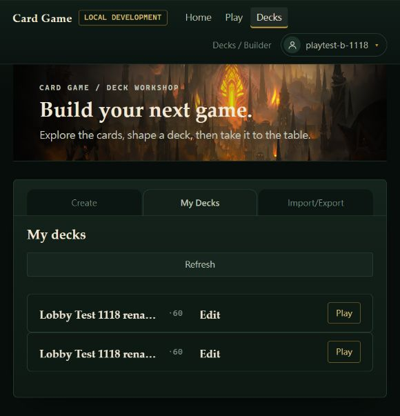

# Pregame browser bug report — 18 November 2026

**Fix follow-up:** All three reported defects have source fixes. See [the fix report](bug-fix-report-2026-11-18.md) for causes, changes, verification and the server restart required to activate the updated copy-limit policy. The observations below retain the original audit evidence.

## Test context

Tested the Windows-hosted application at `http://localhost:3000/` through the Codex browser. Application interactions used visible controls and ordinary keyboard input; no game commands, API calls, database edits, or injected application state were used. The user narrowed the requested audit to everything before the game room. No two-player match or card-effect testing was completed.

The checkout reported HEAD `435f3f27` when this report was written. Built server, player, and deck-builder files were timestamped 18 November 2026, approximately 15:06 Hong Kong time. This identifies the local test context, not a verified bundle-to-commit mapping. Existing unrelated local edits were left untouched.

P2 means a functional defect that should be fixed in the normal bug-fixing cycle. Reproduction evidence comes from the browser session, not a source-code diagnosis. Usability findings are recorded separately in [the pregame audit](pregame-ux-audit-2026-11-18.md).

## BUG-01 — Returning to the builder loses saved-deck identity and creates duplicates

**Priority:** P2. **Status:** Reproduced end to end.

**Steps**

1. Sign in and create a valid deck in Decks. The test deck contained `60 land-red` and was named `Lobby Test 1118`.
2. Save it. Confirm that the editor offers **Update saved deck**, **Save as new**, and **Play this deck →**.
3. Rename it to `Lobby Test 1118 renamed`, update it, and confirm **This version is saved.**
4. Use the top navigation to visit **Play**, then **Decks**.
5. Observe the restored draft's name and contents, then click the now-offered **Save deck**.
6. Open **My Decks**.

**Expected:** Returning to an unchanged saved deck retains its association with the saved record. The primary save action updates that record; making another record remains an explicit **Save as new** action.

**Actual:** Name and contents are restored, but the editor offers **Save deck** rather than **Update saved deck** and no longer shows the saved-version handoff. Clicking Save creates another record. My Decks displays two identically named 60-card decks.

**Evidence:** The original Play link referenced deck ID `c2c97b94-babe-426f-a405-7fa5cad96b2e`; the duplicate referenced `28b173ee-0197-4880-9c25-8774527bc5ea`. Both were displayed as `Lobby Test 1118 renamed · 60`.

**Impact:** Normal navigation can turn an intended update into an accidental copy. Identical names and card counts make choosing the right version difficult.

**Acceptance check:** Save a deck, navigate away and back, then change and save it. Its ID and the number of saved records must stay the same. Explicit Save as new should still create a different ID.

## BUG-02 — Copy-limit enforcement contradicts an exempt land's rules text

**Priority:** P2. **Status:** Reproduced through catalog and editor controls.

**Steps**

1. Open Decks and search for `兵器之古戰場` (`ancient-weapon-battlefield`).
2. Read its displayed rules text: `此卡不受牌組構築上限限制` — the card is exempt from the deck-construction copy limit.
3. Use **Add** four times.
4. Try to add a fifth copy using either the catalog or the deck editor.

**Expected:** The displayed copy-limit exemption and enforced deck-building limit agree. If the exemption is intended, a fifth copy is available while the deck remains below its overall size limit.

**Actual:** The catalog counts down from **4 left** to **0 left** and disables Add. The editor also disables **Add one ancient-weapon-battlefield** at four copies. The test draft had only six cards total, so the overall 250-card cap was not the cause.

**Evidence:** At four copies the browser exposed disabled buttons named `Add 兵器之古戰場 (0 left)` and `Add one ancient-weapon-battlefield`. Other lands with the same exemption wording, such as 血炎山, exposed much larger remaining allowances.

**Impact:** A player following the card's visible rules cannot construct the corresponding deck through the builder.

**Acceptance check:** Resolve whether the rules text or the enforced limit is authoritative, then make both consistent. Check catalog Add, editor +, imported-deck validation, and saved-deck validation against the same policy. This audit did not determine which underlying definition needs changing.

## BUG-03 — Browser sign-out leaves another room tab on an unexplained loading board

**Priority:** P2. **Status:** Observed in one cross-tab sequence; recovery coverage is limited.

This was observed before the scope was narrowed, in an unstarted room. It is included as a session-recovery defect, not a gameplay finding.

**Steps**

1. Sign in as account A, select a saved deck, create a room, and leave its tab open waiting for an opponent.
2. Open another Play tab in the same browser and account.
3. Open the account menu in that second tab and choose **Sign out this browser**.
4. Return to the room tab.

**Expected:** The room tab explicitly explains that sign-out ended its session and provides a clear sign-in or return-to-lobby action. A loading indicator should represent work that can finish.

**Actual:** The room URL remains open, its header becomes **Guest** and **Play / Lobby**, and the body shows **Loading board**, empty phase controls, and **LOG 0**. No session-ended explanation was visible. This remained present across later observations. Signing in again changed the account display, but a complete restoration of room ownership was not demonstrated.

**Impact:** A deliberate sign-out looks like a stalled application. The player cannot tell whether to wait, sign in, reload, or navigate away.

**Acceptance check:** Repeat browser sign-out with another waiting-room tab open. Every affected tab must transition to an explicit unauthenticated/session-ended state with a useful next action. Separately verify supported sign-in/resume behavior; permanent room loss was not established by this audit.

## Test data and limits

- Created local test accounts `playtest-a-1118` and `playtest-b-1118` and saved test decks. Passwords are intentionally omitted from this report.
- Account A's saved deck was `Imported deckPlaytest Red 1118`; account B has the two duplicate decks documented above. Test data was retained; no existing user decks were deleted.
- One waiting room was created for A. No opponent joined and no gameplay occurred.
- `127.0.0.1` produced a blank page in this browser, while `localhost` worked. This is an environment observation with an undiagnosed cause, not a confirmed application defect.
- The initial build attempt failed on a missing card JSON import. The user subsequently supplied a working server and rebuilt files; that earlier checkout condition is not reported as a current pregame bug.
- No source fixes were made and no automated regression suite was run. The acceptance checks above are proposed follow-up verification, not tests already passed.
