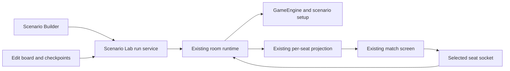

# Scenario Lab playtest room plan

## What it should feel like

Open the local Scenario Lab, load a fixture or choose an empty board, and select **Play both seats**. One lab operator uses one browser tab to control **Seat A** and **Seat B**. The header shows whose turn it is, who can act, and who owes a decision. Select either seat to see the room as that player. Use **Follow action** to switch automatically to the player who needs to respond. Keep **Reveal both hands** separate so the same room can test hidden information and normal player views.

Use the existing match screen for normal play. Put setup and cheat controls in one **Edit board** drawer, with visible **Play** and **Edit board** states. While editing, pause auto-pass and preview the whole change before **Apply**. Show which actions changed the scenario and create an undo point. Use explicit controls for the common operations. Drag-and-drop can be a shortcut once the editor works consistently with clicks and keyboard input.

## What the code already provides

| Area | What exists and how it fits |
| --- | --- |
| Scenario setup | `buildScenarioRoom` creates a deterministic two-seat room from canonical IDs, seeded or ordered libraries, and initial hands, battlefields and graveyards. It starts at main phase with the chosen seat holding priority. Seeded permanents arrive without entry effects. The Scenario Builder can already add a catalog card missing from both decks before launch. The newer workflow needs the same catalog search and placement during a running match. Existing launches bind to two enabled accounts. [Scenario Builder](../apps/admin/pages/Scenarios.tsx) · [Engine setup](../packages/engine/src/engine/scenario-setup.ts) · [Scenario Lab](scenario-lab-architecture.md) |
| Gameplay | `GameEngine.executePlayerAction` is the normal command boundary. Actions validate timing and priority, then run through mutations, replacements, state-based checks and trigger scheduling. Pending choices suspend the rules checkpoint. [Engine](../packages/engine/src/engine/game-engine.ts) · [Mutation committer](../packages/engine/src/engine/mutation-committer.ts) |
| Cards and zones | Zone transitions know about owner and controller, stack objects, hosted cards, and the revision of a card instance. Reuse the transition and state construction logic for edits. Moving a spell to the stack requires a corresponding spell object. Moving a card to hosted storage requires a valid host. [Zone transitions](../packages/engine/src/engine/zone-transitions.ts) |
| Board and transport | `GameScreen` consumes a projected player view. Match actions and snapshot recovery reach Socket.IO through the client hooks. The server already produces per-seat snapshots and deltas, projects legal options and choices, and runs auto-pass. Keeping that path lets both single-operator and assigned-seat tests exercise the same UI and runtime. [Match screen](../apps/game-client/components/GameScreen.tsx) · [Client actions](../apps/game-client/hooks/useGameActions.ts) · [View builder](../apps/server/src/projection/view-builder.ts) · [Room runtime](../apps/server/src/rooms/room-runtime.ts) |
| Snapshots | The lab already preserves an immutable launch scenario for reset. Match recovery shows what a reconstructible engine checkpoint contains, including `roomState` and the last batch ID. Live undo needs a bounded in-memory checkpoint history and a restorable gameplay RNG position. [Scenario service](../apps/server/src/scenarios/service.ts) · [Match recovery](../apps/server/src/rooms/match-recovery.ts) |

## ADR 1 — Add a single-operator launch to Scenario Lab

**Status** Implemented in Scenario Lab. See the [playtest guide](scenario-lab-architecture.md#edit-a-running-single-operator-room).

Keep the existing Scenario Builder and assigned-seat launch. Add **Play both seats** as an explicit launch mode that can start from a draft, a saved scenario or a preset. The local Lab server hosts one engine and two synthetic seats with no player accounts. One existing lab operator sign-in authorizes the launch. Keep the operator's edit authority separate from the two short-lived gameplay credentials, each bound to one seat and one run. Close those connections when the run stops, resets or loses its operator authorization. Live edits and seat credentials are available only for single-operator runs on the existing lab instance. The browser presents all controls and the lab server owns the running state.

Use a narrow match session interface for action dispatch, card options, snapshot refresh, leave and auto-pass. The playtest screen uses a lab session that subscribes to both seat views but routes actions through the selected seat's connection. The normal shell continues to connect a single seat. Isolate lab session state from the normal room resume key. Switching clears seat-specific selection, targeting and menus, and late replies from the other seat cannot replace the active view. The visible board and the acting seat come from the same snapshot revision.

A browser-only engine still makes sense if offline use or zero sign-in becomes a requirement. It would need a separate host and an extraction of the existing Node-backed player projections and identifier policies. Extending the lab first reuses its fixture editor, isolated runtime, reset, logging, projections and auto-pass. It does require local lab startup and one lab operator sign-in.

## ADR 2 — Give the editor its own transaction

**Status** Implemented for typed room edits and in-run checkpoints.

Use a small typed command vocabulary on a lab-only edit boundary. Check the expected run revision so an edit can’t overwrite a move made after the preview. Serialize edits with player actions and pause auto-pass while editing. Apply a batch to a copy of the current state, validate it, then install it as one run checkpoint, update the runtime and send fresh snapshots to both seats. A rejected edit leaves the current state, seed cursor and history intact. Record the edit in the run timeline. Keep normal action packets and the normal command registry for real gameplay.

Give placement two explicit ways to work:

- **Place for setup** changes the scenario silently. Putting Frost Messenger on the battlefield this way does not make it enter through gameplay or reveal cards.
- **Play through the rules** puts the starting pieces in place, then lets the tester cast, activate, move or resolve through the normal engine. Frost Messenger's reveal and reorder, resulting draw and death trigger can then all be checked as player actions.

Make **Add from catalog** and **Move existing card** separate commands. **Add from catalog** accepts a canonical card ID even if neither seat has a copy anywhere in the match. The engine card factory gives each new copy a fresh identity, and the shared card-state initializer sets the destination, owner, controller and visibility. **Move existing card** selects a specific card and its current zone revision. For example, from an empty board you can add Frost Messenger to Seat B's hand and Ancient Weapon Battlefield to Seat B's battlefield, then switch to Seat B and cast Frost Messenger normally. Cards absent from the canonical catalog are custom definitions. Treat those as a later feature with an isolated, validated per-run catalog.

| Editor area | Controls |
| --- | --- |
| Cards | Search the canonical catalog. Add a fresh copy, move an instance or remove it. Choose a seat and destination for hand, library, battlefield, graveyard or exile. Reorder a library and set known top or bottom draws. Support tokens, attachments and hosted cards with explicit owner, controller and host. |
| Player and permanent state | Set life, mana by color, available land plays, tapped and summoning-sick state, counters, damage, owner and controller. Expose temporary effects and rule-use state in Advanced controls. |
| Turn, combat and stack | Set the turn, phase and acting seat through coherent presets. Add attackers and blockers explicitly. Add a spell to the stack with its controller, targets and any required choices, or stage an ability with its source. Inspect and advance priority and stack resolution. Provide exact checkpoints for damage assignment, trigger ordering and pending choices. |
| Reproduction | Load existing scenario fixtures, save named checkpoints, undo or reset, and import/export versioned local scenario data. Provide an Advanced structured state editor with a diff and validation for reproducible engine cases the presets cannot express. |

The hard part is keeping relationships coherent. Validate that every instance has one zone; hosts, targets and attachments resolve to the expected incarnation; and combat, priority and pending choices agree with the phase. If an edit invalidates a live stack or continuation, show which objects would be affected and let the tester return to a safe checkpoint or apply an explicit reset of the dependent state. Canonical card definitions and serialized state remain data. Any experiments that change a card definition can use the normal validator with a tab-local override, after instance-level editing works. An arbitrary JSON patch wired to `roomState` would be quick to build but couples the editor to internal fields and can strand a test in an impossible state.

## Build order and acceptance

1. **One tab, both seats.** Add single-operator launch to the existing lab. Verify seat switching, option discovery, ability and choice IDs, pass priority and the correct view with one lab operator and no player accounts or saved decks. Verify assigned-seat runs still work and only authorized single-operator runs accept edits.
2. **Add any catalog card.** Start a room containing zero copies of the card, then add it to either seat's hand, library (top or bottom), graveyard or exile, or to the battlefield when the card type supports it. Verify two fresh copies have distinct identities, the other view retains correct hand visibility, and direct placement produces no entry trigger. Verify a normal cast from hand does fire the trigger. Reject an unknown ID or invalid destination atomically. Add move, undo, reset and basic player and card fields after that flow works.
3. **Advanced scenarios.** Add stack, combat and choice snapshots, hosted cards, attachments, effects and validated state import/export. Verify replay after reset, priority and auto-pass with pending decisions, stale requests after a seat switch and clear errors for malformed state. Add a test for the normal multiplayer projection and a browser pass for the editor flow.

The implemented workflow can stage a spell or activated ability in an open priority window. It can also preserve an in-flight choice or combat state in a named checkpoint. The editor validates authored choices and instance IDs before applying changes. Direct authoring of arbitrary rule definitions or internal continuation data remains outside these controls.
