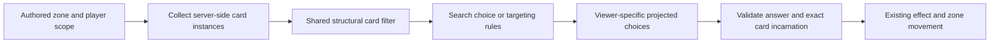

# Card-query architecture and workbook follow-up

**Current blocker status:** see [the current card blocker ledger](card-blockers-current.md). Tables and verification counts below describe their original delivery snapshots.

Date: 3 November 2026. Status: accepted and implemented at the owner's request.

Subsequent work: [contracted rule families](rule-contract-architecture.md) reuse these filters and add conditional stat/cost/event behavior. Its blocker table updates the mechanics assessment below without changing this batch's five-card count.

[Resolution-local result sets](resolution-results-architecture.md) subsequently allow searches/counts restricted to cards from a particular mill, including recorded arrival state. They add no physical zone or workbook card.

## Context and decision

Deck, hand, graveyard, exile, battlefield and spell cards on the stack contain the same CardInstance model. Search choices, structural targeting, continuous/count scopes and action prerequisites previously duplicated card-property tests. That left color filtering available to scopes but unavailable to graveyard search, and restricted action-zone checks to three zones.

Use one pure structural filter and one server-state zone collector. Keep zone access, selection cardinality, targeting permissions, visibility and effects as separate responsibilities. Existing authored fields remain compatible. This is an engine enhancement following the earlier data-only batch.

## Implemented contract

- `types/card-query.types.ts` defines CardFilter: types, tribes, colors, canonical IDs, exact/excluded names, name substring, owner/control, power/maximum-life/fixed-mana-value bounds, counters, summon provenance, and nested allOf/anyOf/not.
- `shared/card-query.ts` owns matchesCardFilter and collectCards. The matcher receives already-resolved characteristics; it does not call back into characteristic evaluation. Collection preserves storage order and never shuffles. A library's top remains the end of its array.
- `engine/effect-scopes.ts` retains source, attachment and exact-object checks around the common filter. Numeric counts inherit it without a second predicate.
- `shared/target-utils.ts` retains extrema around the common filter. Target legality still checks zones, revisions, stack kinds and permissions; search does not acquire shroud/hexproof restrictions.
- Resolution search accepts the same filters and an explicit zonePlayer (self by default). Private zones use the containing player; battlefield/stack use control. An owner filter is separate and can distinguish a stolen battlefield card.
- Action zoneCheck uses the same collector/filter in every zone. Legacy ownedBy/cardType/cardId remain compatible; a nested filter adds the full common vocabulary.
- Each search caches characteristic views only within that immutable choice snapshot. There is no cross-mutation query cache or secondary index to invalidate.

A query is trusted engine-side evaluation, not a new client API for inspecting rooms. Clients receive only their permitted player view. Search choices are visible only to the chooser, and choice handles remain opaque. Other players receive a waiting indicator. Revision-bound references prevent a card which left and returned from masquerading as the earlier selected object.

Selection cardinality remains separate: an eligible mandatory card cannot be declined. A resolution search takes the available required number when fewer cards exist and skips an impossible mandatory selection when none exist, allowing later instructions to continue. Required targets during casting retain their existing legality requirements. Legacy optional searches and reveal behavior are retained.

Ordinary REVEAL_TOP now accepts a shared filter plus min/max. It still captures only 1–3 top cards and returns the unselected remainder to the bottom. Whole-library search never replaces a captured reveal window. A fixed mana-value filter sums fixed base-cost components; variable/query-based costs do not silently resolve to zero or an invented value.

## Cards now unblocked

| Card | Canonical ID | Source | Previously missing behavior |
|---|---|---|---|
| 幻影工兵 | phantom-sapper | 幻影木偶 4 | Mill three, then recover any black creature from the graveyard, including another tribe or a newly milled creature. |
| 諸界風靈使 | worlds-wind-envoy | 風獸 8 | Require choosing a 幽爾 card from the top three if eligible. |
| 風靈先知 | wind-spirit-prophet | 風獸 13 | Name-substring filtering, excluding its own name, with mandatory reveal selection. |
| 天域地界使 雷拉 | heavenly-land-envoy-reila | 上使 6 | Yellow-land filtering within a captured top-three window. |
| 天域尋索者 耶拉 | heavenly-seeker-yela | 上使 7 | Choose one 上使 creature OR yellow relic, excluding itself. |

The workbook's trailing asterisk on Yela is treated as its source-row marker, not part of the canonical card name; both spellings are excluded by its self-exclusion filter. Relics follow the current content representation: Artifact cards excluding Equipment, Creatures and Lands. No new relic card type is introduced.

The catalog now has 94 definitions (79 original + 10 previous additions + these 5). For the six included faction sheets, definition coverage is 68 of 142 named rows; 74 rows remain deferred. BP01, 虛界靈 and the dual-color supplement remain excluded. Existing definitions are not automatically certified as fully faithful to every workbook rule.

### Remaining boundaries

## Cards stored under a permanent

A stored card is a real card in its owner's `hosted` zone. The card records the host's UUID and battlefield revision. A new incarnation of the host cannot retrieve an earlier incarnation's cards. An ability triggered by the host's destruction can still retrieve the original group from its retained source. The engine has no automatic destination for cards left behind after that opportunity, so production cards still need a departure ruling.

The strict `cards.move` contract uses `params.host` for these moves:

- `{ "mode": "store", "visibility": "controller" }` moves the chosen cards to `hosted` under the live source. Visibility can be `public`, `owner`, `controller`, or `hidden`. Controller visibility grants access to the controller who stores the card. Ownership stays with the physical card's owner.
- `{ "mode": "release", "selection": "all" }` moves all matching stored cards from `hosted` to the stated destination. The effect can be optional and can apply a card filter to the host group.
- `{ "mode": "release", "selection": "selected" }` can pair with a search choice declaring `zone: "hosted"` and `storedUnderSource: true`. The search offers only cards whose faces the chooser may see.

Ordinary target selection excludes hosted cards. Automatic releases can still move hidden cards. Player snapshots and deltas expose only authorized faces grouped by host and revision. A card moved out of storage takes the usual visibility of its destination. `storedUnderSource: true` also works in a numeric query scope, including an activated or triggered ability's live `usage.limit`. The use count remains in the usual turn or game history as the limit changes. An ability can also declare `usage.waivedWhen` with a shared rule condition. Uses still accumulate while the condition waives the cap. When it stops matching, the same history determines whether another use is available.

## Other workbook dependencies

Basic finding/filtering of represented card zones is no longer a blocker. Other deferred cards still need their actual missing mechanics: larger reveal windows, category quotas, reveal-to-top or mill-remainder workflows, capturing the exact card just discarded for a later choice, paid deployment, effect-source provenance, unspecified special-summon origins, under-host storage, per-game limits, counter-removal costs or special lifetimes. The hosted-zone foundation leaves card-specific source and fallback destinations to their rules.

## Poison cleanup

The old implementation had a poison resource, ADD_POISON mutation, proposed poison event, Infect damage results, ten-poison loss condition, protocol field and sync mappings. There were no authored card consumers. These are removed together rather than retaining a dormant alternative loss system or adding a card solely to justify it. Normal damage/life loss, wither, lifelink, other counter behavior and simultaneous life/deck-out settlement remain covered by their tests.

Existing rooms are in memory; no stored deck/account migration is needed. Historical plans may describe the earlier feature. This change does not migrate historical delta logs or add compatibility replay for retired poison mutations.

## Alternatives and consequences

Adding another search-only color filter would keep duplicated predicates and leave other zones inconsistent. Combining visibility and targeting into the structural matcher would make harmless search selections inherit targeting restrictions and risk hidden-information leaks. A persistent card index or global characteristic cache would add invalidation complexity without evidence that it is needed. The chosen shared predicate keeps these responsibilities separate and uses local choice-snapshot caching.

The trade-off is that all callers must supply the effective characteristics and explicit zone/player scope appropriate to their rules. A shared matcher does not make every card action legal or implement its movement, timing and resource costs.

## Validation

Focused logic checks cover cross-zone parity among search/target/scope/action queries, effective characteristics, owner versus controller, fixed-cost bounds, compound filters, exact reveal references, empty mandatory searches, the five workbook consumers, opaque private choices, damage results, simultaneous losses and JSONL delta replay. No browser smoke test, full-game socket test or full suite is required for this change.

Verified: 379 checks passed across 23 focused files, plus the selected original-card/preset preservation check (380 distinct checks). A 120-check subset covering the shared query boundaries also passed after final review. All eight TypeScript projects and all four production builds passed.
