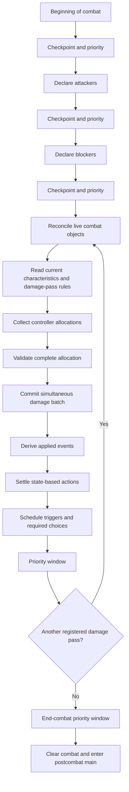

# Combat engine flow

Combat is a turn-based engine process. Attack/block declarations and combat damage never create stack objects. Responses and triggered abilities still use the ordinary stack.

Both players passing with an empty stack closes a response window. Damage assignment has no intervening response window: once all allocations are accepted, the complete batch applies and the rules checkpoint settles it before priority returns.

## Responsibilities

- `combat-state.ts`: identify participants using declaration snapshot UUID, zone revision and controller; permanently prune departed or changed objects; preserve explicit blocked status.
- `combat-rules.ts`: declaration permission/restriction/consequence hooks, generic damage passes, participation, recipients, lethal thresholds and allocation constraints. Existing Flying and Trample are adapters here.
- `combat-service.ts`: read live combat state, persist damage requests, produce distribution choices, revalidate answers and plan damage.
- `damage-service.ts`: shared damage proposal/consequence hooks and atomic damage application for players and permanents. Spell/ability damage uses this path too; ordinary life loss is separate.
- `GameEngine`: identify choices, commit mutations, publish events, settle state-based actions/triggers and grant priority.
- `StateMachine`: phase/turn transitions only. It does not allocate or apply combat damage.

## Manual allocation protocol

Every positive-power source with eligible recipients creates an ordinary `distribution` choice, including sources with one recipient. The source controller submits `choose` with the current `choiceId` and an `allocations` object keyed by the offered option IDs. Full power must be assigned; omitted options mean zero. Fractional, negative, excessive, incomplete and unknown-recipient answers are rejected. Ordinary multi-block damage permits arbitrary splits and overassignment. The existing Trample adapter requires lethal assignment to surviving blockers before assigning damage to the defending player.

The active player makes their assignments first, followed by the defending player. No damage applies while any source still needs input. `combatDamage` stores pass position, source snapshots, requests and accepted allocations; `pendingChoice` stores the continuation. Both are plain JSON and survive reconnection or engine reconstruction. No automatic allocation heuristic is installed.

Recipient IDs distinguish player IDs from permanent UUID/zone-revision references. Overlapping recipient extensions are deduplicated before the choice is constructed.

## Adding engine rules

`CombatRuleRegistry.register(rule)` and `DamageRuleRegistry.register(rule)` return unregister functions. Rule hooks are synchronous and pure; they return permissions, constraints or proposals. They never commit state, open checkpoints or hand out priority.

| Hook | Extension seam |
|---|---|
| `canAttackWhileSummoningSick` | Permission to attack despite this base restriction |
| `canBlockPair` | Pairwise blocking permissions; last explicit opinion wins |
| `validateAttackers`, `validateBlockers` | Constraints on a complete declaration, including groups |
| `attackerMutations`, `blockerMutations` | Transform declaration consequences, such as tapping |
| `damagePasses`, `dealsDamage` | Pass schedule and participation, with priority between passes |
| `damageRecipients` | Eligible damage destinations |
| `lethalDamage`, `validateAllocation` | Assignment thresholds and additional constraints |
| Damage `modify`, `consequences` | Shared damage transformations and consequences using the complete damaged board |

Whole-declaration restrictions still apply after pairwise permission exceptions. Query keywords through `CardCharacteristicService.resolveKeywords`; shared characteristic layers supply effective values. Haste attack permission, Reach, Vigilance, Menace, Defender and First/Double Strike remain deferred combat consumers. Generic damage prevention/results include Lifelink and Deathtouch, but do not add combat assignment consumers or automatic allocation. Additional attack destinations and multiplayer remain open.
