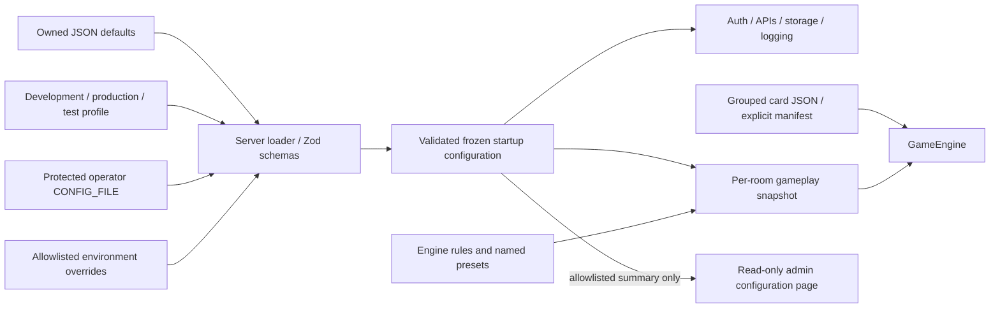

# Configuration and content ownership

**Date:** 27 October 2026. **Status:** implemented before platform Milestone 4. Extends [ARCHITECTURE.md](../ARCHITECTURE.md); see the [admin supplement](admin-architecture.md) and [completion report](phase-4-status-2026-10-27.md).

Editable data lives in its owning workspace. Server settings never enter a browser bundle. Game definitions and presets remain engine content; shared format policy contains data and pure validation only. Permissions, ownership checks, protocol versions, transactions and absolute input ceilings remain code invariants.



## File inventory

Paths below are relative to the repository root. JSON files contain data; adjacent TypeScript owns validation/loading.

| Folder/file | Editable content | Consumer |
|---|---|---|
| `apps/server/src/config/auth.json` | Argon2id costs, fixed lifetimes, global/per-account browser/per-family tab limits and shared password rate policy | Server only |
| `apps/server/src/config/http.json` | Port, request/page bounds and explicit false/loopback proxy trust | HTTP composition |
| `apps/server/src/config/storage.json` | Default database path, lock timeout, decks per account | Server repository/service |
| `apps/server/src/config/rooms.json` | Reconnect grace, selected gameplay preset and rule overrides | Room setup |
| `apps/server/src/config/logging.json` | Delta/audit paths, audit retry interval and log-read budgets | Server logging/admin reader |
| `apps/server/src/config/navigation.json`, `navigation.vite.json` | Instance ID/purpose/label, built/Vite destinations and bounded extra pages | Validated public `/api/platform` metadata |
| `packages/ui/src/config/navigation.json` | Workspace labels/IDs, destination keys and conditional admin visibility | All three frontends |
| `apps/server/src/config/profiles/*.json` | Exact origins, inspection/fixture flags and debug mode per environment | Startup loader |
| `packages/engine/src/config/rules/default-v1.json` | Starting life, opening hand, first-turn draw and land-play limit | Gameplay setup |
| `packages/engine/src/config/presets/*.json` | Development, trigger, ST01A, workbook and small-mechanics deck presets | Explicit fixture selection |
| `packages/engine/src/config/elements.json` | Element-to-mana-color mapping | Engine/content helpers |
| `packages/engine/src/config/diagnostics.json` | Engine diagnostic defaults | Engine/server development |
| `packages/engine/src/library/cards/{core,st01a,workbook,development}/*.json` | One authored card definition per file | Catalog normalizer |
| `packages/engine/src/library/cards/index.ts` | Explicit content manifest; unique stable card IDs | Static bundling/catalog enumeration |
| `packages/protocol/src/decks/config/standard-v1.json` | Initial `standard` deck-size/copy rules | Pure shared validator |
| `packages/protocol/src/decks/config/eligibility.json` | Explicit repeatable-card and excluded-card IDs | Server catalog policy |
| `apps/game-client/config/{ui,diagnostics}.json` | Saved-deck page size and player-side diagnostics | Player bundle only |
| `apps/admin/config/ui.json` | Admin page size, room polling interval and dedicated storage namespace | Admin bundle only |
| `apps/deck-builder/config/ui.json` | Page/import bounds and draft/legacy cleanup namespaces | Builder bundle only |

`schema.ts` is authoritative for supported server settings and safety bounds. Units are explicit: `*Ms` is milliseconds, `*Bytes` is bytes; Argon2 memory cost is KiB. The admin storage namespace is deliberately fixed by its validator to prevent accidental reuse of the player credential key. Frontend JSON is public and must never contain credentials.

## Loading and precedence

The production entry loads and validates exactly one effective configuration, then passes that same object to application composition. The isolated factory can load its own configuration for tests. Precedence is:

1. Bundled module defaults.
2. The profile selected by `NODE_ENV` (`development`, `production` or `test`; default `development`).
3. `FRONTEND_MODE` navigation baseline (`built` default, `vite` only outside production); `npm run dev` selects Vite through the process flag.
4. Optional operator JSON at `CONFIG_FILE`.
5. Explicit programmatic overrides for application tests/embedding.
6. Allowlisted environment overrides: `PORT`, `DATABASE_PATH`, `DELTA_LOG_PATH`, `ADMIN_AUDIT_PATH`, `ALLOWED_ORIGINS`, `INSPECTOR_ENABLED`, `FIXTURE_DECKS_ENABLED`.

Nested objects merge; arrays replace. Unknown/dangerous keys, invalid profiles, bad origin strings and out-of-bounds values fail. A production profile never inherits local origins. Environment booleans must be exactly `true` or `false`. An empty delta path disables diagnostic logging. The production audit destination remains required; the isolated test factory has a separate explicit export-disable seam.

The operator file must be a regular file no larger than 64 KiB. JSON syntax/file errors identify `CONFIG_FILE`; schema errors identify setting paths without printing values or credential material. `ConfigurationError` messages survive the process startup handler, while unrelated failures remain generic. The effective object and nested values are frozen; there is no live reload or remote configuration editor.

**Source defaults are bundled:** editing checked-in JSON/card files requires rebuilding and restarting. Editing an external `CONFIG_FILE` or environment requires restarting only. Use an atomic file replacement for operator changes. Keep deployment profiles in version control, and keep machine-specific files/secrets outside Git. `config.local.json` is ignored as an optional local operator filename; it is loaded only when explicitly selected with `CONFIG_FILE`.

Example operator file for a production server:

```json
{
  "origins": ["https://game.example.test", "https://admin.example.test"],
  "inspectionEnabled": true,
  "http": { "pageSize": 25 },
  "storage": { "databasePath": "/var/lib/cardgame/card-game.sqlite" },
  "logging": {
    "deltaPath": "/var/log/cardgame/deltas.jsonl",
    "auditPath": "/var/log/cardgame/admin-audit.jsonl"
  }
}
```

Replace example domains/paths for the intended host. Relative database/log paths resolve against the deployed repository root, consistently with existing build paths. Secret bootstrap values are not part of this JSON: use `ADMIN_BOOTSTRAP_USERNAME` and a protected `ADMIN_BOOTSTRAP_PASSWORD_FILE` (or the existing environment-secret alternative). The configuration summary API omits paths, origins, password sources and credentials; it exposes only approved operational values and a configuration revision.

Vite's development proxy targets and the nginx example default to backend port 3000. If you change the backend port, update those owning build/deployment configuration files too; frontends deliberately do not import private server settings.

## Gameplay/content migration

All **79 authored definitions** and **five presets** were fingerprinted before extraction. `tests/fixtures/config-baseline.json` retains those fingerprints; the focused regression test compares the complete canonical data, not just card counts. Every manifest key must match its definition ID and every definition still normalizes successfully. No new cards or rule changes are introduced by splitting files.

Card IDs stay unchanged. Add a card by creating a strict JSON definition in the appropriate group and adding its import/key to `cards/index.ts`; the manifest is source-controlled, not generated during production startup. Use the annotated JSONC example as an authoring reference, then remove comments and the outer catalog-map wrapper from the single-card file. Runtime UUIDs, owners, state and choices remain engine-generated.

Presets are overrides of one base rules file, avoiding repeated authoritative defaults. Compatibility imports at engine/server `config.ts` remain thin reexports. The engine's legacy `gameConfig` fixture API remains available for standalone tests; production resolves startup settings and snapshots them for every room. Existing matches retain their life/draw/land rules, debug mode and selected deck arrays even if later defaults change. The legacy long-routing helper uses an explicit fixture-provider seam rather than production live reload.

Deck format meaning remains versioned: the current stored identifier `standard` retains its Milestone 3 rules. A future semantic format change needs a new identifier/schema/migration as appropriate. The account deck quota has moved out of protocol into server storage settings. Catalog legality now uses explicit IDs, replacing filename-suffix inference; unknown or contradictory eligibility IDs fail startup. Player deck loading follows bounded pages so smaller page settings do not silently hide later saved decks.

## Decisions and limitations

| ADR | Decision | Trade-off |
|---|---|---|
| C4-01 | JSON beside the owning workspace; reuse Zod in server/protocol | Clear ownership and no config framework; bundled source changes need rebuilds. |
| C4-02 | Frozen startup config with deterministic precedence and replacement arrays | Reproducible settings and production isolation; restart is required for operator changes. |
| C4-03 | Grouped single-card files plus an explicit manifest | Small reviewable content edits and ordinary static bundling; new cards need a manifest entry. |
| C4-04 | Shared public format policy, server-only quotas/secrets | Preserves package/browser boundaries; public contracts and format evolution still require code review. |
| C4-05 | Read-only effective summary in admin | Operators can verify live settings without revealing credential sources; editing remains a deployment operation. |

Runtime state belongs in SQLite/rooms, not config files. This refactor adds neither encrypted secret storage nor a configuration management service. Linux file permissions, secret provisioning and deployment validation remain operator responsibilities. Focused schema/content/snapshot tests and the completion report record what was verified locally.
