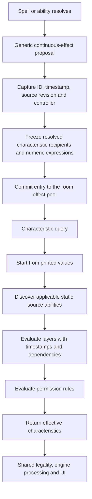

# Continuous effects and effective characteristics

Milestone 6 provides an engine model shared by server and client. Printed blueprints remain unchanged. Room-owned effect entries and source abilities supply the effective values queried by casting, targeting, activation, combat, triggers, state-based actions and existing UI.

## Effect contracts

`ContinuousEffect` is an extensible discriminated union in `src/types/continuous-effect.types.ts`. `CREATE_CONTINUOUS_EFFECT` accepts an operation in `params.effect`; `SET_STATS` accepts `params.power` and `params.toughness`. Both use the ordinary effect/target-resolution pipeline. Their default duration is `PERMANENT`; specify `END_OF_TURN` for a temporary effect. Existing `GRANT_STATS` remains explicitly end-of-turn.

Each committed entry has a unique `id` and ordering `timestamp`. They serve separate purposes: equal timestamps do not merge identities. `REMOVE_CONTINUOUS_EFFECT` with `id` removes exactly one entry. Legacy source-based removal remains supported for old callers. `effectSequence` and `effectTimestamp` are room data and travel through deltas and snapshots.

Resolved characteristic effects capture affected `{cardUuid, zoneRevision}` references and source controller at creation. Numeric count expressions are evaluated at that point. Later entrants and new incarnations are excluded. Source departure does not cancel these effects unless `requiredZone` or a source-dependent duration explicitly requires it. `origin: 'resolved'` defaults to `requiredZone: null`. `WHILE_ON_BATTLEFIELD` and `WHILE_ATTACHED` require the matching source incarnation on the battlefield; the latter also requires attachment state.

Resolved `PERMISSION` effects retain dynamic scopes because they change game rules. A restriction can apply to a later card entering the relevant zone. Static scopes also match dynamically on each query, using the source's effective controller. Ordinary static abilities default to the battlefield; `activeZones` deliberately enables other zones. Characteristic-defining abilities default to all represented zones.

Static effects are derived from current abilities rather than stored copies in the room pool. Source zone-entry timestamps and grant timestamps determine their order. Parts with the same `group` are one effect across layers; the default is one group per static ability. Their affected set and remaining parts are retained once that effect starts applying, including if a later layer removes its generating ability. Give independent effects distinct groups. Unstarted definitions refresh after same-layer text or ability changes.

Granted ability IDs include the originating effect ID and addition index. This keeps duplicate grants distinct and prevents an earlier grant's expiry from renaming a surviving ability. Use IDs returned by effective abilities/options for activation, exact `removeIds`, or ability-specific permissions. Printed ability IDs retain their existing form.

## Evaluation order

The operation determines its stage; the legacy `layer` field remains descriptive metadata.

| Stage | Operation |
|---|---|
| 1 | Copy copiable blueprint values |
| 2 | Control |
| 3 | Text substitutions, preserving names and identity fields |
| 4 | Card types and subtypes |
| 5 | Colors |
| 6 | Abilities and keywords |
| 7a | Characteristic-defining P/T expressions |
| 7b | Set base P/T |
| 7c | Modify P/T and apply counters |
| 7d | Switch P/T |
| After characteristics | Casting/activation permission rules |

Within a stage, defining effects precede ordinary effects. A dependency exists when another effect changes applicability, recipients or the operation's result. Dependencies are reevaluated after each application. Cyclic components use timestamp order internally while outside effects still wait for their prerequisites. With no dependency, timestamp order applies.

`CardCharacteristicService.resolve` returns the complete effective value. Convenience queries expose types, subtypes, colors, keywords, abilities, controller and P/T. `resolveBlueprint` exposes effective spell costs/effects/modes to existing consumers. `resolveCopiableBlueprint` stops after copying, excluding counters and later-layer buffs. Retained source snapshots store effective and copiable last-known information separately.

## Permissions and integration

Shared targeting reads effective type/control/P/T and effective Shroud, Hexproof and protection qualities. Protection targeting supports colors, colorless/monocolored/multicolored, types, subtypes and everything. Announcement and resolution revalidation use the same checks as client highlights.

`PERMISSION` rules select cast/activate actions, player relationships and optional effective ability IDs. `prohibit` wins over timing grants. `instant` and effective Flash relax timing while preserving priority, zone and cost checks. Casting restrictions do not retroactively counter an announced spell. Ability removal changes effective activation/mana options, trigger discovery and existing combat keyword legality.

Control tenure is tracked for every permanent, including noncreatures that later become creatures. Effective controller changes reset tenure and reconcile combat; source changes in other zones are included. Zone revisions preserve the persistent UUID while preventing old references/effects from rebinding after re-entry.

No card catalog additions, new client components or configuration flags are required. Manual combat allocations and open combat keyword hooks remain in place. Protection's damage/blocking/attachment behavior, replacement/prevention, attachments and remaining state-based actions belong to the later milestones that provide those pipelines.
