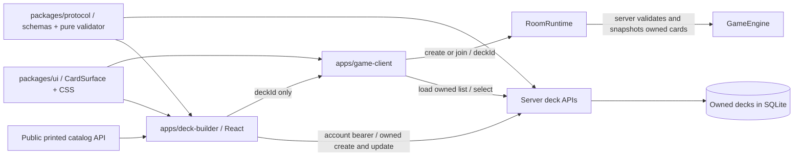

# Deck builder — architecture supplement

**Date:** 28 October 2026. Implements platform Milestone 5. See [ARCHITECTURE.md Appendix F](../ARCHITECTURE.md#appendix-f-deck-builder-and-shared-card-display) and the [completion report](phase-5-status-2026-10-28.md).

## Purpose and structure

The builder turns the persistent catalog/deck APIs from Milestone 3 into a usable workflow: browse → draft → validate → save → select in the game → create/join a room → play. Browsing and local drafting are public. Creating/updating a saved deck needs a game-scoped account session. The server remains authoritative for ownership, format legality and match setup.



| Location | Responsibility and reason |
|---|---|
| `apps/deck-builder/App.tsx` | Public workbench, account controls, catalog filters, live validation, owned list and save state. React reuses the repository's browser stack. |
| `apps/deck-builder/model.ts` | Pure editing/filtering/import/export functions. Drafts can be incomplete; server-write validation remains the protocol validator. |
| `apps/deck-builder/api.ts` | Typed fetch boundary for printed catalog, game-account auth and owned decks. Protocol/Zod schemas reject incompatible replies. No engine or other-app imports. |
| `apps/deck-builder/storage.ts` | Per-tab recovery and separate builder credential namespace. Storage denial falls back to memory with a draft-recovery notice. |
| `apps/deck-builder/config/ui.json` | Public page size, bounded import size, fixed storage namespaces and default game destinations. |
| `packages/ui/src/CardSurface.tsx`, `style.css` | Shared printed face and visual rules. Only React/display fields; no stores, auth, sockets or engine. |
| `apps/game-client/components/CardComponent.tsx` | Wraps the shared face with existing targeting, combat, click/context actions and runtime state/labels. |
| `apps/game-client/deck-handoff.ts`, `StartScreen.tsx` | Parse a requested UUID, retain it through sign-in, find it in the account's owned list and select it before room creation. |

No new framework or external library was added. Vite builds the fourth application; TypeScript checks seven projects. Existing Zod validates public config and API data. The UI package uses source exports like other internal packages and emits declarations only; it has no separate runtime build.

## User behavior and failure handling

- Search matches ID/name/rules/subtype; type, color and deck-legality filters combine locally over a bounded, paged catalog. Displayed IDs support unambiguous text import. Excluded fixtures remain visible when the legality filter is cleared but cannot be added through the catalog.
- Add/remove controls and the name field update a local draft. The shared validator reports structure, size, duplicate, unknown, excluded and copy-limit errors. Invalid imports with valid syntax remain editable and show rule errors. Failed syntax imports do not replace the draft.
- `Save deck` creates; loading an owned deck enables `Update saved deck` and `Save as new`. Saving is disabled during catalog/account loading, operations and invalid drafts. Server rejection preserves edits. A missing saved record releases the stale ID so the user can save a new copy. There is no delete UI in this milestone; the existing DELETE API remains available.
- Local recovery stores **only** name/format/card quantities under `cardgame.builderDraft.v1`. Saved IDs/ownership metadata are excluded, so reload or a different account cannot accidentally inherit an update target. Account changes/sign-out clear the owned list and update target but keep the draft.
- Builder sessions use `cardgame.builderSession.v1` in `sessionStorage`, independently of player and admin storage. Restored sessions are checked against `/api/auth/me`. Expiry and 401/403 clear local authorization. Requests are cancelled or ignored after session changes/unmount; mutations lock editing until they finish. A failed server logout is reported while local credentials are removed.
- Existing authentication permits one current account session per scope: a new game-scoped login rotates earlier game/builder credentials. The builder states this before login/play and rechecks the account when its tab regains focus. Returning after game sign-in clears the old builder authorization while retaining the draft. Concurrent authenticated builder editing and play are not provided by this policy; adding distinct client sessions would be a separate auth design change. Admin scope remains independent.
- “Play this deck” appears only for a saved, unchanged, currently valid draft. It opens the configured game destination in a new tab with `noopener noreferrer`, passing a UUID. This keeps the builder draft available and avoids carrying an existing game tab's room into the new match. Tokens/passwords never enter that URL. The game requires its own login with the same account. Separate Vite origins do not share storage; this deliberate extra login avoids token forwarding. A deleted/foreign deck cannot resolve and blocks room creation until the user changes account or dismisses the link. The server repeats ownership/legality checks on create/join.
- The game removes a successfully consumed/dismissed `deckId` query without disturbing unrelated URL fields. Duplicate or malformed IDs are rejected. Dismissing an in-flight request prevents a late list response from reapplying it.

The catalog is loaded once per page/retry, with at most 10,000 entries and at most 100 per request. Owned list loading is bounded at 1,000 entries (the server's configurable quota ceiling). Response pagination/duplicates are checked. These are small-project bounds, not a scale claim; a larger catalog should gain server-side search/windowed rendering. Concurrent edits in other tabs use the existing last-write-wins API; optimistic revision conflicts are future work. An unacknowledged create may succeed server-side even if its response is lost: refresh the saved list before retrying, rather than assuming exactly-once creation.

## Portable text format

```text
# name: "Mountain servants"
# format: standard
4 empire-servant
56 land-red
```

Card IDs are case-sensitive, stable catalog IDs. Quantity is a positive integer. Repeated IDs merge before validation; excess quantities, unsupported formats, malformed names/lines and oversized inputs fail atomically. Blank/comment lines are permitted. Exports sort IDs; JSON-quoted names preserve Unicode/newlines without creating extra headers. Text import is bounded to the public config byte limit (default 32 KiB), with a hard schema ceiling of 64 KiB, and at most 270 lines. Copy the exported textarea content to a text file if needed. Deck validity still follows `packages/protocol/src/decks/config/standard-v1.json`; the import format grants no extra permission.

## Running and deployment

1. From the root, install workspaces with `npm ci` and build with `npm run build`.
2. For development, run the backend (`npm run dev`), player (`npm run dev:client`) and builder (`npm run dev:deck-builder`) in separate terminals. Open `http://localhost:5175/deck-builder/`. The builder proxies `/api` to port 3000; the game runs on 5173. The development backend origin list includes 5175.
3. Built serving uses `http://localhost:3000/deck-builder/` and the game at `/`. Express serves the separate builder dist in all profiles because its shell/catalog are public. Admin production assets retain their separate boundary.
4. Production can use the same public origin with `/deck-builder/` served from `apps/deck-builder/dist/` by Express or nginx. The [nginx location fragment](../deploy/nginx/deck-builder.locations.example) fits the public game vhost. Keep backend APIs/protected data out of static folders and configure the actual allowed origin. TLS/nginx/Linux installation must be verified on the target host.

Production defaults link back to `/` on the builder's origin. A separately hosted builder can set public **build-time** `VITE_GAME_URL=https://game.example/` when building its workspace; the API proxy and allowed origins must then be configured for that host. The destination accepts only HTTP(S), forbids embedded credentials, and discards pre-existing query/fragment fields. This configuration is never accepted from a user URL. Source JSON/Vite environment changes need a rebuild; backend origin overrides need restart. Vite dev destinations live in the owning frontend config folders.

## Architecture decisions

**Planned extension, 29 October 2026:** [Milestone 6](platform-plan-2026-10-24.md#phase-6--navigation-and-session-integration) will address cross-app navigation/session continuity. [Milestone 7](platform-plan-2026-10-24.md#phase-7--admin-test-lab-and-scenario-builder) will extract reusable editor pieces for admin scenarios and migrate manual test composition with fixture compatibility evidence. These are planned changes; the current separate-session/standard-deck behavior and decisions below remain implemented. See the [design supplement](navigation-test-lab-plan.md).

| ADR | Decision | Alternatives and consequences |
|---|---|---|
| P5-01 | Separate React/Vite builder with a React-only shared face | Putting the editor inside the game would couple release/state boundaries. Copying card markup would drift. A shared package adds a project reference but keeps one appearance and existing game handlers. |
| P5-02 | Public printed DTO catalog plus existing protocol validator | Importing engine blueprints into the browser would violate the established boundary and expose executable content. Local filtering is simple for the current 79-card catalog; larger catalogs need server query support. |
| P5-03 | Separate builder login and UUID-only handoff; preserve scope rotation | Token query strings, cross-origin storage bridges and shared admin credentials were rejected. Game sign-in rotates the builder credential under the existing policy; the draft stays available and focus refresh detects it. Another sign-in avoids credential transfer but does not support simultaneous authenticated editing/play. Ownership is verified by the owned list and server room setup. |
| P5-04 | Per-tab recoverable draft without saved identity | No persistence risks losing ordinary edits; long-lived shared local storage risks cross-account overwrite targets. Session recovery lasts only for this tab and intentionally requires reloading an owned record before updating it. |
| P5-05 | Stable-ID bounded text format, explicit save | Name matching is ambiguous; arbitrary JSON includes metadata. Explicit import/export and save are reviewable, do not execute content, and keep incomplete drafts separate from authoritative saved decks. |

## Verification contract

Focused logic/render tests cover editing, filtering, import failures/roundtrips, storage/session separation, request schemas/pagination/errors, shared face identity and requested-deck ownership. The real short HTTP/socket acceptance uses the builder model/API, checks shared verdicts, saves decks, resolves an owned handoff, snapshots both decks, plays a land and completes a normal turn through empty combat declarations. Guests/no-session saves are denied by the real API. All seven typechecks, four builds and source dependency checks must pass. Browser smoke, long socket/full-suite waits and deployment checks are excluded by the user's testing instruction; no visual/runtime browser verification is claimed.
