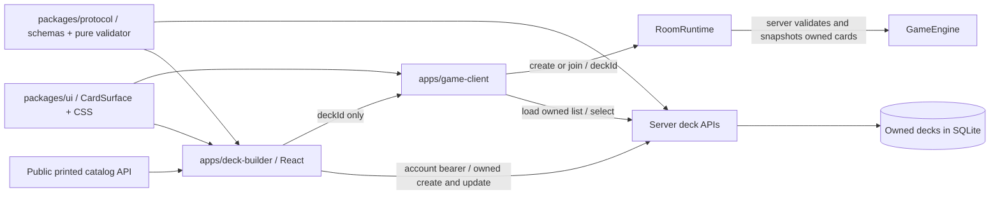

# Deck builder — architecture supplement

**Date:** 28 October 2026. **Updated:** 29 October 2026 for Milestone 6 shared navigation/browser sign-in; [current session architecture](navigation-session-architecture.md) is authoritative. See [ARCHITECTURE.md Appendix F](../ARCHITECTURE.md#appendix-f-deck-builder-and-shared-card-display) and the historical [Milestone 5 report](phase-5-status-2026-10-28.md).

## Purpose and structure

The builder turns the persistent catalog/deck APIs from Milestone 3 into a usable workflow: browse → draft → validate → save → select in the game → create/join a room → play. Browsing and local drafting are public. Creating/updating a saved deck needs a game-scoped account session. The server remains authoritative for ownership, format legality and match setup.



| Location | Responsibility and reason |
|---|---|
| `apps/deck-builder/App.tsx` | Public workbench, account controls, catalog filters, live validation, owned list and save state. React reuses the repository's browser stack. |
| `apps/deck-builder/model.ts` | Pure editing/filtering/import/export functions. Drafts can be incomplete; server-write validation remains the protocol validator. |
| `apps/deck-builder/api.ts` | Typed fetch boundary for printed catalog, game-account auth and owned decks. Protocol/Zod schemas reject incompatible replies. No engine or other-app imports. |
| `apps/deck-builder/storage.ts` | Per-tab draft recovery and legacy credential-key cleanup. Public account access is cookie-managed through browser-session. |
| `apps/deck-builder/config/ui.json` | Public page size, bounded import size, fixed storage namespaces and default game destinations. |
| `packages/ui/src/CardSurface.tsx`, `style.css` | Shared printed face and visual rules. Only React/display fields; no stores, auth, sockets or engine. |
| `apps/game-client/components/CardComponent.tsx` | Wraps the shared face with existing targeting, combat, click/context actions and runtime state/labels. |
| `apps/game-client/deck-handoff.ts`, `StartScreen.tsx` | Parse a requested UUID, retain it through sign-in, find it in the account's owned list and select it before room creation. |

The builder keeps React/Vite/Zod and shared UI. Milestone 6 adds the local browser-session workspace; no external framework was added. TypeScript checks eight projects and Vite builds four applications. Shared packages export source/declarations without a separate runtime build.

## User behavior and failure handling

- Search matches ID/name/rules/subtype; type, color and deck-legality filters combine locally over a bounded, paged catalog. Displayed IDs support unambiguous text import. Excluded fixtures remain visible when the legality filter is cleared but cannot be added through the catalog.
- Add/remove controls and the name field update a local draft. The shared validator reports structure, size, duplicate, unknown, excluded and copy-limit errors. Invalid imports with valid syntax remain editable and show rule errors. Failed syntax imports do not replace the draft.
- `Save deck` creates; loading an owned deck enables `Update saved deck` and `Save as new`. Saving is disabled during catalog/account loading, operations and invalid drafts. Server rejection preserves edits. A missing saved record releases the stale ID so the user can save a new copy. There is no delete UI in this milestone; the existing DELETE API remains available.
- Local recovery stores **only** name/format/card quantities under `cardgame.builderDraft.v1`. Saved IDs/ownership metadata are excluded, so reload or a different account cannot accidentally inherit an update target. Account changes/sign-out clear the owned list and update target but keep the draft.
- Builder account access now uses the shared HttpOnly browser cookie through `packages/browser-session`; it stores no new builder bearer. The old `cardgame.builderSession.v1` key is cleared. Identity/CSRF reads verify the account on startup/focus. Expiry/denials preserve draft data; cancelled or superseded reads cannot restore old account state. Server sign-out failures are shown rather than reported as success.
- A browser family permits bounded, separate game-tab credentials. Opening Play reuses sign-in without revoking the builder or game; explicit browser-family/account-wide public logout still ends the intended children. Legacy password/bearer login retains its prior rotation behavior. Admin scope remains independent.
- “Play this deck” appears only for a saved, unchanged, currently valid draft and configured game destination. It opens a no-opener game tab with a UUID-only URL. Browser sign-in is reused there; the game creates/reuses its own tab credential and verifies the owned deck. Parent/child credentials never enter URLs. A foreign/deleted deck blocks accidental creation until dismissed or corrected; server room setup repeats validation/ownership checks.
- The game removes a successfully consumed/dismissed `deckId` query without disturbing unrelated URL fields. Duplicate or malformed IDs are rejected. Dismissing an in-flight request prevents a late list response from reapplying it.

The catalog is loaded once per page/retry, with at most 10,000 entries and at most 100 per request. Owned list loading is bounded at 1,000 entries (the server's configurable quota ceiling). Response pagination/duplicates are checked. These are small-project bounds, not a scale claim; a larger catalog should gain server-side search/windowed rendering. Concurrent edits in other tabs use the existing last-write-wins API; optimistic revision conflicts are future work. An unacknowledged create may succeed server-side even if its response is lost: refresh the saved list before retrying, rather than assuming exactly-once creation.

## Portable text format

```text
# name: "Mountain servants"
# format: standard
4 empire-servant
56 land-red
```

Card IDs are case-sensitive, stable catalog IDs. Quantity is a positive integer. Repeated IDs merge before validation; excess quantities, unsupported formats, malformed names/lines and oversized inputs fail atomically. Blank/comment lines are permitted. Exports sort IDs; JSON-quoted names preserve Unicode/newlines without creating extra headers. Text import is bounded to the public config byte limit (default 32 KiB), with a hard schema ceiling of 64 KiB, and at most 270 lines. Copy the exported textarea content to a text file if needed. Deck validity still follows `packages/protocol/src/decks/config/standard-v1.json`; the import format grants no extra permission.

## Running and deployment

1. From the root, install workspaces with `npm ci` and build with `npm run build`.
2. For development, run the backend (`npm run dev`), player (`npm run dev:client`) and builder (`npm run dev:deck-builder`) in separate terminals. Open `http://localhost:5175/deck-builder/`. The builder proxies `/api` to port 3000; the game runs on 5173. The development backend origin list includes 5175.
3. Built serving uses `http://localhost:3000/deck-builder/` and the game at `/`. Express serves the separate builder dist in all profiles because its shell/catalog are public. Admin production assets retain their separate boundary.
4. Production can use the same public origin with `/deck-builder/` served from `apps/deck-builder/dist/` by Express or nginx. The [nginx location fragment](../deploy/nginx/deck-builder.locations.example) fits the public game vhost. Keep backend APIs/protected data out of static folders and configure the actual allowed origin. TLS/nginx/Linux installation must be verified on the target host.

Server-owned `navigation.json` supplies built-origin links; `navigation.vite.json` supplies the explicitly selected Vite mode. Production Home/Play/Decks share an HTTPS origin and admin uses a separate origin. `npm run dev` selects Vite; `npm start` defaults to built serving. Old `VITE_GAME_URL`, `developmentGameUrl`, `gamePath` and player `developmentBuilderUrl` settings are replaced by this metadata. Unavailable/invalid navigation disables game handoff rather than guessing a destination. See [current setup](navigation-session-architecture.md#running-and-deployment).

## Architecture decisions

**Milestone 6 delivered:** navigation/session continuity now follows the [current supplement](navigation-session-architecture.md). Milestone 7 will extract editor pieces for nonstandard admin scenarios and migrate manual test composition with preset compatibility evidence. The M5 decisions below record their original trade-offs; P5-03’s repeated-login/rotation limitation is superseded for the current UI flow by M6.

| ADR | Decision | Alternatives and consequences |
|---|---|---|
| P5-01 | Separate React/Vite builder with a React-only shared face | Putting the editor inside the game would couple release/state boundaries. Copying card markup would drift. A shared package adds a project reference but keeps one appearance and existing game handlers. |
| P5-02 | Public printed DTO catalog plus existing protocol validator | Importing engine blueprints into the browser would violate the established boundary and expose executable content. Local filtering is simple for the current 79-card catalog; larger catalogs need server query support. |
| P5-03 | Historical separate builder login/UUID-only handoff; superseded by M6 browser reuse | Credential URLs/storage bridges were rejected. M5 required game re-login; M6 reuses the public browser family and retains separate game-tab credentials/ownership. |
| P5-04 | Per-tab recoverable draft without saved identity | No persistence risks losing ordinary edits; long-lived shared local storage risks cross-account overwrite targets. Session recovery lasts only for this tab and intentionally requires reloading an owned record before updating it. |
| P5-05 | Stable-ID bounded text format, explicit save | Name matching is ambiguous; arbitrary JSON includes metadata. Explicit import/export and save are reviewable, do not execute content, and keep incomplete drafts separate from authoritative saved decks. |

## Verification contract

Focused logic/render checks retain editing/filtering/import/storage/API/card-face coverage. Milestone 6 additionally proves cookie sign-in → builder save → tab-owned match/full turn → builder update without another login or game revocation. Anonymous/guest saves remain denied. All eight project typechecks, four builds and import/bundle checks are required. See the [current completion report](phase-6-status-2026-10-29.md) for exact results. Browser smoke, long socket/full-suite waits and target-host deployment remain excluded; no browser interaction/visual claim is made.
