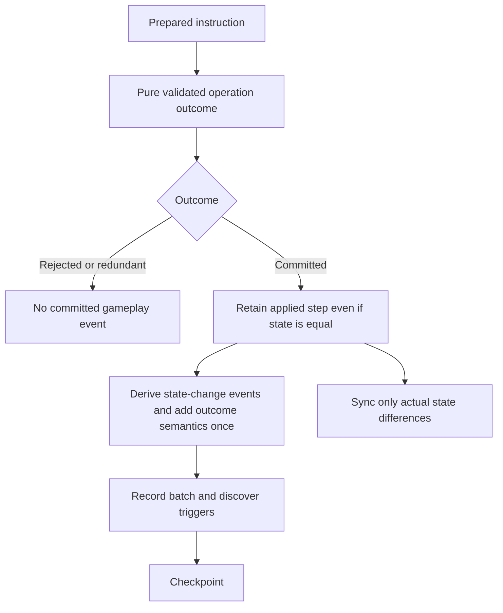

# 8.1 prerequisite — Committed operation outcomes

Status: proposed structural prerequisite; implementation stopped for owner review. Inspected baseline: `ad6a96e`, 12 October 2026. Parent: [zones and library workflows](8.1-zones-and-library.md).

## Demonstrated structural gap

`GameEngine.commitPreparedMutations` in `src/engine/game-engine.ts` calls `gameReducer(previous, mutation)` and then executes:

```typescript
if (sameStateValue(previous, next)) continue;
```

Only retained steps reach `deriveAppliedEvents` and the committed batch. `sameStateValue` in `src/engine/applied-events.ts` recursively compares plain state values; new array/object references alone do not establish a change. The reducer currently returns only `GameRoom`, so the commit layer cannot distinguish rejection, redundant assignment, and a successful semantic operation with an unchanged result.

A shuffle of one card, an empty library, or a larger library with the same resulting permutation can succeed without changing library state. Treating it as an absent operation would lose its semantic event and make the log/trigger history depend on whether the random outcome changed the order. This is source-level evidence about the current commit contract; no new shuffle handler exists and no runtime reproduction of such a handler is claimed.

Rule evidence: [official comprehensive rules, effective 25 September 2026](https://media.wizards.com/2026/downloads/MagicCompRules%2020260925.txt), 701.24e, explicitly preserves shuffle triggers for zero/one-card libraries. Verified against the TXT link from the official rules page on 12 October 2026.

## Rejected patches

- Increment an artificial shuffle counter solely to defeat equality filtering.
- Add a shuffle-specific exception around `sameStateValue`.
- Emit the semantic event directly from `EffectRegistry` before the operation commits.
- Retain every no-op mutation: invalid attempts and redundant setters must not become successful gameplay events.

These approaches obscure whether an operation actually succeeded or bypass the established actual-event boundary. The owner's instruction is to stop when hardcoding/patching would be needed; no production implementation has been made.

## Proposed general boundary

Use one typed operation outcome at the reducer/commit boundary. State change and semantic success are distinct results:

```typescript
// Proposed contract, not an existing exported API.
type OperationOutcome =
  | { status: 'rejected'; state: GameRoom; reason: string }
  | { status: 'unchanged'; state: GameRoom }
  | { status: 'committed'; state: GameRoom; events: EventDraft[] };
```

Each operation's authoritative reducer owns validity and whether it constitutes a successful semantic operation. Changed setters commit; redundant setters are unchanged; invalid instructions reject. A valid shuffle commits a semantic outcome regardless of whether its order differs. The event data represents the actual validated outcome, not speculative intent.

The final contract must also define ownership of existing derived events. Keep exactly one event producer for each semantic family: do not emit both outcome-provided and `deriveAppliedEvents` versions of the same event. One viable split keeps current before/after derivation for state changes and lets outcomes supply only semantics not recoverable from state differences. Another moves event production to outcomes completely, but that would be a substantially broader migration. Recommend the first, incremental split after review.

Compatibility: pure `gameReducer(state, mutation) => GameRoom` can remain the state-only projection used by preview, sync and historical JSONL replay. Authoritative commits consume the richer outcome. Both paths must use the same validation/reduction implementation, not duplicate mutation switches. Preview must not publish events. Commit must not rerun randomness: shuffle instructions already contain the chosen explicit permutation.

## Data flow



## Modules affected if approved

| Module | Responsibility |
|---|---|
| `src/types/game-mutation.types.ts` / `game-event.types.ts` | Instruction and semantic-event contracts |
| `src/engine/game-reducer.ts` | One validated reduction path; state-only projection plus richer outcome |
| `src/engine/game-engine.ts` | Commit from explicit outcome, preserving batching, history and checkpoint order |
| `src/engine/applied-events.ts` | Merge actual outcomes with derived events without duplication |
| `src/engine/proposed-events.ts` | Preview remains pure; suspended transactions retain prepared instructions |
| `src/server/sync-service.ts` | Equal-state semantic commit needs no fabricated state delta |
| `src/shared/game-logger.ts` | Existing generic event-batch recording receives successful operation semantics |

## Required evidence before library implementation resumes

1. A rejected instruction produces neither state changes nor success events.
2. A redundant setter retains current no-event behavior.
3. A successful semantic operation with equal state produces one committed event/batch.
4. A state-changing operation retains existing events without duplication.
5. JSONL records and state-only replay preserve unchanged-state successes in the timeline without inventing state.
6. Live clients remain convergent when an event has no state delta; reconnect remains unchanged.
7. Preview and suspended/resumed replacement transactions never publish early or twice.
8. Existing full suite, both typechecks and production build pass after the boundary migration.

After that contract is accepted and proven, ordered movement and explicit shuffle can be implemented as general operations. This prerequisite does not close the reveal, access or private-projection gates in 8.1.
