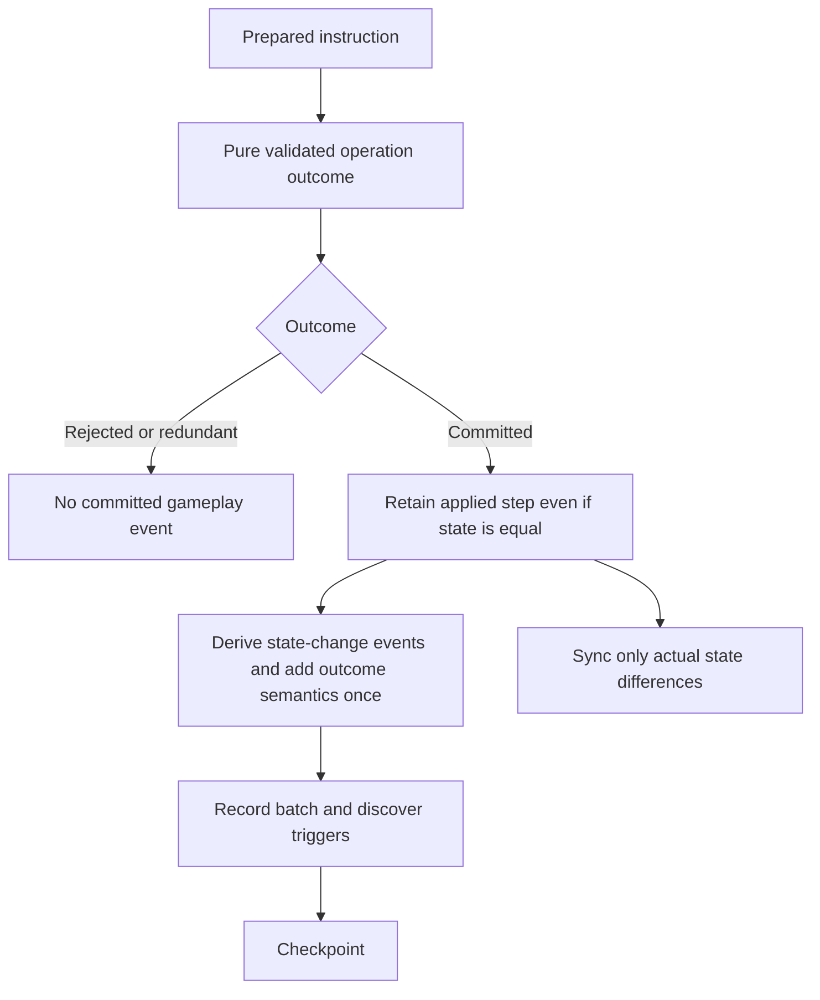

# 8.1 prerequisite — Committed operation outcomes

Status: owner approved on 12 October 2026; boundary and generic shuffle consumer implemented and verified. Historical gap baseline: `ad6a96e`. Parent: [zones and library workflows](8.1-zones-and-library.md).

## Original structural gap

At the historical baseline, `GameEngine.commitPreparedMutations` in `src/engine/game-engine.ts` called `gameReducer(previous, mutation)` and then executed:

```typescript
if (sameStateValue(previous, next)) continue;
```

Only retained steps reached `deriveAppliedEvents` and the committed batch. `sameStateValue` recursively compares plain state values; new array/object references alone do not establish a change. The old reducer returned only `GameRoom`, so the commit layer could not distinguish rejection, redundant assignment, and a successful semantic operation with an unchanged result.

A shuffle of one card, an empty library, or a larger library with the same resulting permutation can succeed without changing library state. Treating it as an absent operation loses its semantic event and makes the log/trigger history depend on whether the random outcome changed the order. New regression tests reproduced this failure before implementation and now pass through the approved boundary.

Rule evidence: [official comprehensive rules, effective 25 September 2026](https://media.wizards.com/2026/downloads/MagicCompRules%2020260925.txt), 701.24e, explicitly preserves shuffle triggers for zero/one-card libraries. Verified against the TXT link from the official rules page on 12 October 2026.

## Rejected patches

- Increment an artificial shuffle counter solely to defeat equality filtering.
- Add a shuffle-specific exception around `sameStateValue`.
- Emit the semantic event directly from `EffectRegistry` before the operation commits.
- Retain every no-op mutation: invalid attempts and redundant setters must not become successful gameplay events.

These approaches obscure whether an operation actually succeeded or bypass the established actual-event boundary. Implementation stopped for review; the owner then approved the general solution. None of these patches was used.

## Implemented general boundary

Use one typed operation outcome at the reducer/commit boundary. State change and semantic success are distinct results:

```typescript
type OperationOutcome =
  | { status: 'rejected'; state: GameRoom; reason: string }
  | { status: 'unchanged'; state: GameRoom }
  | { status: 'committed'; state: GameRoom; events?: EventDraft[] };
```

`reduceGameOperation(state, mutation)` in `src/engine/game-reducer.ts` is the authoritative reduction boundary. `gameReducer` returns its state-only projection. They share reduction and characteristic/combat postprocessing. Changed legacy setters commit; equal legacy setter/invalid results retain their unchanged/no-event behavior. Explicit semantic operations distinguish rejection from success, including terminal rejection. This task does not migrate every old invalid-input reason.

Event ownership is explicit per operation. Omitted `events` preserves existing before/after derivation. A present list, including an empty list, owns that instruction's semantic events and suppresses legacy derivation for the step. The commit layer still produces one generic `MUTATION_APPLIED` and centrally assigns identities. There is no union/deduplication of two competing semantic producers.

Pure preview/replay computes outcomes without publishing them. `GameEngine.commitPreparedMutations` retains committed outcomes rather than inferring success from equality. Nested atomic damage results also use the outcome boundary. Valid dealt-damage batches retain their semantic events even when replaced results leave state equal. Rejected and redundant instructions are not published.

## First real consumer and dependency flow

`src/engine/library-operations.ts` exports `planLibraryShuffle(room, playerId, random)` and `applyLibraryShuffle(room, instruction)`. Planning uses Fisher–Yates over copied exact references and returns `SHUFFLE_LIBRARY` with a recorded permutation. Reduction validates player, complete membership, uniqueness, library ownership/zone and revisions before changing anything. Same-order reduction returns the original room/card references while still committing `LIBRARY_SHUFFLED`.

`EffectRegistry.SHUFFLE` consumes existing player targets. `EffectContext` in `src/engine/effect-context.ts` supplies randomness as a runtime dependency, with the standard default in one place. `new GameEngine(room, { random })` passes it through `ActionService`, initial resolution and both continuation paths. Functions never enter room state. A recovered engine supplies dependencies for future instructions; prepared instructions in replacement continuations retain their already chosen permutations and never reroll.

`ON_SHUFFLE` maps to `LIBRARY_SHUFFLED` through ordinary trigger discovery/controller filters and checkpoint scheduling. Turn history records actual shuffles. This is meaningful rule history, not an artificial shuffle counter used to force a commit. A semantic event whose deck stays equal has no deck patch; its actual history/trigger changes use their normal mappings.

## Data flow



## Module responsibilities

| Module | Responsibility |
|---|---|
| `src/types/game-mutation.types.ts` / `game-event.types.ts` | Instruction and semantic-event contracts |
| `src/types/operation-outcome.types.ts` | Explicit operation result and semantic ownership |
| `src/engine/game-reducer.ts` | One reduction path; state-only projection plus richer outcome |
| `src/shared/state-value.ts` | Shared plain-state comparison; re-exported from applied-events for compatibility |
| `src/engine/game-engine.ts` | Commit from explicit outcome, preserving batching, history and checkpoint order |
| `src/engine/applied-events.ts` | Merge actual outcomes with derived events without duplication |
| `src/engine/proposed-events.ts` | Existing pure preview; suspended transactions retain prepared instructions |
| `src/server/sync-service.ts` | Equal-state semantic commit needs no fabricated state delta |
| `src/shared/game-logger.ts` | Existing generic event-batch recording receives successful operation semantics |

## Acceptance responsibilities

1. A rejected instruction produces neither state changes nor success events.
2. A redundant setter retains current no-event behavior.
3. A successful semantic operation with equal state produces one committed event/batch.
4. A state-changing operation retains existing events without duplication.
5. JSONL records and state-only replay preserve unchanged-state successes in the timeline without inventing state.
6. Live clients remain convergent when an event has no state delta; reconnect remains unchanged.
7. Preview and suspended/resumed replacement transactions never publish early or twice.
8. Existing full suite, both typechecks and production build pass after the boundary migration.

`tests/engine/operation-outcomes.test.ts` covers equal/changing permutations, invalid references, terminal behavior, redundant setters, nested damage-result semantics, runtime dependency recovery, suspended prepared transactions, actual JSONL writer/reader and delta/state replay. `tests/server/live-routing.test.ts` adds ordinary socket casting of a synthetic shuffle, an empty-library trigger, both client histories and reconnect before trigger resolution. Existing event/replacement/sync tests remain regression coverage.

JSONL replay here means recorded timeline/delta replay from a known baseline. It does not create durable command replay or restart recovery; those remain 9.3. Ordered movement, reveal, cast access and private projections are still open 8.1 gates.

## Verification evidence — 12 October 2026

- Full Vitest suite: 842 tests in 71 files passed, including 34 actual-server scenarios; 34.89 seconds.
- Both server and client TypeScript checks passed.
- Production build passed using the package script's equivalent steps: TypeScript emit followed by Vite build, invoked with the bundled Node runtime. The bundled runtime has no `npm.cmd`.
- Independent read-only review found no actionable defects or card-specific bypasses. Runtime test evidence above comes from the implementation run; the reviewer could not start Vitest because its cache access was restricted.
