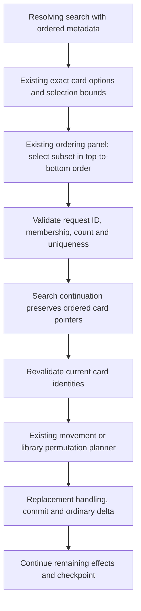

# 8.1 slice — Player-ordered card search

Status: approved by the owner and implemented, reviewed and verified on 12 October 2026. Source baseline `9cd92ed`; approved design committed at `7ce49ba`. Parent: [zones and library workflows](8.1-zones-and-library.md). Uses the implemented [ordered library operations](8.1-ordered-library-operations.md).

## Result and scope

Let a resolving search select cards and their top-to-bottom order in one existing choice prompt. Feed the submitted sequence into `REORDER_LIBRARY` or placed `MOVE_ZONE`; the server remains the sole holder of the exact deck list.

This slice extends generic engine choice data and reuses `ChoicePanel`. It introduces no new component, choice command, continuation category, event type, card-specific branch or global setting. Reveal/access/simultaneous transfers remain separate scopes.

## Approaches

1. **One ordered-search prompt — recommended.** The current panel already numbers selected options and submits their sequence. Preserve the search's selection bounds and exact card references while presenting it as an ordering request. Selection and ordering use one answer and one existing continuation.
2. **Search followed by a separate ordering decision.** Makes the stages visibly distinct, but requires a second request and a persisted phase marker even though the current controls can express both decisions together. Revisit only if a workflow requires selection to finish before a separate player's ordering decision.
3. **Dedicated card-order transport/UI.** Adds a parallel protocol and component for capabilities already provided by the generic choice system. It is outside the agreed reuse boundary.

## Contract

Extend only the search member of `EffectChoice` in `src/types/effect.types.ts`:

```typescript
{
  kind: 'search';
  zone: CardZone;
  cardTypes?: string[];
  subTypes?: string[];
  min?: number;
  max?: number;
  prompt?: string;
  ordered?: boolean;
}
```

`ordered: true` means the chosen subset is submitted in top-to-bottom order. It is authored instruction metadata, not an engine configuration policy. Existing searches without it retain their current prompt/kind and behavior. Existing branch-ordering definitions retain their full-option permutation contract.

For an ordered search, `resolutionChoice` in `src/engine/resolution-choices.ts` returns `PendingChoice.kind: 'ordering'` while retaining the current search option generation, controller, `min/max`, UUID option IDs and exact pointer values. It still stores the original **search** definition inside `ResolutionContinuation.stackObj.effects[effectIndex]`.

The default ordered-search prompt states both the allowed card count and top-to-bottom order. Authored `prompt` overrides it. Existing ordering controls number each selection; their shared instruction text should say "Select items in the desired order" so it also fits a subset instead of implying every available option must be chosen. No domain logic belongs in the client.

`applyResolutionChoice` distinguishes values using the original effect's choice definition, not the display kind alone. An original search answer becomes ordered `TargetPointer[]`, sets targeting to the existing untargeted selection semantics and clears `choice`, exactly as current search does. An original `options`/`ordering` definition continues to interpret its values as `ModeDefinition` branches. A card pointer must never be cast to a mode or cause `.effects` to be read from a card option.

The existing `validateChoiceAnswer` owns bounds, known IDs and uniqueness, and preserves submitted ID order. This slice does not relax those checks. A zero selection is valid only when the search already permits it; zero/one selected cards need no separate ordering decision. An infeasible required search retains the current skip-and-continue behavior. Prior effect results and the instruction cursor remain unchanged until the selected instruction executes once.

## Source identity and invalidation

Order does not refresh card identity. Option values retain the selected zone and `zoneRevision`. After the answer, existing resolution revalidation removes references which are no longer present in that zone/incarnation; a returned card with the same UUID and a newer revision is not selected again implicitly. Remaining live selected cards keep their submitted relative order. If none remain, the ordered operation does nothing and resolution continues according to the existing untargeted search behavior.

An invalid request ID, duplicate, unknown option or wrong count rejects the answer without replacing the pending request. A well-formed answer containing a now-stale option follows normal effect revalidation rather than stranding the room with an impossible permanent ordering request. This is a statement of the current search/resolution boundary; a broader targeting redesign remains separately scoped.

## Data flow and ownership



| Module | Change/responsibility |
|---|---|
| `src/types/effect.types.ts` | Optional authored `search.ordered` metadata |
| `src/engine/resolution-choices.ts` | Ordering presentation, count/direction prompt and search-versus-mode value dispatch |
| `src/engine/choices.ts` | Existing ordered answer validation; no second validator |
| `src/engine/effect-resolver.ts` | Existing identity revalidation and instruction continuation; no new phase |
| `src/client/components/ChoicePanel.tsx` | Existing numbered selection controls; generic instruction wording only |
| `src/engine/library-operations.ts` / `zone-transitions.ts` | Existing authoritative list changes; no new ordering representation |
| `src/server/sync-service.ts` | Existing request/deck deltas and recipient filtering |

## Acceptance evidence

Implemented in `tests/engine/pending-choices.test.ts`, `tests/client/pending-choices.test.ts` and `tests/server/live-routing.test.ts`.

- A search offering at least three cards can choose two in a deliberately different order; top/bottom reorder or transfer followed by draws proves the submitted direction.
- The pending request is `ordering`, its min/max remain search bounds and its values remain exact card pointers. Authored-mode ordering still expands its branches in submitted order.
- Duplicate, unknown, stale-request-ID and wrong-count answers leave the same request and card lists intact.
- Optional empty and single-card answers finish without an extra request; infeasible required searches continue through their existing path.
- JSON round-trip/reconstructed engine resumes the ordering request. Earlier effects are not repeated, costs are not repaid and later effects/checkpoints run once.
- A selected card moving away and returning under the same UUID before answer is not affected; live survivors retain relative order.
- Existing client controls display the direction prompt and numbered selections, and submit IDs in that sequence with the current request ID.
- Ordinary socket casting reaches the ordered prompt, accepts the answer, preserves exact server/acting-client order and restores it on reconnect. Opponent public updates retain existing filtering.
- Full suite, both typechecks and production build pass for this bounded change; log actual results in this document after implementation.

### Verification results — 12 October 2026

- Before production edits, the focused run failed in eight expected cases: ordered searches still presented as searches and the UI instruction still implied selecting every item. After implementation, the final focused run passed **68 tests across three files**, including reconnect during the pending ordering prompt.
- Final full Vitest run passed **886 tests across 72 files** in 35.00 seconds.
- Both package TypeScript checks passed: `tsc --noEmit -p tsconfig.json` and `tsc --noEmit -p src/client/tsconfig.json`.
- The package build steps passed: TypeScript emit and Vite production build. The bundled Node runtime invoked the local CLIs directly.
- `git diff --check` passed. Independent read-only review approved functional compliance and code quality with no actionable code findings.

The tests prove top/bottom direction through actual draws, preserve exact pointers through JSON recovery, and exercise real library-to-exile-to-library moves before an answer. Surviving selections retain order; returned incarnations are excluded. The live socket scenario restores the same pending request for the acting player, then verifies exact deck/draw order, existing opponent delta filtering and the final reconnect snapshot.

This slice is complete. Reveal lifetime/audience, cross-zone cast access and simultaneous ordered transfers remain separate work under 8.1. Private projections remain deferred under 0.3.

## Stop conditions

Stop before a card-ID branch, new client/protocol, second selection callback stored in room data, automatic choice of a meaningful player order, replacement bypass, fabricated ordering counter or implicit refresh of a stale card revision. Revise the general contract before proceeding if any of those becomes necessary.
