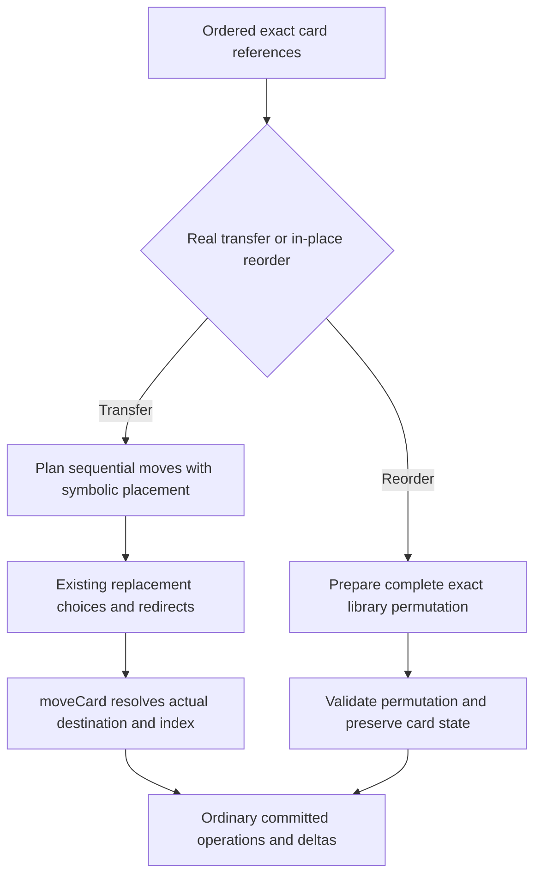

# 8.1 slice — Ordered library operations

Status: owner approved 12 October 2026; engine primitives implemented and verified. Design baseline: `f60b3f0`; implementation starts from `e0c6d51`. Parent: [zones and library workflows](8.1-zones-and-library.md). Execution: [implementation plan](8.1-ordered-library-plan.md).

## Bounded result

Expose top/bottom placement through the existing movement effect and add an exact in-place library permutation. This slice supplies the engine primitives for later interactive card ordering. It does not add a named card, a new client component, an interactive ordering prompt, reveal records, casting access or simultaneous multi-card transfer semantics.

Existing effect targets supply the requested order. When an effect needs the player to choose that order, a subsequent slice will extend the existing choice continuation. Do not treat the current authored-mode `ordering` choice as an ordering of cards.

## Alternatives and decision

1. **Symbolic placement plus exact permutation — recommended.** A movement retains `top`/`bottom` intent until its actual destination is known. A separate reorder instruction expresses the complete intended library without pretending cards changed zones. Both use ordinary proposals, reduction, events and deltas.
2. **Forward only raw insertion indices.** Smallest change, but indices prepared against the original deck can become invalid after a cancellation or redirect. It also exposes bottom-to-top storage details to effect authors and still lacks in-place reordering.
3. **New compound transfer operation.** Could encode simultaneous groups, destination decisions and order together, but introduces a replacement/continuation contract beyond this sequential primitive slice. Revisit only when a separately scoped simultaneous workflow requires it.

## Typed contracts

Add `src/types/library.types.ts` containing:

```typescript
export interface LibraryCardReference {
  cardUuid: string;
  zoneRevision: number;
}
export type LibraryPlacement = 'top' | 'bottom';
export interface MoveZoneParameters {
  origin?: import('./card.types').CardZone;
  destination: import('./card.types').CardZone;
  libraryPlacement?: LibraryPlacement;
}
```

Extend `GameMutation` with:

```typescript
{ type: 'REORDER_LIBRARY'; playerId: PlayerId; order: LibraryCardReference[] }
```

Its `order` is the **complete resulting library in internal bottom-to-top order**, matching recorded shuffle instructions. Use the same named reference type in `SHUFFLE_LIBRARY`; keep its payload shape unchanged.

Extend `MOVE_CARD` with optional `zoneRevision` and `libraryPlacement`. Old callers remain valid. When supplied, the source revision must be a safe integer matching the live card before a move can be proposed or reduced. `toIndex` and `libraryPlacement` cannot both be supplied. Symbolic placement applies only when the final destination is `library`; a redirect to another zone uses that zone's ordinary insertion behavior. A replacement explicitly choosing another library position must overwrite the original placement rather than add a conflicting index.

The `MOVE_ZONE` effect accepts `MoveZoneParameters`. An authored `libraryPlacement` with an authored destination other than `library` is invalid and produces no instructions. Do not coerce malformed strings to zones or placement values. Existing effects without placement retain their current target sequence and append behavior.

Add a `REORDER_LIBRARY` effect accepting `params.placement: LibraryPlacement` and ordered card targets from one owner's current library. Target order is **top-to-bottom** for either placement. This effect does not accept mixed-owner selections or reinterpret a player target as card ordering. Empty selection is an unchanged operation. A stale, duplicate, missing or non-library selected reference rejects the whole requested reorder before producing a permutation; never keep a valid subset of malformed input.

## Functions and ownership

Extend `src/engine/library-operations.ts` with:

```typescript
planLibraryReorder(
  room: GameRoom,
  playerId: string,
  selectedTopToBottom: readonly LibraryCardReference[],
  placement: LibraryPlacement,
): GameMutation[]

applyLibraryReorder(
  room: GameRoom,
  instruction: Extract<GameMutation, { type: 'REORDER_LIBRARY' }>,
): OperationOutcome
```

The planner verifies the complete selected set, removes it from the current deck, reverses the selected list once to obtain internal order, then appends it for `top` or prepends it for `bottom`. Unselected cards retain their relative order. It records the complete resulting permutation with exact revisions. Invalid planning input produces no instructions.

The reducer validates the complete permutation before any change: existing player, complete membership, uniqueness, library zone/ownership and exact safe-integer revisions. Invalid instructions return a rejected outcome. An identical permutation returns an unchanged outcome; an actual reorder returns a committed outcome with `events: []` to own its semantics explicitly. No new shuffle, leave/enter or rule-trigger event is invented. Generic mutation logging and the ordinary deck delta still record actual reorder changes.

Share exact permutation validation/array construction between shuffle and reorder inside this module. Keep shuffle's distinct semantic contract: even an identical valid shuffle commits `LIBRARY_SHUFFLED`. Do not make shuffle call a public reorder reducer and inherit its unchanged behavior.

`src/engine/zone-transitions.ts` remains the only actual zone-transfer reducer. Extract its existing preflight checks into `validateCardMove(room: GameRoom, move: Extract<GameMutation, { type: 'MOVE_CARD' }>): boolean`, adding the new revision and symbolic-placement checks there. Validation includes the existing owner, source/destination, token, index, stack-object and controller checks. It changes no state and captures no departing-source information. Both `moveCard` and proposal preparation call it; do not maintain a second copy of move validity rules.

For a validated move, `moveCard` computes a symbolic insertion index against the current destination deck: `top` means its current length, `bottom` means zero. Real moves still reset active state and increment revision. Same-zone `MOVE_CARD` remains unchanged; the distinct reorder instruction owns in-place ordering.

`src/engine/proposed-events.ts` calls the shared validator for original `MOVE_CARD` instructions before offering replacements. Invalid original instructions therefore cannot consume a replacement or open its decision. Prepared replacement results still undergo ordinary final move validation at reduction; they are not treated as new original instructions or run through replacements twice. Replacement events retain placement intent through ordinary serialization. Do not add a second transaction runner or reorder a library afterward to compensate for redirected moves.

## Sequential transfer ordering

For a placed `MOVE_ZONE` effect, selected target order is top-to-bottom. Validate and capture exact live source references before planning. Partition valid sources by owner while retaining order within each owner. Each group has its own destination library.

- Top placement emits each owner's transfers in reverse selected order. Appending B then A puts A above B.
- Bottom placement emits transfers in selected order. Prepending A then B stores B,A below the existing deck, also presenting A above B within the moved block.

The existing replacement transaction resolves these transfers sequentially. A cancelled or redirected transfer never occupies a destination-library slot; surviving selected cards keep their requested relative order. A replacement which independently changes the same library takes effect normally and may affect the final arrangement. This slice does not promise atomic simultaneous movement or global ordering across different owners' libraries.

Same-library sources are outside placed transfer effects; use the reorder effect instead. Reject an ambiguous mixture of same-library reordering and external transfers in one placed effect. Legacy unplaced movement keeps its existing behavior.

## Flow and example



Given internal deck `[X,Y]`, where Y is the top, selecting `[A,B]` in top-to-bottom order produces `[X,Y,B,A]` at the top or `[B,A,X,Y]` at the bottom. Drawing proves A precedes B within the selected block. If B is redirected to exile, the library receives only A; B is never reinserted by a later reorder.

## Acceptance and verification

Focused scenarios live in `tests/engine/library-ordering.test.ts`; actual socket coverage extends `tests/server/live-routing.test.ts`. Existing `tests/engine/zone-transitions.test.ts`, `tests/engine/effect-registry.test.ts`, `tests/engine/operation-outcomes.test.ts` and `tests/engine/replacement-transactions.test.ts` remain regression gates.

Required coverage:

- Two or more top/bottom transfers followed by draws; unplaced movement remains compatible.
- Complete and subset reorders, preserved unselected order, exact card/state references and unchanged zone revisions/counters/damage.
- Duplicate, missing, stale, wrong-owner and malformed permutations reject with no partial changes or success events; equal reorder is unchanged while equal shuffle still commits.
- Invalid placement/index combinations and stale transfer references reject before replacement consumption.
- Cancellation and redirects retain survivor order for both top and bottom; redirects into non-library zones ignore original library placement.
- Replacement choices round-trip through JSON and resume without duplicating moves or reversing order.
- Actual mutation logging and deltas reflect a changed order without fabricated shuffle/zone events. The acting client receives exact library order; the opponent receives the existing public updates. Reconnect confirms the authoritative order through the existing snapshot behavior.
- Both TypeScript checks, the full test suite and production build pass for the bounded code slice.

No new configuration setting is required. If implementation reveals a need for a configurable policy, place it in `src/config.ts` and review its purpose before introducing it.

## Contract review evidence

The source review after the draft commit confirmed that `move_destination` in `src/engine/replacement-rules.ts` spreads the existing move and changes only `to`; it already preserves serializable placement/revision intent. `planProposedMutations` and `resumeProposedChoice` in `src/engine/proposed-events.ts` own the sequential transaction and serialized pause. Choice dispatch belongs to `src/engine/game-engine.ts`, and `src/engine/resolution-choices.ts` currently interprets ordering values as authored `ModeDefinition` branches. These findings support reuse of replacement transport while keeping interactive card ordering a distinct follow-up.

At baseline the original proposal path checked source existence but did not reuse the reducer's full move validation. The implemented shared validator resolves that gap: original invalid moves produce no replacement candidates or consumption, and reduction checks prepared results through the same validator.

## Implemented integration and verification — 12 October 2026

The named types, planners, reducers and effect consumers above are implemented. `src/server/sync-service.ts` maps `REORDER_LIBRARY` to the ordinary deck update alongside shuffle. No state counter, new semantic event, new configuration setting or replacement transport was introduced. Existing `filterForPlayer` omits opponent deck/hand patches; private projection redesign remains deferred. The actual-server test checks both recipients according to this existing contract rather than claiming identical hidden arrays in both caches.

- Initial regressions demonstrated missing reorder/placement behavior and invalid-move replacement consumption; the corrected socket test failed on the unchanged deck before implementation.
- Focused ordering coverage: 35 engine cases plus one actual-server scenario passed. Cases include cancelled and redirected transfers, both placements, multiple owners, exact-reference preservation, malformed inputs and serialized replacement resumes.
- Full suite: 878 tests in 72 files passed, including 35 actual-server scenarios; 35.29 seconds.
- Both server/client TypeScript checks passed.
- Production TypeScript emit and Vite build passed using the bundled Node runtime, matching the package build steps. The runtime does not include `npm.cmd`.
- Independent read-only review identified partial planning for malformed placed selections. Three additional regressions reproduced it before correction; placed movement now requires every selected source to form a valid distinct transfer. Targeted follow-up review found no remaining actionable issue.

Interactive card-order prompts, reveal lifetimes, cast access and simultaneous ordered transfers remain separate open workflows. This primitive slice does not complete all of 8.1.

## Stop conditions

Stop before any card-specific branch, setup mutation used for normal play, temporary authoritative array edit, second replacement runner, invented state counter, compensating reinsertion of a redirected card, or automatic choice of a player-required order. Report the missing general contract and revise this design first.
