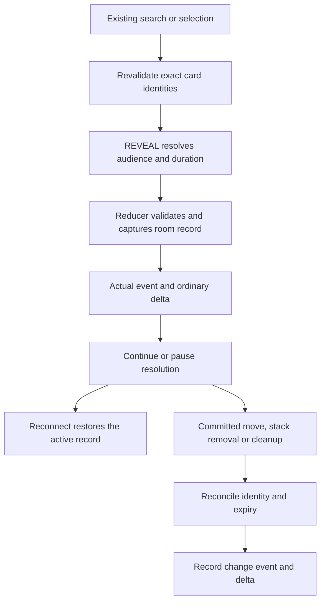

# 8.1 slice — Reveal lifecycle

Status: proposed for owner review; no implementation. Inspected source baseline `a676697`, 12 October 2026. Parent: [zones and library workflows](8.1-zones-and-library.md).

## Problem and example

The engine has no reveal primitive, semantic reveal event or active reveal record. Debug snapshots contain full cards, while ordinary deltas already filter opponent hand/deck updates. Neither describes when a rules-level reveal begins, who its declared viewers are, or whether it remains active after reconnect. The logger cannot reconstruct an active reveal from an event that was never produced.

Example: an instruction reveals a selected library card to both players, then another instruction asks a player to order cards. Resolution pauses. An active record keeps the reveal available through that pause and a reconnect. Answering the choice finishes resolution and ends the reveal. If the card leaves the library first, its old reveal ends; returning with the same UUID and a new zone revision does not renew it.

Ending an active reveal does not erase historical knowledge. The existing event timeline retains the captured information. This slice does not create a separate player memory database or change card-instance identity/reset behavior.

## Alternatives and recommendation

1. **Room-owned records — recommended.** One typed record carries exact card references, captured card faces, viewers and expiry. Pure operations create and reconcile these records. Ordinary snapshots, deltas and logging reuse existing paths.
2. **Events only.** Smaller initially, but reconnect would require replaying and interpreting history to find currently active reveals. This duplicates lifetime logic outside the engine.
3. **Visibility fields on each card.** Mixes reveal policy into card state, complicates overlapping audiences and conflicts with blueprint reset on genuine zone changes. Reveal records instead refer to the existing card instance.

## Bounded contract

Add one generic `REVEAL` effect. It consumes the current instruction's card/permanent pointers after existing target revalidation. Existing search or selection choices supply pointers; this slice does not introduce a reveal-choice kind or select the top N cards automatically.

Authored parameters:

```typescript
interface RevealParameters {
  audience?: 'all' | 'controller' | 'opponents'; // default: all
  duration?: 'resolution' | 'end_of_turn';       // default: resolution
}
```

These are effect metadata, not global settings. No configuration switch is needed. The effect handler already receives the resolving `StackObject`, so it can record its UUID without a new execution-context field.

New types belong in `src/types/reveal.types.ts`:

```typescript
interface RevealedCard {
  cardUuid: string;
  zone: CardZone;
  zoneRevision: number;
  card: CardInstance; // captured informational face, never an authoritative zone member
}
type RevealExpiry =
  | { kind: 'resolution'; stackUuid: string }
  | { kind: 'end_of_turn'; turnNumber: number };
interface RevealRecord {
  id: string;
  controllerId: PlayerId;
  viewerIds: PlayerId[];
  cards: RevealedCard[];
  expiry: RevealExpiry;
}
```

Capture card data with a plain-data copy at creation. This preserves what was revealed even if later card state changes. References govern whether a reveal is still active; captured faces do not grant targeting, zone access or casting permissions. Card order within the record follows the submitted instruction order, without duplicating the library's authoritative list.

`GameRoom` gains optional `reveals?: RevealRecord[]` and `revealSequence?: number`. Missing records/sequence in old snapshots mean empty/zero. A monotonically increasing sequence assigns `reveal:<roomId>:<sequence>` IDs, following the existing replacement-record pattern. It serves record identity only; it does not alter card revisions or characteristic timestamps.

Add a typed `REVEAL_CARDS` mutation with `controllerId`, resolved `viewerIds`, exact card references and `expiry`. It carries no externally supplied captured faces. The reducer validates references against the current room and captures the actual cards. Valid nonempty reveals append one distinct record; repeated reveals can overlap without replacing earlier records. Empty selections do nothing. Invalid controller/viewer/expiry values, duplicate references, missing cards or stale references reject the operation as a whole.

The effect planner resolves audience against the current room players. `all` includes every current player; `controller` includes the resolving controller; `opponents` includes all other current players. A zero-viewer request does nothing. Do not turn invalid authored values into default values. Resolution expiry requires its named stack item to exist; turn expiry must match the room's current turn number.

## Lifetime and reconciliation

Create `src/engine/reveal-service.ts` for record validation/capture, reconciliation and read queries. Keep these functions independent of UI, sockets and logging.

- After every committed operation, reconcile active references against its resulting room. Remove a card entry when UUID, zone or zone revision no longer matches. Preserve other entries and their relative order; discard an empty record.
- Resolution records expire when their named stack object leaves the stack, including spell movement, ability removal, countering or debug removal. A pending resolution/replacement choice retains the stack object, so its reveals remain active.
- Turn records expire on `CLEAR_END_OF_TURN_EFFECTS`, the existing cleanup operation. Also remove records whose recorded turn precedes the current turn, covering direct turn advancement through existing debug paths.
- `END_GAME` removes all active records as part of that operation. Subsequent terminal commands remain rejected through the existing operation boundary.
- Reordering and shuffling a library do not change zone incarnation, so they retain active card reveals. Array position is not identity.
- Rejected/unchanged operations do not renew, expire or fabricate reveals. A valid newly created record is a committed operation even if its cards also appear in another reveal.

Place reconciliation at the existing `reduceGameOperation` boundary, alongside current combat reconciliation, so previews and committed execution use the same rule. Preserve the original room/record references when nothing changes. Do not insert compensating movement or fake state updates.

Expose `revealsForPlayer(room, playerId): RevealRecord[]` as a pure query over the active records and their declared viewers. This is the extension seam for future private projections and presentation.

## Events, delta and debug visibility

Add one extensible semantic event, `REVEAL_CHANGED`, with `{ revealId, before: RevealRecord | null, after: RevealRecord | null }`. Creation has a null before; expiry has a null after; loss of only some revealed cards carries both records. Emit it for actual per-step record changes, alongside ordinary mutation/zone/stack events. Derive record changes before the current operation-owned-event early return so shuffle/reorder outcome ownership does not suppress reveal lifecycle events.

The logger is already event-agnostic. Add the typed payload and derive the event; do not add logger-specific reveal branches. Committed batches and JSONL preserve the actual mutation and event data.

`SyncService` emits an ordinary `reveals` array update whenever the field changes, including changes caused by movement/stack/cleanup operations rather than just `REVEAL_CARDS`. It also synchronizes `revealSequence` changes for exact debug-state convergence. Existing client store path application and reconnect snapshots require no new command or component.

Declared audience is engine data/query behavior in this slice. Full debug snapshots and current outgoing state paths remain available; this does **not** complete deferred [0.3 private client views](0.3-private-views.md) or promise transport secrecy. Existing opponent hand/deck delta filtering remains intact. A future unified projector must use the reveal query rather than infer permission from arbitrary zone visibility.

## Module map and flow

| Module | Responsibility |
|---|---|
| `src/types/reveal.types.ts` | Authored parameters, exact captured-card records and expiry union |
| `src/types/game.room.types.ts` | Serializable active records and record-ID sequence |
| `src/types/game-mutation.types.ts` | Typed reveal request without caller-supplied card faces |
| `src/engine/reveal-service.ts` | Validate/capture, reconcile lifetime/identity, query declared viewers |
| `src/engine/effect-registry.ts` | Resolve authored audience/duration and propose generic reveal |
| `src/engine/game-reducer.ts` | Apply reveal operation and reconcile committed resulting state |
| `src/types/game-event.types.ts`, `src/engine/applied-events.ts` | Extensible lifecycle payload and actual per-step event derivation |
| `src/server/sync-service.ts` | Ordinary record/sequence deltas for direct and incidental changes |



## Acceptance evidence required

- New `tests/engine/reveals.test.ts`: default/explicit audiences, both lifetimes, captured faces, stable identities and submitted order, overlapping records and independent expiry, malformed authored parameters and mutation payloads, empty/optional search, all-or-nothing stale/duplicate operation validation.
- Real zone moves end the old incarnation's reveal; leave/return cannot renew it. Partial departures retain live entries in their order. Reorder/shuffle retain reveals. Stack disappearance and cleanup expire only matching records. End-game clears records.
- Extend `tests/engine/pending-choices.test.ts`: reveal followed by an ordinary optional/ordered choice, JSON reconstruction during the pause, retained reveal, then exactly-once continuation and expiry without costs/effects replay.
- Extend `tests/engine/applied-events.test.ts` and `tests/engine/operation-outcomes.test.ts` where needed: creation, partial update and expiry events; no semantic event from rejected/unchanged operations; ordinary zone/stack events remain present.
- Extend `tests/server/sync-service.test.ts` and `tests/server/live-routing.test.ts`: actual socket casting/search/reveal, pause/reconnect, record retention and completion/expiry convergence. Opponent hand/deck filtering stays intact; full debug snapshots retain their current contract.
- Run focused red/green tests, independent review, full suite, both package typechecks, production build and diff checks. Record actual evidence here, then commit locally.

## Extension and stop boundaries

Longer or explicitly revoked lifetimes can extend `RevealExpiry` and the reconciliation service after their own contract review. Automatic top-of-library selection, permanent face-up/face-down rules, player knowledge databases, cast permissions and reveal-specific UI presentation are separate work.

Stop before a card-ID branch, a second authoritative card/deck representation, a private-state filtering workaround, a wall-clock expiry timer, a resolution callback stored in room data, a replacement bypass or a component/command introduced solely for this reveal slice. Revise the generic contract if one becomes necessary.
