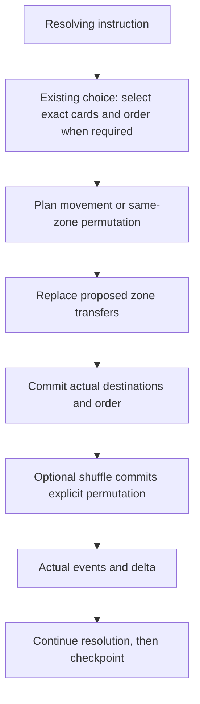

# 8.1 — Zones and library workflows

Status: operation outcomes, generic shuffle, sequential ordered library transfers, in-place permutations and player-ordered search implemented; reveal deferred until a concrete consumer; cross-zone casting remains open. Source inspected 12 October 2026. Parent: [development index](README.md).

The owner approved the [structural prerequisite](8.1-committed-operation-outcomes.md) after the initial stop. The implemented shuffle uses that general outcome boundary. The approved [ordered library operation design](8.1-ordered-library-operations.md) is also implemented and verified. The [player-ordered search](8.1-ordered-card-search.md) selects a subset and its order in one existing prompt.

## Purpose and scope

Complete generic search, reveal, shuffle, ordered movement, draw/discard and cast-from-zone workflows. Reuse existing operations rather than rebuild the choice system. Private client projection is a separate deferred item: the roadmap's authorized-information gate cannot be declared complete while full state is still transmitted for debugging.

## Existing structure

| Module | Responsibility and current contract |
|---|---|
| `src/engine/zone-transitions.ts` | Shared `validateCardMove` checks original proposals and reduction. `moveCard` supports live top/bottom insertion, preserves UUID, resets active state and advances zone revision. Same-zone moves return the original room. |
| `src/types/game-mutation.types.ts` | `MOVE_CARD` already carries `toIndex`, owner, origin/destination and optional stack object. `DRAW_CARDS` and failed-draw state exist. |
| `src/engine/game-reducer.ts` | Library top is `deck[deck.length - 1]`. Drawing takes the last card. |
| `src/engine/resolution-choices.ts` | `resolutionChoice` offers filtered search options from the controller's zones. `search.ordered` presents numbered subset ordering with search bounds. Answers dispatch by original definition: search values become exact card pointers; authored ordering values become effect branches. |
| `src/engine/effect-registry.ts` | `MOVE_ZONE` forwards exact source references and symbolic library placement; ordered transfers group by owner. `REORDER_LIBRARY` prepares an in-place subset ordering from selected top-to-bottom card references. |
| `src/engine/room-factory.ts` | Setup deck shuffle uses Fisher–Yates and `Math.random`; this is not an in-game shuffle effect or injected replay contract. |
| `src/engine/library-operations.ts` | Shuffle and reorder share exact permutation validation. Reorder preserves card/state references; shuffle owns its semantic event even for equal order. |
| `src/engine/effect-context.ts` | Runtime randomness dependency supplied through engine/effect resolution and continuation paths; snapshots remain plain data. |
| `src/engine/handlers/play-card-handler.ts` | Both validate and propose find the spell in the acting player's hand. |
| `src/shared/action-permissions.ts` | Permission results currently contain allowed/instant; there is no grant of casting access to another zone. |

An insertion index alone does not define a player-visible top/bottom ordering workflow. Repeated insertions can reverse the chosen order. In-place reordering is not a zone change and must not increment revisions or emit leave/enter events.

## Proposed boundaries

| Unit | Consumes | Produces | Must not do |
|---|---|---|---|
| Ordered-zone planner | Room, exact selected references, placement and player order | Pure movement/reorder instructions | Mutate arrays or grant priority |
| Shuffle planner | Current library identities, injected randomness | Explicit resulting permutation | Generate randomness inside the reducer |
| Reducer | Validated serializable instructions | New arrays with preserved card identities | Decide choices or hide information |
| Reveal lifecycle | Exact references, viewers and duration | Room-owned reveal records/events | Treat a reveal as a zone move |
| Cast-access query | Actor, live card, zone and effective permissions | Explicit permission/constraints | Assume an allowed zone in printed requirements gives possession/access |

The ordered-operation exports and payloads are recorded in the approved slice document. The reveal row is a deferred candidate boundary, to be re-scoped against its first consumer; cast access awaits its contract. Keep one representation of library order: internal bottom-to-top, with selected order expressed top-to-bottom and one explicit conversion.

## Flow

Replacement redirects must be reflected in the final ordering plan: a card redirected to another zone is not silently inserted into the intended library. Empty searches and optional zero selections complete through the existing continuation. Suspended choices retain exact references and ordering intent.

## Extension points and decisions

- Extend effect parameters and typed mutations together; do not smuggle normal play through setup-only `SET_PLAYER_ZONES`.
- Randomness is supplied at planning time; replay consumes the recorded outcome. Durable recovery is still 9.3.
- Successful shuffles remain observable even when the order stays equal. `reduceGameOperation` records semantic success independently of state equality. No dummy counter or shuffle-only commit bypass is needed.
- Decide whether ordered multi-card transfers form one simultaneous transfer batch or sequential instructions according to the effect, rather than applying one policy globally.
- Reveal work is deferred until a concrete effect consumes it. That consumer determines whether an informational event suffices or active state with a lifetime/audience is needed across input and reconnect. Do not implement the full candidate lifecycle preemptively.
- Cross-zone casting extends card lookup, access queries, options, cost reservation, stack movement and target validation together. Do not add an exile-only second cast handler.

## Independently reviewable slices

1. Sequential ordered library placement, in-place permutation and interactive ordered search — implemented. Simultaneous ordered movement remains a separately scoped follow-up.
2. Generic shuffle using an injected source and explicit committed order — implemented through the outcome boundary; final slice verification is recorded in the prerequisite document.
3. Reveal — [deferred candidate design](8.1-reveal-lifecycle.md), revisit when a concrete effect consumer requires it.
4. General cast access from authorized zones, using shared announcement/cost flow.
5. Private projections only when the deferred 0.3 scope is resumed.

## Acceptance evidence

Existing tests to extend: `tests/engine/zone-transitions.test.ts`, `tests/engine/pending-choices.test.ts`, `tests/engine/replacement-transactions.test.ts`, `tests/engine/action-costs.test.ts`, `tests/server/sync-service.test.ts`, `tests/server/live-routing.test.ts`.

Required scenarios: top and bottom order for multiple cards; reorder without reset/revision/event changes; duplicate/stale references rejected without partial changes; empty and optional searches finish; replaced destinations preserve intended survivors' order; shuffle neither creates nor loses cards; recorded permutation reproduces the same deck; paused choice reconstruction/reconnect; authorized cast from another zone reserves the source and pays exactly once; unauthorized access rejects before costs. Test draw-after-order to prove the internal/UI conversion, not just array equality.

## Stop conditions

Stop if ordering requires bypassing `moveCard`, temporary mutation of authoritative arrays, replay-time randomness, a card-specific reveal/cast branch, or suppressed delta/events. Resolve the missing general contract before coding.
