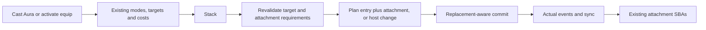

# 8.2 — Attachments

Status: legality and cleanup foundations implemented; attachment actions proposed. Baseline: `ad6a96e`, inspected 12 October 2026. Parent: [development index](README.md).

## Purpose and existing structure

Provide generic attachment actions and Aura/equip flows through the existing engine. Currently the engine can clean up attachment state seeded in fixtures, but has no complete action flow that establishes that state.

| Module | Current responsibility |
|---|---|
| `src/types/card.types.ts` | Printed attachment requirements and state fields for host UUID/revision or player host. |
| `src/engine/state-based-planner.ts` | Private `attachmentLegal` checks effective host type, requirements, identity and protection; illegal Auras move to graveyard and other attachments detach. |
| `src/types/game-mutation.types.ts` | `UNATTACH_CARD` exists; there is no corresponding generic attach mutation. |
| `src/engine/game-reducer.ts` | Detaches by clearing host fields; zone reset removes active attachment state. |
| `src/engine/continuous-effects.ts` | `WHILE_ATTACHED` lifetime checks source attachment presence. |
| `src/engine/handlers/activate-ability-handler.ts` | Existing ability announcement/cost/stack flow to reuse for equip. |
| `src/engine/effect-resolver.ts` | Existing target revalidation, structural destinations and sequential resolution to integrate with Aura entry. |

## Proposed responsibility boundaries

Extract shared attachment legality from the SBA planner into a focused query used by attachment planning and ongoing legality. Keep targeting legality distinct: ongoing attachment checks must not gain target-only restrictions merely because the initial spell/ability targeted the host.

The attach planner consumes the attachment's exact reference, host card reference or player identity, and effective characteristics. It produces a typed mutation. The reducer establishes one host and clears incompatible host fields. An attach instruction may change hosts without moving the attachment between zones. Equip remains an activated ability using shared costs and resolution; it does not directly assign state when the player clicks an option.

Aura spell resolution must establish attachment as part of successful battlefield entry before the checkpoint. Entering first and waiting for a later checkpoint/action would expose an unattached Aura to the existing SBA rule. Replacement redirection of entry must also be respected.

## Extension points

- Shared legality supports Aura card/player hosts, Equipment creature hosts and Fortification land hosts without named-card cases.
- Attachment definitions express restrictions as data using effective characteristics.
- Explicit attach/unattach events and deltas integrate with generic logging; state writes outside the reducer are prohibited.
- Reuse exact references for host changes. The same UUID returning with a new revision is not the original host.
- Review `WHILE_ATTACHED` recipient scopes alongside host changes: a truthy attached flag alone does not retarget a frozen affected-object set.

## Slices and acceptance

1. Shared ongoing legality query plus attach/unattach operation and delta/event coverage — [bounded operation design](8.2-attachment-operations.md), proposed for review; no implementation yet.
2. Aura announcement and atomic successful-entry attachment.
3. Equip/Fortification ability resolution through existing costs/stack.

Extend `tests/engine/state-based-extended.test.ts`, `tests/engine/object-resolution.test.ts`, `tests/engine/activate-ability.test.ts`, `tests/engine/continuous-lifetime.test.ts`, `tests/server/sync-service.test.ts` and `tests/server/live-routing.test.ts`.

Prove: illegal or stale hosts cannot attach; self-attachment fails; player hosts follow requirements; host departure/re-entry does not retain the old attachment; Aura and Equipment cleanup differ; equip can fail after payment when its target becomes illegal; Aura does not temporarily die between entry and attachment; entry redirection prevents attachment to a nonexistent entrant; ongoing legality does not reuse shroud/hexproof targeting checks; host changes update effective effects, events and both clients. Existing fixture-only cleanup tests do not prove these action flows.

## Stop conditions

Stop if integration needs an Aura-ID branch, manual fixture-state mutation in normal play, bypass of target revalidation, delayed attachment after a checkpoint, or a second equip payment/stack flow. Propose the shared structural-entry contract first.
