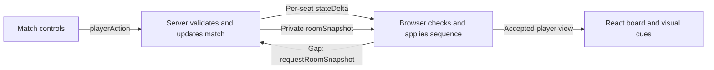

# Match UI proof of concept

## Change the UI

| I want to change… | Start here |
| --- | --- |
| Match layout, connection status, or where controls sit | [GameScreen.tsx](../apps/game-client/components/GameScreen.tsx) and the Game shell section of [style.css](../apps/game-client/style.css) |
| The hand fan, permanent rows, or the stack | [Hand.tsx](../apps/game-client/components/Hand.tsx), [PermanentHalf.tsx](../apps/game-client/components/board/PermanentHalf.tsx), or [StackDisplay.tsx](../apps/game-client/components/StackDisplay.tsx) |
| What a card face looks like | [CardSurface.tsx](../packages/ui/src/CardSurface.tsx) and its [shared styles](../packages/ui/src/style.css). For match-only styles, use the game client's stylesheet. |
| What triggers a movement or effect | [board-transitions.ts](../apps/game-client/presentation/board-transitions.ts) |
| How cards move and how long a hit lasts | [useBoardMotion.ts](../apps/game-client/presentation/useBoardMotion.ts) and [impact-motion.ts](../apps/game-client/presentation/impact-motion.ts) |
| Targeting lines, elemental colors, and persistent overlays | [TargetingLines.tsx](../apps/game-client/presentation/TargetingLines.tsx), [PermanentStatus.tsx](../apps/game-client/components/board/PermanentStatus.tsx), and [board-effects.css](../apps/game-client/presentation/board-effects.css) |

To add a cue, first look for the change in the before and after `PlayerView`. For example, a life change produces a `number` cue at `seatAnchor('life', id)`. Put that same anchor in the seat component's `data-board-anchor` attribute. Add a case to `playCue` if the cue needs a different visual. Cover the trigger in [board-transitions.test.ts](../tests/client/board-transitions.test.ts) with two player views.

For a card movement, give the source and destination distinct anchors. Hand and battlefield anchors use the card's instance ID and zone revision. The cue pairs visible instances across zones. Ability sources on the stack are references to cards, so only spell cards travel there. Deck draws use the visible hand and deck count. Opponent hand contents stay private.

The board always renders the latest accepted view. The motion hook measures the old and new layouts and draws brief, pointer-transparent effects on top. Several updates in one render produce one visual diff and a bounded list of hits. Snapshots establish a fresh baseline and clear active animations. With reduced motion enabled, targeting lines and counter badges remain visible.

## Add an effect

- **Targeting** uses the legal targets and selected targets in the local draft. One available target gets a dashed guide. Hover or focus previews a target when there are several. A selected link stays solid until the draft closes.
- **Combat and spell hits** use the optional `impacts` field on accepted deltas. [damage-impacts.ts](../apps/server/src/projection/damage-impacts.ts) projects applied damage into visible source and target references. Reciprocal damage produces one clash. An unblocked attacker lunges toward the defending seat. The hit can use the previous layout when a card died in that update.
- **Elemental art** uses the visible source's single card color. To change the look of a red hit, edit `[data-impact="red"]` in the effects stylesheet. Mixed-color, colorless, and private sources use the neutral preset. The prototype themes damage and keeps the existing life-gain numbers.
- **Ongoing state** belongs in the player view. The Scorch glow and count come from the card's current counters and survive a reload. To add another counter style, extend the small badge component and stylesheet. For an aura or global effect, first identify its viewer-safe state in the protocol and render the overlay from that state.

## Library options

| Library | Where it fits |
| --- | --- |
| [Motion](https://motion.dev/docs/react-layout-animations) | React card reflow, spring gestures, and shared-layout transitions. It could replace the card movement renderer when hand drag or layout animation grows. |
| [PixiJS](https://pixijs.com/8.x/guides/components/scene-objects/particle-container) | A transparent 2D canvas for lots of particles, texture effects, and layered spell art. It is the first library to try for a more elaborate effects layer. |
| [Rive](https://rive.app/docs/runtimes/web/web-js) | Art-directed reusable animations such as a shield, portal, or persistent aura. Designers can author the animation and wire its states to the existing UI cues. |
| [Three.js](https://threejs.org/docs/pages/WebGLRenderer.html) | Camera movement, 3D card models, lighting, or a fully rendered table. It adds a scene and a camera to maintain. |

This prototype uses CSS and the browser's Web Animations API. A library can replace `playImpact` while the server projection, targeting, and persistent state stay in their current files.

## Board updates and recovery



We kept the existing Socket.IO connection because commands, opponent updates, and recovery snapshots can use the same ordered stream and the existing seat authentication. The browser drops duplicate or older deltas. On a gap it pauses gameplay input and requests a fresh snapshot. The response must match the current room and viewer and cover the newest sequence the browser has seen. A timeout exposes Retry. Reconnect also establishes a new baseline. The browser never resends a gameplay command during recovery.

Full snapshots cost more to send than deltas, so they are used for setup and recovery. This approach restores the current board after a gap. For a future effect that must depict every intermediate step, the protocol would need ordered, viewer-filtered presentation events with replay. Two snapshots can only show their net changes.

## Try the prototype

Run `npm run build` from the repository root. To try it with local fixture decks, start the built game from a separate PowerShell session:

```powershell
$env:NODE_ENV = 'test'
$env:DATABASE_PATH = 'data/ui-poc.sqlite'
npm start
```

1. Open [Play](http://localhost:3000/play) in two independently opened tabs. Create a room in the first and join it in the second.
2. Choose rock, paper, or scissors in each tab. Pass through the first upkeep, draw, and main phase to see the draw animation.
3. Play a land, right-click it to produce mana, then cast a creature. Both players pass to resolve it. Look for the hand-to-board and stack-to-board movement.
4. When that creature can attack, try it unblocked for a lunge toward the opponent. For a clash, have the other player block and confirm each damage assignment.
5. Target the opponent with Broken Fireball (`破裂火球`) to see the targeting line and red projectile. The `st01a` fixture preset also includes Fireball (`火球術`), whose main mode applies Scorch. Reload after it resolves to see the badge restored from the snapshot.

## Table art

The background was created with built-in image generation and saved as a local JPEG. [battle-table.jpg](../apps/game-client/assets/battle-table.jpg)

<details>
<summary>Image prompt</summary>

Generate a single ultra-wide landscape background texture for a high-end fantasy trading card tabletop game interface. Straight-down orthographic view, dark deep charcoal-teal/forest-green aged leather table surface with understated fine-grain detail, a precisely incised understated thin aged antique brass double-line rectangular border and very small angular brass corner filigree around the outer edges, faint broad concentric engraved geometric rings and faint radial compass geometry in the central 45 percent. The leather is nearly black at edges and subdued in center. No objects, no cards, no characters, no UI, no text, no letters, no numbers, no bright glow. Authentic realistic material and engraving, rich yet restrained lighting, extremely low-contrast detail to make pale text and small cards pop when overlaid. Composition extends edge to edge. Wide 16:9 landscape.

</details>
