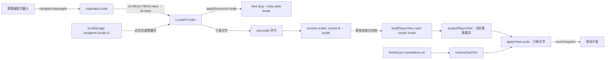

# 中英雙語（i18n）最小可行方案與 PoC 實測

**狀態：** PoC 已實作並實測（2026-11-15）。**範圍：** 最小垂直切片，不是全量交付。
**適用代碼：** `packages/ui/src/i18n/`、`packages/engine/src/shared/localized-card-text.ts`、
`packages/protocol/src/events/locale-events.ts`、`apps/server/src/projection/localize-view.ts`。

---

## 1. 現況與約束

本專案在這次改動之前沒有任何 i18n 機制，文字分佈在三個地方：

| 位置 | 內容 | 語言 | 為什麼難處理 |
|---|---|---|---|
| 前端 JSX | 按鈕、標題、提示、錯誤訊息 | 英文硬編碼 | 分散在 4 個前端、32 個檔案 |
| 工具函式字串 | 錯誤訊息、日誌文案、狀態文案 | 英文硬編碼 | 不在 JSX 內，naive 抽取器會漏 |
| **卡牌內容** | `name` / `rulesText` / `subTypes` / mode `label` / choice `prompt` | **原生繁體中文**（157/162 個定義） | 由**服務端投影**進 `PlayerView` 下發；客戶端依架構規則不能 import engine |

實測清點（`scripts/i18n/inventory.mjs`，TypeScript 編譯器 API，與 readability gate 同一套手法）：

| 指標 | 數值 |
|---|---|
| 掃描檔案 | 89（game-client 53、deck-builder 8、admin 14、packages/ui/src 14） |
| 候選文案 | **576 條**（JSX 文本 311、文字屬性 22、工具函式字面量 243） |
| 總字元 | **13,197** |
| 耗時 | 150ms |

結論：介面文案量（576 條 / 1.3 萬字元）屬於「人工可控、不需要翻譯管理系統」的量級；
真正的工作量在**卡牌內容**（162 個定義，每張含 name / rulesText / mode label / prompt）。

架構約束（`tests/architecture/import-boundaries.test.ts` 已強制）：

- 客戶端不得 import `packages/engine/**`（含 type-only）→ 卡牌譯文只能經 protocol / server 送達。
- 覆蓋率門檻 99–100%，`packages/ui/src/**/*.ts`、`apps/game-client/**/*.ts` 都在統計範圍 → 新增純邏輯必須帶測試。
- readability gate 掃 `packages/engine/src` → 新導出需 JSDoc、行長 ≤140。

---

## 2. 三檔方案對比與選定

| # | 方案 | 做法 | 優點 | 代價 | 判斷 |
|---|---|---|---|---|---|
| A | **純手寫 typed dictionary**（介面層採用） | `translate(locale, key, params)` + `Intl.PluralRules/NumberFormat`，鍵由 TS 從 en 詞典推導 | 零依賴；缺鍵編譯期報錯；100% 覆蓋率容易達成；與專案「不引入投機依賴」一致 | 需自寫插值 / 複數 / 回退（約 250 行）；無翻譯管理系統整合 | **採用**：本專案只有 2 語言、無 SSR、無 lazy load |
| B | **成熟庫**（react-i18next / react-intl / Lingui） | `i18next@27 + react-i18next@18`（官方要求 React ≥18、i18next ≥27） | 功能最全：ICU、命名空間、lazy load、提取工具鏈 | 引入 2 個執行期依賴；i18next 的鍵型別安全要靠額外宣告檔，反而弱於 A；ICU 語法對本專案用不到 | 不採用；保留遷移路徑（見 §7） |
| C | **框架特定工具鏈**（Vite 插件 + 提取） | Lingui 編譯期提取、`i18next-cli` | 提取自動化 | 建置期多一層插件；提取器只解決「找字串」，而本專案真正難的是服務端卡牌內容 | 部分借用概念：改用 `inventory.mjs` 達成同等效果，不新增建置期依賴 |

**卡牌內容層與上述三檔無關**：文字在服務端，任何前端 i18n 庫都碰不到。只有兩種做法：

1. **服務端按連線 locale 投影**（採用）— 一份資料、一份真相，客戶端零重複；
2. 客戶端 `definitionId → 譯文` 覆蓋表 — 不需改後端，但同一份卡牌內容在兩處維護，必然漂移。

選擇 1，與專案既有的「server projection 是唯一顯示來源」哲學一致（`reveal-policy` 決定「誰能看見」，
新的 `localize-view` 只決定「用什麼文字」）。

---

## 3. 資料流



三條互不干擾的通道：

- **介面文字**：純前端，切換即時生效，不需要往返。
- **卡牌文字**：服務端按 `socket.id → locale` 重投影，切換後收到一次 `roomSnapshot`。
- **目錄文字**（deck-builder，未做）：同一 `resolveCardText` 可用於 HTTP catalog。

---

## 4. 契約

### 4.1 卡牌內容（engine）

```ts
type CardLocale = 'en' | 'zh-Hant';
interface CardTextTranslation {
  name: string;                       // 必填
  rulesText?: string;                 // 省略則沿用原文
  subTypes?: readonly string[];
  modes?: Record<string, string>;     // key 是穩定的 mode.id
}
interface CardBlueprint { translations?: Partial<Record<CardLocale, CardTextTranslation>> }
```

規則：

- 原文（繁中）是唯一真相，譯文只覆蓋它點名的欄位 → 半翻譯的卡仍可完整顯示。
- 載入時 `assertCardTranslations` 拒絕：未知 locale、缺 name、指向不存在的 mode id。
- `zod` 側用 **`z.partialRecord`** 而非 `z.record`：後者對 enum key 要求窮盡（實測會報
  `translations.zh-Hant: expected object, received undefined`）。

### 4.2 連線語言（protocol）

```ts
const LOCALE_CODES = ['en', 'zh-Hant'] as const;         // 線上契約
SocketAuthSchema        → locale?: LocaleCode            // 握手（可選，舊客戶端不送）
SetLocaleRequestSchema  → { protocolVersion, locale }    // 對局中切換
LocaleChangedSchema     → { protocolVersion, locale }    // 回執
```

`PROTOCOL_VERSION` **不升版**：全部是新增的可選欄位 / 新增事件，舊客戶端與舊 payload 仍通過 `.strict()`
以外的既有校驗（實測 8 個 TypeScript 專案與 22 條架構測試全綠）。

### 4.3 回退鏈

| 層 | 順序 |
|---|---|
| 介面 locale 協商 | 記住的選擇 → `zh*` → `zh-Hant`；`en*` → `en`；其餘 → `en` |
| 介面 key | 當前詞典 → en 詞典 → key 本身（半翻譯不會留白） |
| 卡牌文字 | 當前 locale 譯文 → 作者原文（繁中） |

---

## 5. MVP 落地清單

| 檔案 | 作用 |
|---|---|
| `packages/ui/src/i18n/locale.ts` | `LocaleCode`、`LOCALE_LABELS`、`negotiateLocale` |
| `packages/ui/src/i18n/storage.ts` | `cardgame.locale.v1` 讀寫、`resolveInitialLocale` |
| `packages/ui/src/i18n/runtime.ts` | `translate`：插值 + `Intl.PluralRules` + `Intl.NumberFormat` |
| `packages/ui/src/i18n/context.tsx` | `LocaleProvider` / `useT` / `useLocale`，同步 `<html lang>` |
| `packages/ui/src/i18n/messages/{en,zh-Hant}.json` | 104 條 key，扁平 dotted |
| `packages/ui/src/LocaleSwitch.tsx` | 頂欄雙 pill 切換器（內聯 translate 圖示，無 emoji） |
| `packages/ui/src/WorkspaceHeader.tsx` | 導航 `labelKey`、麵包屑、帳號/複製房間等文案走 `t()` |
| `apps/game-client/display-labels.ts` | 12 個 phase + 13 個 action id → 詞典 key |
| `apps/{game-client,deck-builder,admin}/main.tsx` | 首幀前 `applyDocumentLocale`，掛 `LocaleProvider` |
| `packages/engine/src/types/card-text.types.ts` | `CardLocale` / `CardTextTranslation` |
| `packages/engine/src/shared/localized-card-text.ts` | `resolveCardText` / `resolveModeLabel` / `assertCardTranslations` |
| `packages/engine/src/library/cards/core/fireball.json` | 唯一的英文譯文（示範卡） |
| `packages/protocol/src/events/locale-events.ts` | `LocaleCodeSchema` / `setLocale` / `localeChanged` |
| `apps/server/src/projection/localize-view.ts` | 投影後處理：只換文字，不改可見性 |
| `apps/server/src/realtime/handshake.ts` | 握手讀 `locale`，預設 `en` |
| `apps/server/src/application.ts` | `socket.id → locale` 表、`setLocale` 處理、斷線清理 |
| `apps/game-client/socket.ts` | `requestLocale()`，重連握手帶上已知選擇 |

---

## 6. PoC 實測（2026-11-15）

環境：`npm run build` 後 `PORT=3311 npm start`（生產建置、本機 3311；3000 埠被既有行程佔用，未動它）。
瀏覽器語言 `zh-HK`。

| 檢查項 | 結果 |
|---|---|
| 首次載入語言 | **繁體中文**（依 `navigator.languages` 協商，未經手動切換） |
| 介面文案 | `工作區`、`歡迎來到卡牌遊戲`、`首頁捷徑`、`建立或加入房間`、`你的牌組`、`尚無已儲存的牌組。` |
| 導航標籤 | `首頁 / 對戰 / 牌組`（`navigation.json` 的 `labelKey`） |
| 麵包屑 | `首頁`（先前是硬編碼 `Home`，本次補上） |
| 語言組無障礙名稱 | `語言`，`繁體中文` `aria-pressed=true` |
| 切到 English 後 | 全站英文：`Workspaces`、`Welcome to Card Game`、`Your decks`、`No saved decks yet.` |
| `<html lang>` | 切換後 `en` → 切回 `zh-Hant` |
| `body[data-locale]` | `en` / `zh-Hant` 同步 |
| `localStorage['cardgame.locale.v1']` | `en` → `zh-Hant`（重新整理後仍為中文，記住生效） |
| 卡牌雙語 | `tests/server/localize-view.test.ts`：同一份 view 在 `en` 下為 `Fireball` / `Scorch 2` / `Flame Soldier`，`zh-Hant` 下為 `火球術` / 灼熱原文 |

驗證命令與結果：

| 命令 | 結果 |
|---|---|
| `npm run typecheck` | 8 個專案零錯誤 |
| `npm run test:architecture` | 22 條通過（含客戶端不得 import engine、protocol 對 engine 只能 type-only） |
| `npm run build` | server / player / admin / deck-builder 四包成功 |
| `npx vitest run tests/library/localized-card-text.test.ts` | 9 條通過 |
| `npx vitest run tests/server/localize-view.test.ts` | 5 條通過 |
| `npx vitest run --project client tests/client/i18n-*.test.ts tests/client/display-labels.test.ts` | 20 條通過 |

**既有失敗（與本次改動無關）**：`apps/game-client` 的 client project 有 8 條測試失敗，成因是工作區裡
既有的未提交改動（`packages/ui/src/Toast.tsx`、`page-transition.tsx`）與 UI 重構後過時的斷言
（期望 `card-token` / `Sign in above to save` / `{2}{R}{Y}` 等已不存在的輸出）。已用
`git stash -u` 把我的全部改動暫時移除後在 HEAD 上重跑同一批測試，**同樣 8 條失敗**，確認與 i18n 無關。

---

## 7. 全量路線圖（本次未做）

| 批次 | 內容 | 估計 |
|---|---|---|
| B1 | 剩餘 132 張 workbook 卡 + 7 張 development 卡補 `translations.en`（依 §8 術語表） | 內容工作，每批 20–30 張可校對 |
| B2 | 介面文案全量覆蓋：把 inventory CSV 的 576 條逐條遷進詞典（目前覆蓋約 104 條，集中在頂欄 / 首頁 / 大廳 / 對局核心） | 機械但細緻，建議按 app 分批 |
| B3 | `choice prompt` 雙語：`ChoiceView` 需帶穩定來源 id（`cardDefinitionId` + choice id），才能查譯文 | 改 protocol 契約 |
| B4 | 對局日誌 `summary` 雙語：目前 `PublicNotification.summary` 是服務端生成的英文摘要 | 需結構化事件 + 客戶端渲染 |
| B5 | deck-builder / admin 的 catalog 雙語：`catalog.ts` 與 `catalog-router.ts` 接受 `?locale=`，`CatalogCardSchema` 帶 `locale` | 小改動，與 §4 共用 resolver |
| B6 | 若未來語言數 > 3 或需要翻譯管理系統：把扁平詞典直接餵給 `i18next` resources（鍵結構已相容），遷移成本限於 `runtime.ts` 一個檔案 | 一次性 |

---

## 8. 術語表（卡牌機制，依現有卡牌原文確立）

| 繁中原文 | English | 說明 |
|---|---|---|
| 灼熱（指數） | Scorch (counter) | 反擊用的累積型計數 |
| 僕從 | Creature | 對應 `cardTypes: Creature` |
| 遺跡 | Relic | 對應 `cardTypes: Artifact` 且非 Equipment |
| 能量（總值） | energy (total) | 遺跡的耐久 |
| 主（模式） | Main | `castSpeed: sorcery` 的模式前綴 |
| 速（模式） | Speed | `castSpeed: instant` 的模式前綴 |
| 充能指數 | Charge counter | |
| 上使 | Angel / Emissary | 代幣子類型，逐卡確認 |
| 橫置：生產一點炎屬性能量 | Tap: add one fire energy | 地牌/法力來源的固定句式 |

---

## 9. 已知限制

1. **只有 `fireball` 有一張英文譯文**：其餘 161 個定義在英文介面下仍顯示繁中原文（回退設計如此，不會留白）。
2. **介面只覆蓋 MVP 切片**：頂欄、首頁、大廳、對局核心（階段條 / 對局記錄 / 操作按鈕 / 同步狀態 / 結算）。
   account 表單、choice panel、卡牌詳情、deck-builder 與 admin 的整頁文字仍是英文。
3. **`label` 帶序號時不翻譯**：`火球術 #2` 這種同名編號會保留原文（避免把 `#2` 拼進譯名）。
4. **伺服器端 `summary` / stack `description` 仍是英文**：屬於服務端生成句子，需 B4 的結構化改造。
5. **`admin` 麵包屑的動態部分**（`Administration / <page>`）保持英文：該 app 不在 MVP 翻譯範圍。

---

## 10. 全量落地進度（2026-11-17）

MVP 之後的三批工作已完成：

| 項目 | 狀態 |
|---|---|
| 對局 UI 全量本地化 | 完成：PlayerInfo/OpponentInfo/Hand/Battlefield/RoomControls/LogDrawer/AutoPassControl/ChoicePanel/ContextMenu/TargetSelector/CardObservations/DebugControls/RotateGate/CombatDisplay/CardPreview/PermanentHalf/AccountControls，`board.*` 共 108 條 key |
| 介面枚舉詞彙 | 完成：`packages/ui/src/i18n/vocabulary.ts` 提供 cardTypeLabel/colorLabel/cardTypeLine/colorLine/tokenLabel；卡面狀態行、卡牌詳情、觀察窗、懸停預覽、deck 篩選下拉全部走映射（value 保持原枚舉） |
| 日誌摘要雙語 | 完成：server 兩處通知帶 `summaryKey`/`summaryParams`，GameLog 優先按 key 渲染，未知 key 回退 `summary` |
| 語言切換器 | 完成：移除圖標，改為 `ENG` / `繁中` 兩枚純文字按鈕（title 與 aria 仍用全稱），位置移到頂欄 summary 右側 |
| deck 目錄雙語 | 完成：`GET /api/cards?locale=` 由 `buildCatalog(policy, locale)` 提供，切語言自動重取 |

仍待處理（與 §7 路線圖一致）：

- 剩餘卡牌英文譯文（workbook 批次，`abyss-giant` 依 §8 凍結不譯）
- deck-builder 與 admin 的整頁文案（`builder.*` 85 條已做，admin 180 條未做）
- 客戶端拼接的日誌摘要（`Phase: …`、`Priority: …`、`On stack: …` 等）仍為英文
