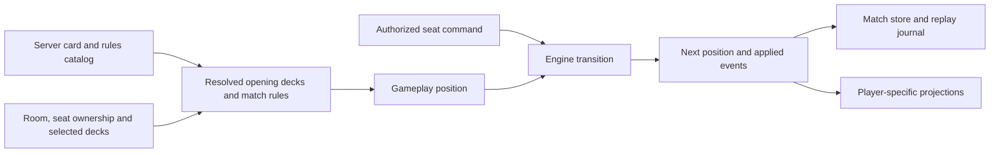

# Match state and content ownership

The server owns waiting rooms, seats linked to accounts, deck selection, and persistence. The engine owns the rules for moving from one gameplay position to the next. A gameplay position contains seat IDs, zones, resources, priority and other rules state. The server correlates engine events with its room ID.

## Decision

The server resolves deck IDs before opening play. Engine transitions accept the position, command, runtime capabilities for IDs and randomness, and a correlation ID for events. Outside a server, a caller can start, play and replay with synthetic definitions and two seat IDs. The empty ability list represents a card with zero abilities. Mana production is a declared ability.

The position snapshots resolved rules and carries the token blueprints and counter definitions for its match. Cards already in zones carry their own blueprints. Keeping these definitions in the checkpoint increases its size and lets recovery use the same content after a catalog edit or retirement. The server runs existing rooms from their stored position and reuses the engine runner while that position is current.

The loader validates authored content and resolves token references. Card file paths, preset names, deck eligibility, lobby choices and account ownership belong to the application. Stable card IDs are used for saved deck and scenario references. Moving a card file updates the generated imports, and content validation reports missing references.

## Existing saves

Checkpoint format 2 stores the pinned definitions. Recovery verifies format 1 against its original hashes using the archived token and counter definitions. The first accepted command writes a format 2 checkpoint with the recovered state and pinned definitions.

## Verification

The architecture gate checks that the engine transition has no runtime path to the shipped catalog or application modules. The synthetic match test supplies its own cards, token and counter, serializes and restores gameplay positions, and checks the replayed result. Server tests cover saved deck selection and recovery through normal room entry points.
