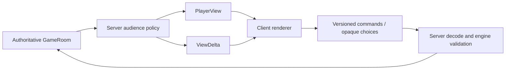

# Milestone 1 — Protocol and Player Projection

**Started:** 26 October 2026. **Verification:** brief targeted logic tests, typechecks and builds. The user waived browser smoke tests, further long socket tests and time-consuming full-suite runs.

## Contract and decisions

- Introduce a source-exporting `@card-game/protocol` workspace. Explicit wire DTOs contain display fields, public state, viewer-owned cards and server-resolved legal targets. Protocol may use type-only engine imports; clients import protocol and local UI code, never engine implementations or raw GameRoom.
- One server projection policy governs snapshots, delta values, stack/combat sources and choice visibility. No raw blueprint, library array/order, rule continuation, trigger queue, effect pool, setup deck or internal event batch reaches players.
- Build deltas by comparing projected before/after views, not by deleting fields from raw mutation patches. Internal mutation deltas remain available to server-side diagnostics. This trades coarser public updates for a complete, auditable information boundary.
- Project display characteristics and targeting candidates on the server. Engine validation stays authoritative; UI target selection uses supplied legal target references and display-only bounds.
- Choice options use stable opaque wire IDs. Translate answers at the transport boundary; expose no engine continuation or arbitrary option value. Opponents receive waiting status only. Authorized search/reveal labels remain visible to the deciding player.
- Version outgoing messages and client commands. Reject incompatible handshakes/messages rather than interpret stale wire data.
- Provide a full-state debug router with an injected authentication/role seam, disabled to all callers until Phase 2 supplies authentication. Debug flag and inspector/admin role are both required. Do not introduce a temporary unauthenticated inspection endpoint.
- Correct R-B to prohibit client-to-engine runtime imports, while allowing server engine access. Keep engine independent of protocol; verify duplicate wire action vocabulary against the engine in tests.

## Execution and acceptance ledger

1. Protocol workspace, DTOs, action/event contracts, presentation constants and version checks; wire rules vocabulary parity tests.
2. Projection tests for own/opponent hands, both libraries, public zones, source snapshots, malicious extra fields, choices and legal targets. Implement allowlisted card/view builders and opaque choice answer decoding.
3. Apply the same boundary to create, join, RPS resolution, normal updates, getOptions and reconnect. Test snapshot/delta equivalence and private-data absence over real socket connections.
4. Migrate the client store, card/stack/combat/choice rendering and targeting to DTOs. Split UI logging/flags from engine config. Adapt logic tests to construct actual projected fixtures.
5. Protect debug inspection with fail-closed defaults, debug flag and role tests.
6. Enforce protocol type-only engine imports and no client engine imports; remove all five temporary exceptions. Update compiler, bundler and test aliases/references.
7. Run the accepted targeted logic checks, application typechecks, architecture gate and builds. Update architecture, supplement, map and completion report; preserve existing rule coverage while adapting intentional wire-contract assertions. Further long socket/full-suite runs are waived by the user.

Authentication and session trust remain Phase 2 concerns. No claim is made that private views authenticate the viewer. Admin UI, persistence, deck builder and animations remain outside this milestone.

Implementation decisions and current contracts are documented in the [architecture supplement](protocol-projection-architecture.md). The [completion report](phase-1-status-2026-10-26.md) owns the final requirement-by-requirement verification record.
