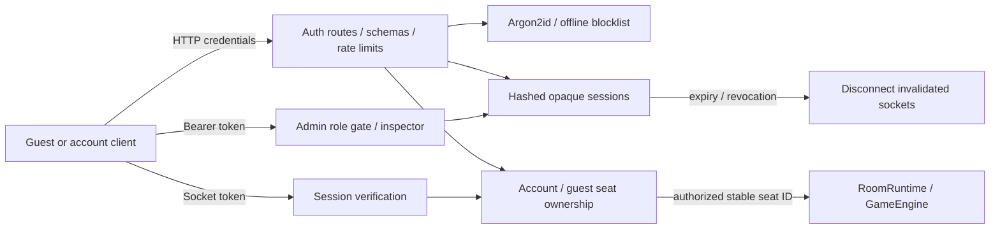

# Milestone 2 — Accounts, Sessions and Admin Access

The user requested platform Milestone 2 and authenticated admin access, with focused testing. Admin UI implementation is excluded by their clarification; the completion report will propose the later panel design. Long socket scenarios and the full suite will not block delivery.

## Decisions

- Authentication belongs to the server transport. Passwords travel only through HTTP auth routes; Socket.IO receives an opaque session token. The engine continues to receive seat/player IDs and knows nothing about credentials.
- Guests also receive server-issued session credentials. Browser-generated player IDs are placeholders, never proof of seat ownership. Invalid supplied tokens fail rather than falling back to an anonymous guest.
- Preserve an existing guest seat by transferring its server-side ownership to the authenticated account. Engine seat IDs remain stable, including cards, targets and pending continuations. Account-to-seat bindings determine the authorized engine PlayerId; the browser cannot choose it. This avoids rewriting every historical player reference inside an active match.
- Account and session repositories sit behind the server store seam. Accounts, sessions and seat bindings remain in memory for this phase; Phase 3 can replace the repositories. Expired sessions and capacity bounds prevent unbounded session growth.
- Use Argon2id with server-only parameters, a length-based password policy and an offline common/breached-password blocklist. Use fresh random session tokens, store their hashes, expire/revoke them, rotate account sessions on login, and check active sockets after connection as well as at handshake.
- Public registration always creates a player. Only explicit operator bootstrap configuration creates an admin. Following the user's concern about privilege sharing, a fresh password login must request a separate `admin` scope (15-minute expiry). Game sessions, including an admin account's game session, cannot inspect. The token-validation implementation is shared, while scope/role authorization is separate. No public role-promotion endpoint or default admin password is introduced.
- Apply Helmet, bounded auth inputs and auth rate limiting. HTTP and Socket.IO share an explicit origin allowlist; unlisted origins and preflights fail.
- Add game-client account controls so registration/login while seated can actually exercise linking. Admin endpoints are independently usable through the HTTP auth API; no admin bundle ships in the game client.

## Focused acceptance

1. Password policy/hash verification, expired/revoked/rotated sessions, capacity bounds, and recursive log redaction.
2. Validated register/login/logout/me and guest issuance; public role escalation denied; login logs contain no password/hash/token.
3. Short actual-server lifecycle: account login, create/join, a turn, logout and token rejection; forged IDs ignored and seat takeover denied.
4. Guest plays, registers/logs in, and reconnects with account credentials to the same seat. Conflicting account-seat links fail. Linked/revoked guest sockets cannot continue acting.
5. Admin authenticated access succeeds; normal users and invalid sessions fail; disabled inspection still fails. Unlisted HTTP/socket origins fail.
6. Focused client/account logic, import architecture, strict typechecks and production builds. No long/full-suite waits or browser smoke requirement.

Documentation and the final report will distinguish the completed account/admin API from the later panel UI and persistent storage.
