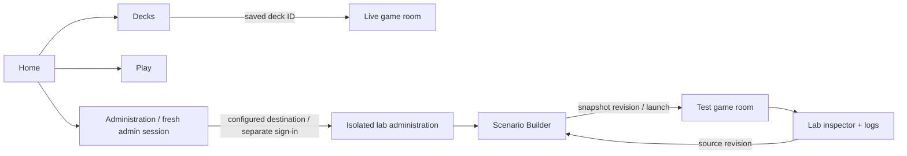

# Navigation and admin Test Lab — planned extension

**Date:** 29 October 2026. **Status:** design/roadmap only. Current implementation remains platform Milestones 0–5. This supplement defines Milestones 6–7; the original UI revamp moves from 6 to 8. No application behavior changes with this planning revision.

See the [milestone roadmap](platform-plan-2026-10-24.md#phase-6--navigation-and-session-integration), [current builder](deck-builder-architecture.md), [admin](admin-architecture.md) and [authentication](authentication-architecture.md) designs.

## Delivery sequence

| Milestone | Outcome | Dependencies |
|---|---|---|
| 0–5, delivered | Workspace/protocol, accounts, persistence, admin and builder | Existing reports remain historical evidence |
| 6, next | Navigation, public-session continuity, compatible routes, environment context | 2/4/5 and existing protocol boundaries |
| 7 | Isolated admin Test Lab, Scenario Builder, launch/inspect loop, fixture export | 4/5/6 |
| 8, original 6 | UI store split, transitions, animations, hand fan and battlefield presentation | 1/6; 7 is not a technical prerequisite |

Default order is **6 → 7 → 8**. UI work can follow 6 directly if prioritized. Security-lab deployment/monitoring/IDS/pentest phases keep their own numbering and gates. Completed acceptance requirements are not reopened.

## Navigation and journeys

The shared header presents **Home · Play · Decks · Administration**, account controls and a persistent server-backed **Live / Test Lab** indication. Admins get Administration and a configured lab destination when available. Local sidebars hold growing page lists.

| Workspace | Pages | Context to preserve |
|---|---|---|
| Home | Owned decks, active-room/resume reference, shortcuts; recent items only where real records exist | Account, environment and verified room availability |
| Play | Lobby, create/join, active room | Per-tab seat, connection and pending deck selection |
| Decks | Catalog/editor, saved decks, import/export | Recoverable draft, dirty state, selected owned record |
| Administration | Rooms, accounts, logs, configuration | Fresh admin scope, current selection and bounded log cursor |
| Test Lab inside lab administration | Scenarios, scenario editor, test rooms, inspector/log links | Lab identity, scenario/revision, room and run provenance |

Proposed public destinations: `/home`, `/play`, `/play/rooms/:roomId`; builder retains `/deck-builder/`. These are future routes. Implementation must preserve existing `/`, admin hashes and `deckId` links through compatible resolution/redirects. Production admin keeps its dedicated origin. URLs identify a request; membership and seat authority come from the server.

An active match retains its dedicated game tab. Workspace links from a game open another tab so the editor/inspector can remain available with the match. Resume validates session/membership and handles stale rooms explicitly. Dirty drafts/scenarios retain recovery and replacement confirmation. Post-login returns use approved routes/application destinations, not arbitrary redirects.

Shared header/sidebar/breadcrumb components live in `packages/ui`. A small navigation registry defines stable ID, label, approved destination, workspace and required capability. Public configuration supplies deployment URLs; apps retain local routing/API adapters and independent builds. Visibility does not enforce authorization. Public links can name the admin frontend; public bundles must exclude its API client, session handling and scenario editor. Home stays in the public app, scenario tooling in admin. This plan selects no new router or framework.

## Session prerequisite for Milestone 6

Currently, builder/game credentials are separate and a fresh game login revokes earlier game-scoped credentials. Navigation alone cannot provide smooth concurrent editing/play.

Write and implement a lifecycle/transport ADR before completing 6.1. It must settle ordinary sign-in reuse, bounded concurrent sessions, renewal/rotation/expiry, local versus account-wide logout, disabled-account revocation, guest linking, old-tab migration and per-tab seats. Do not simply remove rotation and leave concurrency/revocation undefined. Demonstrate the same journey with same-origin production hosting and separate Vite development ports.

The current bearer transport remains implemented until the ADR explicitly extends/supersedes it. If transport changes, document request-integrity, XSS/CSRF and socket-auth consequences. No credential-bearing URLs, cross-origin storage-copy bridge, unchecked return destination or public/admin credential sharing. Admin retains fresh short-lived privileged sessions. Live/lab authentication and credential namespaces remain independent.

## Scenario and configuration ownership

| Data | Owner after migration | Reason |
|---|---|---|
| Ordinary manual playtest composition | Standard saved-deck repository/editor | One editing path, unchanged standard legality |
| Development scenario | Dedicated versioned scenario repository, lab admin editor | Controlled nonstandard setup without relaxing normal matches |
| Canonical card abilities/effects | Engine content/normalizer | Builder selects IDs; it does not execute arbitrary effect code |
| Game-wide rules/security/deployment policy | Existing config folders/server invariants | Scenario editing cannot change permissions or enable capabilities |
| Automated regression input | Reviewed source-controlled export, normally `tests/fixtures/scenarios/` | No browser/login/database dependency |

Extract reusable catalog, card-count controls, draft presentation and import/export pieces from the builder. Keep auth/network adapters app-owned. Use separate standard-deck and scenario schemas; sharing controls does not mean sharing all validation policy.

Define bounded versioned scenario fields for canonical card IDs/counts, test-only eligibility, smaller decks, fixed order/gameplay seed, starting life/hand settings and explicitly supported starting zones/state. Include server-created ID/revision and launch provenance. Reject unsupported fields, credentials, executable scripts and arbitrary engine mutation streams. Keep game rules unchanged. Seed only gameplay randomness; authentication entropy remains independent.

Scenario CRUD/launch/reset needs admin scope, current role and an enabled server-owned lab capability. Live instances refuse scenario execution, even for admins. Launch snapshots the source revision/content; later edits/deletion cannot rewrite a running room. Reset targets only marked test rooms and is audited. Bind lab participants/test seats server-side; the admin bearer never becomes a game socket credential, and caller-supplied player IDs confer no authority. Use stable engine setup/runtime interfaces; the engine learns nothing about admin or storage.

The workflow is **create/load → save → launch → play/inspect/logs → return to source revision → edit/relaunch/export**. Every screen retains environment/room/scenario context. Handle cancellation, stale responses, missing scenarios and failed writes explicitly; preserve inspector privacy and bounded reads.

Inventory all five existing presets (`development`, `trigger`, `st01a`, `workbook`, `small-mechanics`). Classify each use as manual composition, automated fixture or rule default. Export and compare deterministic order/settings/expected behavior before removing duplicate runtime composition. Retain canonical card/rule files and narrow automated fixtures in source control. Runtime engine packages must not import test directories or depend on browser/editor processes. Promotion of an export into a regression fixture is reviewed version-control work; tests never select a mutable database record implicitly.

## Environment and operations

A Test Lab is a separate instance/backend/database with independent credentials, origins and log paths. Its badge reflects trusted server identity, not a query parameter or client toggle. A switch opens the configured environment and requires its sign-in; it forwards no live token/account/room state. Do not classify public production as development to expose debug routes.

Local acceptance uses independent temporary live-like/lab instances and verifies cross-instance credential/data rejection. Installed Linux isolation, TLS, proxy/firewall, native runtime installation, monitoring, IDS, pentest campaigns and remediation remain in the security-lab plan. Those deployment gates precede real campaigns; application-level checks do not establish host/network isolation.

## Planned decision records

These record roadmap direction; runtime implementation and its verification remain pending.

| ADR | Decision | Alternative/trade-off |
|---|---|---|
| N6-01 | Shared navigation/presentation with independent apps | One giant SPA simplifies routing but changes deployment/bundle boundaries; shared components require explicit config/compatible routes. |
| N6-02 | Public-session continuity; privileged admin scope and independent environments | Repeated login disrupts editing/play. Token forwarding is rejected. Lifecycle/transport selection is a required Phase 6 task with seat/revocation tests. |
| N6-03 | Dedicated game tab plus validated bookmarkable context | Document replacement interrupts sockets. Dedicated tabs add tab management while avoiding a microfrontend host. |
| N7-01 | Admin-owned scenario tooling, shared editor pieces, separate schema | Duplicating the builder drifts; globally disabling standard validation confuses testing with normal play. Extraction needs regression coverage. |
| N7-02 | Isolated lab and immutable launch snapshots | A live-data toggle costs less setup but makes mistakes cross boundaries. Isolation costs provisioning/sign-in steps. |
| N7-03 | Reviewed fixture exports; canonical cards/rules and narrow fixtures remain source-controlled | Mutable saved scenarios make tests stateful. Exports require promotion/review and preserve reproducibility. |

## Verification and limits

Phase 6 proves sign in once → save/edit → play a turn → edit again without revoking the game or losing its seat, plus intended logout/disable/expiry, multi-tab ownership, direct/compatible routes, safe returns and admin boundaries. Phase 7 proves nonstandard admin scenario → marked lab room → play/inspect → revise/relaunch → fixture roundtrip, alongside unchanged normal rejection and preset equivalence. Cover cross-instance credentials in both directions, disabled capabilities, malformed/bounded inputs, storage failure, stale replies and provenance.

Use focused logic/render checks, short actual HTTP/socket tests where needed, architecture/bundle checks, all project typechecks and app builds. The user's instruction excludes browser smoke and long socket/full-suite waits. Deployment/isolation measurements and animation frame-rate claims require their own evidence. All seven original UI work items remain in Milestone 8; browser/60 fps validation is deferred release work.
