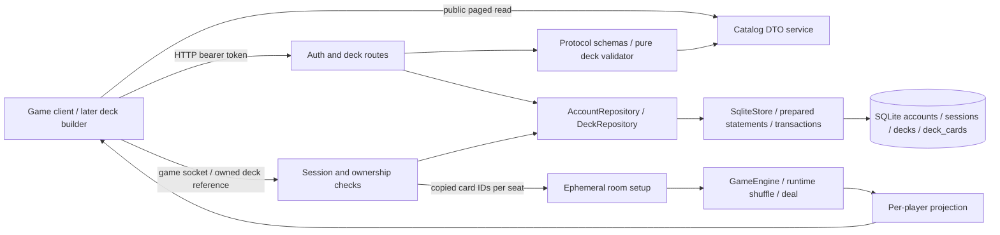

# Persistence and saved decks — architecture supplement

**Date:** 27 October 2026. **Scope:** platform Milestone 3. Extends [ARCHITECTURE.md](../ARCHITECTURE.md), [authentication](authentication-architecture.md) and the [workspace supplement](workspace-architecture.md).

Milestone 3 made accounts, scoped sessions and owned decks durable. Rooms, socket identities, engine instances and room-seat ownership remain process-local. The saved-deck API and a selector in the existing game client support the separate applications added by Milestones 4–5.

**Milestones 4–5 update:** the [admin application](admin-architecture.md) and [deck builder](deck-builder-architecture.md) are implemented. Migration 002 adds the durable audit outbox. Editable defaults/quotas/content moved to [owned configuration folders](configuration-architecture.md). The builder uses the existing owned APIs and shared validator, then hands a UUID to the game. The Milestone 3 report records historical evidence.

## Components and data flow



`index.ts` supplies `DATABASE_PATH`, defaulting to repository `data/card-game.sqlite` relative to the built server. It also handles the backup command and graceful shutdown. `createGameApplication({ databasePath })` opens the persistent repositories and closes them on server shutdown. The application factory without a database path retains isolated in-memory repositories for tests; the production process always supplies a path. Empty paths and ambiguous injected store/path configuration fail.

`InMemoryStore` still owns rooms and receives separate auth/deck repository implementations. The engine receives copied card IDs; it never imports a database driver, account type, token or HTTP router. Full-state diagnostic access remains behind separate admin scope, current role and the inspection flag. Player projections exclude room setup and deck lists.

## Library ownership and choices

| Dependency | Location and role | Reason / cost |
|---|---|---|
| `better-sqlite3` **12.11.1**, exact | Server runtime; imported only by `stores/sqlite-store.ts` | Prepared statements, synchronous transactions and online backup fit one process with bounded accounts/decks. Native binaries are platform/Node dependent; short synchronous work blocks the event loop while executing. Version 13 requires Node 22; the selected 12.x release preserves this project's Node 20 support. CI/local verification uses Node 24. |
| `@types/better-sqlite3` **9.6.0**, exact | Server development dependency | TypeScript declarations for the driver's API; not shipped as a runtime dependency. The declaration package has its own version sequence. |
| Existing Zod | Protocol workspace | Strict shared request/response contracts and deck data validation. No second validation library added. |
| Removed Mongoose | Root and server manifests | No MongoDB repository was active; the unused dependency and its lockfile subtree are removed. |

No ORM, migration framework, database service or driver dependency is added to the browser/engine/protocol packages. An architecture test enforces the native driver's runtime-import boundary. SQL migrations are TypeScript-exported strings bundled with the server, so deployment cannot accidentally omit separate `.sql` assets. Migrations import driver types only.

The selected APIs follow the driver's [official API documentation](https://github.com/WiseLibs/better-sqlite3/blob/v12.11.1/docs/api.md) and [performance guidance](https://github.com/WiseLibs/better-sqlite3/blob/v12.11.1/docs/performance.md). The dependency review also updated existing compatible Vite/body-parser lockfile resolutions to 8.3.5/1.20.9. The final report records the audit result; an audit is not a pentest or proof of absence of vulnerabilities.

## Database and transaction boundary

The first migration creates `schema_migrations`, `accounts`, `sessions`, `decks` and `deck_cards`. Unique account IDs/usernames, foreign keys, checked roles/scopes and normalized unique card entries protect relational consistency. Decks reference their account owner; session records contain token digests and retain both subject kind and scope. Guest session records can persist without creating guest accounts. Seat bindings deliberately have no persistent table because their rooms disappear at restart.

The adapter enables foreign keys, WAL journaling and FULL synchronous durability, with a one-second lock timeout. It caches prepared statements and binds values separately from SQL. All owned deck reads/updates/deletes include the authenticated owner predicate. A nonexistent deck and another account's deck both return 404.

Migrations run in a transaction, apply once in order and reject unknown schema versions. A failed migration rolls back partial changes; never edit an already applied migration to change its meaning. Add the next numbered migration and test both upgrade and rollback. Back up before upgrading. Schema versions are separate from `PROTOCOL_VERSION` and format identifiers.

Password hashing stays outside database transactions. Registration/account insertion, guest-seat transfer, session rotation and token issuance commit atomically. Revocation notifications reach sockets after the outer transaction commits. If session insertion fails, the account insertion or old-session revocation rolls back and no disconnection is announced. Both SQLite and the in-memory repository implement this transaction seam.

Operator bootstrap can reuse an enabled admin account only after verifying the configured password against its current hash. It preserves ID/hash and does not rotate existing sessions merely because the server restarted. It never promotes an existing player or overwrites an existing secret; mismatch/disabled identity fails startup. Password reset and account management remain explicit future admin operations.

## Catalog and deck contract

The catalog exposes stable printed data: definition ID, name, types, colors, cost, rules text, printed power/toughness and deck-legality/copy-limit metadata. It contains no active-match IDs/state or executable ability/effect definitions. Public catalog availability reveals definitions, not which cards an opponent holds or selected. Pagination defaults to 25, caps at 100 and rejects unknown query fields; ordering is stable by definition ID.

`packages/protocol/src/decks/deck.ts` owns the shared `DeckSchema` and pure `validateDeck(input, catalog)`. Its initial `standard` policy now lives in `decks/config/standard-v1.json`: 60–250 cards and four copies, with the explicit repeatable `land-red` exception in eligibility metadata. Other lands retain four copies. The explicit exclusion list contains RPS/development cards, including the two named counter fixtures; filename suffixes no longer determine legality. Duplicate entries, fractions, unknown cards and ownership/role injection fail. A future semantic change should introduce an explicit new format identifier rather than silently rewriting stored decks.

Saved decks have server-generated IDs and timestamps; ownership is stored only on the server. The default account quota is 100 decks, now controlled by server storage settings. All deck routes require an enabled account's game-scoped session; guest/admin-scoped sessions cannot manage decks. The default JSON body limit is 8 KiB, configurable within schema safety bounds. Shared validation returns consistent structured rule errors; responses are schema-validated too.

| Endpoint | Behavior |
|---|---|
| `GET /api/cards?offset=0&limit=25` | Public paginated printed catalog, including legality metadata. |
| `GET /api/decks?offset=0&limit=25` | List the current account's decks only. |
| `POST /api/decks` | Create; body `{protocolVersion:1, deck:{name,format:"standard",cards:[{cardId,quantity}]}}`. |
| `GET /api/decks/:id` | Read an owned deck. |
| `PUT /api/decks/:id` | Replace an owned deck's name/format/cards with a validated body. |
| `DELETE /api/decks/:id` | Delete an owned deck; success is 204. |

## Starting matches

Socket create/join messages accept an optional `deckId`. A selected reference must belong to the authenticated account and pass current format rules. Browser-supplied card lists and ownership claims are rejected. The server expands quantities and copies card IDs into `setup.playerDecks[playerId]` before play. Each seat can select a different deck. After RPS the engine instantiates, shuffles and deals each saved deck using `RuntimeContext`. Saved decks always shuffle, independently of the development-fixture shuffle setting.

Later deck edits/deletion cannot modify a waiting or playing match's copied setup. Rejoining restores the existing seat rather than selecting a new deck. The client includes a cancellable saved-deck list and selector; it sends references only. Full deck creation/editing UI remains Phase 5. Vite proxies `/api` as well as Socket.IO to the backend during development.

Fixture decks require a non-off game debug mode. In development they remain enabled unless `FIXTURE_DECKS_ENABLED=false`; production disables them unless explicitly enabled with `FIXTURE_DECKS_ENABLED=true` and a non-off debug mode. A production player without an owned selected deck receives an actionable rejection. Fixtures are a development escape hatch, never a saved-deck validation bypass.

## Operations and failure modes

Keep the database, WAL/SHM sidecars and backups out of Git and web-served folders. New database directories request mode 0700; provision existing directories privately and use a service umask of 0077 on Linux. Restrict Windows folder ACLs appropriately. These files contain account hashes and session digests and are not encrypted by SQLite. Backups need the same access controls. A configured unwritable path or migration failure stops initialization; request-time database errors produce a generic response without credentials or SQL details.

After building, create a consistent online backup:

```sh
node apps/server/dist/index.js backup /private/backups/card-game-2026-10-27.sqlite
```

The command uses the same `DATABASE_PATH` as startup, requires an existing source and a new destination, invokes SQLite's backup API and closes its connection. It includes committed WAL content; copying just a live `.sqlite` file is not a complete backup procedure. Verify a copy by opening it with a SQLite tool and running `PRAGMA integrity_check` before relying on it. Schedule retention separately; the command does not implement a backup scheduler or off-host storage.

To restore, stop the server first, preserve the current database and any sidecars together in a recovery directory, then place the verified backup at `DATABASE_PATH` without stale WAL/SHM files. Restore ownership/permissions. In the restored database, delete all rows from `sessions` before restarting so historical backup tokens cannot regain access. Do not promote accounts or replace password hashes as part of ordinary restore. Restart and verify schema, login and owned decks. Active matches are intentionally lost.

`deploy/logrotate/deltas` rotates the default Linux path, retaining seven compressed archives with daily/10 MiB rotation criteria and 0640 files. Each append opens/closes the log, so rename/create is appropriate; no copytruncate or restart is needed. Install only on the intended host with its `cardgame` user/group. Validate with `logrotate --debug deploy/logrotate/deltas` and use a temporary test log for a forced-rotation check. Adapt the path if `DELTA_LOG_PATH` changes. Rotation criteria run when logrotate runs; they do not impose an instantaneous disk cap. Linux installation and scheduling are later deployment verification, not claimed by local Windows tests.

| ADR | Decision | Trade-off |
|---|---|---|
| P3-01 | SQLite behind repository interfaces, one server process | Simple operation and atomic writes; synchronous queries/native binaries require bounded workloads and platform verification. |
| P3-02 | Durable accounts/sessions/decks; ephemeral rooms/seats | Restart preserves identity and deck work without claiming resumable game recovery. |
| P3-03 | Atomic auth changes with post-commit notifications | Adds a transaction seam, prevents partial registration and premature socket revocation on disk failure. |
| P3-04 | Shared pure format validator and explicit exceptions | Identical API/builder feedback; the initial custom format and future changes must be documented/versioned. |
| P3-05 | Resolve owned references and snapshot deck contents before play | Avoids browser authority and mid-match deck edits; setup stores an additional private list of definition IDs. |
| P3-06 | Native backup API, offline restore and external log rotation | Keeps storage tooling small; operators still own scheduling, retention, file permissions and Linux verification. |

See the [implementation ledger](milestone-3-implementation.md) and [completion report](phase-3-status-2026-10-27.md) for requirement-specific evidence and the focused-testing adjustment.
