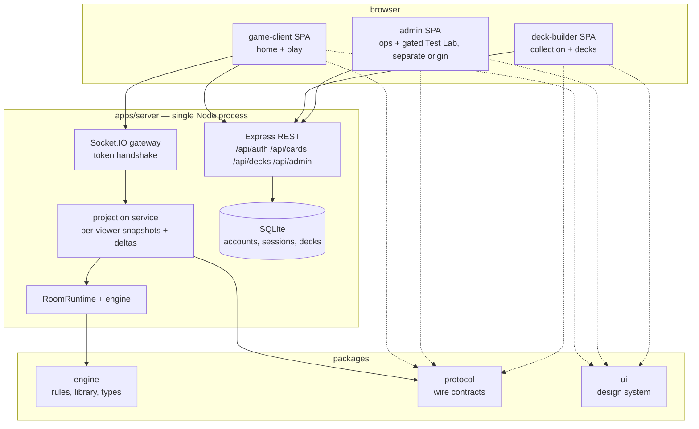
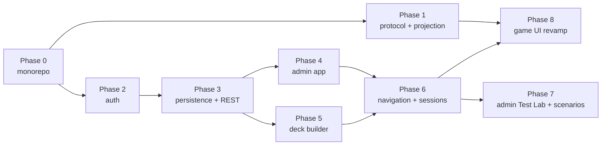

# Platform plan — multi-app structure, accounts, admin, deck builder, UI revamp

**Prepared:** 24 October 2026
**Revised:** 29 October 2026 — navigation/session integration and the admin Test Lab are incorporated below.
**Status:** Phases 0–6 implemented with milestone-specific verification. Next: Phase 7 admin Test Lab/Scenario Builder, then Phase 8 game UI revamp (originally Phase 6). Reports retain their historical numbering. The user’s standing gate is focused logic/short integration checks, architecture, all typechecks/builds; no browser smoke, long socket or blocking full suite. See [Milestone 6 evidence](phase-6-status-2026-10-29.md).
**Scope:** Restructure the application into a workspace monorepo with a protocol boundary, an
account system, an admin app, a deck-builder app, consistent navigation, an admin development workspace, and an animated game client. This plan
changes **no game rules**. Engine rules work continues on the
[implementation plan](implementation-plan-2026-10-07.md) inside the engine package, unaffected.

The [Navigation and Test Lab supplement](navigation-test-lab-plan.md) maps the user journeys, session design, scenario/fixture ownership, environment isolation and decision records onto Phases 6–7. Navigation and public sessions are implemented in Phase 6; the admin Scenario Builder, test-room launch and fixture migration remain planned for Phase 7.

## Relationship to existing plans

| Existing document | This plan |
|---|---|
| [`development/0.3-private-views.md`](development/0.3-private-views.md) (deferred) | **Phase 1 resumes it** as the projection/protocol boundary. The stop condition there is honored: one projection service owns every outgoing path; no ad-hoc field deletion; debug inspection stays at the authoritative server boundary. |
| [`security-lab-plan.md`](security-lab-plan.md) Phase 1 (account system) | **Phase 2 implements it** against the new `apps/server` layout, with the integration points the lab plan does not cover (guest linking, CORS lockdown, REST validation). |
| [`security-lab-plan.md`](security-lab-plan.md) Phase 2 (deployment) | Referenced, not duplicated. `deploy/` artifacts gain the multi-origin nginx routing in Phase 4. |
| [`implementation-plan-2026-10-07.md`](implementation-plan-2026-10-07.md) | Untouched. All engine milestones proceed inside `packages/engine` with the same gates. |
| [`architecture-import-policy.md`](architecture-import-policy.md) | **Updated by every phase.** The boundary test is the enforcement mechanism for this plan; no phase lands without its policy edit. |
| [`navigation-test-lab-plan.md`](navigation-test-lab-plan.md) | Platform Phases 6–7 add shared navigation/public-session continuity and a privileged scenario workspace. This application Test Lab supplies reproducible targets/fixtures; Linux deployment, network isolation, monitoring and pentest campaigns remain owned by the security-lab plan. |

---

## 1. Target system

One Node process per environment, one repository, three independently built frontends behind one API. Home/navigation are part of the public frontend; the Scenario Builder is part of admin. The isolated lab runs its own backend, database and credentials. The split is at
**build and dependency level**, not at service level.



**Principles**

1. **The engine never learns about any of this.** `GameEngine` keeps receiving a `PlayerId`
   and stays unaware of accounts, tokens, HTTP, or which app is asking.
2. **Clients are dumb renderers.** After Phase 1, the game client receives already-resolved
   display data (effective P/T, keywords, legal target ids) and never recomputes game rules.
   This keeps the UI revamp (Phase 8) independent of engine work.
3. **Admin never ships in the player bundle.** Separate build, separate origin, server-side
   role gate. A hidden React route is not an admin boundary.
4. **One wire contract.** `packages/protocol` owns client/server contracts and is versioned (`PROTOCOL_VERSION`) from day one. Clients also share presentation components through `packages/ui`; neither package imports an app, and no frontend imports engine implementations.
5. **Single process until proven insufficient.** No microservices, no message queue, no
   per-app backends. REST + Socket.IO + static builds from one Express app.

---

## 2. Target repository layout

```
card-game/
├── package.json                    # workspaces: apps/*, packages/*; root scripts (verify, test, build)
├── tsconfig.base.json              # shared strict compiler options
├── vitest.config.mts               # workspace projects → per-package/app configs
├── docs/                           # unchanged
├── data/                           # deltas.jsonl; cardgame.db (Phase 3)
├── deploy/                         # systemd, nginx (multi-origin), ufw, auditd, logrotate
├── tests/
│   └── architecture/               # import-boundaries.test.ts — root-scoped, updated every phase
├── packages/
│   ├── engine/                     # @card-game/engine — the game core; no app knowledge
│   │   ├── package.json
│   │   ├── tsconfig.json           # composite
│   │   └── src/
│   │       ├── engine/             # from src/engine/** — internals unchanged
│   │       ├── library/            # from src/library/**
│   │       ├── shared/             # from src/shared/**
│   │       ├── types/              # from src/types/**
│   │       └── config.ts           # game-rules config (audience split in Phase 1)
│   ├── protocol/                   # @card-game/protocol — the only client-facing contract
│   │   ├── package.json
│   │   ├── tsconfig.json
│   │   └── src/
│   │       ├── views/              # PlayerView, CardView, StackView, CombatView, ChoiceView
│   │       ├── deltas/             # ViewDelta (wire delta; supersedes raw StateDelta)
│   │       ├── events/             # socket event registry: names + payload types, both sides
│   │       ├── actions/            # action packet contract (from server/action-packet shape)
│   │       ├── rest/               # zod schemas: auth, catalog, decks, admin
│   │       ├── decks/              # DeckSchema, format rules, shared validation
│   │       ├── client-flags.ts     # client feature flags (split out of gameConfig)
│   │       └── version.ts          # PROTOCOL_VERSION constant
│   └── ui/                         # @card-game/ui — design system shared by all three apps
│       ├── package.json
│       ├── tsconfig.json
│       └── src/
│           ├── card/               # CardSurface, cost badges, type line, P/T box
│           ├── primitives/         # Button, Panel, Tabs, Modal
│           ├── tokens/             # colors, spacing, radii, motion curves
│           └── motion/             # shared animation presets (Phase 8)
└── apps/
    ├── server/                     # @card-game/server — Express + Socket.IO composition root
    │   ├── package.json
    │   ├── tsconfig.json           # project references: engine, protocol
    │   └── src/
    │       ├── index.ts            # bootstrap only (from src/server.ts)
    │       ├── config.ts           # HOST, PORT, data paths, authConfig (new; server audience)
    │       ├── realtime/           # socket wiring, handshake auth (Phase 2)
    │       ├── http/               # REST routers (Phases 2–4)
    │       ├── rooms/              # room-runtime, reconnect, sync (from src/server/**)
    │       ├── projection/         # view builders (Phase 1)
    │       ├── auth/               # per src/server/auth/README.md (Phase 2)
    │       └── stores/             # StateStore seam + SQLite implementation (Phase 3)
    ├── game-client/                # @card-game/client — player SPA (from src/client)
    │   ├── package.json
    │   ├── vite.config.mts         # port 5173; proxy /socket.io and /api → :3000
    │   ├── index.html
    │   └── src/                    # imports ONLY @card-game/protocol and @card-game/ui
    ├── admin/                      # @card-game/admin — ops SPA (Phase 4)
    │   └── ...                     # port 5174; same proxy shape
    └── deck-builder/               # @card-game/deck-builder (Phase 5)
        └── ...                     # port 5175; same proxy shape
```

`tem/` and `lab/` are untouched by this plan.

## 3. Dependency rules (enforced by `tests/architecture/import-boundaries.test.ts`)

| Package / app | May import at runtime | Type-only imports |
|---|---|---|
| `packages/engine` | own code only; internal rules per current policy (engine ↛ server, library ↛ engine, types ↛ config) | — |
| `packages/protocol` | `zod` | `@card-game/engine` (views re-export engine types) |
| `packages/ui` | `react`, `motion` | `@card-game/protocol` (CardView props) |
| `apps/server` | `engine`, `protocol`, `express`, `socket.io`, `argon2`, `better-sqlite3` | — |
| `apps/game-client` | `protocol`, `ui`, `react`, `zustand`, `socket.io-client` | — |
| `apps/admin` | `protocol`, `ui`, `react`, `zustand` | — |
| `apps/deck-builder` | `protocol`, `ui`, `react`, `zustand` | — |

Additional enforced rules, added as phases land:

- **R-A (Phase 0):** no app imports another app. No package imports an app.
- **R-B (Phase 1):** client runtime imports of `@card-game/engine` are **forbidden** (the authoritative server may import it) — the
  current five-edge client allowlist in `architecture-import-policy.md` goes to zero and the
  rule flips from allowlist to ban.
- **R-C (Phase 1):** `packages/protocol` → `packages/engine` edges must be type-only.
- **R-D (Phase 8):** `apps/game-client` animation and ephemeral UI state may not live in the
  store that mirrors server state (asserted by a client architecture test, not import graph).

## 4. Decision records

| # | Decision | Rationale | Rejected alternative |
|---|---|---|---|
| D1 | **npm workspaces**, no Turborepo/Nx | Repo is already npm; build times do not justify a task runner. Revisit only when `verify` exceeds ~2 min. | pnpm (different lockfile churn), Turborepo (YAGNI) |
| D2 | **Source-exporting packages** (`main`/`types` point at `src`), TS project references, no per-package `dist` | Packages are internal-only, never published. Vite bundles source for each application; `tsc -b` checks all projects and emits declaration/build metadata under root `build/types/`, with no per-package JavaScript output. | Per-package build + `dist` consumption (dual build, stale-output bugs) |
| D3 | **Single server process** for REST + Socket.IO + static | Correct at this scale; the multi-app split buys bundle isolation, auth separation, independent deploys — not services. | Microservices / per-app backends |
| D4 | **better-sqlite3** for accounts, sessions, decks; rooms stay in-memory | Synchronous, zero-ops, single file, fits the single process. Rooms are ephemeral game state and correctly stay in memory. `mongoose` is an unused dependency and is removed in Phase 3. | MongoDB (retained only if a multi-process scale-out is later planned — that would be a new decision) |
| D5 | **Admin as a separate app + separate origin** (subdomain in prod, `/admin` path acceptable in the lab), server-side role gate | Admin code must not exist in the player bundle; separate origin gives clean token scoping. | Hidden routes in the game SPA (not a boundary) |
| D6 | **Deck builder as a separate app**, not a lazy route in game-client | Different interaction model (catalog search, filters, persistence), no socket dependency, independent deploy cadence; shares `packages/ui` so the card looks identical. | Lazy route (couples deploy cadence to the game client) |
| D7 | **motion (framer-motion)** for the UI revamp | React 19 compatible; `layout` prop provides FLIP animations for zone moves and hand re-fanning without manual transform bookkeeping. | Manual CSS FLIP (more code, same result); WebGL canvas (wrong tool for DOM card UI) |
| D8 | **Opaque scoped credentials**: Milestone 6 browser-family HttpOnly cookie; explicit per-tab game/admin bearers | Public apps reuse one host-only browser sign-in with Origin/CSRF protections; children retain tab-specific seats and admin remains separately privileged. Legacy bearer APIs retain their defined rotation semantics. | A shared ambient public/admin cookie, bearer URL forwarding, cross-origin credential copying and long-lived localStorage credentials |
| D9 | **`PROTOCOL_VERSION` on every wire payload** from Phase 1 | Cheap insurance; a stale tab after a deploy can be detected instead of misparsed. | Ad-hoc format checks |
| D10 | **Shared navigation/editor components; independent app builds** (Phases 6–7, planned) | A navigation registry and local sidebars give future pages a home without app-to-app imports. Home stays in the public app; the Scenario Builder stays in admin. | Merging every app, adding a microfrontend framework, copying a second editor. |
| D11 | **Public-session continuity delivered in Phase 6; privileged admin and independent lab credentials** | Browser-family cookie plus bounded tab children, fixed expiry, local/family/account-wide public revocation, migration and ownership checks are implemented. See [M6 ADRs](milestone-6-implementation.md). | Token URLs, cross-origin credential copying, implicit seat authority from player IDs, one public/admin credential |
| D12 | **Versioned development scenarios separate from standard saved decks** (Phase 7, planned) | Admin-only tooling can allow test cards/fixed ordering/initial setup without weakening ordinary deck legality. Exported automated fixtures remain reproducible and independent of live storage. | Disabling standard validation globally or making tests depend on admin login/a seeded database. |
| D13 | **Test Lab has its own instance/data and an explicit server-owned purpose** (Phase 7, planned) | The environment badge must describe the actual instance. Live servers reject development scenario execution; admin role alone does not turn a live room into a lab. | An unrestricted UI toggle over live data or a production admin token reused against the lab. |

---

## 5. Phase plan



Default next delivery order: **6 → 7 → 8**. Phase 8 depends on 1 and 6 and can follow 6 directly if animation becomes the priority; Phase 7 is not its technical prerequisite. No parallel-agent work is implied by the dependency graph. Security-lab deployment is a separate track: local isolated scenario checks do not prove a Linux/network deployment.

The original UI Phase 6 is renumbered to Phase 8 from this revision onward. Historical completion reports retain their original references. Scenario tooling is an extension of completed admin/deck-builder capabilities, not a reopening of their acceptance gates.
Each phase lands as one reviewable merge, leaves `npm run verify` green, and updates
`ARCHITECTURE.md`, `docs/MAP.md`, and `architecture-import-policy.md` as part of the change —
docs are canonical in this repo, not an afterthought.

### Phase 0 — Workspace restructure

**Completed:** 26 October 2026. The original 1,391 tests pass unchanged; two required R-A architecture checks bring the suite to 1,393. All Phase 0 acceptance evidence is in the [completion report](phase-0-status-2026-10-25.md).

**Dependency:** none. **Blocks:** everything. **Hard rule:** move-only. No logic edits, no
renames beyond `server.ts` → `index.ts`. Engine milestone work continues on top of the new
paths afterward.

**Work**

| # | Item |
|---|---|
| 0.1 | Root `package.json`: `"workspaces": ["apps/*", "packages/*"]`; scripts `verify` (= typecheck + test + build + architecture gate), `typecheck` (`tsc -b`), per-app `dev` scripts. |
| 0.2 | `git mv` `src/engine`, `src/library`, `src/shared`, `src/types`, `src/config.ts` → `packages/engine/src/`. One dedicated commit, nothing else in it. |
| 0.3 | `git mv` `src/server.ts` → `apps/server/src/index.ts`; `src/server/**` → `apps/server/src/rooms/` (room-runtime, reconnect, action-packet, sync-service). |
| 0.4 | `git mv` `src/client` → `apps/game-client`; move `index.html` to app root for Vite. |
| 0.5 | `tsconfig.base.json` (strict options from current root config); composite `tsconfig.json` per package; app configs reference packages. Repoint aliases: `@engine/*`, `@library/*` → `packages/engine/src/…`; `@shared/*` → `packages/engine/src/types/*` (names unchanged to limit churn; Phase 1 introduces `@protocol/*`). |
| 0.6 | `vitest.config.mts` becomes a workspace config over per-package/app configs; test imports switch from relative `../src/…` to alias/package imports. Test files do not move. |
| 0.7 | Update `tests/architecture/import-boundaries.test.ts` path roots and `architecture-import-policy.md` graph scope. Rules unchanged; add R-A (no app↔app, no package→app). |
| 0.8 | Server static serving + build outputs: `apps/server/dist`, `apps/game-client/dist`; update `deploy/README.md` provisioning paths. |

**Acceptance gate**

- `npm run verify` exits 0 with the same test count as before the move (no expectations changed).
- Boot the production build; the RPS smoke flow (`docs/smoke-test-rps.md`) works end to end.
- `git log --follow packages/engine/src/engine/game-engine.ts` reaches the pre-move history
  (rename detection intact).
- The Phase 0 commit diff contains no non-move modifications (reviewed line-by-line).

### Phase 1 — Protocol package and projection boundary (resumes 0.3)

**Dependency:** 0. **Blocks:** 8. This is the prerequisite for the UI revamp and the security
fix for F02, done once, in the shape the 0.3 document specifies.

**Work**

| # | Item |
|---|---|
| 1.1 | Create `packages/protocol` per §2. Move `types/delta.types.ts` semantics into `protocol/src/deltas/` as `ViewDelta`; move the action-packet shape into `protocol/src/actions/`. Add `PROTOCOL_VERSION`. |
| 1.2 | `apps/server/src/projection/view-builder.ts`: `buildPlayerView(room: GameRoom, viewerId: PlayerId): PlayerView`. `card-view.ts` resolves effective P/T, keywords, types via `CardCharacteristicService` **at projection time** — the client stops computing characteristics. |
| 1.3 | `projection/reveal-policy.ts`: single audience-policy module for every outgoing path (hand counts, revealed cards, deck sizes). No other code decides what a viewer sees. |
| 1.4 | `projection/delta-projector.ts`: mutations → per-viewer `ViewDelta`. `SyncService` broadcasts projected deltas; `roomSnapshot` becomes `PlayerView`. Pending choices carry **legal target ids** resolved server-side (client `targeting.ts` engine queries die). |
| 1.5 | `projection/debug-channel.ts`: authenticated full-state endpoint (`GET /api/debug/room/:id`) gated by debug flag + role. Developer inspection stays at the authoritative boundary, per the 0.3 stop condition. |
| 1.6 | Client: `gameStore` mirrors `PlayerView`; `deltaReducer` consumes `ViewDelta`; `CardComponent`, `combatSelection`, `targeting` read view fields instead of engine services. Split `gameConfig` by audience: rules config stays in engine, client flags move to `protocol/src/client-flags.ts`. |
| 1.7 | Import policy: empty the five-edge client allowlist; add R-B (clients ↛ engine runtime) and R-C (protocol → engine type-only). |

**Acceptance gate** (from the 0.3 evidence requirements)

- Socket tests for create/join, post-RPS, draw, cast, choice, and reconnect assert packets
  contain **no** private card UUIDs, blueprint definitions, or deck order; intended reveals
  (drawn card to its owner, revealed cards) still work.
- `npm run test:architecture` passes with the client allowlist empty.
- Reconnect delivers a `PlayerView` consistent with the deltas the client already applied.
- Original browser-smoke gate waived by the user on 26 October 2026. Verify the corresponding RPS, combat and reconnect flows through logic and real socket integration tests, plus typechecks and production builds.

**Accepted verification adjustment, 26 October 2026:** the user subsequently waived further long socket tests and time-consuming full-suite runs. Final acceptance uses brief targeted logic checks, the architecture gate, strict typechecks and production builds. Earlier socket evidence is recorded separately; a final clean full-suite run is not claimed.

Milestone 1 implementation and evidence: [projection architecture](protocol-projection-architecture.md), [completion report](phase-1-status-2026-10-26.md). Milestone 2 now supplies the verified admin identity required by the debug router.

### Phase 2 — Accounts and sessions (security-lab Phase 1)

**Dependency:** 0. Implements `security-lab-plan.md` Phase 1 in full; the lab plan remains the
reference for parameters and policy. Listed here are only the integration points it does not
cover.

**Implemented 26 October 2026:** [architecture and operator setup](authentication-architecture.md), [completion report](phase-2-status-2026-10-26.md). At the user's request, this also supplies admin-scoped login, explicit admin provisioning and authenticated room-list/inspector endpoints. The panel UI remains Phase 4. The shared verifier checks token validity; separate scope and current role gate admin access.

**Work**

| # | Item |
|---|---|
| 2.1 | `apps/server/src/auth/` exactly per `src/server/auth/README.md`: `password.ts` (Argon2id, params from `apps/server/src/config.ts` `authConfig`), `session.ts`, `account-store.ts` (in-memory behind the `StateStore` seam — Phase 3 swaps the implementation), `routes.ts`, `redaction.ts`. |
| 2.2 | `realtime/handshake.ts`: extract the auth block from the socket connection handler. Handshake carries the session token; `PlayerId` derives from the account. Unauthenticated connections keep the guest path — the client-generated id becomes a pre-login placeholder, per the auth README. |
| 2.3 | Guest→account linking: register or login while seated keeps the seat (identity remap through `reconnect.ts`, which already separates socket identity from player identity). |
| 2.4 | CORS lockdown: three local origins in development; production uses only configured origins. HTTP and sockets share the allowlist, replacing `origin: '*'`. Add `helmet` and `express-rate-limit` on auth routes. |
| 2.5 | `protocol/src/rest/auth.ts`: zod schemas for register/login/logout request and response bodies; server validates through them. |

**Acceptance gate**

- The security-lab Phase 1 gate verbatim: register → login → create room → play a turn →
  logout → token rejected; two accounts cannot take one seat; a forged `playerId` in the
  handshake is ignored; a log line produced during login contains no credential material.
- Guest linking: a guest who plays a turn, registers, disconnects, and reconnects with the
  token rejoins the same seat.
- Preflight from an unlisted origin is rejected.
- Milestone 2 verification adjustment authorized by the user: focused auth, client, runtime/reconnect and architecture checks; strict typechecks; both builds. No browser smoke or blocking long socket/full-suite run. The completion report records exact results; `npm run verify` remains the CI/full regression command.

### Phase 3 — Persistence and the REST surface

**Dependency:** 2.

**Implemented 27 October 2026:** [persistence/deck architecture and library decisions](persistence-deck-architecture.md), [completion evidence](phase-3-status-2026-10-27.md). The game client includes a saved-deck selector, while full builder/admin UIs remain Phases 5/4. The initial `standard` format is 60–250 cards, four copies with an explicit repeatable `land-red` exception; RPS/development fixtures are excluded from saved decks.

**Work**

| # | Item |
|---|---|
| 3.1 | `apps/server/src/stores/sqlite-store.ts` (`better-sqlite3`) with migrations under `stores/migrations/`: tables `accounts`, `sessions`, `decks`. Implements the same repository seams Phase 2's in-memory store implements; rooms remain in `InMemoryStore`. |
| 3.2 | `http/catalog-router.ts`: `GET /api/cards` — paginated catalog from `packages/engine` library data. |
| 3.3 | `protocol/src/decks/`: `DeckSchema`, format rules (minimum size, 4-copy limit), and `validateDeck(deck, catalog)` — pure, shared by server and deck-builder for identical client/server validation. |
| 3.4 | `http/decks-router.ts`: deck CRUD, ownership-scoped (`GET/POST /api/decks`, `GET/PUT/DELETE /api/decks/:id`). |
| 3.5 | Room setup accepts a deck reference: extend the serializable setup contract (`setup-config.types.ts`) with deck card lists; `room-factory` builds the starting library from the deck instead of fixture decks. Fixture decks remain available behind the debug flag. |
| 3.6 | Remove `mongoose` (D4). Add `deploy/logrotate/deltas` for `data/deltas.jsonl` (bounded disk use; also required by the security lab). |

**Acceptance gate**

- Accounts, sessions, and decks survive a server restart; rooms do not (by design).
- A deck with five copies of one card is rejected by both the REST route and the shared
  validator with the same error.
- Account A cannot read, modify, or list account B's decks (ownership tests).
- A room created from a saved deck deals exactly that deck; the RPS → play flow works with it.
- User-authorized verification adjustment: focused persistence/migration/backup, deck API/ownership, short saved-deck match, affected auth/runtime/client and architecture checks; strict typechecks and both builds. No browser smoke or blocking long/full-suite run. `npm run verify` remains the CI/full regression command; the completion report states exactly which checks ran.

### Phase 4 — Admin app

**Dependency:** 2, 3.

**Implemented 27 October 2026:** [admin architecture](admin-architecture.md), [configuration ownership](configuration-architecture.md), [completion evidence](phase-4-status-2026-10-27.md). The user's continuation also authorizes the preceding configuration/content refactor. Card/preset fingerprints preserve data; a read-only configuration page accompanies the three planned admin pages. No new router/configuration framework is added.

**Work**

| # | Item |
|---|---|
| 4.1 | `account.role: 'player' | 'admin'`; `http/admin-router.ts` behind role-gate middleware; every admin action appends to an audit log (`data/admin-audit.jsonl`). |
| 4.2 | Scaffold `apps/admin` (Vite, router, login through the existing auth API). Routes: LogViewer, RoomInspector, Accounts. |
| 4.3 | LogViewer: `GET /api/admin/deltas?offset&limit` — bounded, seek-based reads over `data/deltas.jsonl`; never loads the whole file. |
| 4.4 | RoomInspector: live room list + authoritative state via the Phase 1 debug channel, admin role only. |
| 4.5 | Accounts: list, disable (disabled accounts fail login and their sessions revoke). |
| 4.6 | Serving: nginx routes the admin build at its own origin (subdomain in prod; `/admin` path acceptable in the lab). The game-client build contains zero admin code — different bundles by construction. |

Milestone 2 already provides the role model, operator bootstrap, separate admin sessions and read-only room APIs from 4.1/4.4. Phase 4 still owns the UI, privileged audit trail, bounded log viewer and account-management endpoints. See the [proposed panel design](authentication-architecture.md#later-admin-panel-design).

**Acceptance gate**

- Every `/api/admin/*` route returns 403 for a player token and 401 for no token.
- A string search over `apps/game-client/dist` finds no admin route or API path.
- LogViewer pages through a 100k-line `deltas.jsonl` without holding it in memory.
- Admin actions appear in the audit log with actor, action, target, timestamp.
- User-authorized verification adjustment: focused configuration/content, admin API/audit/log reader/client and affected regression checks; all typechecks and server/player/admin builds. No browser smoke, long socket/full-suite wait or local Linux deployment. `npm run verify` remains available for CI/full regression.

### Phase 5 — Deck builder app

**Dependency:** 3.

**Implementation:** [Deck Builder architecture](deck-builder-architecture.md), [implementation ledger](milestone-5-implementation.md) and [completion evidence](phase-5-status-2026-10-28.md). Browsing/drafting are public; saving requires a game-scoped account session. Independent builder credentials stay in their own per-tab storage; the ID-only handoff is selected after game sign-in and owned-list verification.

**Work**

| # | Item |
|---|---|
| 5.1 | Scaffold `apps/deck-builder` (Vite, port 5175, proxy `/api`). |
| 5.2 | Catalog browser: search/filter over `GET /api/cards`; card rendering via `packages/ui` `CardSurface` — identical card face to the game. |
| 5.3 | Deck editor: add/remove copies, live validation through the shared `protocol/src/decks` module, save/load owned decks, text export/import. |
| 5.4 | Handoff: "play this deck" navigates to the game client with the deck id; room creation consumes it (Phase 3.5 contract). |
| 5.5 | Browsing is public; saving requires a session. |

**Acceptance gate**

- End to end: build a deck → save → create a room from it → play a turn with those cards.
- Client-side and server-side validation produce identical verdicts on the same deck (shared
  module, one test suite).
- An unauthenticated user can browse and draft locally but cannot save.
- `npm run verify` exits 0.

User-authorized Milestone 5 verification adjustment: focused editor/API/storage/handoff/shared-face and affected engine/client/auth/storage/configuration checks, short real HTTP/socket acceptance through a complete turn, import architecture checks, all seven project typechecks and four app builds. No browser smoke, long socket/full-suite wait or local Linux/nginx deployment. The original full `verify` command remains available for CI; it was not run for this milestone.

### Phase 6 — Navigation and session integration

**Dependencies:** 2, 4 and 5; protocol/project boundaries from 0–1 stay enforced. **Status:** implemented 29 October 2026. See [architecture/setup](navigation-session-architecture.md), [ledger/ADRs](milestone-6-implementation.md) and [completion report](phase-6-status-2026-10-29.md). Numbered work and acceptance below remain the scope used for audit.

**Goal:** users can find every workspace and move between Play/Decks without losing their draft, disconnecting an active match or rotating another application's public session. Admin access remains separately privileged. Establish the navigation/environment contracts that Phase 7 consumes.

| # | Item |
|---|---|
| 6.1 | Write the public-session lifecycle/transport ADR, then implement it: reuse ordinary account sign-in across Play/Decks, define bounded concurrent sessions, refresh/rotation/expiry, local versus account-wide logout/revocation, and preserve per-tab player/seat ownership. Replace the current builder/game login-rotation limitation deliberately. Admin tokens remain fresh, short-lived and scope-separated; guest/account linking and disabled-account socket retirement still work. No credential-bearing navigation URLs or cross-origin storage bridge. |
| 6.2 | Add shared header, workspace switcher, breadcrumbs and navigation registry through `packages/ui` plus owning public config folders. Top-level Home, Play, Decks, Administration; environment indicator and account menu. Local sidebars own subpages. Visibility derives from verified identity/capabilities; API access remains server-authorized. Future pages register ID/label/destination/workspace without app dependencies or admin implementations in the public bundle. |
| 6.3 | Add lightweight Home in the public app with owned decks, active-room/resume affordance and workspace links; show recent items only when real records exist. Define bookmarkable routes for Home, lobby, room, builder and admin subpages. Preserve current `/` game entry, `/deck-builder/`, admin-origin URLs, hashes and `deckId` links through compatible redirects/resolution. A route never establishes seat authority. |
| 6.4 | Retain the active game connection; workspace actions from an active game open another tab. Resume validates session/room membership; stale/foreign references fail safely. Preserve draft recovery and unsaved-change prompts. Use approved destinations/opaque references, and validate any post-login return path. |
| 6.5 | Describe environment metadata/destinations through trusted deployment configuration/server identity. Keep public/admin production origins independent. Provide a guarded Test Lab destination/availability state; actual lab/scenario pages arrive in Phase 7. Do not advertise working launch/editor or isolation before delivery. Lab sign-in/data stay independent from live. |
| 6.6 | Update session/storage/protocol contracts, migration/old-tab behavior, tests, import policy, deployment links and ADRs. Explicitly choose how same-origin production and separate Vite dev ports support the same journey; production transport must not depend on a dev-only storage trick. |

**Acceptance gate**

- Focused logic/short integration proof: sign in once, edit/save in Decks, create/join from Play, continue a turn, return to Decks and update without revoking the game's session or losing its seat. Logout, disabling and expiry retire the intended sessions/sockets; multiple tabs cannot claim each other's seats.
- Navigation/route tests cover ordinary/admin visibility, direct entry, pending deck selection, malformed/foreign/stale room references, safe return destinations, unavailable lab and compatibility URLs. Hidden links do not enforce API authority.
- Shared components consume public configuration; app-to-app/frontend-to-engine imports remain forbidden. Public builds exclude admin editor/API implementations and credential namespaces.
- Affected logic/short integration checks, architecture gates, all typechecks and app builds pass. Browser smoke, long socket/full-suite waits and target-host deployment remain outside the standing local gate.

### Phase 7 — Admin Test Lab and Scenario Builder

**Dependencies:** 4, 5 and 6. **Status:** planned. Uses existing engine/setup/runtime seams; adds no gameplay rules. This application Test Lab is distinct from the security-lab deployment/monitoring/pentest phases.

**Goal:** an administrator builds a controlled situation, launches an isolated test room, inspects it, revises it and exports a reproducible fixture. Normal playtest decks continue through the standard builder; canonical card definitions stay in engine content.

| # | Item |
|---|---|
| 7.1 | Provision an explicitly classified local lab instance with separate backend, database, paths/origins and operator credentials. Server-reported identity drives persistent Test Lab banners; live instances refuse scenario execution even for admins. Add a server-side lab capability, default off, with admin-scope/current-role gates on every scenario operation. Linux/network isolation is verified separately under security-lab Phase 2 before campaigns. |
| 7.2 | Extract reusable catalog, card-count controls, draft presentation and import/export UI: presentation in `packages/ui`, shared engine-free data helpers/contracts in `packages/protocol`; keep auth/network adapters app-owned. Add Scenarios/Test Rooms to the admin Test Lab sidebar. Preserve standard-deck behavior and player bundle separation; no duplicate builder app or app-to-app imports. |
| 7.3 | Add strict versioned scenario contracts and dedicated persistence, separate from ordinary decks. Support canonical card IDs/counts, test-only eligibility, smaller decks, fixed order or gameplay shuffle seed, starting life/hand settings and supported initial zones/state. Bound resources and reject unknown/unsupported fields. No credentials, executable code or authored card-effect scripts. Seed only gameplay randomness; auth entropy remains independent. |
| 7.4 | Add audited admin scenario create/list/load/update/delete and launch/reset APIs. Launch snapshots scenario revision/content into a marked test room. Bind participation to server-authorized lab game identities/test seats; an admin bearer never authenticates a normal game socket. Reset affects only marked lab rooms and records its actor. Server validates/constructs setup through stable engine interfaces. |
| 7.5 | Wire Scenario → Launch → Play/Inspect/Logs → Return to scenario. Keep the game tab, editor and inspector available together. Carry environment, room and scenario/revision context. Deletion, stale replies and later edits cannot silently alter an existing room. Inspection/log reading retain their privacy gates and bounds. |
| 7.6 | Export/import versioned reproducible fixtures; automated tests load checked-in files directly without browser/admin login or a running database. Inventory `development`, `trigger`, `st01a`, `workbook`, `small-mechanics` presets; move manual composition into decks/scenarios, compare exports against every old preset and retire duplicate runtime sources only after compatibility evidence. Decouple ordinary room rule validation from fallback fixture-deck selection so selected decks/scenarios own composition. Canonical card definitions, rules and narrow automated fixtures remain source-controlled. |
| 7.7 | Document provisioning, scopes, schema versions, fixture promotion/review, storage migration, audit retention and recovery. Update dependency/config policies and editor regression checks. Lab capability and validation/permission invariants are not panel-editable. |

**Acceptance gate**

- Admin creates a bounded scenario with an otherwise ineligible test card and nonstandard deck size, saves/launches a marked isolated room, plays/inspects it, revises/relaunches it and exports a fixture. Ordinary deck validation still rejects this nonstandard content.
- Fixture tests reproduce supported starting order/zones/life and seeded gameplay; old-preset compatibility is proven before removal. Tests require neither admin login nor mutable scenario storage. Version/provenance survive roundtrip; malformed/incompatible imports fail atomically.
- No token, game-scoped token, revoked/demoted admin, disabled lab and live-instance requests are denied appropriately. Audit launch/reset/CRUD. Cover foreign/stale rooms, invalid seats, oversized inputs, storage failure and in-flight cancellation. Lab credentials/references cannot authorize live operations.
- Separate temporary lab/live instances prove independent session/storage/data handling through short integration checks. This is not Linux/network isolation or pentest completion evidence.
- Affected logic/short integration checks, architecture gates, all typechecks/builds pass. Public bundles exclude admin scenario-editor/API code. No browser smoke, long socket/full-suite run is required by the current instruction.

### Phase 8 — Game client UI revamp

**Dependencies:** 1 and 6; Phase 7 is not a technical prerequisite. **Status:** planned; originally Phase 6. Preserve the original UI work below. No engine changes.

**Work**

| # | Item |
|---|---|
| 8.1 | Store split: `gameStore` becomes mirror-only (`view`, `roomId`, `myPlayerId`); new `uiStore` holds hover, drag, context menu, targeting, combat selection, notifications. Zustand selectors keep re-renders scoped (see the selector notes in repository memory). |
| 8.2 | `store/transitions.ts`: pure `deriveTransitions(prev: PlayerView, next: PlayerView): Transition[]` extracted from the diff logic currently flattened into log strings inside `applyDelta` (entered/left battlefield, stack push/pop, life changes, phase changes). Feeds both `GameLog` and the animation queue — one derivation, two consumers. |
| 8.3 | `animation/AnimationQueue.tsx` drains transitions and drives `motion` components; `packages/ui/src/motion/` holds the presets (card-entrance, zone-move, stack-push, resolve). |
| 8.4 | Hand fan: transform-based arc layout in `Hand.tsx`, drag-to-reorder, hover-lift, drag-to-play. |
| 8.5 | Zone moves as FLIP animations keyed on stable card `uuid` + `zoneRevision` (identity already guaranteed by the engine). |
| 8.6 | Battlefield clustering (creatures/lands rows), stack push/pop motion, targeting line rendering. |
| 8.7 | Client architecture test for R-D: animation/ephemeral state must not live in the mirror store. |

**Acceptance gate**

- `deriveTransitions` has unit tests covering enter/leave/stack/phase/life cases; `GameLog`
  output is unchanged from pre-revamp for the same delta sequence (regression fixture).
- The R-D architecture test passes; no engine imports exist in the client (R-B still green).
- Focused logic checks cover hand layout/reordering, interaction-state transitions, animation queue ordering/cancellation and stable identity handling. All project typechecks and application builds pass, with affected architecture/short integration regressions.
- The original browser smoke and 9-card/60 fps measurement remain deferred release-validation work under the user's logic-only instruction. Logic tests alone do not establish a measured frame rate; no such performance claim is made without recorded measurement. The full `verify` command remains available for CI.

---

## 6. Global verification gate

The default full CI/regression command remains:

```
npm run verify   # = tsc -b (all projects) + vitest run + production build + architecture gate
```

For local delivery, the user's standing instruction supersedes the original full gate: run meaningful affected logic checks, short integration checks where needed, architecture checks, all project typechecks and all application builds; capture each milestone's acceptance evidence. Do not run browser smoke, long socket tests or a blocking full suite by default. Deployment/performance measurements remain separately identified work, with no implied completion from logic/build results. A milestone is complete only when its scoped requirements and adjusted acceptance evidence are satisfied.

## 7. Risks and rollback

| # | Risk | Mitigation |
|---|---|---|
| R1 | Phase 0 move breaks git history / reviewability | Single dedicated move commit; `git mv` only; `--follow` check in the gate; no logic edits in that commit |
| R2 | Projection changes the wire format under a running client | Single repo, client and server land in the same merge; `PROTOCOL_VERSION` lets a stale tab detect and reload instead of misparsing |
| R3 | `better-sqlite3` native module mismatch (Windows dev, Linux deploy) | Prebuilt binaries cover both; Node engines pin already enforced; CI installs and builds on both targets before Phase 3 merges |
| R4 | Admin surface exposure | Server-side role gate on every route (403 tests), separate bundle and origin, audit log, rate limits |
| R5 | Animation regresses interaction performance | Pure transitions and scoped stores; Phase 8 logic regressions. Record a later release-performance measurement before claiming 60 fps. |
| R6 | Engine rules work collides with the restructure | Phase 0 is move-only; engine milestones proceed afterward inside `packages/engine` with unchanged gates |
| R7 | Scope creep (matchmaking, payments, i18n, mobile) | Explicitly out of scope below; each addition requires its own plan |
| R8 | Cross-app navigation revokes a match or binds the wrong seat | Phase 6 session lifecycle ADR, bounded reuse/concurrency, per-tab seat checks, scoped/global revocation tests and compatible pending-deck handling. |
| R9 | Test Lab actions reach live data | Separate instance/database/credentials, server-owned environment purpose, live execution denial, admin capability gates and cross-instance negative checks. |
| R10 | Test content weakens normal deck legality or fixtures drift | Separate versioned scenario schema, unchanged standard validator, fixture exports/provenance and preset equivalence before retirement. |

**Rollback:** every phase is one revertible merge. Phase 0 revert restores the `src/` layout
verbatim (move-only commit). Later phases are additive on top of a green Phase 0.

## 8. Out of scope

- Any engine rules change (separate roadmap).
- Microservices, horizontal scaling, message queues, session stores shared across processes.
- Matchmaking, ladders, friends, chat, payments, i18n, native mobile.
- Turborepo/Nx remote caching, publishing packages to npm.
- The remaining security-lab phases (3–6: metrics, IDS, pentest) — they consume this platform
  but are governed by their own plan.

## 9. Execution method

This is a structural roadmap, not a task list. Before any phase's first commit, that phase
gets its own detailed implementation plan (task-level, test-first, per the repo's
writing-plans convention) derived from this document's work items and gates. Phases are
executed in dependency order. The next default sequence is Phase 6 navigation/session integration → Phase 7 Test Lab/scenarios → Phase 8 UI revamp. Phase 8 can follow Phase 6 directly if UI becomes the priority. Each begins with a detailed ledger/ADRs and ends with the user's adjusted gate and a requirement audit; this roadmap update implements none of those application features.
