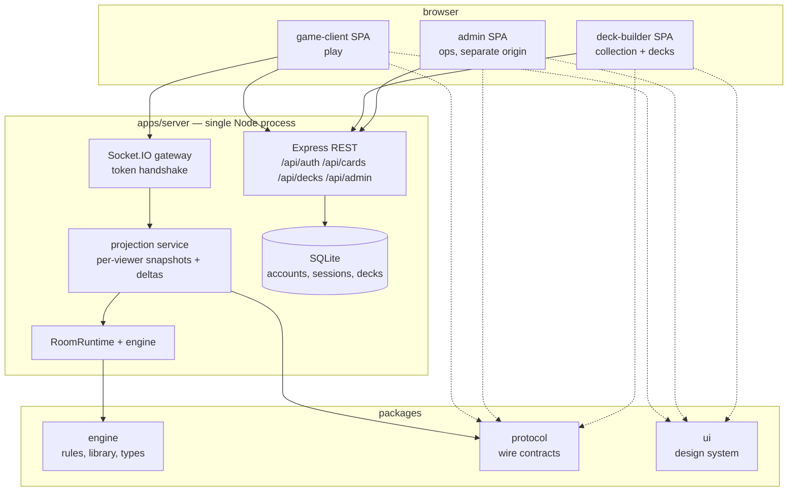
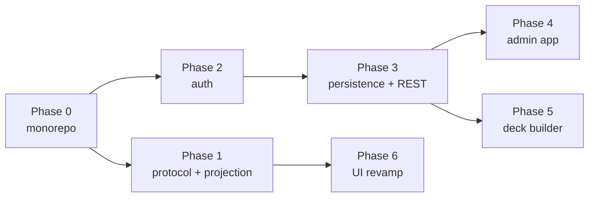

# Platform plan — multi-app structure, accounts, admin, deck builder, UI revamp

**Prepared:** 24 October 2026
**Status:** Proposed. No phase below is implemented.
**Scope:** Restructure the application into a workspace monorepo with a protocol boundary, an
account system, an admin app, a deck-builder app, and an animated game client. This plan
changes **no game rules**. Engine rules work continues on the
[implementation plan](implementation-plan-2026-10-07.md) inside the engine package, unaffected.

## Relationship to existing plans

| Existing document | This plan |
|---|---|
| [`development/0.3-private-views.md`](development/0.3-private-views.md) (deferred) | **Phase 1 resumes it** as the projection/protocol boundary. The stop condition there is honored: one projection service owns every outgoing path; no ad-hoc field deletion; debug inspection stays at the authoritative server boundary. |
| [`security-lab-plan.md`](security-lab-plan.md) Phase 1 (account system) | **Phase 2 implements it** against the new `apps/server` layout, with the integration points the lab plan does not cover (guest linking, CORS lockdown, REST validation). |
| [`security-lab-plan.md`](security-lab-plan.md) Phase 2 (deployment) | Referenced, not duplicated. `deploy/` artifacts gain the multi-origin nginx routing in Phase 4. |
| [`implementation-plan-2026-10-07.md`](implementation-plan-2026-10-07.md) | Untouched. All engine milestones proceed inside `packages/engine` with the same gates. |
| [`architecture-import-policy.md`](architecture-import-policy.md) | **Updated by every phase.** The boundary test is the enforcement mechanism for this plan; no phase lands without its policy edit. |

---

## 1. Target system

One Node process, one repository, four deployable frontends behind one API. The split is at
**build and dependency level**, not at service level.



**Principles**

1. **The engine never learns about any of this.** `GameEngine` keeps receiving a `PlayerId`
   and stays unaware of accounts, tokens, HTTP, or which app is asking.
2. **Clients are dumb renderers.** After Phase 1, the game client receives already-resolved
   display data (effective P/T, keywords, legal target ids) and never recomputes game rules.
   This is what makes the UI revamp (Phase 6) genuinely independent of engine work.
3. **Admin never ships in the player bundle.** Separate build, separate origin, server-side
   role gate. A hidden React route is not an admin boundary.
4. **One wire contract.** `packages/protocol` is the only package any client imports. It is
   versioned (`PROTOCOL_VERSION`) from day one.
5. **Single process until proven insufficient.** No microservices, no message queue, no
   per-app backends. REST + Socket.IO + static builds from one Express app.

---

## 2. Target repository layout

```
card-game/
├── package.json                    # workspaces: apps/*, packages/*; root scripts (verify, test, build)
├── tsconfig.base.json              # shared strict compiler options
├── vitest.config.mts               # workspace projects → per-package/app configs
├── docs/                           # unchanged
├── data/                           # deltas.jsonl; cardgame.db (Phase 3)
├── deploy/                         # systemd, nginx (multi-origin), ufw, auditd, logrotate
├── tests/
│   └── architecture/               # import-boundaries.test.ts — root-scoped, updated every phase
├── packages/
│   ├── engine/                     # @card-game/engine — the game core; no app knowledge
│   │   ├── package.json
│   │   ├── tsconfig.json           # composite
│   │   └── src/
│   │       ├── engine/             # from src/engine/** — internals unchanged
│   │       ├── library/            # from src/library/**
│   │       ├── shared/             # from src/shared/**
│   │       ├── types/              # from src/types/**
│   │       └── config.ts           # game-rules config (audience split in Phase 1)
│   ├── protocol/                   # @card-game/protocol — the only client-facing contract
│   │   ├── package.json
│   │   ├── tsconfig.json
│   │   └── src/
│   │       ├── views/              # PlayerView, CardView, StackView, CombatView, ChoiceView
│   │       ├── deltas/             # ViewDelta (wire delta; supersedes raw StateDelta)
│   │       ├── events/             # socket event registry: names + payload types, both sides
│   │       ├── actions/            # action packet contract (from server/action-packet shape)
│   │       ├── rest/               # zod schemas: auth, catalog, decks, admin
│   │       ├── decks/              # DeckSchema, format rules, shared validation
│   │       ├── client-flags.ts     # client feature flags (split out of gameConfig)
│   │       └── version.ts          # PROTOCOL_VERSION constant
│   └── ui/                         # @card-game/ui — design system shared by all three apps
│       ├── package.json
│       ├── tsconfig.json
│       └── src/
│           ├── card/               # CardSurface, cost badges, type line, P/T box
│           ├── primitives/         # Button, Panel, Tabs, Modal
│           ├── tokens/             # colors, spacing, radii, motion curves
│           └── motion/             # shared animation presets (Phase 6)
└── apps/
    ├── server/                     # @card-game/server — Express + Socket.IO composition root
    │   ├── package.json
    │   ├── tsconfig.json           # project references: engine, protocol
    │   └── src/
    │       ├── index.ts            # bootstrap only (from src/server.ts)
    │       ├── config.ts           # HOST, PORT, data paths, authConfig (new; server audience)
    │       ├── realtime/           # socket wiring, handshake auth (Phase 2)
    │       ├── http/               # REST routers (Phases 2–4)
    │       ├── rooms/              # room-runtime, reconnect, sync (from src/server/**)
    │       ├── projection/         # view builders (Phase 1)
    │       ├── auth/               # per src/server/auth/README.md (Phase 2)
    │       └── stores/             # StateStore seam + SQLite implementation (Phase 3)
    ├── game-client/                # @card-game/client — player SPA (from src/client)
    │   ├── package.json
    │   ├── vite.config.mts         # port 5173; proxy /socket.io and /api → :3000
    │   ├── index.html
    │   └── src/                    # imports ONLY @card-game/protocol and @card-game/ui
    ├── admin/                      # @card-game/admin — ops SPA (Phase 4)
    │   └── ...                     # port 5174; same proxy shape
    └── deck-builder/               # @card-game/deck-builder (Phase 5)
        └── ...                     # port 5175; same proxy shape
```

`tem/` and `lab/` are untouched by this plan.

## 3. Dependency rules (enforced by `tests/architecture/import-boundaries.test.ts`)

| Package / app | May import at runtime | Type-only imports |
|---|---|---|
| `packages/engine` | own code only; internal rules per current policy (engine ↛ server, library ↛ engine, types ↛ config) | — |
| `packages/protocol` | `zod` | `@card-game/engine` (views re-export engine types) |
| `packages/ui` | `react`, `motion` | `@card-game/protocol` (CardView props) |
| `apps/server` | `engine`, `protocol`, `express`, `socket.io`, `argon2`, `better-sqlite3` | — |
| `apps/game-client` | `protocol`, `ui`, `react`, `zustand`, `socket.io-client` | — |
| `apps/admin` | `protocol`, `ui`, `react`, `zustand` | — |
| `apps/deck-builder` | `protocol`, `ui`, `react`, `zustand` | — |

Additional enforced rules, added as phases land:

- **R-A (Phase 0):** no app imports another app. No package imports an app.
- **R-B (Phase 1):** `apps/*` runtime imports of `@card-game/engine` are **forbidden** — the
  current five-edge client allowlist in `architecture-import-policy.md` goes to zero and the
  rule flips from allowlist to ban.
- **R-C (Phase 1):** `packages/protocol` → `packages/engine` edges must be type-only.
- **R-D (Phase 6):** `apps/game-client` animation and ephemeral UI state may not live in the
  store that mirrors server state (asserted by a client architecture test, not import graph).

## 4. Decision records

| # | Decision | Rationale | Rejected alternative |
|---|---|---|---|
| D1 | **npm workspaces**, no Turborepo/Nx | Repo is already npm; build times do not justify a task runner. Revisit only when `verify` exceeds ~2 min. | pnpm (different lockfile churn), Turborepo (YAGNI) |
| D2 | **Source-exporting packages** (`main`/`types` point at `src`), TS project references, no per-package `dist` | Packages are internal-only, never published. Vite and `tsc -b` both consume source directly; one compilation path. | Per-package build + `dist` consumption (dual build, stale-output bugs) |
| D3 | **Single server process** for REST + Socket.IO + static | Correct at this scale; the multi-app split buys bundle isolation, auth separation, independent deploys — not services. | Microservices / per-app backends |
| D4 | **better-sqlite3** for accounts, sessions, decks; rooms stay in-memory | Synchronous, zero-ops, single file, fits the single process. Rooms are ephemeral game state and correctly stay in memory. `mongoose` is an unused dependency and is removed in Phase 3. | MongoDB (retained only if a multi-process scale-out is later planned — that would be a new decision) |
| D5 | **Admin as a separate app + separate origin** (subdomain in prod, `/admin` path acceptable in the lab), server-side role gate | Admin code must not exist in the player bundle; separate origin gives clean token scoping. | Hidden routes in the game SPA (not a boundary) |
| D6 | **Deck builder as a separate app**, not a lazy route in game-client | Different interaction model (catalog search, filters, persistence), no socket dependency, independent deploy cadence; shares `packages/ui` so the card looks identical. | Lazy route (couples deploy cadence to the game client) |
| D7 | **motion (framer-motion)** for the UI revamp | React 19 compatible; `layout` prop provides FLIP animations for zone moves and hand re-fanning without manual transform bookkeeping. | Manual CSS FLIP (more code, same result); WebGL canvas (wrong tool for DOM card UI) |
| D8 | **Opaque session token** in `localStorage`, sent via `Authorization` header (REST) and the existing socket `auth` handshake payload | No cookies → no CSRF class; the socket handshake already carries an auth object, so no new transport path. CSP headers (helmet, Phase 2) mitigate XSS. | httpOnly cookie + CSRF token (tighter XSS posture; revisit if the threat model changes) |
| D9 | **`PROTOCOL_VERSION` on every wire payload** from Phase 1 | Cheap insurance; a stale tab after a deploy can be detected instead of misparsed. | Ad-hoc format checks |

---

## 5. Phase plan



Phase 6 may proceed in parallel with Phases 2–5 once Phase 1 lands; it blocks on nothing else.
Each phase lands as one reviewable merge, leaves `npm run verify` green, and updates
`ARCHITECTURE.md`, `docs/MAP.md`, and `architecture-import-policy.md` as part of the change —
docs are canonical in this repo, not an afterthought.

### Phase 0 — Workspace restructure

**Dependency:** none. **Blocks:** everything. **Hard rule:** move-only. No logic edits, no
renames beyond `server.ts` → `index.ts`. Engine milestone work continues on top of the new
paths afterward.

**Work**

| # | Item |
|---|---|
| 0.1 | Root `package.json`: `"workspaces": ["apps/*", "packages/*"]`; scripts `verify` (= typecheck + test + build + architecture gate), `typecheck` (`tsc -b`), per-app `dev` scripts. |
| 0.2 | `git mv` `src/engine`, `src/library`, `src/shared`, `src/types`, `src/config.ts` → `packages/engine/src/`. One dedicated commit, nothing else in it. |
| 0.3 | `git mv` `src/server.ts` → `apps/server/src/index.ts`; `src/server/**` → `apps/server/src/rooms/` (room-runtime, reconnect, action-packet, sync-service). |
| 0.4 | `git mv` `src/client` → `apps/game-client`; move `index.html` to app root for Vite. |
| 0.5 | `tsconfig.base.json` (strict options from current root config); composite `tsconfig.json` per package; app configs reference packages. Repoint aliases: `@engine/*`, `@library/*` → `packages/engine/src/…`; `@shared/*` → `packages/engine/src/types/*` (names unchanged to limit churn; Phase 1 introduces `@protocol/*`). |
| 0.6 | `vitest.config.mts` becomes a workspace config over per-package/app configs; test imports switch from relative `../src/…` to alias/package imports. Test files do not move. |
| 0.7 | Update `tests/architecture/import-boundaries.test.ts` path roots and `architecture-import-policy.md` graph scope. Rules unchanged; add R-A (no app↔app, no package→app). |
| 0.8 | Server static serving + build outputs: `apps/server/dist`, `apps/game-client/dist`; update `deploy/README.md` provisioning paths. |

**Acceptance gate**

- `npm run verify` exits 0 with the same test count as before the move (no expectations changed).
- Boot the production build; the RPS smoke flow (`docs/smoke-test-rps.md`) works end to end.
- `git log --follow packages/engine/src/engine/game-engine.ts` reaches the pre-move history
  (rename detection intact).
- The Phase 0 commit diff contains no non-move modifications (reviewed line-by-line).

### Phase 1 — Protocol package and projection boundary (resumes 0.3)

**Dependency:** 0. **Blocks:** 6. This is the prerequisite for the UI revamp and the security
fix for F02, done once, in the shape the 0.3 document specifies.

**Work**

| # | Item |
|---|---|
| 1.1 | Create `packages/protocol` per §2. Move `types/delta.types.ts` semantics into `protocol/src/deltas/` as `ViewDelta`; move the action-packet shape into `protocol/src/actions/`. Add `PROTOCOL_VERSION`. |
| 1.2 | `apps/server/src/projection/view-builder.ts`: `buildPlayerView(room: GameRoom, viewerId: PlayerId): PlayerView`. `card-view.ts` resolves effective P/T, keywords, types via `CardCharacteristicService` **at projection time** — the client stops computing characteristics. |
| 1.3 | `projection/reveal-policy.ts`: single audience-policy module for every outgoing path (hand counts, revealed cards, deck sizes). No other code decides what a viewer sees. |
| 1.4 | `projection/delta-projector.ts`: mutations → per-viewer `ViewDelta`. `SyncService` broadcasts projected deltas; `roomSnapshot` becomes `PlayerView`. Pending choices carry **legal target ids** resolved server-side (client `targeting.ts` engine queries die). |
| 1.5 | `projection/debug-channel.ts`: authenticated full-state endpoint (`GET /api/debug/room/:id`) gated by debug flag + role. Developer inspection stays at the authoritative boundary, per the 0.3 stop condition. |
| 1.6 | Client: `gameStore` mirrors `PlayerView`; `deltaReducer` consumes `ViewDelta`; `CardComponent`, `combatSelection`, `targeting` read view fields instead of engine services. Split `gameConfig` by audience: rules config stays in engine, client flags move to `protocol/src/client-flags.ts`. |
| 1.7 | Import policy: empty the five-edge client allowlist; add R-B (apps ↛ engine runtime) and R-C (protocol → engine type-only). |

**Acceptance gate** (from the 0.3 evidence requirements)

- Socket tests for create/join, post-RPS, draw, cast, choice, and reconnect assert packets
  contain **no** private card UUIDs, blueprint definitions, or deck order; intended reveals
  (drawn card to its owner, revealed cards) still work.
- `npm run test:architecture` passes with the client allowlist empty.
- Reconnect delivers a `PlayerView` consistent with the deltas the client already applied.
- Both smoke flows (`smoke-test-rps.md`, `smoke-test-battle-phase.md`) pass against the
  projected wire format.

### Phase 2 — Accounts and sessions (security-lab Phase 1)

**Dependency:** 0. Implements `security-lab-plan.md` Phase 1 in full; the lab plan remains the
reference for parameters and policy. Listed here are only the integration points it does not
cover.

**Work**

| # | Item |
|---|---|
| 2.1 | `apps/server/src/auth/` exactly per `src/server/auth/README.md`: `password.ts` (Argon2id, params from `apps/server/src/config.ts` `authConfig`), `session.ts`, `account-store.ts` (in-memory behind the `StateStore` seam — Phase 3 swaps the implementation), `routes.ts`, `redaction.ts`. |
| 2.2 | `realtime/handshake.ts`: extract the auth block from the socket connection handler. Handshake carries the session token; `PlayerId` derives from the account. Unauthenticated connections keep the guest path — the client-generated id becomes a pre-login placeholder, per the auth README. |
| 2.3 | Guest→account linking: register or login while seated keeps the seat (identity remap through `reconnect.ts`, which already separates socket identity from player identity). |
| 2.4 | CORS lockdown: explicit origin allowlist (three dev origins + prod origins) replacing `origin: '*'`. Add `helmet` and `express-rate-limit` on auth routes. |
| 2.5 | `protocol/src/rest/auth.ts`: zod schemas for register/login/logout request and response bodies; server validates through them. |

**Acceptance gate**

- The security-lab Phase 1 gate verbatim: register → login → create room → play a turn →
  logout → token rejected; two accounts cannot take one seat; a forged `playerId` in the
  handshake is ignored; a log line produced during login contains no credential material.
- Guest linking: a guest who plays a turn, registers, disconnects, and reconnects with the
  token rejoins the same seat.
- Preflight from an unlisted origin is rejected.
- `npm run verify` exits 0.

### Phase 3 — Persistence and the REST surface

**Dependency:** 2.

**Work**

| # | Item |
|---|---|
| 3.1 | `apps/server/src/stores/sqlite-store.ts` (`better-sqlite3`) with migrations under `stores/migrations/`: tables `accounts`, `sessions`, `decks`. Implements the same repository seams Phase 2's in-memory store implements; rooms remain in `InMemoryStore`. |
| 3.2 | `http/catalog-router.ts`: `GET /api/cards` — paginated catalog from `packages/engine` library data. |
| 3.3 | `protocol/src/decks/`: `DeckSchema`, format rules (minimum size, 4-copy limit), and `validateDeck(deck, catalog)` — pure, shared by server and deck-builder for identical client/server validation. |
| 3.4 | `http/decks-router.ts`: deck CRUD, ownership-scoped (`GET/POST /api/decks`, `GET/PUT/DELETE /api/decks/:id`). |
| 3.5 | Room setup accepts a deck reference: extend the serializable setup contract (`setup-config.types.ts`) with deck card lists; `room-factory` builds the starting library from the deck instead of fixture decks. Fixture decks remain available behind the debug flag. |
| 3.6 | Remove `mongoose` (D4). Add `deploy/logrotate/deltas` for `data/deltas.jsonl` (bounded disk use; also required by the security lab). |

**Acceptance gate**

- Accounts, sessions, and decks survive a server restart; rooms do not (by design).
- A deck with five copies of one card is rejected by both the REST route and the shared
  validator with the same error.
- Account A cannot read, modify, or list account B's decks (ownership tests).
- A room created from a saved deck deals exactly that deck; the RPS → play flow works with it.
- `npm run verify` exits 0.

### Phase 4 — Admin app

**Dependency:** 2, 3.

**Work**

| # | Item |
|---|---|
| 4.1 | `account.role: 'player' | 'admin'`; `http/admin-router.ts` behind role-gate middleware; every admin action appends to an audit log (`data/admin-audit.jsonl`). |
| 4.2 | Scaffold `apps/admin` (Vite, router, login through the existing auth API). Routes: LogViewer, RoomInspector, Accounts. |
| 4.3 | LogViewer: `GET /api/admin/deltas?offset&limit` — bounded, seek-based reads over `data/deltas.jsonl`; never loads the whole file. |
| 4.4 | RoomInspector: live room list + authoritative state via the Phase 1 debug channel, admin role only. |
| 4.5 | Accounts: list, disable (disabled accounts fail login and their sessions revoke). |
| 4.6 | Serving: nginx routes the admin build at its own origin (subdomain in prod; `/admin` path acceptable in the lab). The game-client build contains zero admin code — different bundles by construction. |

**Acceptance gate**

- Every `/api/admin/*` route returns 403 for a player token and 401 for no token.
- A string search over `apps/game-client/dist` finds no admin route or API path.
- LogViewer pages through a 100k-line `deltas.jsonl` without holding it in memory.
- Admin actions appear in the audit log with actor, action, target, timestamp.
- `npm run verify` exits 0.

### Phase 5 — Deck builder app

**Dependency:** 3.

**Work**

| # | Item |
|---|---|
| 5.1 | Scaffold `apps/deck-builder` (Vite, port 5175, proxy `/api`). |
| 5.2 | Catalog browser: search/filter over `GET /api/cards`; card rendering via `packages/ui` `CardSurface` — identical card face to the game. |
| 5.3 | Deck editor: add/remove copies, live validation through the shared `protocol/src/decks` module, save/load owned decks, text export/import. |
| 5.4 | Handoff: "play this deck" navigates to the game client with the deck id; room creation consumes it (Phase 3.5 contract). |
| 5.5 | Browsing is public; saving requires a session. |

**Acceptance gate**

- End to end: build a deck → save → create a room from it → play a turn with those cards.
- Client-side and server-side validation produce identical verdicts on the same deck (shared
  module, one test suite).
- An unauthenticated user can browse and draft locally but cannot save.
- `npm run verify` exits 0.

### Phase 6 — Game client UI revamp

**Dependency:** 1 only (may run parallel to 2–5). No engine changes.

**Work**

| # | Item |
|---|---|
| 6.1 | Store split: `gameStore` becomes mirror-only (`view`, `roomId`, `myPlayerId`); new `uiStore` holds hover, drag, context menu, targeting, combat selection, notifications. Zustand selectors keep re-renders scoped (see the selector notes in repository memory). |
| 6.2 | `store/transitions.ts`: pure `deriveTransitions(prev: PlayerView, next: PlayerView): Transition[]` extracted from the diff logic currently flattened into log strings inside `applyDelta` (entered/left battlefield, stack push/pop, life changes, phase changes). Feeds both `GameLog` and the animation queue — one derivation, two consumers. |
| 6.3 | `animation/AnimationQueue.tsx` drains transitions and drives `motion` components; `packages/ui/src/motion/` holds the presets (card-entrance, zone-move, stack-push, resolve). |
| 6.4 | Hand fan: transform-based arc layout in `Hand.tsx`, drag-to-reorder, hover-lift, drag-to-play. |
| 6.5 | Zone moves as FLIP animations keyed on stable card `uuid` + `zoneRevision` (identity already guaranteed by the engine). |
| 6.6 | Battlefield clustering (creatures/lands rows), stack push/pop motion, targeting line rendering. |
| 6.7 | Client architecture test for R-D: animation/ephemeral state must not live in the mirror store. |

**Acceptance gate**

- `deriveTransitions` has unit tests covering enter/leave/stack/phase/life cases; `GameLog`
  output is unchanged from pre-revamp for the same delta sequence (regression fixture).
- The R-D architecture test passes; no engine imports exist in the client (R-B still green).
- All smoke flows pass; hand fan interaction with a 9-card hand stays within a 60 fps frame
  budget on integrated graphics (spot check, recorded).
- `npm run verify` exits 0.

---

## 6. Global verification gate

Every phase, without exception, ends with:

```
npm run verify   # = tsc -b (all projects) + vitest run + production build + architecture gate
```

plus the phase's own acceptance evidence. A phase is not complete because the code is written;
it is complete when the gate output is captured.

## 7. Risks and rollback

| # | Risk | Mitigation |
|---|---|---|
| R1 | Phase 0 move breaks git history / reviewability | Single dedicated move commit; `git mv` only; `--follow` check in the gate; no logic edits in that commit |
| R2 | Projection changes the wire format under a running client | Single repo, client and server land in the same merge; `PROTOCOL_VERSION` lets a stale tab detect and reload instead of misparsing |
| R3 | `better-sqlite3` native module mismatch (Windows dev, Linux deploy) | Prebuilt binaries cover both; Node engines pin already enforced; CI installs and builds on both targets before Phase 3 merges |
| R4 | Admin surface exposure | Server-side role gate on every route (403 tests), separate bundle and origin, audit log, rate limits |
| R5 | Animation regresses interaction performance | Transitions are pure and memoized; stores split so deltas do not re-render the board; perf spot check in the Phase 6 gate |
| R6 | Engine rules work collides with the restructure | Phase 0 is move-only; engine milestones proceed afterward inside `packages/engine` with unchanged gates |
| R7 | Scope creep (matchmaking, payments, i18n, mobile) | Explicitly out of scope below; each addition requires its own plan |

**Rollback:** every phase is one revertible merge. Phase 0 revert restores the `src/` layout
verbatim (move-only commit). Later phases are additive on top of a green Phase 0.

## 8. Out of scope

- Any engine rules change (separate roadmap).
- Microservices, horizontal scaling, message queues, session stores shared across processes.
- Matchmaking, ladders, friends, chat, payments, i18n, native mobile.
- Turborepo/Nx remote caching, publishing packages to npm.
- The remaining security-lab phases (3–6: metrics, IDS, pentest) — they consume this platform
  but are governed by their own plan.

## 9. Execution method

This is a structural roadmap, not a task list. Before any phase's first commit, that phase
gets its own detailed implementation plan (task-level, test-first, per the repo's
writing-plans convention) derived from this document's work items and gates. Phases are
executed in dependency order; Phase 6 may be pulled forward after Phase 1 if the UI revamp is
the priority.
