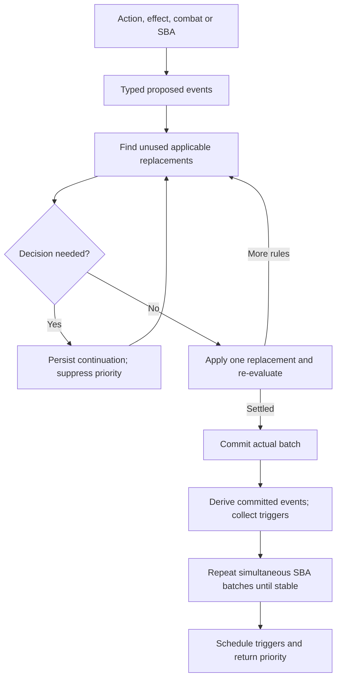

# Proposed events and settlement

Milestone 7 adds a pure proposal planner before authoritative commits. The reducer remains responsible for state changes; event discovery and trigger scheduling still use committed batches.

## Flow

## Contracts

`planProposedMutations(room, mutations, options)` and `resumeProposedChoice(room, choice, answer)` return prepared mutations or a pending choice. Planning never changes the supplied room. A paused transaction commits none of its gameplay prefix or tail. The choice retains completed previews, remaining instructions, current event frames and replacement IDs already applied to each event lineage.

Events distinguish damage, destruction, sacrifice, discard, ordinary transfers, individual draws, life changes, poison and counters. Card references pair the stable UUID with `zoneRevision`. Matching uses effective characteristics. Self-replacements precede ordinary replacements, including their exception for prohibited events; indestructible otherwise prohibits destruction before regeneration can consume a shield.

Replacement definitions are serializable data in `room.replacementEffects`. `ADD_REPLACEMENT_EFFECT` assigns a room sequence ID; explicit removal selects one ID. Definitions carry match filters, optional/self flags, exact source references, durations, finite event uses and finite prevention amounts. End-of-turn registrations expire during cleanup; source-dependent registrations require the original source incarnation on the battlefield. Independent resolved shields survive source departure.

Built-in operations are damage scaling, prevention, redirection, changed movement destination, cancellation and regeneration. Extend `ReplacementOperationMap` through declaration merging and register the corresponding handler with `registerReplacementOperation`. A handler declares applicability and returns replacement events plus any associated prepared mutations. It must not mutate the room or open a checkpoint. Register handler code when the engine starts; snapshots store operation data, not functions.

Finite damage shields reserve consumption during preview. When simultaneous sources exceed one recipient's remaining shield, the affected player distributes prevention using the existing choice component. Damage marked unpreventable still encounters prevention handlers without reducing its shield. Redirection and other changes cause applicability to be checked again. Descendant events inherit applied-rule history, preventing the same rule from repeatedly replacing its own result.

## Damage and resolution

The damage pipeline first replaces/prevents assignments, then proposes their results, then commits one `APPLY_DAMAGE_BATCH`. Result replacement can itself create damage; serializable parent transactions keep nested choices inside the original atomic batch. Damage consequence hooks run on the fully damaged board before SBAs.

Generic result consumers implement lifelink, deathtouch, infect/wither, loyalty/defense damage and protection prevention. Only players, creatures, planeswalkers and battles receive damage. Effective source characteristics and retained source information determine results. Damage events record the final dealt amount even when a result replacement changes the loss/counters or moves the recipient. Fully prevented damage produces no damage event or lifelink gain.

Resolving effects are processed sequentially: later instructions see replaced results of earlier ones. A replacement choice retains the next resolution position. Earlier completed instructions may already be committed, but checkpoints remain suppressed until resolution completes. Individual draws similarly observe the previous draw. Combat allocation remains manual; combat completion and phase response tails remain in paused transactions.

## State-based batches

One board snapshot supplies all conditions in a batch. Legend/protector decisions are collected before any of that batch is applied, in active-player order. Choices retain exact references and survive engine reconstruction and reconnect. Departure information uses the full pre-batch snapshot.

Checks cover zero toughness, lethal/deathtouch destruction, opposing +1/+1 and -1/-1 counters, token cessation outside the battlefield, Aura legality, Equipment/Fortification detachment, legend/world uniqueness, zero loyalty/defense, battle protector validity, poison and failed draws. Siege defense settlement waits for its pending/stacked triggers. World tenure records when a permanent gains or regains the supertype. Departed tokens cannot move again before cessation.

The checkpoint repeats until stable before scheduling collected triggers. All simultaneous changes precede terminal freezing; simultaneous player losses produce a draw.

## Sync and boundaries

Choice continuations and new state use existing snapshot/delta transport. Atomic damage results replay their constituent mutations through explicit delta mappings. JSONL keeps generic applied mutation records alongside semantic actual events; extensions do not require a separate logger for each operation.

This supplies engine foundations, not new catalog cards. Full token creation/copying, attach/equip/casting flows, loyalty actions and battle gameplay remain Milestone 8. Entry-control/copy/face replacement consumers can extend the framework with those families. New combat keyword consumers and auto-allocation remain deferred; exotic loop handling and durable restart recovery remain Milestone 9.

Reference: [official comprehensive rules, 25 September 2026](https://media.wizards.com/2026/downloads/MagicCompRules%2020260925.txt), particularly 120, 121, 614–616 and 704.
