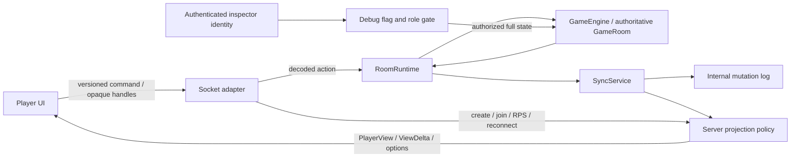

# Protocol and Player Projection — Architecture Supplement

**Date:** 26 October 2026. **Scope:** platform Milestone 1.

This supplements [ARCHITECTURE.md](../ARCHITECTURE.md) and the [workspace supplement](workspace-architecture.md). The [implementation ledger](milestone-1-implementation.md) records Milestone 1; its [completion report](phase-1-status-2026-10-26.md) records historical verification. Milestone 2 now connects [scoped sessions and authenticated admin access](authentication-architecture.md).

## Requirements and ownership

Every player-facing snapshot, delta and card-options response must use explicit wire contracts. Players receive their own hand, public zones, counts, resolved displays, and server-provided target candidates. Neither player's library contents/order, an opponent's hand, raw card blueprints, effect pools, engine continuations, event batches nor trigger queues belong on this channel. A deciding player receives authorized choice labels and opaque option handles; everyone else receives a waiting status. Explicit reveal notifications disclose the announced card's name, without exposing its underlying library object.

The engine retains the complete `GameRoom` and validates every action. `packages/protocol` owns `PlayerView`, `CardView`, `ViewDelta`, action/event envelopes, presentation constants and `PROTOCOL_VERSION`. Its engine dependencies are type-only. The game client imports protocol and its local UI modules. Server code may import the engine. The five temporary client engine exceptions are removed.

## Wire behavior

`buildPlayerView(room, viewerId)` verifies membership and builds an allowlisted aggregate. `card-view.ts` resolves effective characteristics, controller, mana display and combat candidates. `target-groups.ts` uses authoritative structural and permission checks; the client only selects supplied references. Numeric announcements, alternatives and modes use the engine's choice machinery. Target references retain zone revisions. An unsent client draft drops targets whose legality or incarnation changes.

`reveal-policy.ts` owns audience decisions. Public stack spells and retained battlefield sources remain displayable; a private source stays hidden. Retained source displays use the engine's last-known information without sending the snapshot's rule internals. An opponent's RPS play remains hidden until the round resolves. Public card action lists and eligibility flags can differ by viewer; equality between two entire views is therefore not a synchronization invariant.

`delta-projector.ts` compares projected before/after aggregates. Changes currently replace changed top-level fields. Removed optional fields receive explicit removals. Raw mutation paths, old values and event batches never become wire changes. Internal `StateDelta` records remain available to server replay/diagnostics. Correctness is established by applying each viewer's deltas and comparing the result with a fresh projection for that viewer.

Snapshots carry the current room sequence. The client rejects incompatible versions, wrong room/audience deltas and duplicate sequences. A gap produces a reconnect message; a full snapshot restores sequence and clears unsent local UI state. Card-options responses are correlated with room, card and zone. Socket handshakes and application messages carry version 1; unversioned clients must reload after this deployment.

Choice option handles use process-local HMAC keys scoped to room, choice, viewer and raw option. Generated ability identifiers also receive opaque handles because their internal suffixes can contain source UUIDs. The server decodes these against current authoritative options/abilities. Handles identify choices; they do not authenticate a player. They remain stable across reconnects within this process, matching the current in-memory room lifetime.

## Decision records

| ADR | Context and decision | Alternatives considered | Consequences |
|---|---|---|---|
| P1-01 | Use explicit DTO builders and a server-owned audience policy for every player path. | Send raw aggregates and hide fields in React; remove selected raw paths before sending. | Adding an engine field cannot implicitly publish it. New display fields require an intentional protocol change. |
| P1-02 | Diff projected states, keeping internal replay deltas separate. | Maintain a second mutation-to-wire path translator. | One visibility policy covers snapshots and changes. Top-level replacements use more bandwidth than granular patches; refine only with equivalent privacy and convergence tests. |
| P1-03 | Resolve characteristics and target candidates on the server. | Ship the engine and rule definitions to each client. | Clients stay independent of rules. Projection costs more server CPU; one synchronous characteristic-evaluation scope reuses board results and expires after each projection. Retained incarnations preserve independent resolution semantics. |
| P1-04 | Use opaque choice handles and hide generated ability provenance. | Publish option values, continuations or raw identifiers that embed private source IDs. | Server answers remain exact without exposing their execution context. Keys are process-local because persistence and restart recovery are later milestones. |
| P1-05 | Gate full-state inspection at the server. | Introduce a temporary shared secret or allow local unauthenticated inspection. | Milestone 1 failed closed without an authenticator. Milestone 2 supplies verified identity only for a separate admin-scoped session with current admin role, plus the inspection flag. |
| P1-06 | Carry one explicit protocol version through handshake, commands and responses. | Guess compatibility from individual payload fields. | Stale clients are rejected predictably. Future incompatible schemas require a version increment and coordinated deployment. |

These decisions implement the user-authorized milestone. Reviewable evidence consists of the source boundaries and the targeted architecture/privacy/logic checks listed in the completion report. Long socket and full-suite runs were subsequently waived by the user.

## Failure modes and operations

Unknown viewers cannot obtain a player projection. Unknown or stale choice handles fail validation. Cross-room or wrong-audience updates do not mutate the client. Ordering gaps require reconnect; there is no durable replay/resume protocol yet. Full-state inspection returns 404 when disabled, 401 without authenticated identity, and 403 without an inspection role.

The server's diagnostic JSONL log still contains authoritative internal information and is not a player endpoint. `DELTA_LOG_PATH` can select its location; an empty value disables it. Integration tests use temporary logs so they do not append to the developer's runtime history. Persistence, log retention and deployment access policy remain later operational work.

At Milestone 1, private projections still depended on a client-supplied player identity. Milestone 2 addresses that gap with server-issued guest/account sessions and server-owned seat bindings; claimed player IDs are ignored. Admin UI, deck building, database persistence and deployment hardening remain later work. The future inspector UI can consume the separate authenticated endpoint without entering the player projection channel.

## Verification policy

The user requested logic testing and waived browser smoke tests, then waived further long socket tests and time-consuming full-suite runs. Final verification uses brief targeted logic tests, import-graph checks, strict application typechecks and production builds. Earlier actual Socket.IO and broader rule/client test evidence is recorded separately. No final full-suite or browser smoke result is claimed. The acceptance report records commands, totals and limits.
