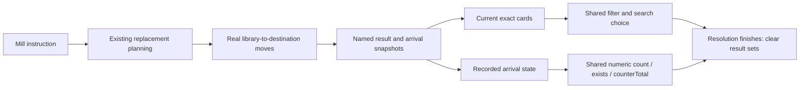

# Resolution-local card collections

**Current blocker status:** see [the current card blocker ledger](card-blockers-current.md). Tables and verification counts below describe their original delivery snapshots.

Status: mill results implemented, 2026-11-03. Supplements the [rule contracts](rule-contract-architecture.md) and [shared card queries](card-query-architecture.md). The [captured-window and visibility extension](card-window-design.md) is implemented on the same result-source API.

## Decision

Milling moves cards directly from library to their real destination through the existing replacement/mutation pipeline. A named temporary result set records those cards; it is a query source, not another physical zone or owner of live cards. Later instructions see the updated graveyard. Membership is fixed by the originating operation, not by a continuously evaluated graveyard filter.

Requirements are immediate normal-zone membership, exact identity, shared filters/numeric queries, survival across paused choices and JSON reconstruction, and cleanup at the end of the whole resolving spell/ability. Hidden information follows the existing server projection boundary.



## Authoring

A mill instruction may capture a result:

```json
{
  "family": "cards",
  "operation": "mill",
  "params": { "amount": 3 },
  "recordResult": { "name": "milled", "kind": "milled" }
}
```

`recordResult` supports mill (`kind: "milled"`) and library capture (`kind: "captured"`) instructions. Names are safe nonempty identifiers, local to a single resolving stack object. Executing a second declaration of the same name is an error, not an overwrite; use distinct names for successive mills. No result is allocated for ordinary instructions that do not request capture.

A later instruction can search that set using the ordinary card filters and choice flow:

```json
{
  "family": "cards",
  "operation": "move",
  "params": { "origin": "graveyard", "destination": "hand" },
  "choice": {
    "kind": "search",
    "zone": "graveyard",
    "from": { "kind": "result", "name": "milled" },
    "cardTypes": ["Creature"],
    "colors": ["black"],
    "min": 1,
    "max": 1
  }
}
```

`zonePlayer` retains its existing meaning, defaulting to self; specify opponent for an opponent's graveyard. `cardRefs`, ordering, allAvailable and ordinary filter composition still work. Results retain the mill's top-to-bottom order. A search remains a resolution-time choice, not an announcement-time target, and acquires no extra targeting/visibility rights.

Numeric scopes accept the same `from` source:

```json
{
  "numeric": {
    "kind": "query",
    "id": "count",
    "args": {
      "scope": {
        "from": { "kind": "result", "name": "milled", "view": "recorded" },
        "zones": ["graveyard"],
        "cardTypes": ["Creature"]
      }
    }
  }
}
```

This counts creatures that actually arrived in the graveyard through this mill, even if a later instruction recovered one. The same source works with the existing `exists` and `counterTotal` queries. Result scopes do not inherit the ordinary implicit battlefield default; omitted zones admit all recorded destinations.

Instructions also accept a shared `condition`, evaluated immediately before the instruction/its choice. It may compare a result count, use an exists query, combine all/any/not, or read ordinary source/target/controller/event/history/room fields. Numeric bindings retain their existing spell/ability ownership rules. Conditions and parameter values use one resolution numeric context. For example, use `op: gt`, the count expression above as `left`, and `0` as `right` to continue only when at least one matching card arrived.

See `example-mill-result` in the [validated reference](../packages/engine/src/library/card_data.example.jsonc) for a complete spell: mill three, gain life for creatures actually put into the graveyard, then recover a black creature from that exact set. This is documentation content, not a new catalog card.

## Recorded versus current

| View | Semantics | Use |
|---|---|---|
| `current` (default) | Locate successful arrivals by UUID, destination zone and zone revision; evaluate live characteristics. | Selecting/moving a card still present; counting current eligible members. |
| `recorded` | Read immutable arrival snapshots and their captured effective characteristics. | Historical counts/conditions about the operation's actual results. |

Search choices only accept current view. A recorded snapshot cannot be selected as a live card. Leaving and returning changes the zone revision, so the new incarnation does not rejoin the set. Other cards entering the graveyard are never added. Captured data are historical snapshots, not a second authoritative copy of card state.

Replacement redirects record the real destination. A graveyard-only query excludes cards sent to exile; a recorded query without a zone restriction can include successful arrivals elsewhere. Cancelled/failed moves retain attempted provenance but have no arrival and are excluded from both query views. Partial/empty libraries record the actual available cards and do not turn milling into drawing or failed-draw loss.

An undeclared result never falls back to a whole-zone search. Search candidates are empty; numeric evaluation is unresolved and the dependent instruction skips. A declared result with zero successful arrivals is a valid empty set and counts as zero.

## Selected subsets and limited options

A search choice can set `recordSelection: "picked"` to retain its exact selections before applying the instruction. A later result source can use `{ "kind": "result", "name": "window", "except": "picked" }` to address the remainder, even when a chosen card moved to the top of the same library. An empty selection is a valid empty result. An undeclared exclusion makes the source unavailable. These references follow the same zone and revision checks as captured results.

A selected subset inherits the observation of its source, so later searches still require active face grants. `distinctBy: "printed_name"` permits only one choice per printed name. The chooser gets opaque per-choice group handles, and the server independently validates the submitted selection.

A resolution option can declare the ordinary `usage` block. The server shows available options, checks the current budget at selection and debits the room's existing turn or game history only when the option is chosen. Other options on that ability retain their own availability.

## Ownership and lifecycle

- `types/resolution-result.types.ts` defines the serializable source, capture definition and attempted/arrival records.
- `shared/card-collections.ts` resolves zone-card inputs or named result inputs; consumers then reuse shared card filters.
- `engine/resolution-results.ts` captures attempts before replacements and settles successful arrivals from actual final mutations.
- `StackObject.resolutionResults` is local planning/continuation state, never a room-wide card zone. A replacement continuation carries a `cardResultProbe` until the decision settles.
- Search continuations retain the set across choices and JSON reconstruction. Different stack objects have independent namespaces, including nested/new triggers.
- Normal completion, countering and fizzling clear temporary results from completion reports and structural completion. Once the object/choice is gone, no live result set remains in the room. Milled cards remain in their actual zones.

Earlier trusted diagnostic events/logs can contain snapshots of a pending continuation under the existing logging policy; cleanup does not rewrite historical logs. Public player projections never serialize the internal result maps/probes. Persistent static modifiers and ordinary announcement costs cannot retain a resolution-local query source. Later granted/delayed abilities start their own resolution namespace; their definitions do not capture a parent's result set. To create a persistent effect from a result, materialize an appropriate supported value during resolution rather than retain the temporary set.

## Consequences and remaining scope

This adds exact-mill recovery, current/historical filtered counts and conditional follow-up instructions without per-card handlers. It reuses normal movement, replacement decisions, numeric expression validation and the existing choice UI. Capturing full characteristic snapshots costs memory/work only for instructions opting into results; ordinary milling remains unchanged.

The explicit current/recorded distinction adds authoring detail but prevents stale-card recovery and changing historical counts. Persistent remembered sets, result iteration, stat summation, milling-quantity modifiers, new physical zones and new workbook cards are outside this change. Larger capture/reveal windows and configurable visibility are implemented through the [shared collection guide](card-window-design.md). Counter-removal and optional ordinary payments are now delivered separately in the [payment guide](counter-payment-architecture.md); material costs and unspecified special-summon wording remain separate work.

The exact-card portion of 幻像祭壇's mill-then-claim blocker is now supported; its tapped-entry requirement still needs its own implementation. The creature-count portion of 諸界六皇 萬智之德步尼 is supported; its per-game activation and integer-division requirements remain. No workbook implementation count changes.

## Verification

Focused engine tests cover immediate graveyard membership, exact subsets, recorded/live characteristics, historical counts after recovery, successive mills, empty/short libraries, redirects/cancellation, multiple serialized replacement pauses, reconstructed card choices, missing contexts, duplicate names, opponent zones, isolation, cleanup, public projection and rejected persistent/result misuse. Regression coverage includes existing ordered outcomes, card queries, reveals, choices, numeric consumers, replacements, triggers and architecture imports. Browser smoke, long socket scenarios and the full suite are excluded by the user's standing instruction.

Verification: **309 passing logic tests across 18 focused files**, all eight TypeScript projects and all four application builds. The reference now contains 33 card examples, all parsed by the authoring-example gate. The existing 94-card gameplay-definition migration check still passes. Local JSON reports live under ignored `build/`.
