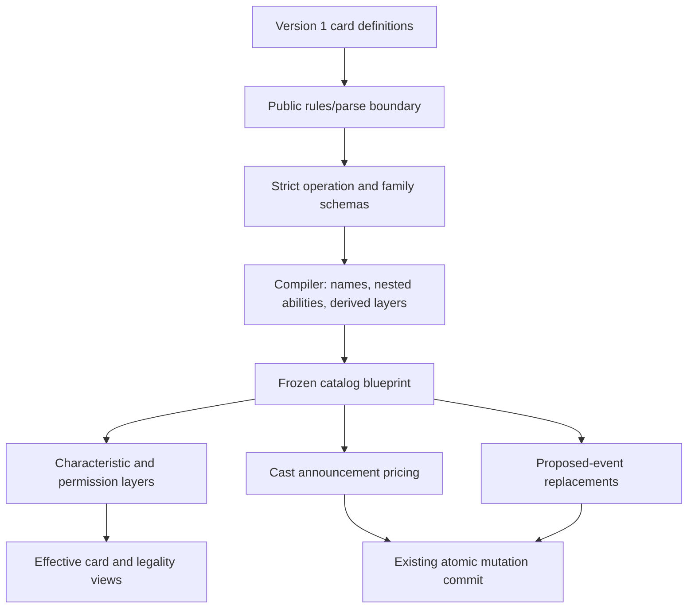

# Contracted rules and functional effect families

**Current blocker status:** see [the current card blocker ledger](card-blockers-current.md). Tables and verification counts below describe their original delivery snapshots.

Status: implemented, 2026-11-03. Supplements [ARCHITECTURE.md](../ARCHITECTURE.md), [card authoring](../packages/engine/src/library/README.md) and the [cross-zone query design](card-query-architecture.md).

Follow-up: [resolution-local card collections](resolution-results-architecture.md) add exact-mill recovery and filtered historical/current result queries. The validation figures below record the original rule-contract delivery; the follow-up records its own verification.

## Context and decision

Modifiers affect different decisions: what a card is, whether an action/target is legal, what it costs, and what happens to a proposed event. A generic arithmetic pipeline cannot correctly own all four. The previous `ModifierPipeline` had no consumers and returned its input unchanged. `ModifierRegistry`, despite old documentation calling it a stub, performed live permission checks.

Use one strict, versioned authoring boundary and a discriminated modifier contract, with separate consumers by function. Preserve the established characteristic layers and proposed-event transaction rather than create a second implementation of them. Zod supplies runtime validation and inferred source types; the engine's numeric validator supplies expression/declaration checks. Zod was already used by protocol and is now an explicit engine dependency.

## Ownership and structure

| Location | Responsibility |
|---|---|
| `packages/engine/src/rules/parse.ts` | Public shared parser facade. All catalog and synthetic authoring uses it or its library exports. |
| `rules/schema/shared.ts` | Filters/scopes, numeric values, conditions, costs, targets, usage identities, structural limits. |
| `rules/schema/contracts.ts` | Strict card/ability/instruction contracts, modifier discrimination, contextual validation. |
| `rules/schema/characteristics.ts`, `permissions.ts`, `costs.ts`, `event-replacements.ts` | Family-specific allowed operations and fields. |
| `rules/schema/instructions.ts`, `compile.ts` | Functional instruction vocabulary and controlled compilation of actual instruction positions. |
| `rules/operation-stage.ts` | One operation-to-layer mapping shared by compiler and runtime. |
| `rules/runtime/active-rules.ts` | Live source discovery, effective ability/zone checks, explicit usage identities. |
| `rules/runtime/costs.ts` | Pure cast pricing and usage descriptors; no payment during previews. |
| `rules/runtime/event-replacements.ts` | Materialize live source rules into the existing replacement transaction. |
| `engine/characteristic-layers.ts` | Existing dependency/layer evaluation, now with conditional rule support. |
| `engine/permission-registry.ts` | Existing cast/target permission checks, renamed to describe its function. |

Schema/compile modules depend on types and pure shared helpers, never engine implementation modules. Runtime evaluators depend on the engine. Library parsing imports only the schema/compiler side. Recursive ability grants, copies, delayed triggers and modes use the same validation; compilation never interprets an arbitrary text dictionary as executable data.

## Common contract and family semantics

All authored modifiers have a stable `id`, `family`, optional `group`/`condition`, a scope, and an operation specific to that family. Source UUID/revision/controller are runtime authority and cannot be injected as top-level authored rule fields. Static ability `activeZones` controls where its rules are live, defaulting to battlefield. Card filtering and numeric queries share the cross-zone contract.

| Family | Changes | Execution |
|---|---|---|
| `characteristics` | Copy, control, text, types, colors, abilities/keywords, set/adjust/switch stats | Compiled into existing layer operations. Layer numbers are derived, not authored. |
| `permissions` | Cast/activation prohibition and timing | Same characteristic pipeline, consumed by action permission checks. Target protection remains effective keywords plus target legality. |
| `costs` | Base mana setters/waivers, increases and reductions for casting | Shared announcement, options, validation and payment preparation. Activation pricing is explicitly rejected as unsupported. |
| `event-replacements` | Prevention, scaling, redirection, destinations, cancellation and regeneration for compatible event kinds | Existing replacement ordering, optional choices, cycle guards and commit semantics. Card/player scope is explicit. |

Resolved temporary characteristic/replacement entries retain their existing runtime source/timestamp/lifetime representation. Static rules retain source definitions in `blueprint.abilities[].rules`; characteristic/permission operations also retain compiled `effects` for the established evaluator. This duplicate representation is compiler output, not two authoring implementations. Do not edit compiled effects alongside source rules.

Immediate instructions are grouped separately by function: cards, resources, damage, orientation, counters, stack, attachments, characteristics, event-replacements and triggers. The compiler maps functional names onto the live uppercase opcodes. Engine-form instructions are still strictly validated; they are not an unchecked `params` escape hatch. A missing/unknown parameter fails at loading.

## Evaluation, identity and inspection

Conditions use safe paths and shared numeric expressions. Static/cost rules cannot request an event or announced binding they do not own. Static conditional stats evaluate against the intermediate board at the current layer, avoiding recursive final-characteristic queries. Grouped effects freeze applicability once they begin, preserving the existing layer/dependency semantics. TEXT operations cannot rewrite contract discriminators or IDs.

Cast pricing applies base setters/waivers, composes additional costs, applies increases, then reductions floored at zero. A base waiver preserves non-mana/additional costs. Generic reductions preserve colored requirements. Announcement snapshots record applicable rule signatures; changes during a pending announcement are detected. Preview, failure and cancellation consume no limit. Successful eligible casts consume `on_commit` usage even if the adjustment was numerically zero.

Replacement rules are discovered for the current event and recipient, including counter/type/controller filters. Usage is consumed `on_change` only when the replacement changes that event; unpreventable damage is not prevented and does not consume a prevention use. Prevention and true damage reduction are distinct mechanics.

Usage declares period (`turn`/`game`), positive limit and identity:

- `source_card`: same physical card UUID across zone changes.
- `source_incarnation`: UUID plus zone revision; reentry resets identity.
- `controller`: shared by that controller's copies of the same blueprint/ability/rule.

Turn usage uses existing `turnHistory.uses`; game usage uses serializable `room.gameRuleUses`, updated through an explicit mutation. These limits currently cover cost/event modifiers, not per-game ordinary activation limits.

Inspection does not require one authoritative catch-all list. Privileged full room inspection can see source rules on blueprints, `continuousEffectPool`, `replacementEffects`, turn-history usage and game-rule usage. `activeRules(room)` exposes effective source/ability/rule identity for cost/event evaluation; characteristic effects retain their existing layer entries. An inspector UI can group these by family and link source identity. This change does not add an inspector screen or expose raw rules/hidden cards to public player projections.

To avoid needless discovery in ordinary rooms, a conservative gate checks whether any definition/current continuous pool contains cost/event rules, including nested grants/copies. Only frozen definition results are cached in a WeakMap; mutable room state and live applicability are never cached there.

## Legacy review and migration

| Finding | Decision |
|---|---|
| Unused `modifier-pipeline.ts` no-op | Deleted; each family has a concrete consumer. |
| Live `ModifierRegistry` inaccurately called a stub | Renamed `PermissionRegistry`, preserving behavior and correcting architecture references. |
| Flattened ability `effectId` and ambiguous `onPlay` alias | Migrated catalog/examples/tests; rejected in version 1. |
| Accepted-but-ignored `globalFlag` and activated ability `duration` | Retired. Effect-owned lifetimes remain supported. Firebreathing's operation already supplies its end-of-turn lifetime. |
| `mana: null` | Migrated to omitted/empty cost and rejected by the source contract. |
| Single `effect`, ordered `effects`, `onEnterEffects` | Live supported authoring forms. Described as single/ordered/self-entry shorthand, not deprecated merely because they predate this contract. |
| Uppercase instruction opcodes, count shorthand and DYNAMIC markers | Live execution vocabulary with consumers, retained under strict validation. |
| Legacy bearer sessions, old-room defaults and automated fixture presets | Real compatibility outside this rules migration; intentionally unchanged. |

All 94 catalog definitions now declare version 1 and functional instructions; all seven static abilities use rule definitions. No card identity was added in this change. `tests/fixtures/rule-contract-baseline.json` records pre-change commit `274a9c6`, the original structural hashes, and gameplay hashes regenerated from that committed source. Semantic comparison excludes only redundant characteristic/permission rule metadata and the unused activated-duration field. It checks all 94 cards and the original 79-card configuration subset; the baseline was not regenerated from the migrated definitions.

### Source-based effect immunity

An `affect` prohibition can specify `sourceCardTypes`. The permission applies when any listed type matches the source card's effective types. If a source has left its zone, the stack or change cause retains its last known types. Resolved continuous modifiers store the source types at resolution. Passive continuous modifiers use the current layer's source characteristics. The same actor and type matching applies to target selection, untargeted recipients, proposed card events, and continuous modifiers. Combat damage and rule events are outside effect immunity.

### Per-card protection grants

A resolved characteristic effect can add a static replacement ability to each matching permanent. Give the granted rule a card scope with `self: true`, a damage replacement operation, and a turn usage limit with `identity: "source_incarnation"`. Every recipient gets its own use history. `prevent_damage` consumes the use only when it changes a preventable damage event. The next turn refreshes the budget if the grant is still active. A +2/+2 grant and this shield can use the same friendly Ice Dragon filter. The one-time shield granted by an Aurora counter has its own independent rule and lifetime.

### Paid recovery before a lethal departure

The `recover_marked_damage` event replacement can offer a choice before a creature leaves for lethal marked damage. It requires a positive maximum life total and a live source that can be destroyed. The payment uses the existing destruction receipt. If a replacement prevents the source from being destroyed, the original lethal departure resumes. The payment can suspend for its own replacement choice, which is stored with the original transaction. A paid source is unavailable to other creatures in the same lethal batch. Recovery subtracts the stated amount from marked damage on the exact creature. If it remains lethal, the state-based check still applies.

## What this removes from the blocker list

| Requirement / workbook example | Result |
|---|---|
| Shared zone search/filter | Already solved by the preceding card-query change; this contract reuses it. |
| Persistent stat bonus based on graveyard count or player/room state | Implemented and tested through shared numeric/condition rules. No custom per-card pipeline needed. |
| All matching cards cost less/more; first eligible cast per turn is free/discounted | Implemented for casts, with history/usage, colored-cost preservation and committed consumption. |
| Conditional creature cost on 海神之怒 耶夢加得 | Cost part expressible; random hand discard remains separate missing behavior. |
| 冰陵之主's counter/tribe-filtered protection | Passive filtered prevention is supported and tested. Actual card implementation still needs wording decisions: friendly/all, and prevention versus true flat damage reduction. No wording was guessed. Its attack/draw portion uses existing triggers. |
| Conditional cast/activation prohibition, timing or effective keyword/stat/type | Supported where the existing permission/keyword/characteristic consumers cover the requested behavior. A schema name alone does not add a new keyword mechanic. |
| 魔海尖塔 / 極北王冠 once-per-game activation | Conditions/restrictions can be represented; per-game ordinary activation usage is still missing. |
| Graveyard casting, material/counter-removal costs, under-host storage, random discard, category quotas, larger reveal workflows, nonstacking unique semantics | Not implemented by this contract. Need explicit semantics and appropriate engine consumers. |

The prior workbook report remains 68/142 named rows implemented across the six included sheets, with 74 deferred. This change removes some mechanics blockers but adds no workbook cards, so it does not change that count or declare all deferred rows ready. BP01, 虛界靈 and the dual-color supplement remain excluded; unspecified special-summon origins remain deferred.

## Validation

Focused checks cover strict rejection, nested authoring, all 32 examples, migration parity, cost ordering/payment/usage, live conditional stats/permissions, source reentry, event prevention, simultaneous consumption and existing characteristic/replacement/announcement/trigger/query consumers.

Final verification: **613 passing tests across 36 focused files**, counting the latest successful run of each file rather than adding repeated runs. This includes the 22-case architecture gate. All eight TypeScript projects and all four application builds pass; the server was rebuilt after the final runtime fixes. JSON reports are local ignored build artifacts. Per the standing user constraint, no browser smoke, long socket/full-game scenarios or time-consuming full suite was run.
