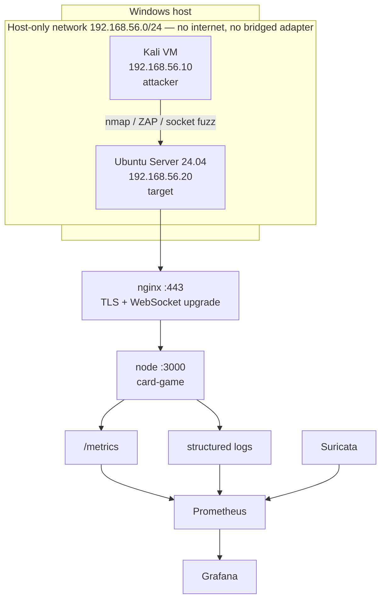

# Security lab plan — Linux-hosted card game as a pentest target

**Prepared:** 21 October 2026
**Status, 26 October 2026:** Phase 1 accounts/session boundary implemented through platform Milestone 2, with the user's focused-test adjustment. Deployment, monitoring, IDS, pentest campaigns and remediation evidence remain planned. See the [completion report](phase-2-status-2026-10-26.md).
**Scope:** Turn the existing card game into a deliberately-hosted, deliberately-tested target for Linux security auditing, network analysis, intrusion detection, and observability work.

This plan is separate from the rules-fidelity roadmap in
[`implementation-plan-2026-10-07.md`](implementation-plan-2026-10-07.md). It changes no game
rules. It adds an account system, a deployment profile, a monitoring stack, and a test lab.

---

## 1. Goal

Demonstrate, on one coherent codebase, the following competencies:

| Competency | Where it is demonstrated |
|---|---|
| Password management | Phase 1 — Argon2id hashing, policy, rotation, no-secret-logging |
| Secure coding practice | Phase 1 + Phase 6 — auth boundary, input validation, output redaction |
| Encryption | Phase 2 (TLS termination), Phase 6 (log encryption at rest) |
| Linux security-audit tooling (Bash/Python) | Phase 2 + Phase 5 — `lynis`, `auditd`, `aide`, `ss`, `nftables` |
| TCP/IP and Ethernet | Phase 5 — capture and dissect the HTTP-upgrade → WebSocket path |
| Vulnerability scanning | Phase 5 — Trivy, `npm audit`, ZAP, Nuclei |
| IDS/IPS | Phase 4 — Suricata with custom rules for this application's traffic |
| PromQL / Grafana | Phase 3 — metrics endpoint, dashboards, alert rules |
| Pentest methodology | Phase 5 + Phase 6 — recon → exploit → detect → remediate → re-scan |

## 2. Non-goals

- **Not** a rewrite of the game engine. `GameEngine` remains the single public API.
- **Not** a claim of production readiness. The target is a lab VM on an isolated network.
- **Not** a from-scratch IDS or scanner. Real tools (Suricata, ZAP, Trivy) are used; the
  custom Python work is the Socket.IO fuzzer, which no off-the-shelf tool covers.
- Private-view work from [`development/0.3-private-views.md`](development/0.3-private-views.md)
  was implemented by platform Milestone 1. F02 can serve as a historical finding with
  before/after regression evidence; a pentest campaign must assess the current code rather
  than assume the original disclosure is still present.

## 3. Why this target

The following table records the original pre-milestone baseline. Milestone 1 addressed player-view disclosure; Milestone 2 replaces client-trusted identity and permissive origins with scoped sessions, validation, Helmet and auth rate limits. Platform Milestone 3 adds account/session/deck persistence and logrotate configuration. Rooms remain ephemeral; Linux rotation installation/scheduling still needs deployment verification. The baseline is historical evidence, not a list of currently reproducible findings.

| Existing condition | Location | Security relevance |
|---|---|---|
| `cors: { origin: '*' }` | `apps/server/src/index.ts` | Permissive cross-origin policy |
| No authentication on any socket event | `apps/server/src/index.ts` | Identity is a client-supplied UUID |
| Client-generated `playerId` in `sessionStorage` | `apps/game-client/session.ts` | Trivially forgeable identity |
| Unredacted `roomSnapshot` (F02) | `ARCHITECTURE.md` §1.2 | Opponent hand/deck disclosure |
| `InMemoryStore` only | `apps/server/src/rooms/state-store.ts` | No persistence, no session expiry at baseline |
| Unbounded `appendFileSync` delta log | `apps/server/src/rooms/sync-service.ts` | Disk-fill denial of service |
| No `helmet`, no rate limiting | `apps/server/src/index.ts` | Missing standard hardening |
| `parseActionPacket` is the only input boundary | `apps/server/src/rooms/action-packet.ts` | Single validation choke point |

## 4. Ordering constraint

**Phase 1 must precede Phase 5.** Without authentication, every pentest finding reduces to
"there is no auth," and the report becomes one finding repeated. With accounts in place the
findings become distinct and individually gradeable: auth bypass, session fixation, IDOR on
`roomId`, seat impersonation, credential stuffing, token replay.

## 5. Lab topology



**Hard rule:** host-only adapter. No port forwarding, no bridged mode, no internet route on
the target. Nothing in this plan may be executed against a host that was not built for it.

---

## Phase 1 — Account system

**Implemented:** [auth architecture and policy](authentication-architecture.md), [evidence](phase-2-status-2026-10-26.md). Admin API access was also pulled forward at the user's request; the UI remains platform Phase 4. Sessions remain in memory, with expiry, rotation and revocation.

**Dependency:** none. **Blocks:** Phase 5.

### Work

1. Add `apps/server/src/auth/` with `password.ts`, `session.ts`, `account-store.ts`, `routes.ts`.
2. Hash with Argon2id (`argon2` package). Parameters recorded in a new server-only `apps/server/src/config.ts` under an
   `authConfig` block, not hardcoded at call sites.
3. Registration and login over HTTP (`POST /api/auth/register`, `POST /api/auth/login`),
   returning an opaque session token. Do not put credentials in the Socket.IO handshake.
4. Authenticate the socket handshake with the session token; derive `PlayerId` from the
   account, not from the client. Keep `apps/server/src/rooms/reconnect.ts` intact — it already separates
   socket identity from player identity, which is the right shape.
5. Session lifecycle: expiry, rotation on login, revocation on logout, and a bounded
   in-memory session table behind the existing `StateStore` interface.
6. Password policy: minimum length, no composition rules, rejection of known-breached
   passwords (offline list). Document the reasoning — this is a graded decision.
7. Ensure no password, hash, or token reaches `packages/engine/src/shared/game-logger.ts`. Add a redaction
   helper and a test that asserts it.

### Acceptance gate

- Register → login → create room → play a turn → logout → token rejected.
- Two accounts cannot occupy the same seat; a forged `playerId` in the handshake is ignored.
- A test asserts that a log line produced during login contains no credential material.
- Typechecks, builds and focused auth/client/runtime/architecture checks pass. The user waived browser smoke, further long socket tests and a blocking full-suite run for this delivery; the report records that adjusted gate. Full regression remains available through `npm run verify`.

---

## Phase 2 — Linux deployment and host hardening

**Dependency:** Phase 1.

### Work

| Item | Detail |
|---|---|
| Runtime | Node 22 via NodeSource; `npm ci && npm run build` on the target |
| Service user | `cardgame` system account, `/usr/sbin/nologin`, owns only `/opt/cardgame/apps/server/dist`, `/opt/cardgame/apps/game-client/dist`, and `/opt/cardgame/data` |
| systemd unit | `NoNewPrivileges=yes`, `ProtectSystem=strict`, `ProtectHome=yes`, `PrivateTmp=yes`, `PrivateDevices=yes`, `RestrictAddressFamilies=AF_INET AF_INET6`, `ReadWritePaths=/opt/cardgame/data`, `MemoryMax=512M` |
| Binding | Make the listen host explicit in `apps/server/src/index.ts` (`HOST` env, default `127.0.0.1` behind nginx) |
| Reverse proxy | nginx, TLS 1.2+, `proxy_set_header Upgrade $http_upgrade` and `Connection "upgrade"` for Socket.IO |
| Firewall | `ufw` default deny incoming; allow 22 and 443 only |
| SSH | key-only, `PermitRootLogin no`, `PasswordAuthentication no`, fail2ban |
| Audit | `auditd` watch rules on `/opt/cardgame`; `aide` baseline database |
| Log rotation | `logrotate` for `data/deltas.jsonl` — this also mitigates the disk-fill finding |

### Deliverables

- `deploy/cardgame.service`
- `deploy/nginx.conf`
- `deploy/ufw.sh`
- `deploy/auditd/cardgame.rules`
- `deploy/README.md` with the exact provisioning sequence

### Acceptance gate

- `systemctl status cardgame` active; service survives reboot.
- `systemd-analyze security cardgame.service` score recorded (target: exposure below 4.0).
- `ss -tulpn` shows only 22, 443, and loopback 3000.
- `lynis audit system` report captured as a baseline artifact.
- `curl https://<target>/` succeeds; plain HTTP redirects to HTTPS.

---

## Phase 3 — Observability (Prometheus, PromQL, Grafana)

**Dependency:** Phase 2.

### Work

1. Add `prom-client`; expose `GET /metrics` on the loopback interface only.
2. Instrument at existing boundaries — do not scatter counters through the engine:
   - `cardgame_actions_total{action,result}` — from the `playerAction` handler
   - `cardgame_action_duration_seconds` — histogram around `executePlayerAction`
   - `cardgame_rooms_active` — gauge from `store.listRooms()`
   - `cardgame_socket_connections` — gauge on connect/disconnect
   - `cardgame_auth_attempts_total{result}` — from Phase 1
   - `cardgame_delta_log_bytes` — from `sync-service.ts`
3. `deploy/monitoring/docker-compose.yml` with Prometheus, Grafana, and Suricata.
4. Provisioned Grafana dashboard: action throughput, rejection rate, room count, auth
   failures, action latency p95, delta log growth.
5. Alert rules with documented PromQL, for example:
   - `rate(cardgame_actions_total{result="rejected"}[5m]) > 5` — action flooding
   - `rate(cardgame_auth_attempts_total{result="failure"}[5m]) > 10` — credential stuffing
   - `cardgame_delta_log_bytes > 5e8` — disk-fill approach
   - `cardgame_socket_connections > 50` — connection exhaustion

### Acceptance gate

- `/metrics` scraped successfully; all series present in Prometheus.
- Dashboard renders live data during a two-client game.
- Each alert rule fires when triggered manually and resolves when the condition clears.
- PromQL queries are documented in `deploy/monitoring/README.md` with expected output.

---

## Phase 4 — Detection (Suricata IDS/IPS)

**Dependency:** Phase 3.

### Work

1. Deploy Suricata on the target, monitoring the host-only interface.
2. Write custom rules for this application's traffic, not just generic signatures:
   - repeated `playerAction` frames above a threshold within a window
   - `joinRoom` failures in sequence (room enumeration)
   - oversized WebSocket frames
   - requests carrying a `playerId` that does not match the authenticated session
   - TLS handshake anomalies and cipher downgrade attempts
3. Ship Suricata `eve.json` into Prometheus (via a small exporter) so alerts appear on the
   same Grafana dashboard as application metrics.
4. Document each rule with its intent, the attack it detects, and a false-positive note.

### Acceptance gate

- Each custom rule fires during a scripted reproduction of its target behaviour.
- Alerts appear in Grafana within the scrape interval.
- Rules produce no alerts during a normal two-player game (false-positive check).

---

## Phase 5 — Pentest

**Dependency:** Phases 1–4. **Executed from the Kali VM only.**

### Phases and tools

| Step | Tools | Evidence captured |
|---|---|---|
| Recon | `nmap -sV -sC -p-`, `whatweb`, `nikto` | Port/service inventory |
| TLS | `testssl.sh`, `sslyze` | Cipher and protocol findings |
| Web/app | OWASP ZAP baseline + active, Burp Community | ZAP HTML report |
| Socket.IO fuzzing | custom Python client (`python-socketio`) | Script + findings |
| Info disclosure | socket client reading `roomSnapshot` | Captured payload showing opponent hand |
| DoS | `hping3`, action-flood script | Rate-limit behaviour, resource graphs |
| Packet analysis | `tcpdump` + Wireshark | PCAP of handshake, upgrade, WS frames |
| Host audit | `lynis`, `auditd`, `aide`, `ss -tulpn` | Audit reports |
| Dependencies | `trivy fs`, `npm audit`, `grype` | SBOM + CVE list |

### The Socket.IO fuzzer

This is the differentiating deliverable. ZAP and Burp do not understand the Socket.IO
protocol, so a purpose-built client is required. It lives in `lab/fuzz/` with its own
`requirements.txt`.

Test cases:

1. Malformed `actionId` values and unknown action names.
2. `roomId` for a room the account never joined (IDOR).
3. Oversized payloads and deeply nested `data` objects.
4. Rapid-fire actions to test rate limiting and engine stability.
5. Replayed packet with a substituted `playerId`.
6. Actions sent out of turn / without priority.
7. `getOptions` for a card in another player's hand.

### Findings register

Every finding is recorded in `lab/findings/register.md` with: ID, title, severity (CVSS),
affected component, reproduction steps, evidence path, detection status (which Suricata rule
or Grafana alert caught it), remediation commit, and re-test result.

### Acceptance gate

- Every finding has reproduction steps that a second person can follow.
- Every finding has a severity and an evidence artifact.
- At least one finding is detected by the Phase 4 rules — proving detection works, not just
  scanning.

---

## Phase 6 — Remediation and re-scan

**Dependency:** Phase 5.

### Work

1. Fix findings in reviewable commits, one finding per commit where practical.
2. Expected fixes, in likely priority order:
   - Redact `roomSnapshot` per player (this is the deferred F02 /
     [`0.3-private-views.md`](development/0.3-private-views.md) work — implement it here with
     a single projection service used by both snapshots and deltas)
   - Restrict CORS to the known origin
   - Add `helmet` and a Content-Security-Policy
   - Add per-socket and per-account rate limiting
   - Bound and rotate `data/deltas.jsonl`
   - Encrypt the delta log at rest (AES-256-GCM, key from systemd `LoadCredential`) with an
     HMAC integrity check — this is the "encryption" deliverable
   - Tighten `parseActionPacket` validation
3. Re-run the full Phase 5 toolset and record before/after for each finding.

### Acceptance gate

- Each finding's re-test shows the issue closed, with the new evidence attached.
- The full test suite, both typechecks, and the production build still pass.
- No regression in gameplay: a two-client game completes end to end.

---

## Phase 7 — Writeup

**Dependency:** Phase 6.

Deliverables:

- `docs/security-lab-report.md` — methodology, findings table, remediation, lessons learned
- `lab/README.md` — how to rebuild the lab from scratch
- Grafana dashboard export (JSON) committed to `deploy/monitoring/`
- PCAP walkthrough: Ethernet → IP → TCP → HTTP upgrade → WebSocket frames, annotated
- A short "what I would do differently" section — this is what distinguishes a report from a
  checklist

---

## Repository layout

```
deploy/
  cardgame.service
  nginx.conf
  ufw.sh
  auditd/cardgame.rules
  monitoring/
    docker-compose.yml
    prometheus.yml
    grafana/            # provisioned datasource + dashboard JSON
    alerts.yml
    README.md
lab/
  fuzz/                 # Python Socket.IO fuzzer + requirements.txt
  audit/                # Bash wrappers around lynis/auditd/aide, JSON output
  scan/                 # trivy, npm audit, ZAP, nuclei runners
  crypto/               # log encryption + HMAC verification tool
  findings/
    register.md
    evidence/
  README.md
apps/server/src/auth/        # Phase 1
```

`lab/` and `deploy/` are additive. Application paths use the workspace layout established by platform Phase 0.

---

## Sizing

Rough, part-time. These are not commitments.

| Phase | Effort |
|---|---|
| 1 — Account system | 2–3 days |
| 2 — Deployment + hardening | 1 day |
| 3 — Observability | 1 day |
| 4 — Detection | 1–2 days |
| 5 — Pentest | 3–5 days |
| 6 — Remediation + re-scan | 2–3 days |
| 7 — Writeup | 1–2 days |
| **Total** | **~2 weeks** |

Phases 1–3 alone (about 4 days) already support a "secure coding + observability" story.
Phases 4–6 are what make it a security project.

---

## Risks and mitigations

| Risk | Mitigation |
|---|---|
| Target exposed beyond the lab | Host-only adapter; verify with `ip a` and `nmap` from outside before starting |
| Findings collapse into "no auth" | Phase 1 precedes Phase 5 |
| Scanner noise treated as findings | Triage every result; record accepted-risk decisions explicitly |
| Detection rules never fire | Phase 4 gate requires a scripted reproduction per rule |
| Report shows findings without fixes | Phase 6 is mandatory; re-scan evidence required |
| Game regressions from hardening | Full suite + two-client end-to-end game in every phase gate |

---

## Out of scope

- Internet-facing deployment
- Multi-tenant accounts, OAuth, MFA (possible later extension)
- Persistence migration off `InMemoryStore` (separate concern; noted in `ARCHITECTURE.md` §1.2)
- Game rules changes
- Mobile or native clients
