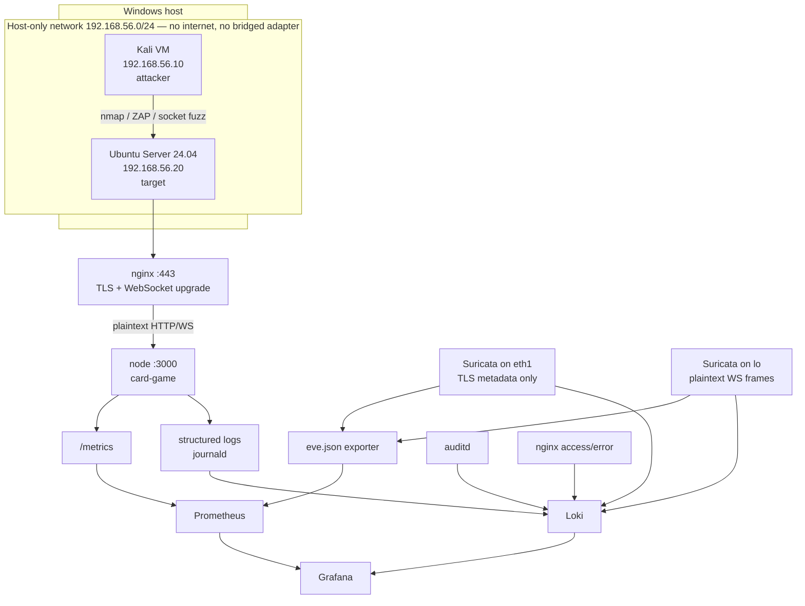

# Security lab plan — learn, demonstrate, assess and improve

**Prepared:** 21 October 2026
**Status, 26 October 2026:** Phase 1 accounts/session boundary implemented, with the user's focused-test adjustment. Deployment, monitoring, IDS, pentest campaigns and remediation evidence remain planned.
**Revised, 2 November 2026:** Phase 4 rewritten around what Suricata can actually observe through TLS termination; new Phase 4.5 adds log aggregation and cross-source correlation (Loki) so findings can be triaged, not merely counted; Phase 5 records why the fuzzer is a separate Python implementation; a learning ramp is added for a first pass through the stack. No phase has been executed beyond Phase 1.
**Delivery status:** structure and planning only for the Linux lab. Platform accounts, private player views, SQLite account/session/deck storage, admin UI and shared public sessions already exist. Installed Linux hardening, monitoring, detection and campaigns are not completed by this scaffold.
**Scope:** Turn the existing card game into a deliberately-hosted, deliberately-tested target for Linux security auditing, network analysis, intrusion detection, and observability work.

## Revised goal

First learn to run and explain the existing game behind nginx locally. Build a repeatable isolated security target, then demonstrate one complete assess → detect → investigate → fix → retest story. An optional domain through Cloudflare Tunnel is a separate invited-demo deployment. Detailed automation and tool configuration follow after this structure is reviewed.

The game does not need full public-product readiness, advanced animation or the admin Scenario Builder before this work. Keep game rules unchanged. Platform Milestone 7 is application scenario tooling, not this plan's Phase 7 report.

Start at [lab/README](../lab/README.md), the [architecture decisions](security-lab-architecture.md) and [beginner runbooks](../lab/runbooks/README.md).

## Two deployment profiles

| Profile | Path | Purpose | Assessment scope |
|---|---|---|---|
| Isolated lab | Kali → host-only Ubuntu nginx HTTPS → loopback Node | Linux, TLS, packet analysis, application security and detection | Explicitly inventoried lab endpoints; bounded campaigns |
| Invited demo | Browser → domain / Cloudflare → cloudflared → nginx → Node | Show a playable game and learn the proxy path | Functional checks only; no active scanners or flood tests |

## Competencies demonstrated

| Competency | Where it is demonstrated |
|---|---|
| Password management | Phase 1 — Argon2id hashing, policy, rotation, no-secret-logging |
| Secure coding practice | Phase 1 + Phase 6 — auth boundary, input validation, output redaction |
| Encryption | Phase 2 (TLS termination), Phase 6 (log encryption at rest) |
| Linux security-audit tooling (Bash/Python) | Phase 2 + Phase 5 — `lynis`, `auditd`, `aide`, `ss`, `nftables` |
| TCP/IP and Ethernet | Phase 5 — capture and dissect the HTTP-upgrade → WebSocket path |
| Vulnerability scanning | Phase 5 — Trivy, `npm audit`, ZAP, Nuclei |
| IDS/IPS | Phase 4 — Suricata with custom rules, split by what each network layer can observe |
| PromQL / Grafana | Phase 3 — metrics endpoint, dashboards, alert rules |
| Log aggregation and correlation | Phase 4.5 — Loki over `journald`, `auditd`, `eve.json` and nginx logs, with cross-source queries |
| Pentest methodology | Phase 5 + Phase 6 — recon → exploit → detect → remediate → re-scan |

Direct tunnel → Node is an optional later variant, not another required stack. Never tunnel the vulnerable assessment VM. Use separate instance IDs, databases, accounts, logs and secrets. A label alone is not isolation.

Offline operation means no internet route during a campaign. Provision pinned dependencies/images/scanner databases beforehand using a recorded staging/import process, then disconnect staging access and verify routes. A demo tunnel requires internet and cannot satisfy the offline profile.

## What this plan is not

- **Not** a rewrite of the game engine. `GameEngine` remains the single public API.
- **Not** a claim of production readiness. The target is a lab VM on an isolated network.
- **Not** a from-scratch IDS or scanner. Real tools (Suricata, ZAP, Trivy) are used; the
  custom Python work is the Socket.IO fuzzer, which no off-the-shelf tool covers.
- **Not** a full SIEM. Phase 4.5 adds log aggregation and cross-source correlation in Grafana.
  It does not add case management, threat-intelligence feeds, UEBA, or a second analytics
  stack. The distinction is stated so the deliverable is not overclaimed.
- Private-view work from [`development/0.3-private-views.md`](development/0.3-private-views.md)
  was implemented by platform Milestone 1. F02 can serve as a historical finding with
  before/after regression evidence; a pentest campaign must assess the current code rather
  than assume the original disclosure is still present.

## Current baseline

Implemented by platform work: versioned protocol/private views, account authentication, scoped game/admin sessions, fixed expiry/revocation, HttpOnly public browser families with CSRF protection, tab seat ownership, SQLite account/session/deck storage, saved decks, admin inspection and audit outbox, trusted navigation metadata.

Rooms/seats remain ephemeral. Node listen-host configuration, a metrics listener, JSON security telemetry and lab tooling are still implementation tasks. Historical permissive CORS, unauthenticated identity and private-view disclosure are historical findings only; assess the current commit before making a finding.

Existing [nginx examples](../deploy/nginx/README.md) and logrotate policy are source artifacts, not installed-host proof.

## Delivery order and phase boundaries

Keep phase numbers for traceability, but run a small Phase 5 baseline immediately after Phase 2. Logging/metrics/detection then enrich a repeat campaign; do not wait for the entire dashboard stack to start assessment.

| Phase | Next deliverable | Evidence before calling it implemented |
|---|---|---|
| 1 — auth foundation | Verify current controls and document current scopes | Existing platform reports plus focused regressions for changed behavior |
| 2 — learn / host | Node locally, nginx HTTP, local TLS, service user, firewall, snapshots/restore | Record each runbook checkpoint, actual listeners/routes and successful two-client path |
| 5a — early baseline | One bounded auth/ownership assessment, manual raw-log/PCAP triage | Exact scope/commit, reproducible test and controls; finding or explicit negative result |
| 3 — metrics / telemetry | Boundary counters, histogram, private scrape and security JSON events | Correct series, bounded labels, scrape reachability and redaction controls |
| 4 — network detection | Proven wire and loopback IDS rules using a pinned parser | Small PCAP proof first; attack/control samples, layer and known limitations |
| 4.5 — log investigation | Alloy → Loki plus source/time/request context | Positive ingestion control, synthetic-secret redaction, documented investigation queries |
| 5b — repeat assessment | Stateful Socket.IO and HTTP cases plus selected host/dependency/TLS checks | Campaign manifest, case matrix, raw private evidence and reviewed findings |
| 6 — remediate / retest | Fix confirmed issues and rerun affected cases/controls | Linked commit, before/after artifacts, regression evidence and dispositions |
| 7 — communicate | Rebuild guide, findings report, detection coverage, sanitized walkthrough | Another person can follow the report; all claims distinguish tested from planned |

### Phase 2 details to settle later

Use the supported runtime tested by CI, pin tool/package/image versions, record native dependency compatibility and the provisioning source. Service account reads application/dependency/static files; only runtime data is writable. Node and management listeners remain private. Select either explicit port-80 redirect service or refusal; firewall and acceptance must agree.

Define SSH access from the host/management subnet, an actual systemd unit, resource budgets for the entire stack, audit/AIDE baselines, log rotation and restore drills. Existing application backup/migration guidance remains authoritative: take pre-upgrade backups with the matching old release.

### Phases 3–4.5 details to settle later

Instrument server boundaries, not game-rule modules. Proposed metrics retain the existing names: actions by bounded action/result, action duration, active rooms, connections, auth outcomes and delta-log bytes. Normalize unknown actions to a fixed value; do not label by raw input, account, room or token. Establish baseline traffic before choosing thresholds and alert durations.



Two sensors, not one. TLS terminates at nginx, so a sensor on the host-only interface sees
ciphertext; the plaintext WebSocket stream only exists on loopback. Phase 4 assigns every rule
to the layer that can actually observe it. Prometheus carries counts; Loki carries the records
needed to triage them.

**Hard rule:** host-only adapter. No port forwarding, no bridged mode, no internet route on
the target. Nothing in this plan may be executed against a host that was not built for it.

Use the [telemetry contract](../lab/contracts/telemetry.md). Pin Suricata and prove WebSocket decoding under the actual masking/compression/fragmentation/transport settings. Wire sees encrypted visitor traffic only in the direct nginx lab; loopback sees the proxy hop. Authenticated identity and failed-join semantics belong to application evidence first. This is IDS; IPS needs a separate inline/blocking experiment.

Ship journald, nginx, auditd and sensor EVE through Alloy to Loki. Prometheus stores numerical series; Loki stores searchable records. Raw logs can be investigated before Loki exists. A cross-source workflow is not an automatic raw-log SQL join.

### Phase 5 scope

Use [campaign and result templates](../lab/campaigns/README.md), [fuzzer boundaries](../lab/contracts/fuzzing.md) and the [case matrix](../lab/campaigns/case-matrix.md). Include anonymous, guest, account, sibling-tab and admin subjects. Inventory endpoints and credentials by reference, never by secret value.

Begin with one meaningful ownership test and its benign control. Add selected recon/TLS, host audit, dependency analysis, browser-cookie/CSRF, revocation, malformed input and bounded resource tests. Raw wire framing requires separate lower-level tools; a valid Socket.IO client does not create every malformed frame.

All active campaigns use the isolated profile. A test attempt triggering a detector is detection evidence, not automatically a vulnerability. Never manufacture a current finding to satisfy an alert quota. Historical vulnerable commits, if used, must be separately identified and isolated.

### Phase 6 scope

Fix confirmed findings; do not schedule already-implemented CORS, Helmet or private projections as new work. Record accepted risk, false positives and unresolved issues honestly.

Encryption is an optional separately designed learning slice after the first remediation loop. AES-GCM already authenticates ciphertext. Specify nonce/key lifecycle, rotation, envelope version and tamper handling; log deletion/reordering requires its own threat model. Existing JSONL readers and rotation need an explicit integration decision before formats change.

## Learning ramp

1. Start the built game through Node and explain what runs where.
2. Put nginx in front using HTTP on the private network.
3. Add locally trusted TLS; verify the API and Socket.IO transport.
4. Freeze a VM snapshot and record the first bounded campaign.
5. Add one metric, one panel and one alert before expanding.
6. Prove one Suricata rule with attack and benign PCAPs.
7. Add Alloy/Loki and a time/source/request-based investigation.
8. Fix a finding, retest and publish a sanitized walkthrough.
9. Optionally build a separate invited domain demo.

No fixed calendar commitment: this is a first pass through several tools. Instrumentation, capture/parser discovery, native installs and correlation design need their own checkpoints.

This plan assumes no prior exposure to Prometheus, PromQL, Grafana or Suricata. The phases are
ordered for delivery; the table below is the order to *learn* them, and it front-loads the parts
that unblock everything else.

| Step | Do this | Why here |
|---|---|---|
| 1 | Add `prom-client`, expose `/metrics`, `curl` it | Nothing downstream works until the text format is familiar |
| 2 | Query it in the Prometheus expression browser at `:9090` | `rate`, `sum by`, `histogram_quantile` cover most of PromQL; the UI is the fastest feedback loop |
| 3 | Point Grafana at Prometheus, build one panel by hand | Learn the query editor before automating it |
| 4 | Convert that panel to provisioned JSON | Reproducibility is the point of the lab |
| 5 | Write one alert rule, trigger it, watch it fire and resolve | `for:` duration and resolution behaviour are the parts people get wrong |
| 6 | Install Suricata in IDS mode on `lo`, read `eve.json` with `jq` | Loopback is plaintext, so rules are easy to verify before adding TLS |
| 7 | Write one rule that matches your own traffic | Rule syntax is learned by matching something you can see |
| 8 | Add the `eve.json` exporter | The glue between detection and dashboards |
| 9 | Add Loki and one correlation query | Log correlation is the step that turns alerts into triage |

Steps 1–5 are a weekend. Step 6 onward is where the time goes, mostly on rule syntax and on
discovering which interface actually sees what you assumed it saw.

## Verification and evidence

The standing local code gate remains focused logic, short relevant integration, architecture checks and affected typechecks/builds. No browser smoke, long socket/full-suite run is required by this scaffold. Actual host/TLS, two-client walkthrough and tool detections must later be observed and recorded; a build does not prove them.

Record commit, config hash, tool versions, VM snapshot, UTC timestamps, target/profile, result and evidence locations. Keep raw captures and credentials private. Publish reviewed text/JSON extracts only. Use positive logging controls alongside synthetic-secret redaction checks.

Each detector records attack sample, benign sample, expected/observed result, latency, blind spots and missed/dropped-event handling. One quiet normal match is an initial check, not a false-positive-rate measurement.

## Structure and ownership

- [deploy/profiles](../deploy/profiles/README.md): application override examples and separation requirements.
- [deploy](../deploy/README.md): eventual runtime/proxy/hardening and monitoring artifacts.
- [lab/inventory](../lab/inventory/README.md): scope and target identity.
- [lab/contracts](../lab/contracts/README.md): telemetry and independent fuzzer boundaries.
- [lab/runbooks](../lab/runbooks/README.md): learning/provisioning/campaign steps.
- [lab/campaigns](../lab/campaigns/README.md): case matrix and reproducibility.
- [lab/findings](../lab/findings/README.md): register, finding template and publication boundary.

Detailed executable deployment/scanner/fuzzer configurations remain future work. No tools are installed, services started, secrets provisioned or targets scanned by this structure.

## Phase 3 — Observability (Prometheus, PromQL, Grafana)

**Dependency:** Phase 2.

### Work

1. Add `prom-client`; expose `GET /metrics` on the loopback interface only.
2. Instrument at existing boundaries — do not scatter counters through the engine:
   - `cardgame_actions_total{action,result}` — from the `playerAction` handler
   - `cardgame_action_duration_seconds` — histogram around `executePlayerAction`
   - `cardgame_rooms_active` — gauge from `store.listRooms()`
   - `cardgame_socket_connections` — gauge on connect/disconnect
   - `cardgame_auth_attempts_total{result}` — from Phase 1
   - `cardgame_delta_log_bytes` — from `sync-service.ts`
3. `deploy/monitoring/docker-compose.yml` with Prometheus, Grafana, and Suricata.
4. Provisioned Grafana dashboard: action throughput, rejection rate, room count, auth
   failures, action latency p95, delta log growth.
5. Alert rules with documented PromQL, for example:
   - `rate(cardgame_actions_total{result="rejected"}[5m]) > 5` — action flooding
   - `rate(cardgame_auth_attempts_total{result="failure"}[5m]) > 10` — credential stuffing
   - `cardgame_delta_log_bytes > 5e8` — disk-fill approach
   - `cardgame_socket_connections > 50` — connection exhaustion

### Acceptance gate

- `/metrics` scraped successfully; all series present in Prometheus.
- Dashboard renders live data during a two-client game.
- Each alert rule fires when triggered manually and resolves when the condition clears.
- PromQL queries are documented in `deploy/monitoring/README.md` with expected output.
- Every `rate()` window is at least four times the configured scrape interval, and the
  interval is recorded next to the alert rules.

---

## Phase 4 — Network detection (Suricata IDS/IPS)

**Dependency:** Phase 3.

### Constraint: what Suricata can actually see

The topology terminates TLS at nginx (`Kali → :443 nginx → :3000 node`). A sensor on the
host-only interface therefore sees ciphertext. Application-layer rules — `playerAction` frame
rates, `playerId`/session mismatches, `joinRoom` enumeration — are **not implementable on that
interface**, because those fields live inside the encrypted WebSocket stream. An earlier draft
of this phase asked for exactly that; it was not buildable.

Detection is therefore split by layer, and every rule is assigned to the layer that can
observe it:

| Layer | Sensor | Observes | Rules |
|---|---|---|---|
| Wire (TLS) | Suricata on `eth1` (host-only) | IP/TCP/TLS metadata, record sizes, connection rates | port and service scans, TLS version and cipher anomalies, connection floods, oversized TLS records |
| Loopback (plaintext) | Suricata on `lo` | nginx→node HTTP and WebSocket frames in clear | oversized WebSocket frames, `joinRoom` failure sequences, HTTP request anomalies |
| Application | Prometheus metrics and structured logs | authenticated identity, action semantics | action flooding, auth failure bursts, seat/identity mismatch, IDOR attempts |

Rules that need authenticated identity are application-layer by definition: the session
binding is established inside the Node process, not on the wire. Do not attempt to reconstruct
it from packets.

### Work

1. Deploy Suricata in IDS mode on both `eth1` and `lo` (separate instances, or one `af-packet`
   configuration per interface). Record which interface each rule is bound to.
2. Write custom rules, each tagged with its layer from the table above:
   - wire: TLS handshake anomalies, cipher downgrade attempts, connection-rate floods
   - loopback: oversized WebSocket frames, `joinRoom` failure sequences (room enumeration)
   - application (Prometheus alert rules, not Suricata): repeated `playerAction` frames above
     a threshold, `playerId` that does not match the authenticated session
3. Ship Suricata `eve.json` into Prometheus via a small exporter so network alerts appear on
   the same Grafana dashboard as application metrics. The exporter is lossy by design — it
   emits counters and last-seen timestamps, not raw alert records. Raw records go to the log
   pipeline in Phase 4.5.
4. Document each rule with its intent, the attack it detects, the interface it runs on, and a
   false-positive note.

### Acceptance gate

- Each custom rule fires during a scripted reproduction of its target behaviour, on the
  interface named in its documentation.
- Application-layer detections fire from Prometheus alert rules, not Suricata signatures.
- Alerts appear in Grafana within the scrape interval.
- Rules produce no alerts during a normal two-player game (false-positive check).
- The plan records, per rule, why that layer is the only one that can observe the behaviour.

---

## Phase 4.5 — Log aggregation and correlation (Loki)

**Dependency:** Phase 4. **Blocks:** Phase 5 — findings must be detectable and triageable.

### Why this phase exists

Phases 3 and 4 produce numbers and alerts. Neither preserves the evidence needed to answer
"which account, from which address, at what time, and what did the request contain?" That
evidence lives in logs, and before this phase nothing ships those logs anywhere queryable.
Without it a Phase 5 finding can be *noticed* but not *triaged*, and the findings register's
"Detected by" column can only ever name a counter.

This is deliberately not a full SIEM. It is log aggregation plus cross-source correlation in
the Grafana instance already standing up in Phase 3.

### Work

1. Add Loki and Promtail (or Grafana Alloy) to `deploy/monitoring/docker-compose.yml`.
2. Ship four sources, each with a distinct label set:
   - `journald` — the `cardgame` unit's stdout/stderr (structured application logs)
   - `auditd` — `/var/log/audit/audit.log` (kernel audit trail from Phase 2)
   - `suricata` — `eve.json` (raw alert records, not the exporter's counters)
   - `nginx` — access and error logs (client address, TLS version, status)
3. Add Loki as a Grafana datasource and build a "Security events" dashboard with at least
   three cross-source correlation queries, for example:
   - authentication failures in application logs joined by source address to nginx 4xx
     responses and Suricata alerts
   - `auditd` writes under `/opt/cardgame/data` correlated with delta-log growth
   - one account appearing in both a Suricata alert and an application rejection
4. Define retention explicitly. Loki retention is a configuration value, not a default;
   record the chosen window and its disk cost.
5. Redaction check: confirm no password, hash, session token or CSRF token reaches Loki.
   Phase 1's redaction helper covers application logs; verify it end to end through the
   pipeline rather than assuming it survives shipping.

### Acceptance gate

- All four sources are queryable in Grafana with the expected labels.
- Each correlation query returns a non-empty result during a scripted attack.
- A deliberate credential-bearing log line is confirmed absent from Loki.
- Retention is configured and documented with its disk cost.
- The findings register can cite a log query, not only a metric, as detection evidence.

---

## Phase 5 — Pentest

**Dependency:** Phases 1–4.5. **Executed from the Kali VM only.**

### Phases and tools

| Step | Tools | Evidence captured |
|---|---|---|
| Recon | `nmap -sV -sC -p-`, `whatweb`, `nikto` | Port/service inventory |
| TLS | `testssl.sh`, `sslyze` | Cipher and protocol findings |
| Web/app | OWASP ZAP baseline + active, Burp Community | ZAP HTML report |
| Socket.IO fuzzing | custom Python client (`python-socketio`) | Script + findings |
| Info disclosure | socket client reading `roomSnapshot` | Captured payload showing opponent hand |
| DoS | `hping3`, action-flood script | Rate-limit behaviour, resource graphs |
| Packet analysis | `tcpdump` + Wireshark | PCAP of handshake, upgrade, WS frames |
| Host audit | `lynis`, `auditd`, `aide`, `ss -tulpn` | Audit reports |
| Dependencies | `trivy fs`, `npm audit`, `grype` | SBOM + CVE list |

### The Socket.IO fuzzer

This is the differentiating deliverable. ZAP and Burp do not understand the Socket.IO
protocol, so a purpose-built client is required. It lives in `lab/fuzz/` with its own
`requirements.txt`.

**Why Python, and what it costs.** Socket.IO is not WebSocket: it is a framing layer over
Engine.IO with packet-type bytes, namespaces, acknowledgement IDs, JSON payloads and an HTTP
long-polling fallback. A generic proxy can replay bytes but cannot *construct* a valid
`playerAction` event, so it never reaches the application logic where the interesting findings
live. That alone justifies a purpose-built client.

The choice of Python is a second, separate argument: **independence**. The repository already
depends on `socket.io-client` in `apps/game-client` and `socket.io` in `apps/server`, so a
Node/TypeScript fuzzer would be less work. But it would reuse the same client library and
likely the same shared Zod schemas the server validates with, and an attacker that inherits
the defender's assumptions can mask bugs. `python-socketio` is an independent implementation
of the protocol.

The cost is real: protocol knowledge is maintained in two places, and `lab/fuzz/` can silently
drift from the real event contract. Mitigation is a contract test that asserts the fuzzer's
event names and payload shapes still match `packages/protocol`; a drift failure is a test
failure, not a surprise during a campaign.

Test cases:

1. Malformed `actionId` values and unknown action names.
2. `roomId` for a room the account never joined (IDOR).
3. Oversized payloads and deeply nested `data` objects.
4. Rapid-fire actions to test rate limiting and engine stability.
5. Replayed packet with a substituted `playerId`.
6. Actions sent out of turn / without priority.
7. `getOptions` for a card in another player's hand.

### Findings register

Every finding is recorded in `lab/findings/register.md` with: ID, title, severity (CVSS),
affected component, reproduction steps, evidence path, detection status (which Suricata rule,
Grafana alert or Loki correlation query caught it, and which layer did not), remediation
commit, and re-test result.

### Acceptance gate

- Every finding has reproduction steps that a second person can follow.
- Every finding has a severity and an evidence artifact.
- At least one finding is detected by the Phase 4 rules — proving detection works, not just
  scanning.
- At least one finding is triaged from a Phase 4.5 log query, not only from a counter.

---

## Phase 6 — Remediation and re-scan

**Dependency:** Phase 5.

### Work

1. Fix findings in reviewable commits, one finding per commit where practical.
2. Expected fixes, in likely priority order:
   - Redact `roomSnapshot` per player (this is the deferred F02 /
     [`0.3-private-views.md`](development/0.3-private-views.md) work — implement it here with
     a single projection service used by both snapshots and deltas)
   - Restrict CORS to the known origin
   - Add `helmet` and a Content-Security-Policy
   - Add per-socket and per-account rate limiting
   - Bound and rotate `data/deltas.jsonl`
   - Encrypt the delta log at rest (AES-256-GCM, key from systemd `LoadCredential`) with an
     HMAC integrity check — this is the "encryption" deliverable
   - Tighten `parseActionPacket` validation
3. Re-run the full Phase 5 toolset and record before/after for each finding.

### Acceptance gate

- Each finding's re-test shows the issue closed, with the new evidence attached.
- The full test suite, both typechecks, and the production build still pass.
- No regression in gameplay: a two-client game completes end to end.

---

## Phase 7 — Writeup

**Dependency:** Phase 6.

Deliverables:

- `docs/security-lab-report.md` — methodology, findings table, remediation, lessons learned
- `lab/README.md` — how to rebuild the lab from scratch
- Grafana dashboard export (JSON) committed to `deploy/monitoring/`
- PCAP walkthrough: Ethernet → IP → TCP → HTTP upgrade → WebSocket frames, annotated
- A short "what I would do differently" section — this is what distinguishes a report from a
  checklist
- A detection-coverage table: for each finding, which layer observed it (wire, loopback,
  application metric, log correlation) and which did not. Gaps are findings too.

---

## Repository layout

```
deploy/
  cardgame.service
  nginx.conf
  ufw.sh
  auditd/cardgame.rules
  monitoring/
    docker-compose.yml  # Prometheus, Grafana, Loki, Promtail, Suricata
    prometheus.yml
    grafana/            # provisioned datasources + dashboard JSON
    alerts.yml
    suricata/           # suricata.yaml + cardgame.rules, per-interface
    exporter/           # eve.json -> Prometheus counters
    loki/               # retention and scrape configuration
    README.md
lab/
  fuzz/                 # Python Socket.IO fuzzer + requirements.txt
  audit/                # Bash wrappers around lynis/auditd/aide, JSON output
  scan/                 # trivy, npm audit, ZAP, nuclei runners
  crypto/               # log encryption + HMAC verification tool
  findings/
    register.md
    evidence/
  README.md
apps/server/src/auth/        # Phase 1
```

`lab/` and `deploy/` are additive. Application paths use the workspace layout established by platform Phase 0.

---

## Sizing

Rough, part-time. These are not commitments.

| Phase | Effort |
|---|---|
| 1 — Account system | 2–3 days |
| 2 — Deployment + hardening | 1 day |
| 3 — Observability | 1 day |
| 4 — Network detection | 1–2 days |
| 4.5 — Log aggregation and correlation | 1 day |
| 5 — Pentest | 3–5 days |
| 6 — Remediation + re-scan | 2–3 days |
| 7 — Writeup | 1–2 days |
| **Total** | **~2 weeks** |

Phases 1–3 alone (about 4 days) already support a "secure coding + observability" story.
Phases 4–6 are what make it a security project. Phase 4.5 is the cheapest addition that turns
alerts into evidence; without it the findings register can only cite counters. The learning
ramp below is not included in these figures.

---

## Risks and mitigations

| Risk | Mitigation |
|---|---|
| Target exposed beyond the lab | Host-only adapter; verify with `ip a` and `nmap` from outside before starting |
| Findings collapse into "no auth" | Phase 1 precedes Phase 5 |
| Scanner noise treated as findings | Triage every result; record accepted-risk decisions explicitly |
| Detection rules never fire | Phase 4 gate requires a scripted reproduction per rule |
| Rules written for traffic the sensor cannot see | Phase 4 assigns every rule to a layer and records why that layer is the only one that can observe it |
| Findings noticed but not triageable | Phase 4.5 ships raw records to Loki before Phase 5 begins |
| Log pipeline leaks credentials | Phase 4.5 gate requires an end-to-end redaction check through the shipping path |
| Log volume fills the lab disk | Retention is an explicit Phase 4.5 deliverable with its disk cost recorded |
| Report shows findings without fixes | Phase 6 is mandatory; re-scan evidence required |
| Game regressions from hardening | Full suite + two-client end-to-end game in every phase gate |

---

## Out of scope

- Internet-facing deployment
- Multi-tenant accounts, OAuth, MFA (possible later extension)
- Persistence migration off `InMemoryStore` (separate concern; noted in `ARCHITECTURE.md` §1.2)
- Game rules changes
- Mobile or native clients
- Full SIEM capability: case management, threat-intelligence feeds, UEBA, long-term cold
  storage, or a second analytics stack. Phase 4.5 is log aggregation and correlation only.
