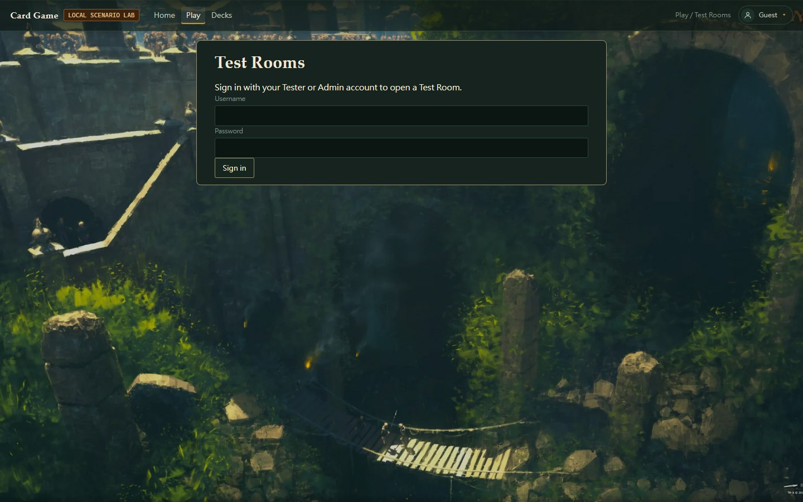
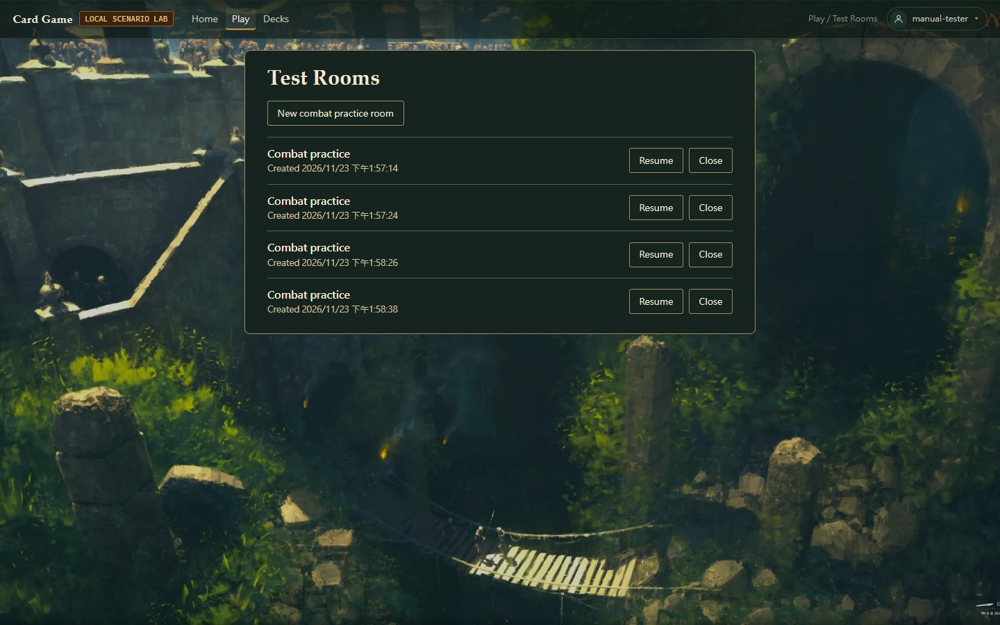
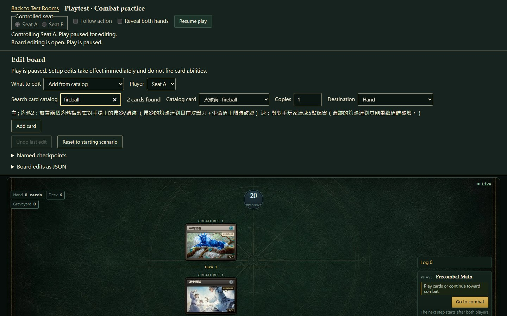
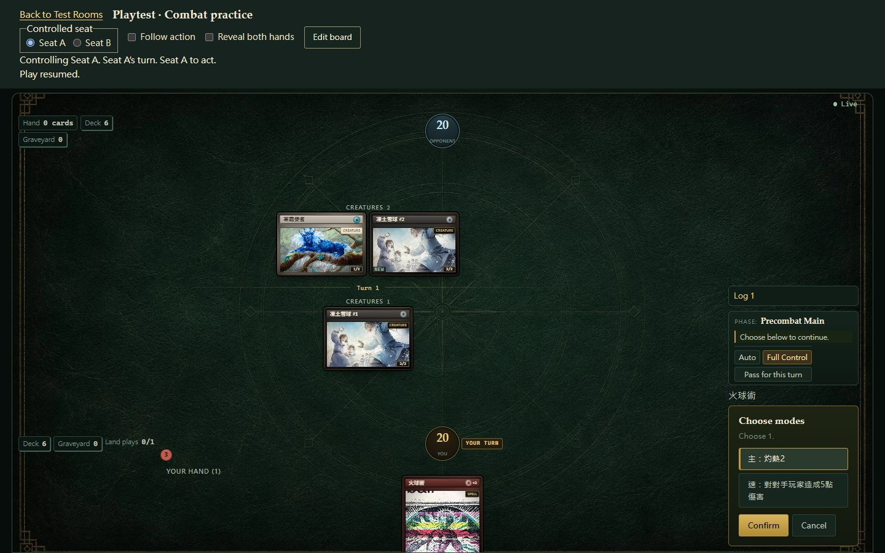
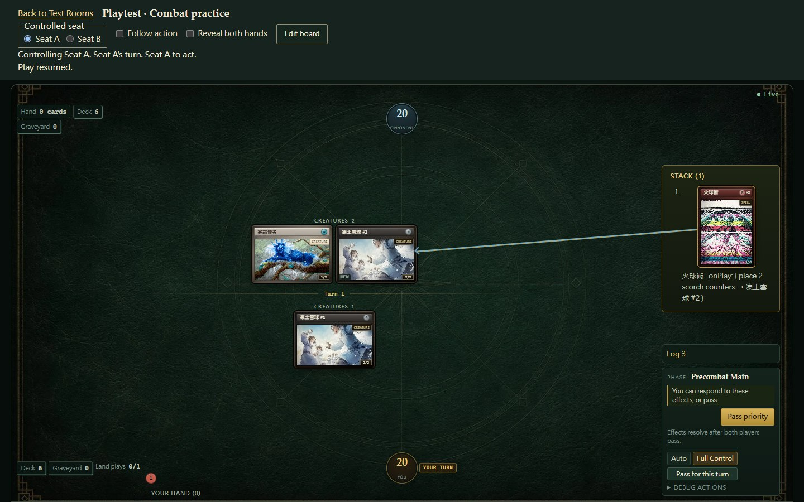
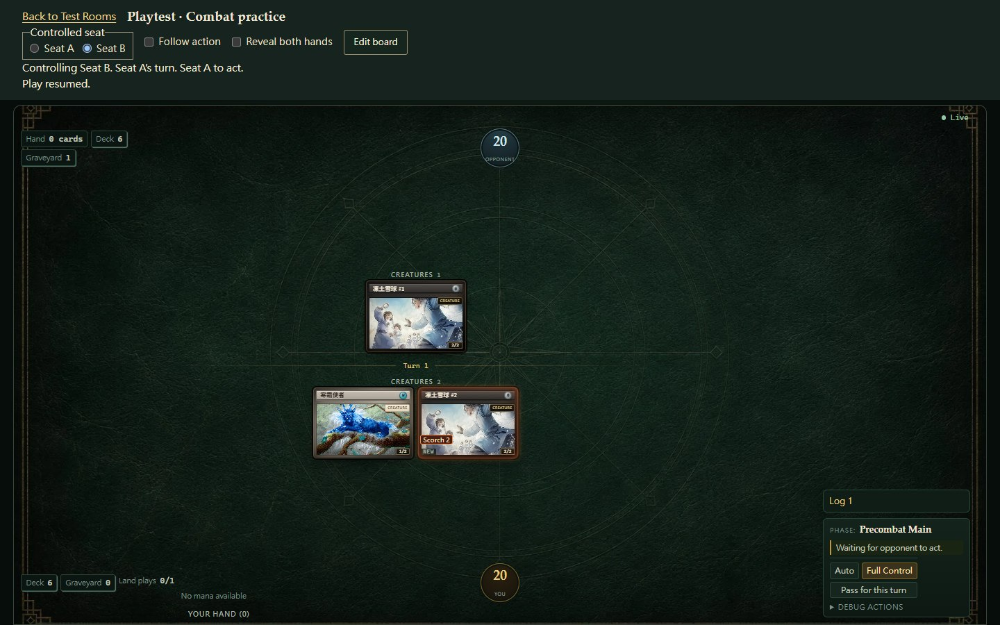
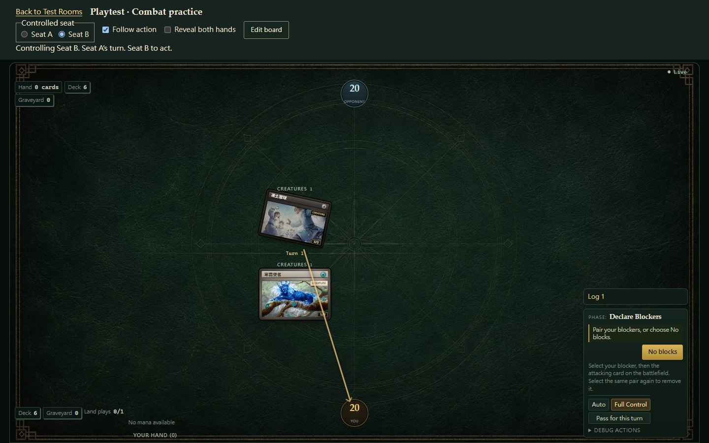
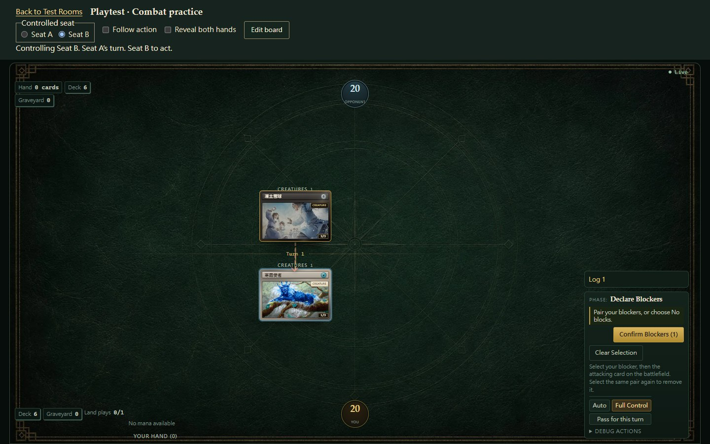

# Card game tester manual

Use Test Rooms to reproduce a card effect, check combat, or investigate the game screen. One Tester account controls both seats in the same tab. Test games use the same match screen and normal game actions as ordinary matches.

## Sign in and open a room

1. Open [Test Rooms on the local lab](http://localhost:3005/play/test-rooms).
2. Sign in as **manual-tester**. The password is in the local tester login file (`data/scenario-lab/tester-manual/tester-login.txt`). This disposable account exists on the prepared local lab. On another lab, use the tester account assigned by that lab’s administrator.
3. Choose **New combat practice room**. It starts with a Frozen Snowball for Seat A, a Frost Messenger for Seat B, and six library cards each. Wait until the match says **Live**.

| Control | When to use it |
| --- | --- |
| **Seat A** and **Seat B** | Switch to the acting seat or check what the other player sees. The status line tells you who can act. |
| **Follow action** | Switch automatically to the seat that needs to respond. Leave it off when comparing the two views step by step. |
| **Reveal both hands** | Inspect setup when necessary. Leave it off when testing private cards or choices. |
| **Full Control** | Pass priority yourself while testing responses. Use **Auto** when specifically testing automatic passing. |
| **Back to Test Rooms** | Return to the room list. Use **Resume** on the room to get back to its board. **Close** discards the room and its checkpoints. |

## Set up the test

Write one expected result first. For example, “After Fireball’s main-phase mode resolves, the chosen opposing permanent shows two Scorch counters and both players remain at 20 life.”

1. Open **Edit board**. The match pauses while you prepare the position.
2. Use **Add from catalog**. Search by card name or stable card ID, choose a player and zone, then select **Add card**. Use **Life and mana** for resources, **Battlefield card state** for tapped status and counters, and **Turn, phase and priority** when a test needs a specific timing window.
3. Open **Named checkpoints**, enter a name such as **Before Fireball**, and select **Save checkpoint**. This saves the current room position, including an open stack or choice. To repeat the test, return to the editor and select that checkpoint under **Saved checkpoint → Restore checkpoint**.
4. Select **Resume play**. Test a play, payment, or trigger by taking the real action. Editor placement is silent. Putting a card directly on the battlefield skips its cost and entry trigger. Staging a stack entry also skips the normal announcement and payment.

## Cast and resolve Fireball

**Goal.** Check the mode and target choices, mana payment, and the result from both seats.

1. Start a fresh combat practice room. Open **Edit board → Board edits as JSON**. Paste the [Fireball recipe](fireball-recipe.json) into **Edit recipe**, then choose **Apply recipe**. This gives Seat A three red mana and Fireball in hand and adds a Frozen Snowball to Seat B’s battlefield. Apply it once so the target stays easy to identify.
2. Save **Before Fireball** and select **Resume play**. Keep **Follow action** and **Reveal both hands** off. In Seat A, click **火球術** (Fireball), select **主：灼熱2** (main-phase Scorch 2), then **Confirm**.
3. Choose **凍土雪球** (Frozen Snowball) in the target dialog and **Confirm** again. Check that Fireball is on the stack and Seat A has one red mana remaining.
4. Click **Pass priority** as Seat A, switch to **Seat B**, then click **Pass priority**. The stack should clear. Seat B’s Frozen Snowball should display **Scorch 2**. Both life totals should remain **20** and Seat A’s graveyard should gain Fireball.
5. Restore **Before Fireball**. Repeat the cast and select **Cancel** at the target prompt. Check that Fireball stays in hand, all three red mana remain, and no spell goes on the stack.

## Compare blocked and unblocked combat

**Goal.** Verify the attacker and blocker controls, the combat arrows, and the life total.

1. Open a fresh combat practice room. On Seat A, select **Go to combat**. Pass priority from the seat shown in the status line until **Declare Attackers** appears.
2. Select Seat A’s Frozen Snowball and choose **Confirm Attackers (1)**. Pass any response windows until Seat B can declare blockers.
3. For the first run, choose **No blocks**. Pass further response windows. If a combat damage prompt opens, switch to the seat that owns it, enter the full amount shown under **Allocate** for the single recipient, and select **Confirm**. Expect Seat B to fall from **20 to 18**. Record if the attack arrow points to the wrong player or the life change appears on the wrong side.
4. Start the fresh setup again, declare the same attack, then switch to Seat B. Select its Frost Messenger, select the attacking Frozen Snowball, and choose **Confirm Blockers (1)**. Check that the line connects those two cards. Pass and complete both damage prompts, switching seats when the status line tells you to. At **End of Combat**, Seat B should still be at **20**, Frost Messenger should have left the battlefield, and Frozen Snowball should still be on it.

## Report a bug someone else can replay

Capture the screenshot before changing anything. Include the room name, controlled seat, phase, viewport size, cards and target copy numbers, steps, expected result, observed result, and how often it happens. Attach the setup recipe when it reproduces the state. Record whether **Auto**, **Follow action**, and **Reveal both hands** were enabled if they affect the issue.

| Field | Example |
| --- | --- |
| Title | Fireball target picker shows three identical labels |
| Setup | Precombat Main, Seat A controls Fireball, Seat B has three Frozen Snowballs |
| Steps | Cast Fireball’s main-phase mode and open the target choice |
| Expected | Each option identifies its matching battlefield copy |
| Observed | Three options have the same label, so I cannot tell which copy I am confirming |
| Evidence | Recipe or starting setup, screenshot of the prompt, browser and window size |

If a room loses its connection, try **Retry** once. If the board still does not load, go back to **Test Rooms**, sign in again if prompted, and choose **Resume**. Detached rooms are kept for up to 24 hours. A server restart clears them, so save a recipe for positions you will need again.

The prepared local lab has the temporary Tester no-timeout setting enabled in Accounts 4A. Tester logins issued under that setting have no idle or fixed session deadline. Signing out, account revocation, browser data clearing, or restarting the game service can still require sign-in. When using a temporary browser profile, go back to Test Rooms and choose **Sign out this browser** before closing it so the account can reuse that session slot. See the [card testing and UI verification guide](../card-testing-ui-verification.md) for coverage and browser evidence.
