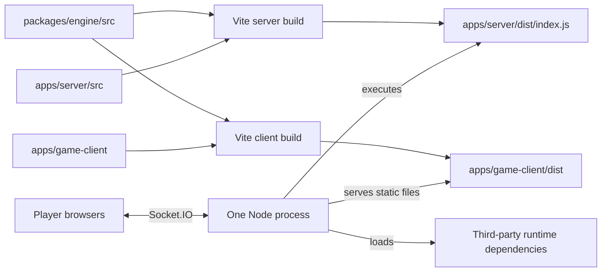

# Workspace Architecture — Supplement to ARCHITECTURE.md

**Updated:** 26 October 2026

**Status:** Current, verified platform Phase 0

This supplement describes the build, runtime, typechecking, and test boundaries introduced by the workspace restructure. [ARCHITECTURE.md](../ARCHITECTURE.md) remains the reference for game behaviour and subsystem ownership; the [concept map](MAP.md) locates individual rules and flows. Acceptance evidence is recorded in the [Phase 0 completion report](phase-0-status-2026-10-25.md).

## 1. Workspace and artifact ownership

| Workspace or directory | Owns | Consumed by |
|---|---|---|
| `packages/engine/src/` (`@card-game/engine`) | Rules, card catalog, shared helpers, configuration, serializable contracts | Server, the existing client rule-query exceptions, tests |
| `apps/server/src/` (`@card-game/server`) | Express/Socket.IO composition and room lifecycle, identity mapping, synchronization | Node server build and server tests |
| `apps/game-client/` (`@card-game/client`) | React components, Socket.IO client, Zustand state and UI interactions | Player build and client tests |
| `tests/` | Existing engine, server, client, library, shared and architecture scenarios | Four Vitest projects; files stay at the repository root |
| `build/types/` | Generated declarations and incremental TypeScript metadata | TypeScript project references only; ignored by Git |
| `apps/server/dist/` | Executable server bundle, including engine code | Node at runtime; ignored by Git |
| `apps/game-client/dist/` | HTML, CSS and browser JavaScript | Express static serving; ignored by Git |
| `data/deltas.jsonl` | Runtime diagnostic/replay log | SyncService; ignored by Git |

There is one backend process. The directory split establishes code and build ownership; it does not introduce services or change the game protocol. Accounts, a protocol package, admin and deck-builder applications, persistence, and security-lab infrastructure are not implemented by Phase 0.

## 2. Build and runtime flow



`@card-game/engine/*` exports `./src/*.ts`. Both application builds consume those source files. The server Vite configuration bundles this internal package and emits CommonJS for the supported Node runtime; third-party dependencies remain external. Production Node executes the resulting JavaScript, so it does not require a TypeScript loader or an engine JavaScript build.

The client Vite configuration consumes engine sources through the existing aliases and emits a separate browser build. Existing client rule-query imports remain constrained by the exact five-edge exception register in the [import policy](architecture-import-policy.md). Moving them behind a projection/protocol boundary belongs to Phase 1.

The compiled server resolves its client directory as `../../game-client/dist` relative to `apps/server/dist`. Its delta-log path resolves three levels up to repository `data/deltas.jsonl`. These lookups use the server bundle's directory rather than the caller's working directory. Keep the two application output directories in this relative layout when deploying.

## 3. Typechecking and clean builds

The root `tsconfig.json` is a solution referencing engine, server and client. Both applications reference the engine project.

- Engine and server are composite projects with declaration-only emission under `build/types/engine/` and `build/types/server/`.
- Client is a composite, no-emit project; its incremental metadata is also under `build/types/`.
- Shared strict compiler options live in `tsconfig.base.json`.
- `tsc -b` orders referenced projects. The per-app typecheck commands also use build mode, so referenced declarations are generated when absent.
- Vite produces executable JavaScript. TypeScript declaration outputs are not runtime artifacts and cannot select an old JavaScript engine implementation.

This separates typechecking artifacts from executable builds while preserving plan decision D2: internal packages export source, with no per-package JavaScript `dist` to maintain.

## 4. Test projects and module identity

| Vitest project | Test scope | Configuration |
|---|---|---|
| `engine` | `tests/engine`, `tests/library`, `tests/shared` | `packages/engine/vitest.config.mts` |
| `server` | `tests/server` | `apps/server/vitest.config.mts` |
| `client` | `tests/client` | `apps/game-client/vitest.config.mts` |
| `architecture` | `tests/architecture` | `tests/architecture/vitest.config.mts` |

The root configuration composes these projects with the repository as their root. Existing relative fixture paths and `process.cwd()` source checks therefore remain valid. Projects share the alias table in `vitest.shared.mts`; the suite uses four worker threads and preserves ordinary test isolation.

Within a test context, `@card-game/engine/engine/game-engine` and `@engine/game-engine` resolve to the same source file. The same holds for shared configuration and logging aliases. A spy installed by a test therefore observes the class or logger used by the server under test. Before this fix, server package imports selected compiled engine files while tests selected source files; the resulting distinct module instances caused 55 failures.

Tests do not import the production bundle as a substitute for source-level integration coverage. The separate production browser smoke exercises the actual bundle and static-serving layout.

## 5. Dependency boundaries

The AST import graph scans production `.ts` and `.tsx` files under `apps/` and `packages/`, skipping generated and dependency directories. It resolves relative imports and the current engine, shared, rules, library, config, client, server and engine-package aliases.

Phase 0 adds rule R-A: an app cannot import another app, and a package cannot import an app. Runtime and type-only edges are checked. Existing rules still prohibit runtime cycles, engine-to-transport imports, transport access to concrete handlers, card-content access to engine implementations, executable config imports from contracts, and undocumented client rule queries. The authoritative UUID/random boundary remains behind RuntimeContext.

The exact rules, exceptions and enforcement limits are maintained in [architecture-import-policy.md](architecture-import-policy.md). These build boundaries do not implement authentication, authorization or private-view filtering.

## 6. Decision records and trade-offs

| Decision | Reason | Cost or limitation |
|---|---|---|
| Retain npm workspaces and one Node process | Matches the existing dependency system and operating model | No service-level scaling or fault isolation is implied |
| Export internal engine source and bundle applications | Avoids a stale package JavaScript build and keeps tests on the authoritative implementation | Application builds must understand TypeScript; direct Node consumers of the source package need their own compilation strategy |
| Emit declarations centrally for project references | Makes ordered strict checks work from a clean checkout | Typechecks create ignored metadata and declaration files |
| Build client and server into separate app directories | Gives each application ownership of its output | Deployment must retain both directories and their relative layout |
| Share test aliases and keep tests root-scoped | Preserves module identity, fixtures, assertions and history | Changes to aliases must remain consistent with the import policy and application compiler/bundler configuration |
| Preserve the move-only commit | Keeps history traceable and distinguishes relocation from build repair | Phase 0 delivery also needs a follow-up configuration/documentation commit |

## 7. Verification and operation

From the repository root:

```sh
npm ci
npm run verify
npm start
```

`verify` checks all three TypeScript projects, runs all four test projects including architecture, and builds both applications. CI runs the same sequence through `npm ci` and `npm run verify` on Node 24. Individual commands remain available:

| Command | Purpose |
|---|---|
| `npm run typecheck:server` | Check server and its engine reference |
| `npm run typecheck:client` | Check client and its engine reference |
| `npm run test:architecture` | Run the focused import boundary gate |
| `npm test` | Run all root-scoped tests |
| `npm run build` | Build server and client outputs |
| `npm run dev` | Build and start the backend |
| `npm run dev:client` | Serve the player app through Vite on port 5173 |

Recorded local verification on Node 24.22.1: clean dependency installation; 1,393 passing tests in 114 files; both production builds; and two-browser create/join, RPS, card play, priority resolution, turn advancement and reconnect. An independent pre-move run passed 1,391 tests; the two added cases enforce R-A. All 7,499 expect expressions across the 113 non-architecture test files were preserved, allowing only relocated filesystem paths.

Use the [production RPS smoke checklist](smoke-test-rps.md) to reproduce the browser flow. The [completion report](phase-0-status-2026-10-25.md) contains the detailed acceptance ledger and evidence locations. Hosted CI and Linux deployment have not been executed during this local verification.
